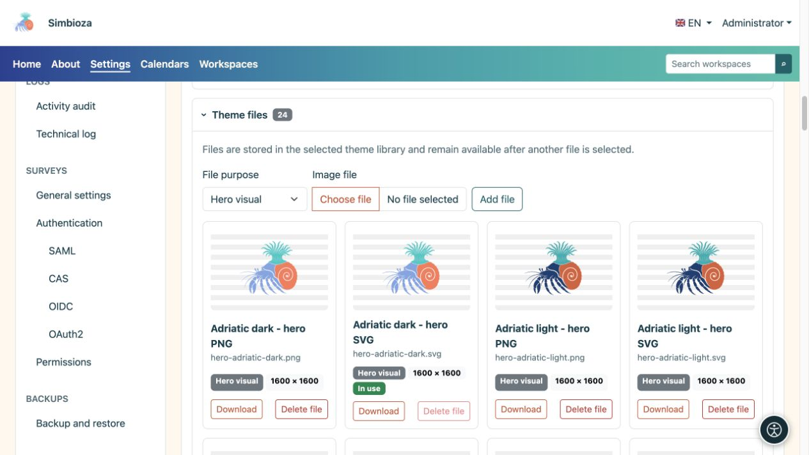
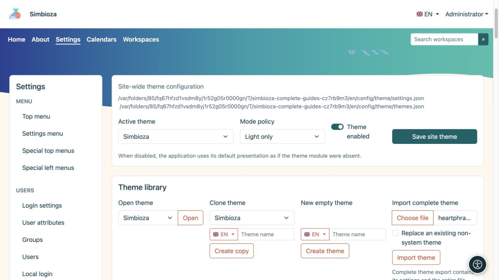

# File del tema, importazione ed esportazione

> Le schermate mostrano l’interfaccia in inglese.

[Temi](teme_it.md)

**Obiettivo:** aggiungi il tuo marchio o illustrazione, conserva un tema o trasferiscilo su un'altra installazione. Esistono due diverse esportazioni ZIP: scegli in base al tuo obiettivo.

## Aggiungi un'immagine alla libreria dei temi

1. Espandi **File del tema** nel tema aperto.
2. Scegli un **file immagine** e il suo ruolo.
3. Caricalo. Le immagini supportate sono PNG, JPEG, GIF, WebP e SVG sicure; un singolo file può pesare al massimo 25 MiB.
4. Torna all'intestazione o alla sezione principale, seleziona il nuovo file per la variante pertinente e salva il tema.

| Ruolo del file | Offerto nel |
| --- | --- |
| Immagine della sezione principale | Selezione dell'immagine della sezione principale. |
| Icona dell'applicazione | Selettori del marchio/logo dell'intestazione appropriati. |
| Logo | Selezione del logo dell'intestazione. |
| Altro | Conservato nella libreria senza diventare automaticamente un'immagine della sezione principale o un logo. |

**Risultato:** il file rimane nella libreria del tema. Il solo caricamento non sostituisce il marchio o l'immagine selezionati. Un nuovo file non elimina quello precedente, che potrai selezionare nuovamente. Gli elenchi riflettono i file disponibili e quindi cambiano secondo il tema e l'installazione.

<figure>

<figcaption>Seleziona separatamente l'immagine caricata in Sezione principale o Intestazione.</figcaption>
</figure>

Un file contrassegnato come **In uso** non può essere eliminato mentre il tema vi fa riferimento. Scegli e salva prima una sostituzione, quindi rimuovi il file indesiderato. Puoi caricare versioni chiare e scure separate.

## Di quale esportazione hai bisogno?

| Azione | Contenuto | Scopo |
| --- | --- | --- |
| **Esporta pacchetto del tema** | Pagine HTML dimostrative, CSS/JavaScript locale e immagini richieste. | Ispezionare l'aspetto all'esterno dell'applicazione; estrai ZIP e apri `index.html`. |
| **Esporta tema completo** | Le impostazioni di un tema, il manifest del checksum e l'intera libreria, inclusi i file attualmente inutilizzati. | Trasferisci tramite **Importa tema completo** o conserva una copia modificabile. |
| Backup del componente Theme o del sito | Il sottosistema dei temi, tutti i temi e i file salvati nell'ambito del backup. | Ripristino dell'amministratore; vedere [Backup](admin-sigurnosne-kopije_it.md). |

Un pacchetto di anteprima non esporta le pagine, gli utenti o i sondaggi effettivi. Un'esportazione completa di un singolo tema non è un backup Simbioza completo. Il tema privato di un'area di lavoro fa parte anche del relativo [backup dell'area di lavoro](podrucja-izvoz-backup_it.md).

## Importa un tema salvato

1. Trova **Importa tema completo** nella Libreria temi.
2. Scegli un ZIP creato da **Esporta tema completo**.
3. Per una copia separata, lascia disattivato **Sostituisci un tema non di sistema esistente**. Se la sua identità esiste già, l'importazione sceglie un'identità separata non utilizzata.
4. Abilita la sostituzione solo quando intendi sostituire il tema non di sistema esistente. Questo percorso non sovrascrive i temi di sistema.
5. Seleziona **Importa tema** e controlla il suo nome, sia le varianti che i file.
6. Per applicarlo a livello globale, seleziona il tema importato come **Tema attivo** e salva le impostazioni del sito.

**Risultato:** il tema è modificabile in questa installazione. Archivi errati o danneggiati segnalano un errore; rinominare un pacchetto dimostrativo non lo trasforma in un'esportazione completa.

Se rimuovi un tema non di sistema in bundle, gli aggiornamenti ordinari non dovrebbero aggiungerlo nuovamente. Importa il ZIP preparato quando lo desideri indietro. Prima di sostituire il tema personalizzato, effettua un'esportazione completa corrente.

<figure>

<figcaption>Scegli un'esportazione completa ZIP; lascia disattivata la sostituzione quando desideri una copia separata.</figcaption>
</figure>
