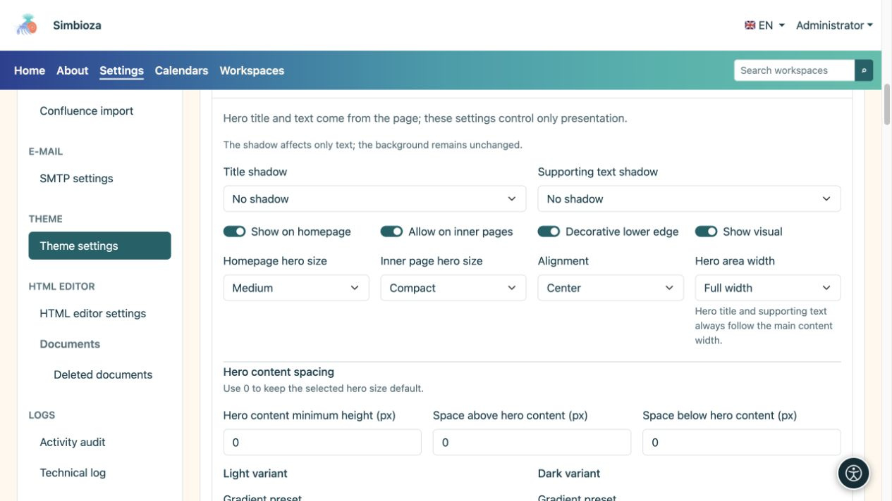
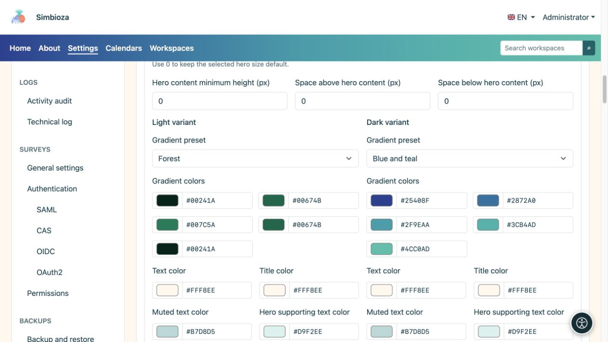
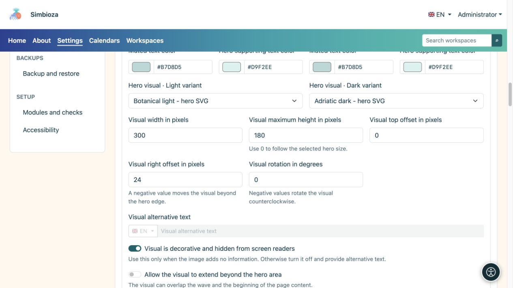
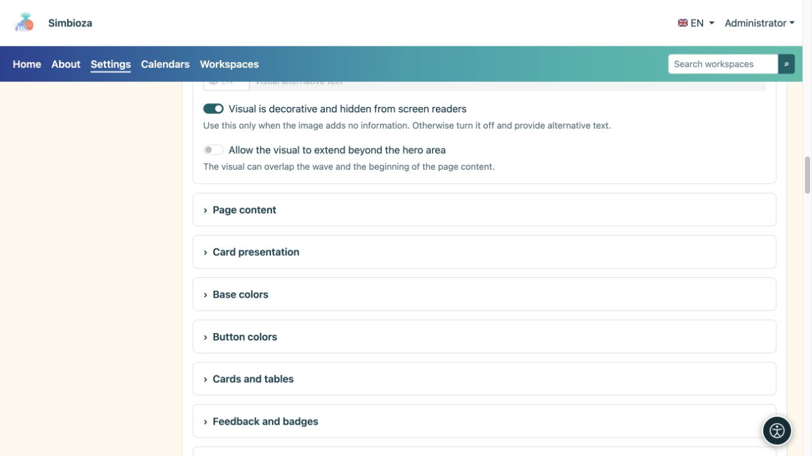
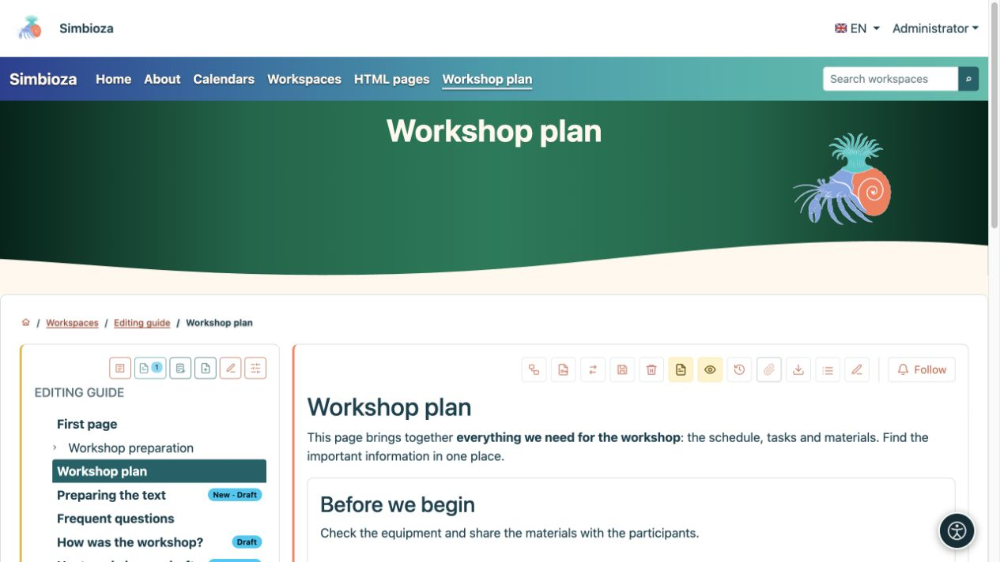

# Den Hero-Bereich gestalten: Titel, Farben und Bild

> Die Bildschirmaufnahmen zeigen die englische Benutzeroberfläche.

[Designs](teme_de.md)

Der **Hero-Bereich** ist ein größerer hervorgehobener Seitenbereich. Das Design steuert sein Erscheinungsbild; Titel und Beschreibung stammen von der tatsächlichen Seite. Dieses Formular legt nicht für jede Seite einen Titel fest.

## Wählen Sie, wo es angezeigt wird und wie viel Platz es beansprucht

1. Erweitern Sie **Hero** im offenen Design.
2. Legen Sie **Auf Startseite anzeigen** und **Auf Innenseiten zulassen** separat fest.
3. Wählen Sie Größen und Ausrichtung.
4. Überprüfen Sie sowohl die Startseite als auch eine normale Innenseite.

| Einstellung | Auswahlmöglichkeiten | Bedeutung |
| --- | --- | --- |
| Größe des Hero-Bereichs der Startseite | Kompakt / Mittel / Groß | Platz für den Hero-Bereich der Startseite. |
| Größe des Hero-Bereichs auf der Innenseite | Kompakt / Mittel / Groß | Platz für normale Seiten, getrennt von der Startseite. |
| Ausrichtung | Start / Mitte | Textposition. |
| Breite des Hero-Bereichs | Volle Breite / Wide / sm / md / lg / xl / xxl | Visueller Rahmen. Titel und unterstützender Text folgen der Breite des Hauptinhalts. |
| Titelschatten / Schatten des unterstützenden Texts | Keine / Weicher Schatten / Kontrastkontur | Separate Textauswahl, ohne einen Hintergrund hinzuzufügen. |

**Dekorative Unterkante** fügt eine Welle hinzu; **Visual anzeigen** aktiviert die ausgewählte Illustration. Durch das Deaktivieren des Visuals wird seine Datei nicht gelöscht.

<figure>

<figcaption>Für die Startseite und die Innenseiten gibt es separate Größeneinstellungen.</figcaption>
</figure>

### Der Hero-Bereich ist zu groß

Wählen Sie zunächst **Kompakt** für den entsprechenden Seitentyp aus. **Mindesthöhe des Inhalts**, **Abstand des oberen Inhalts** und **Abstand des unteren Inhalts** sind manuelle Ergänzungen: **0 verwendet die Standardgröße der Größenvoreinstellung und nicht die Höhe Null**. Setzen Sie alle zuvor großen Werte auf 0 zurück und überprüfen Sie sie erneut.

[Inhaltsüberschneidung](teme-sadrzaj-kartice_de.md) hebt den Hauptinhalt über den Hero-Bereich; es ersetzt nicht die Einstellung „Größe des Hero-Bereichs“. Schmale Bildschirme verwenden ein responsives Layout. Überprüfen Sie daher auch eine Ansicht in Telefongröße.

## Konfigurieren Sie Farben und Verläufe

Legen Sie Titel, unterstützenden/gedämpften Text und Verlaufsfarben separat für den hellen und dunklen Modus fest.

| Voreingestellter Farbverlauf | Verwenden |
| --- | --- |
| Neutral dunkel | Ein ruhiger dunkler Hintergrund. |
| Blau und Blaugrün | Ein cooler mehrfarbiger Übergang. |
| Rot und Orange | Ein wärmerer Übergang. |
| Blau und Lila | Ein stärkerer cooler Übergang. |
| Blau und Himmelblau | Ein helleres Blaugefühl. |
| Wald | Ein grüner Übergang. |
| Benutzerdefiniert | Ihre eigenen fünf Farben. |

Fünf Farben bilden den Übergang; überprüfen Sie die Beschriftung auf dem gesamten Schriftzug. Wenn eine Beschreibung schwer lesbar ist, passen Sie ihre **Textfarbe** an diesen Hintergrund an. Schatten ist optional und ersetzt nicht den Kontrast.

<figure>

<figcaption>Die Änderung einer Variante ersetzt nicht die Prüfung der anderen.</figcaption>
</figure>

## Wählen Sie das Bildmaterial aus und positionieren Sie es

1. Wählen Sie Bilder in der Hell- und Dunkelauswahl aus. Sie listen Dateien mit der Rolle **Hero-Bild** auf; Fügen Sie unter [Designdateien](teme-datoteke_de.md) eine fehlende hinzu.
2. Breite einstellen. Die maximale Höhe 0 behält den Standardgrenzwert bei; ein positiver Wert fügt einen Grenzwert hinzu.
3. Positionieren Sie das Bild mit einem Versatz von oben und rechts. Ein negativer Rechtsversatz kann es über den rechten Rand hinaus verschieben; Drehung ist ein Winkel in Grad.
4. Aktivieren Sie **Visuellen Überlauf außerhalb des Hero-Bereichs zulassen** nur, wenn dies beabsichtigt ist und die Navigation oder den Inhalt nicht verdeckt.
5. Speichern und prüfen Sie eine echte Seite, einen langen Titel und einen schmalen Bildschirm.

<figure>

<figcaption>Breite, Höhe, Versatz und Drehung verändern die Darstellung des ausgewählten Bildes.</figcaption>
</figure>

Aktivieren Sie **Visual ist dekorativ und für Bildschirmleseprogramme verborgen** nur zur Dekoration. Es bedarf dann keines Alternativtextes. Wenn das Bild Informationen übermittelt, deaktivieren Sie die Dekoration und geben Sie **visuellen Alternativtext** in den verfügbaren Sprachen ein.

<figure>

<figcaption>Beschreiben Sie informative Bilder; kündigen Sie reine Dekoration nicht als wichtigen Inhalt an.</figcaption>
</figure>

**Ein ruhigeres Beispiel:** kompakter Hero-Bereich, zentrierte Ausrichtung, Waldverlauf und keine Inhaltsüberlappung. Dadurch wird die Präsentation von einem hohen Homepage-Design abgeändert, ohne dass das Dokument geändert wird.

<figure>

<figcaption>Ein gespeichertes, kompaktes Design, das auf echte Inhalte angewendet wird.</figcaption>
</figure>

Wenn ein Anwendungsbildschirm seinen Hero-Bereich absichtlich unterdrückt, kann die Aktivierung im Design diese Entscheidung möglicherweise nicht außer Kraft setzen.
