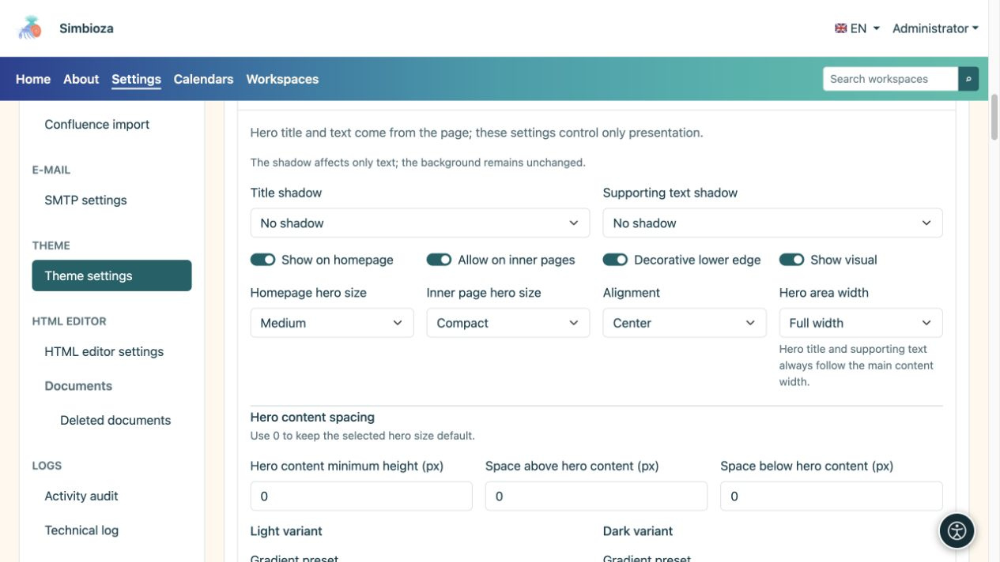
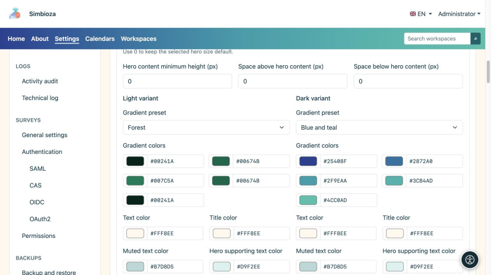
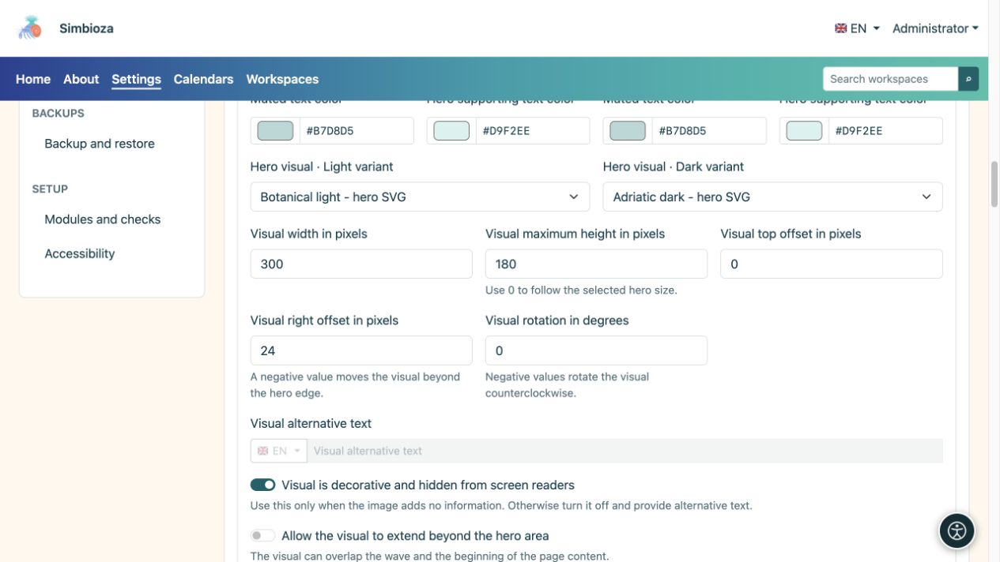
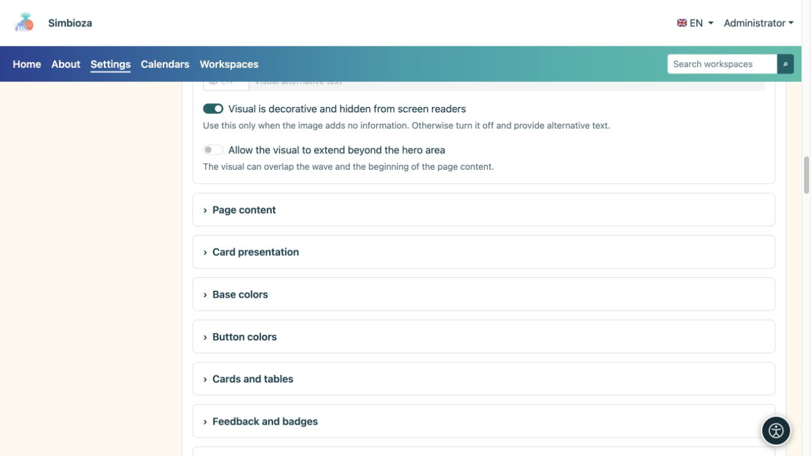
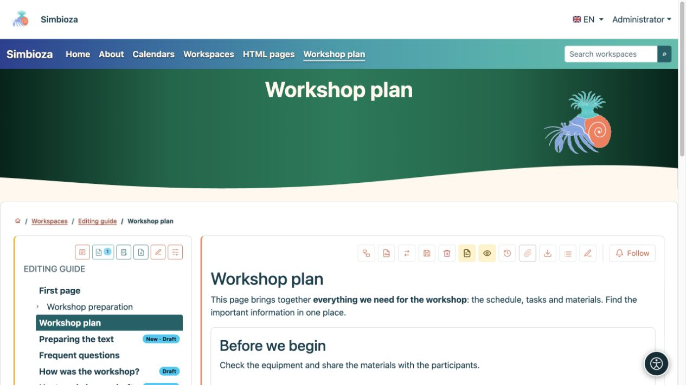

# Configure the hero: title, colours and image

[Themes](teme_en.md)

The **hero** is a larger highlighted page area. Theme controls its appearance; the title and description come from the actual page. This form does not set one title for every page.

## Choose where it appears and how much space it uses

1. Expand **Hero** in the open theme.
2. Set **Show on homepage** and **Allow on inner pages** separately.
3. Choose sizes and alignment.
4. Inspect both the home page and an ordinary inner page.

| Setting | Choices | Meaning |
| --- | --- | --- |
| Homepage hero size | Compact / Medium / Large | Space for the home-page hero. |
| Inner-page hero size | Compact / Medium / Large | Space for ordinary pages, separate from the home page. |
| Alignment | Start / Centre | Text position. |
| Hero area width | Full width / Wide / sm / md / lg / xl / xxl | Visual frame. Title and supporting copy follow main-content width. |
| Title shadow / Supporting-text shadow | None / Soft shadow / Contrast outline | Separate text choices, without adding a background. |

**Decorative lower edge** adds a wave; **Show visual** enables the selected illustration. Disabling the visual does not delete its file.

<figure>

<figcaption>The home page and inner pages have separate size settings.</figcaption>
</figure>

### The hero is too tall

First select **Compact** for the relevant page type. **Minimum content height**, **Top content spacing** and **Bottom content spacing** are manual additions: **0 uses the size preset's default, rather than zero height**. Reset any previously large values to 0 and check again.

[Content overlap](teme-sadrzaj-kartice_en.md) lifts main content over the hero; it does not replace the hero-size setting. Narrow screens use responsive layout, so also check a phone-sized view.

## Configure colours and gradients

Set title, supporting/muted text and gradient colours separately for light and dark modes.

| Gradient preset | Use |
| --- | --- |
| Neutral dark | A quiet dark background. |
| Blue and teal | A cool multicolour transition. |
| Red and orange | A warmer transition. |
| Blue and purple | A stronger cool transition. |
| Blue and sky blue | A lighter blue feel. |
| Forest | A green transition. |
| Custom | Your own five colours. |

Five colours form the transition; inspect lettering across all of it. If a description is hard to read, adjust its **text colour** on that background. Shadow is optional and does not replace contrast.

<figure>

<figcaption>Changing one variant does not replace checking the other.</figcaption>
</figure>

## Choose and position the visual

1. Choose images in the light and dark selectors. They list files with the **Hero visual** role; add a missing one under [Theme files](teme-datoteke_en.md).
2. Set width. Maximum height 0 keeps the default limit; a positive value adds a limit.
3. Position the image with top and right offsets. A negative right offset may move it past the right edge; rotation is an angle in degrees.
4. Enable **Allow visual overflow outside the hero** only when intended and when it does not cover navigation or content.
5. Save and inspect a real page, a long title and a narrow screen.

<figure>

<figcaption>Width, height, offsets and rotation change the selected image's presentation.</figcaption>
</figure>

Enable **Visual is decorative and hidden from screen readers** only for decoration. It then needs no alternative text. If the image communicates information, turn decoration off and enter **Visual alternative text** in available languages.

<figure>

<figcaption>Describe informative images; do not announce pure decoration as important content.</figcaption>
</figure>

**A quieter example:** compact hero, centred alignment, Forest gradient and no content overlap. This changes the presentation from a tall home-page design without changing the document.

<figure>

<figcaption>A saved compact design applied to real content.</figcaption>
</figure>

If an application screen deliberately suppresses its hero, enabling it in the theme may not override that decision.
