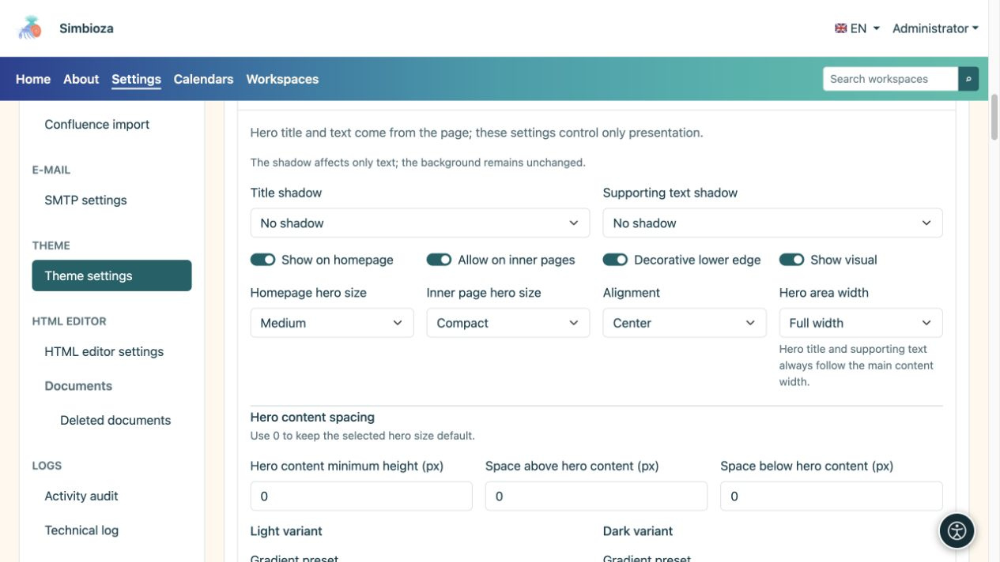
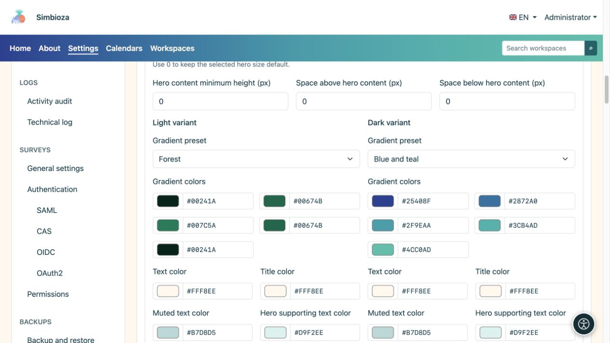
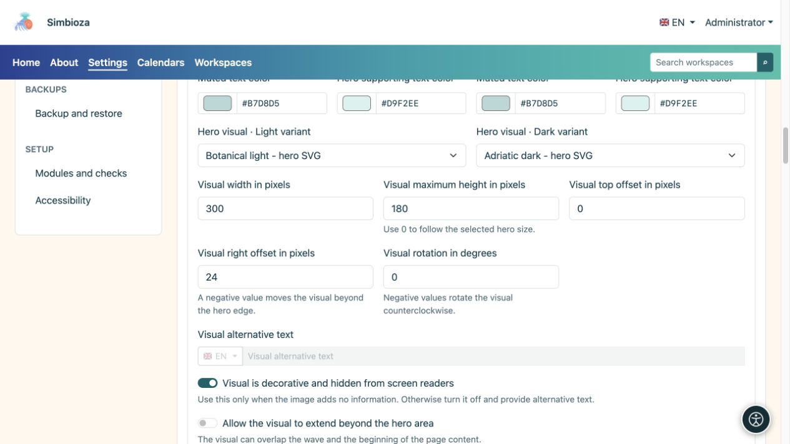
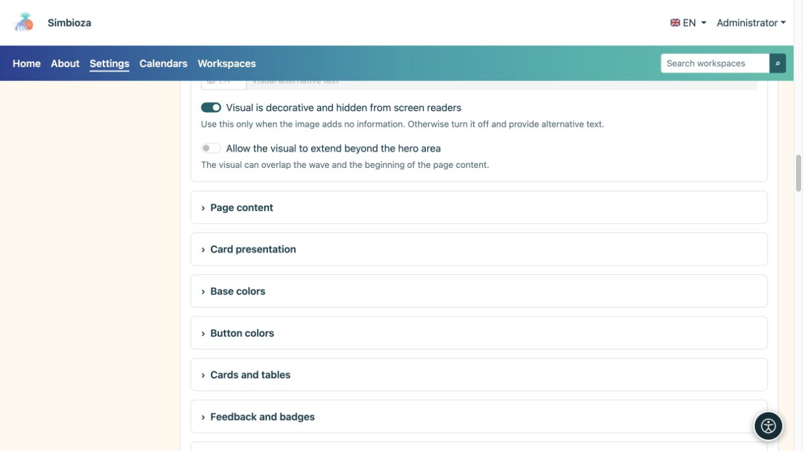
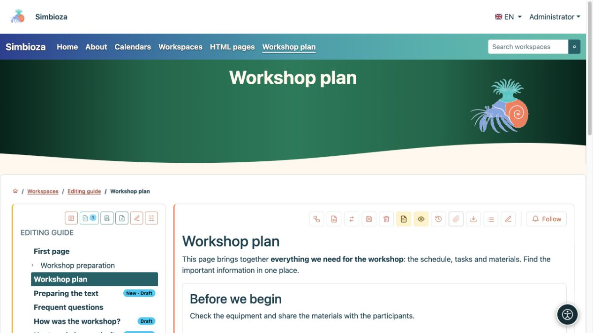

# Configurar el elemento principal: título, colores e imagen

> Las capturas de pantalla muestran la interfaz en inglés.

[Temas](teme_es.md)

El **elemento principal** es un área de página resaltada más grande. El tema controla su apariencia; el título y la descripción provienen de la página real. Este formulario no establece un título para cada página.

## Elija dónde aparece y cuánto espacio utiliza

1. Expande **Elemento principal** en el tema abierto.
2. Configure **Mostrar en la página de inicio** y **Permitir en páginas interiores** por separado.
3. Elija tamaños y alineación.
4. Inspeccione tanto la página de inicio como una página interior normal.

| Configuración | Opciones | Significado |
| --- | --- | --- |
| Tamaño del elemento principal de la página de inicio | Compacto / Mediano / Grande | Espacio para el elemento principal de la página de inicio. |
| Tamaño del elemento principal de la página interior | Compacto / Mediano / Grande | Espacio para páginas ordinarias, separadas de la página de inicio. |
| Alineación | Inicio / Centro | Posición del texto. |
| Ancho del área del elemento principal | Ancho completo / Ancho / sm / md / lg / xl / xxl | Marco visual. El título y el texto de respaldo siguen el ancho del contenido principal. |
| Sombra de título/sombra de texto de apoyo | Ninguno / Sombra suave / Contorno de contraste | Opciones de texto separadas, sin agregar fondo. |

**Borde inferior decorativo** añade una ola; **Mostrar imagen** habilita la ilustración seleccionada. Deshabilitar el objeto visual no elimina su archivo.

<figure>

<figcaption>La página de inicio y las páginas interiores tienen configuraciones de tamaño independientes.</figcaption>
</figure>

### El elemento principal es demasiado alto.

Primero seleccione **Compacto** para el tipo de página relevante. **Altura mínima del contenido**, **Espaciado superior del contenido** y **Espaciado inferior del contenido** son adiciones manuales: **0 usa el tamaño predeterminado predeterminado, en lugar de la altura cero**. Restablezca cualquier valor previamente grande a 0 y verifique nuevamente.

[Superposición de contenido](teme-sadrzaj-kartice_es.md) eleva el contenido principal sobre el elemento principal; no reemplaza la configuración de tamaño de elemento principal. Las pantallas estrechas utilizan un diseño responsivo, así que consulte también una vista del tamaño de un teléfono.

## Configurar colores y degradados

Establezca el título, el texto compatible/silenciado y los colores degradados por separado para los modos claro y oscuro.

| Preestablecido de degradado | Usar |
| --- | --- |
| Oscuro neutro | Un fondo oscuro y tranquilo. |
| Azul y verde azulado | Una transición multicolor genial. |
| rojo y naranja | Una transición más cálida. |
| Azul y morado | Una transición cool más fuerte. |
| Azul y azul cielo | Una sensación de azul más claro. |
| Bosque | Una transición verde. |
| Personalizado | Tus propios cinco colores. |

Cinco colores forman la transición; Inspeccione las letras en todo él. Si una descripción es difícil de leer, ajuste el **color del texto** en ese fondo. La sombra es opcional y no reemplaza el contraste.

<figure>

<figcaption>Cambiar una variante no reemplaza comprobar la otra.</figcaption>
</figure>

## Elija y coloque la imagen

1. Elija imágenes en los selectores claro y oscuro. Enumeran archivos con la función **Hero visual**; agregue uno que falta en [Archivos de tema](teme-datoteke_es.md).
2. Establecer ancho. La altura máxima 0 mantiene el límite predeterminado; un valor positivo añade un límite.
3. Coloque la imagen con desplazamientos superior y derecho. Un desplazamiento derecho negativo puede moverlo más allá del borde derecho; la rotación es un ángulo en grados.
4. Habilite **Permitir desbordamiento visual fuera del elemento principal** solo cuando sea previsto y cuando no cubra la navegación o el contenido.
5. Guarde e inspeccione una página real, un título largo y una pantalla estrecha.

<figure>

<figcaption>El ancho, el alto, los desplazamientos y la rotación cambian la presentación de la imagen seleccionada.</figcaption>
</figure>

Habilite **Lo visual es decorativo y está oculto para los lectores de pantalla** solo con fines decorativos. Entonces no necesita ningún texto alternativo. Si la imagen comunica información, desactive la decoración e ingrese **Texto alternativo visual** en los idiomas disponibles.

<figure>

<figcaption>Describir imágenes informativas; No anuncie pura decoración como contenido importante.</figcaption>
</figure>

**Un ejemplo más tranquilo:** elemento principal compacto, alineación centrada, gradiente de bosque y sin superposición de contenido. Esto cambia la presentación de un diseño de página de inicio alto sin cambiar el documento.

<figure>

<figcaption>Un diseño compacto guardado aplicado a contenidos reales.</figcaption>
</figure>

Si la pantalla de una aplicación suprime deliberadamente a su elemento principal, es posible que habilitarlo en el tema no anule esa decisión.
