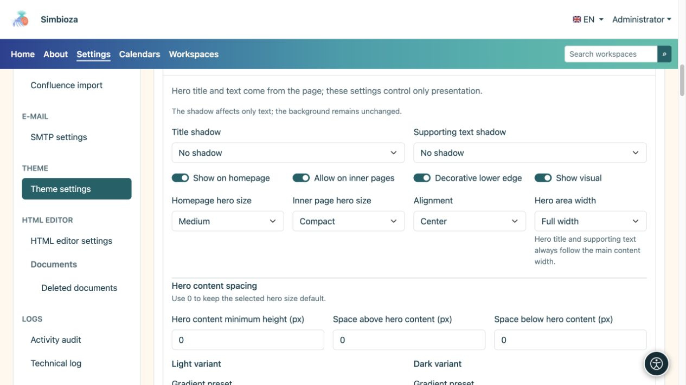
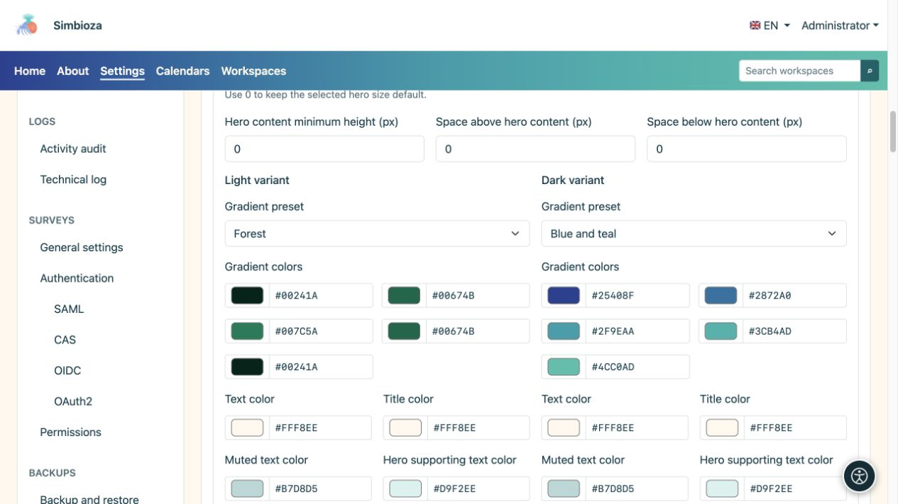
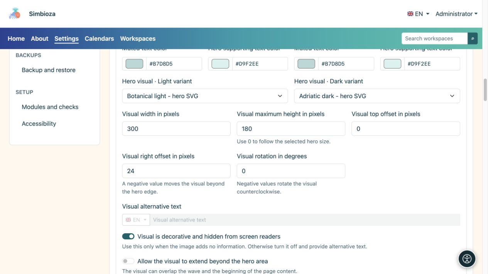
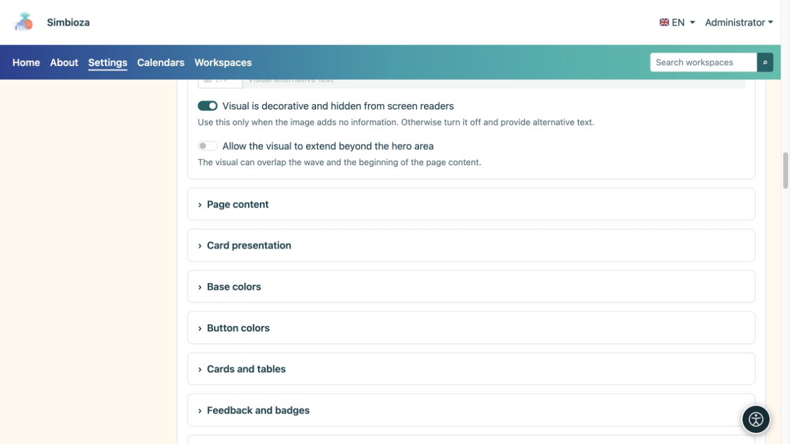
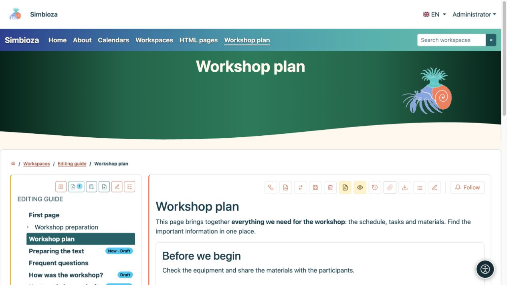

# Configurer le bandeau principal : titre, couleurs et image

> Les captures d’écran présentent l’interface en anglais.

[Thèmes](teme_fr.md)

Le **bandeau principal** est une zone de page en surbrillance plus grande. Le thème contrôle son apparence ; le titre et la description proviennent de la page réelle. Ce formulaire ne définit pas un titre pour chaque page.

## Choisissez où il apparaît et combien d'espace il utilise

1. Développez **Bandeau principal** dans le thème ouvert.
2. Définissez séparément **Afficher sur la page d'accueil** et **Autoriser sur les pages intérieures**.
3. Choisissez les tailles et l'alignement.
4. Inspectez à la fois la page d’accueil et une page intérieure ordinaire.

| Paramètre | Choix | Signification |
| --- | --- | --- |
| Taille du bandeau principal de la page d'accueil | Compact / Moyen / Grand | Espace pour le bandeau principal de la page d'accueil. |
| Taille du bandeau principal de la page intérieure | Compact / Moyen / Grand | Espace pour les pages ordinaires, distinct de la page d'accueil. |
| Alignement | Début / Centre | Position du texte. |
| Largeur de la zone du bandeau principal | Pleine largeur / Large / sm / md / lg / xl / xxl | Cadre visuel. Le titre et le texte d’accompagnement suivent la largeur du contenu principal. |
| Ombre du titre / Ombre du texte de support | Aucun / Ombre douce / Contour contrasté | Séparez les choix de texte, sans ajouter d'arrière-plan. |

**Bord inférieur décoratif** ajoute une vague ; **Afficher le visuel** active l'illustration sélectionnée. La désactivation du visuel ne supprime pas son fichier.

<figure>

<figcaption>La page d'accueil et les pages intérieures ont des paramètres de taille distincts.</figcaption>
</figure>

### Le bandeau principal est trop grand

Sélectionnez d'abord **Compact** pour le type de page concerné. **Hauteur minimale du contenu**, **Espacement du contenu supérieur** et **Espacement du contenu inférieur** sont des ajouts manuels : **0 utilise la taille par défaut du préréglage de taille, plutôt que la hauteur nulle**. Réinitialisez toutes les valeurs précédemment élevées à 0 et vérifiez à nouveau.

[Chevauchement du contenu](teme-sadrzaj-kartice_fr.md) élève le contenu principal sur le bandeau principal ; il ne remplace pas le paramètre de taille du bandeau principal. Les écrans étroits utilisent une mise en page réactive, alors vérifiez également une vue de la taille d'un téléphone.

## Configurer les couleurs et les dégradés

Définissez le titre, le texte d’accompagnement ou atténué et les couleurs dégradées séparément pour les modes clair et sombre.

| Préréglage de dégradé | Utiliser |
| --- | --- |
| Neutre foncé | Un fond sombre et calme. |
| Bleu et turquoise | Une transition multicolore aux couleurs froides. |
| Rouge et orange | Une transition plus chaleureuse. |
| Bleu et violet | Une transition froide plus marquée. |
| Bleu et bleu ciel | Une sensation de bleu plus clair. |
| Forêt | Une transition verte. |
| Personnalisé | Vos propres cinq couleurs. |

Cinq couleurs forment la transition ; inspectez le lettrage partout. Si une description est difficile à lire, ajustez sa **couleur du texte** sur cet arrière-plan. L'ombre est facultative et ne remplace pas le contraste.

<figure>

<figcaption>Changer une variante ne remplace pas la vérification de l’autre.</figcaption>
</figure>

## Choisir et positionner le visuel

1. Choisissez les images dans les sélecteurs des modes clair et sombre. Ils présentent les fichiers ayant le rôle **Visuel du bandeau principal** ; ajoutez un fichier manquant dans [Fichiers du thème](teme-datoteke_fr.md).
2. Définir la largeur. La hauteur maximale 0 conserve la limite par défaut ; une valeur positive ajoute une limite.
3. Positionnez l'image avec des décalages en haut et à droite. Un décalage négatif vers la droite peut le déplacer au-delà du bord droit ; la rotation est un angle en degrés.
4. Activez **Autoriser le débordement visuel en dehors du bandeau principal** uniquement lorsque cela est prévu et lorsqu'il ne couvre pas la navigation ou le contenu.
5. Enregistrez et inspectez une vraie page, un titre long et un écran étroit.

<figure>

<figcaption>La largeur, la hauteur, les décalages et la rotation modifient la présentation de l'image sélectionnée.</figcaption>
</figure>

Activer **Le visuel est décoratif et masqué aux lecteurs d'écran** uniquement à des fins de décoration. Il n’y a donc pas besoin de texte alternatif. Si l'image communique des informations, désactivez la décoration et saisissez **Texte alternatif visuel** dans les langues disponibles.

<figure>

<figcaption>Décrire des images informatives ; n'annoncez pas la décoration pure comme un contenu important.</figcaption>
</figure>

**Un exemple plus sobre :** bandeau principal compact, alignement centré, dégradé de forêt et aucun chevauchement de contenu. Cela modifie la présentation d'une grande page d'accueil sans modifier le document.

<figure>

<figcaption>Un design compact sauvegardé appliqué au contenu réel.</figcaption>
</figure>

Si un écran d'application supprime délibérément son bandeau principal, son activation dans le thème ne peut pas annuler cette décision.
