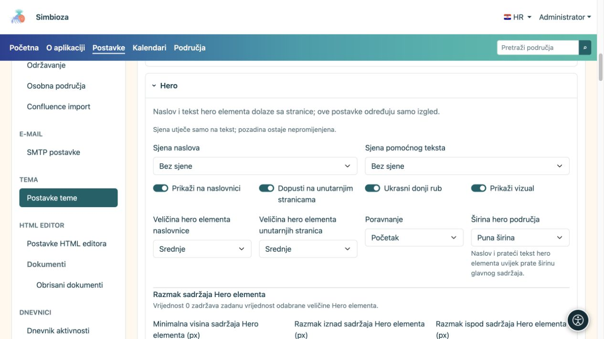
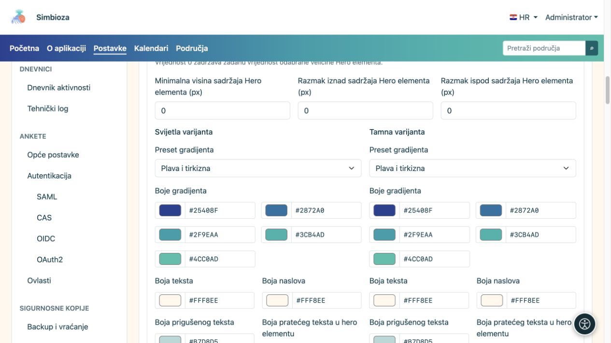
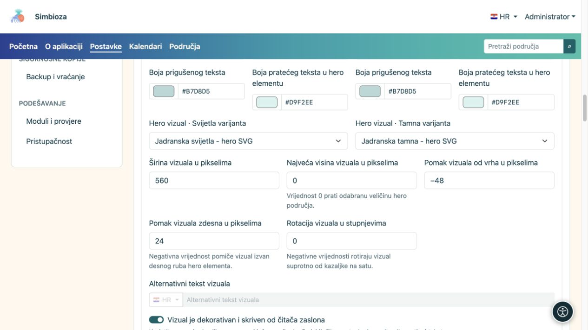
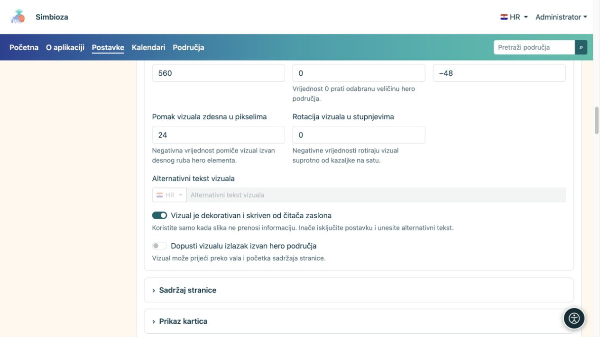
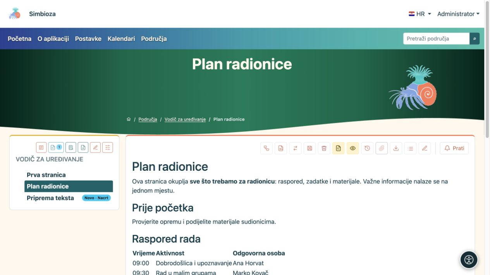

# Uredite hero: naslov, boje i sliku

[Teme](teme_hr.md)

**Hero** je veći istaknuti dio stranice. Tema određuje njegov izgled, a naslov i opis dolaze iz konkretne stranice. U ovaj obrazac ne upisujete naslov svih stranica.

## Odaberite gdje i koliko prostora zauzima

1. U otvorenoj temi proširite **Hero**.
2. Odvojeno uključite **Prikaži na naslovnici** i **Dopusti na unutarnjim stranicama**.
3. Odaberite veličine i poravnanje.
4. Pregledajte naslovnicu i običnu unutarnju stranicu.

| Postavka | Odabiri | Značenje |
| --- | --- | --- |
| Veličina hero elementa naslovnice | Kompaktno / Srednje / Veliko | Prostor naslovničkog heroa. |
| Veličina hero elementa unutarnjih stranica | Kompaktno / Srednje / Veliko | Prostor heroa običnih stranica; odvojeno od naslovnice. |
| Poravnanje | Početak / Sredina | Položaj teksta. |
| Širina hero područja | Puna širina / Široko / sm / md / lg / xl / xxl | Okvir vizuala. Naslov i prateći tekst prate širinu glavnoga sadržaja. |
| Sjena naslova / Sjena pomoćnog teksta | Bez sjene / Blaga sjena / Kontrastni obrub | Dva zasebna izbora za tekst, bez dodavanja podloge. |

**Ukrasni donji rub** dodaje val, a **Prikaži vizual** uključuje odabranu ilustraciju. Isključivanje vizuala ne briše datoteku.

<figure>

<figcaption>Naslovnica i unutarnje stranice imaju odvojene veličine.</figcaption>
</figure>

### Hero je previsok

Najprije odaberite **Kompaktno** za odgovarajuću vrstu stranice. Polja **Minimalna visina sadržaja**, **Razmak iznad sadržaja** i **Razmak ispod sadržaja** ručne su dopune: **0 znači zadanu vrijednost odabrane veličine, a ne nultu visinu**. Ako ste ranije upisali velike brojeve, vratite ih na 0 i provjerite rezultat.

[Preklapanje sadržaja](teme-sadrzaj-kartice_hr.md) podiže glavni sadržaj preko heroa; ne zamjenjuje odabir njegove veličine. Na uskom zaslonu primjenjuje se prilagodljiv raspored, pa provjerite i mobitel.

## Podesite boje i gradijent

Za svijetli i tamni prikaz odvojeno podesite boje naslova, pratećeg/prigušenog teksta i gradijenta.

| Predložak gradijenta | Kada ga koristiti |
| --- | --- |
| Neutralna tamna | Mirna tamna podloga. |
| Plava i tirkizna | Hladniji višebojni prijelaz. |
| Crvena i narančasta | Topliji prijelaz. |
| Plava i ljubičasta | Izraženiji hladni prijelaz. |
| Plava i nebeskoplava | Svjetliji plavi dojam. |
| Šuma | Zeleni prijelaz. |
| Prilagođeno | Vlastitih pet boja. |

Pet boja oblikuje prijelaz; pregledajte slova na svim njegovim dijelovima. Ako opis nije čitljiv, podesite **boju teksta** na toj podlozi. Sjena je neobavezna dopuna, a ne zamjena za kontrast.

<figure>

<figcaption>Promjena boje u jednoj varijanti ne zamjenjuje provjeru druge.</figcaption>
</figure>

## Odaberite i smjestite vizual

1. Odaberite sliku u svijetlom i tamnom padajućem izborniku. Popis nudi datoteke namjene **Hero vizual**; nedostajuću dodajte kroz [Datoteke teme](teme-datoteke_hr.md).
2. Podesite širinu. Najveća visina 0 ostavlja zadano ograničenje; pozitivan broj postavlja dodatno ograničenje.
3. Gornjim i desnim pomakom postavite sliku. Negativan desni pomak može je povući preko desnog ruba; rotacija je kut u stupnjevima.
4. **Dopusti vizualu izlazak izvan hero područja** uključite samo ako takav prijelaz želite i ako ne prekriva navigaciju ili sadržaj.
5. Spremite i provjerite stvarnu stranicu, dugačak naslov i mobitel.

<figure>

<figcaption>Širina, visina, pomaci i rotacija mijenjaju prikaz odabrane slike.</figcaption>
</figure>

**Vizual je dekorativan i skriven od čitača zaslona** uključite samo za ukras. Tada alternativni tekst nije potreban. Ako slika prenosi informaciju, isključite dekorativnost i unesite **Alternativni tekst vizuala** na dostupnim jezicima.

<figure>

<figcaption>Informativnoj slici dodajte opis; čisti ukras nemojte predstavljati kao važan sadržaj.</figcaption>
</figure>

**Primjer mirnijeg izgleda:** kompaktni hero, poravnanje u sredinu, gradijent Šuma i bez preklapanja sadržaja. Tako se rezultat razlikuje od visoke naslovnice bez promjene samog dokumenta.

<figure>

<figcaption>Primjer spremljenog kompaktnog prikaza na stvarnoj stranici.</figcaption>
</figure>

Ako neki ekran namjerno ne prikazuje hero, njegovo uključivanje u temi ne mora nadjačati tu odluku aplikacije.
