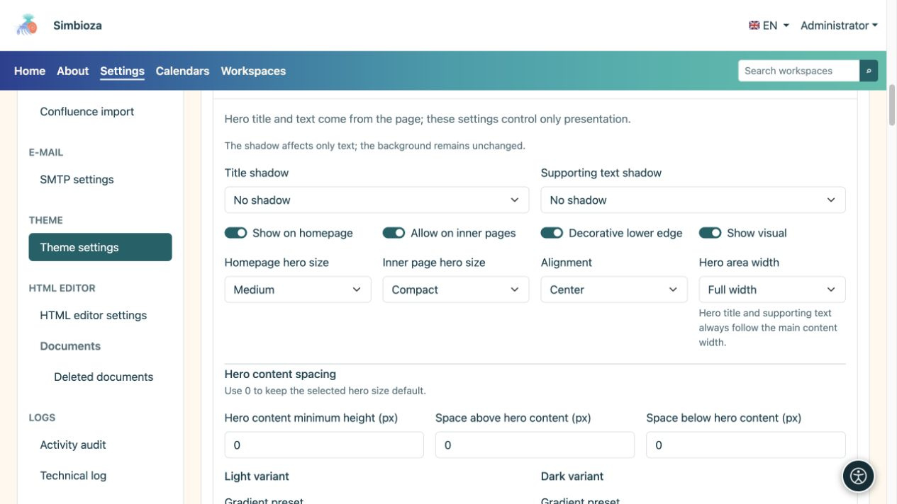
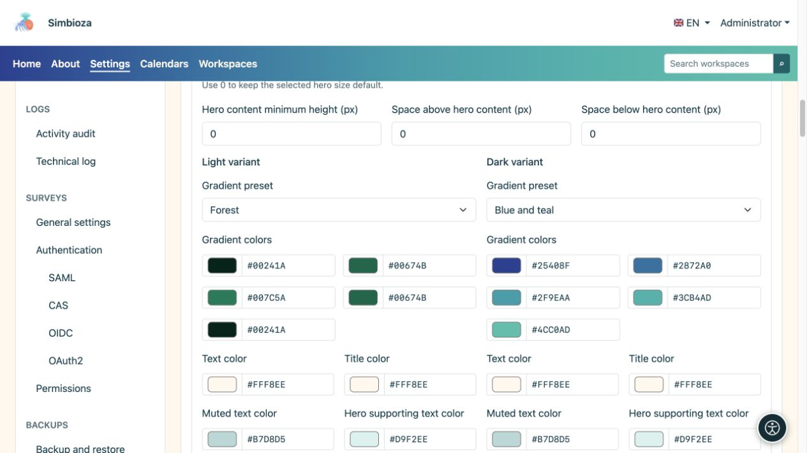
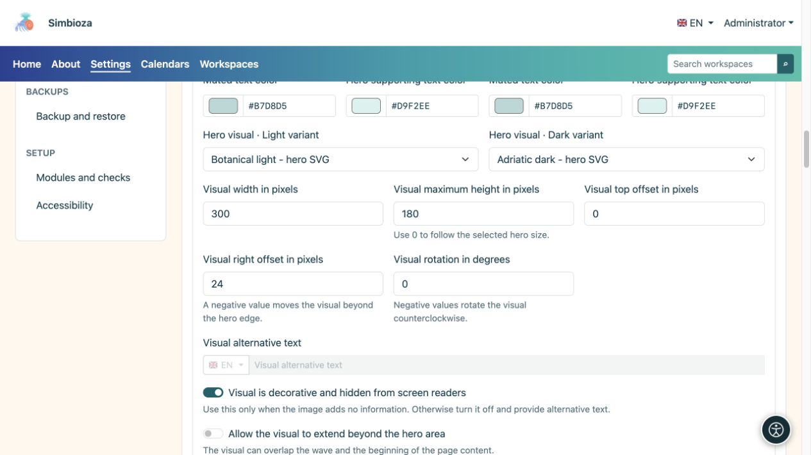
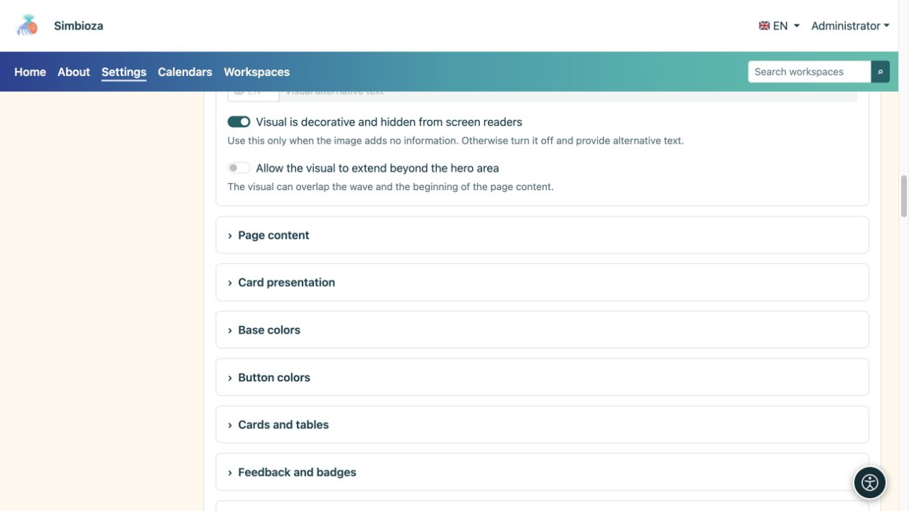
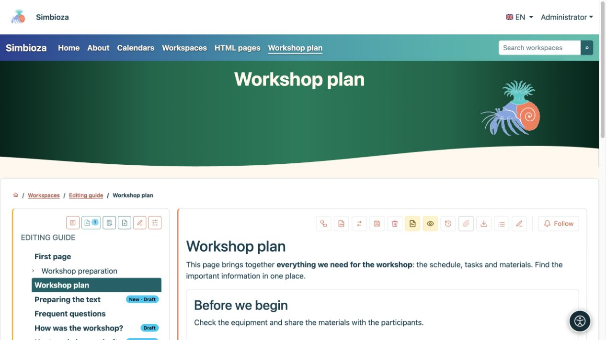

# Configura la sezione principale: titolo, colori e immagine

> Le schermate mostrano l’interfaccia in inglese.

[Temi](teme_it.md)

La **sezione principale (hero)** è un'area evidenziata più ampia della pagina. Il tema ne controlla l'aspetto; il titolo e la descrizione provengono dalla pagina effettiva. Questo modulo non imposta un unico titolo per tutte le pagine.

## Scegli dove apparire e quanto spazio utilizza

1. Espandi **Hero** nel tema aperto.
2. Imposta **Mostra sulla home page** e **Consenti nelle pagine interne** separatamente.
3. Scegli le dimensioni e l'allineamento.
4. Ispeziona sia la home page che una normale pagina interna.

| Impostazione | Scelte | Significato |
| --- | --- | --- |
| Dimensioni della sezione principale della home page | Compatto/Medio/Grande | Spazio per la sezione principale della home page. |
| Dimensioni della sezione principale della pagina interna | Compatto/Medio/Grande | Spazio per le pagine ordinarie, separato dalla home page. |
| Allineamento | Inizio/Centro | Posizione del testo. |
| Larghezza dell'area della sezione principale | Larghezza intera / Largo / sm / md / lg / xl / xxl | Cornice visiva. Il titolo e il testo di supporto seguono la larghezza del contenuto principale. |
| Ombra del titolo/Ombra del testo di supporto | Nessuno/Ombra morbida/Contorno contrastato | Scelte di testo separate, senza aggiungere uno sfondo. |

**Bordo inferiore decorativo** aggiunge un'onda; **Mostra immagine** abilita l'illustrazione selezionata. La disabilitazione dell'oggetto visivo non ne elimina il file.

<figure>

<figcaption>La home page e le pagine interne hanno impostazioni di dimensione separate.</figcaption>
</figure>

### La sezione principale è troppo alta

Seleziona innanzitutto **Compatta** per il tipo di pagina pertinente. **Altezza minima del contenuto**, **Spaziatura del contenuto superiore** e **Spaziatura del contenuto inferiore** sono aggiunte manuali: **0 utilizza l'impostazione predefinita della dimensione preimpostata, anziché l'altezza zero**. Reimpostare tutti i valori precedentemente grandi su 0 e ricontrollare.

[Sovrapposizione contenuto](teme-sadrzaj-kartice_it.md) solleva il contenuto principale sopra la sezione principale; non sostituisce l'impostazione della dimensione della sezione principale. Gli schermi stretti utilizzano un layout reattivo, quindi controlla anche una visualizzazione delle dimensioni di un telefono.

## Configura colori e sfumature

Imposta separatamente per le modalità chiara e scura i colori del titolo, del testo di supporto/secondario e della sfumatura.

| Preimpostazione gradiente | Utilizzo |
| --- | --- |
| Scuro neutro | Uno sfondo scuro e tranquillo. |
| Blu e verde acqua | Una fantastica transizione multicolore. |
| Rosso e arancione | Una transizione più calda. |
| Blu e viola | Una transizione più forte e interessante. |
| Blu e azzurro cielo | Una sensazione di blu più chiaro. |
| Foresta | Una transizione verde. |
| Personalizzato | I tuoi cinque colori. |

Cinque colori formano la sfumatura; controlla il testo su tutta l'area. Se una descrizione è difficile da leggere, regola il **colore del testo** su quello sfondo. L'ombra è facoltativa e non sostituisce il contrasto.

<figure>

<figcaption>La modifica di una variante non sostituisce il controllo dell'altra.</figcaption>
</figure>

## Scegli e posiziona l'immagine

1. Scegli le immagini nei selettori per l'aspetto chiaro e scuro. Elencano i file con ruolo **Immagine della sezione principale**; aggiungi quelli mancanti in [File del tema](teme-datoteke_it.md).
2. Imposta la larghezza. L'altezza massima 0 mantiene il limite predefinito; un valore positivo aggiunge un limite.
3. Posiziona l'immagine con gli offset in alto e a destra. Un offset destro negativo potrebbe spostarlo oltre il bordo destro; la rotazione è un angolo in gradi.
4. Abilita **Consenti overflow visivo all'esterno della sezione principale** solo quando previsto e quando non copre la navigazione o il contenuto.
5. Salva e controlla una pagina reale, un titolo lungo e uno schermo stretto.

<figure>

<figcaption>Larghezza, altezza, offset e rotazione modificano la presentazione dell'immagine selezionata.</figcaption>
</figure>

Abilita **L'immagine è decorativa e nascosta agli screen reader** solo a scopo decorativo. Quindi non necessita di testo alternativo. Se l'immagine comunica informazioni, disattiva la decorazione e inserisci **Testo alternativo visivo** nelle lingue disponibili.

<figure>

<figcaption>Descrivere immagini informative; non annunciare la pura decorazione come contenuto importante.</figcaption>
</figure>

**Un esempio più sobrio:** sezione principale compatta, allineamento centrato, sfumatura Foresta e nessuna sovrapposizione dei contenuti. Questo modifica la presentazione rispetto a una pagina iniziale con sezione alta senza cambiare il documento.

<figure>

<figcaption>Un design compatto salvato applicato a contenuti reali.</figcaption>
</figure>

Se una schermata dell'applicazione nasconde deliberatamente la propria sezione principale, abilitarla nel tema potrebbe non modificare questa scelta.
