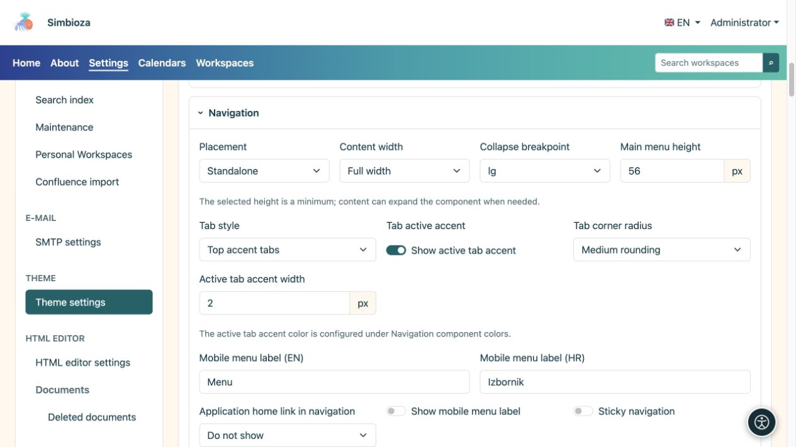
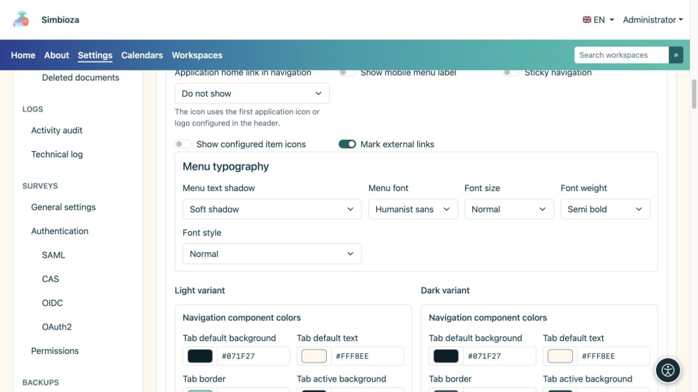
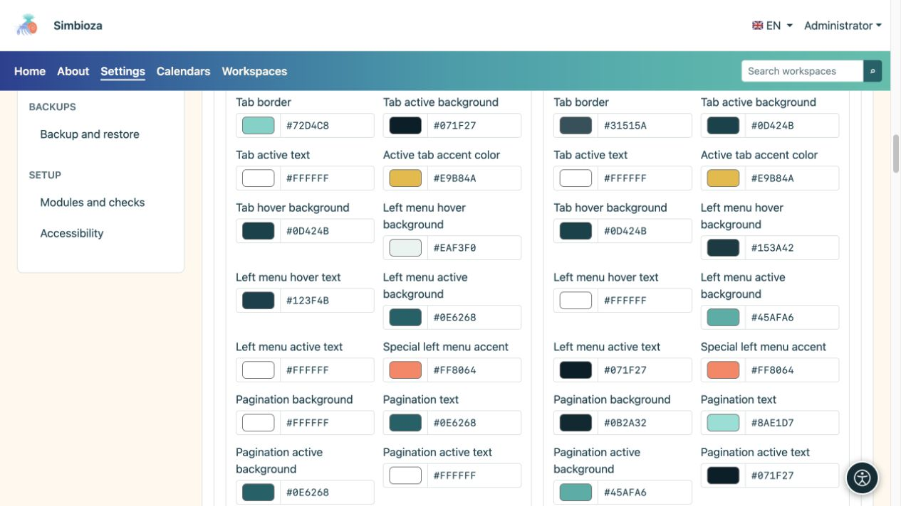

# Das Erscheinungsbild der Navigation festlegen

> Die Bildschirmaufnahmen zeigen die englische Benutzeroberfläche.

[Designs](teme_de.md)

Das Design steuert, wie die Navigation aussieht. Um Seiten, Untermenüs oder Links hinzuzufügen oder zu entscheiden, wer ein Element sieht, verwenden Sie [Menüs](izbornici_de.md).

## Wählen Sie Position und Verhalten

Öffnen Sie **Navigation** im Design-Editor.

| Einstellung | Verfügbare Auswahlmöglichkeiten | Wirkung |
| --- | --- | --- |
| Platzierung | Standalone / Im Hero-Bereich | Ein eigener Streifen unterhalb der Kopfzeile oder Navigation auf dem Hero-Hintergrund. |
| Breite | Volle Breite / Wide / sm / md / lg / xl / xxl | Die gleichen [Containerfamilien](teme-zaglavlje_de.md) wie der Header. |
| Haltepunkt für die mobile Navigation | sm / md / lg / xl / xxl | Unterhalb der gewählten Größe verwendet die Navigation den Mobilmodus; ein größerer Haltepunkt ermöglicht die frühere Aktivierung. |
| Link zur Startseite der Anwendung in der Navigation | Ausgeblendet / Anwendungsname / Anwendungssymbol | Eine Markierung oder ein Name am Anfang der Navigation, kein neuer beliebiger Menüpunkt. |
| Menütextschatten | Keine / Weicher Schatten / Kontrastkontur | Betont die Beschriftung, ohne den Hintergrund zu verändern. |

**Sticky-Navigation** gilt nur bei eigenständiger Platzierung. Es ist im Hero-Bereich nicht verfügbar. **Die Höhe des Hauptmenüs** ist ein Minimum; Mehr Eintrag oder größere Beschriftungen können den Streifen vergrößern.

Geben Sie für Mobilgeräte eine Kurzbezeichnung in den verfügbaren Sprachen ein und aktivieren Sie deren Anzeige, wenn Sie Text neben dem Symbol wünschen. **Konfigurierte Elementsymbole anzeigen** und **Externe Links markieren** steuern zusätzliche Indikatoren, keine Ziele.

<figure>

<figcaption>Die Präsentation erfolgt getrennt von den Elementen, die vom Modul „Menüs“ verwaltet werden.</figcaption>
</figure>

## Legen Sie die Typografie des Menüs fest

| Feld | Auswahlmöglichkeiten |
| --- | --- |
| Menüschriftart | System-Benutzeroberfläche / Abgerundetes System / Humanistische Sans / Lesbare Serifen / Monospace |
| Schriftgröße | Klein / Normal / Groß / Extragroß |
| Schriftstärke | Normal / Mittel / Halbfett / Fett |
| Schriftstil | Normal / Kursiv |

Ändern Sie einen Wert und überprüfen Sie längere Etiketten. Sehr große Schriften und viele Gegenstände benötigen mehr Platz; überprüfen Sie vor dem Speichern die Verpackung und die mobile Navigation.

<figure>

<figcaption>Die Navigation verwendet möglicherweise eine andere Schriftart als die Basisschriftart des Designs.</figcaption>
</figure>

## Navigations- und Tab-Farben

Helle und dunkle Varianten haben unterschiedliche Farben. Konfigurieren Sie Menühintergründe/-verläufe, Text und aktive Elemente, mobile Navigation, Breadcrumbs, Seitennavigation und das Seitenmenü. Fünf Verlaufsfarben verlaufen von links nach rechts.

Anwendungsregisterkarten verfügen über separate Strukturoptionen:

| Feld | Auswahlmöglichkeiten |
| --- | --- |
| Tab-Stil | Standard-Tabulatoren / Tabulatoren mit Top-Akzent |
| Ecken | Keine Rundung / Kleine Rundung / Mittlere Rundung |

**Aktiv-Tab-Akzent anzeigen** und seine Stärke steuern die Auswahlanzeige separat. Standard-, Aktiv- und Hover-Zustände müssen unterscheidbar bleiben. Im HTML-Editor eingefügte Inhaltsregisterkarten verfügen über [ihre eigene Farbgruppe](teme-boje-komponente_de.md), getrennt vom Hauptmenü.

<figure>

<figcaption>Überprüfen Sie die aktiven Zustände sowie das Menü im Ruhezustand.</figcaption>
</figure>

**Ergebnis:** Das gespeicherte Design präsentiert dieselben Elemente mit einem neuen Layout und neuen Farben. Überprüfen Sie eine echte Seite, ein geöffnetes Untermenü, das aktive Element und den mobilen Modus. Eine Designfarbe kann kein Element hinzufügen, das aufgrund von Konfigurations- oder Zugriffsberechtigungen fehlt.
