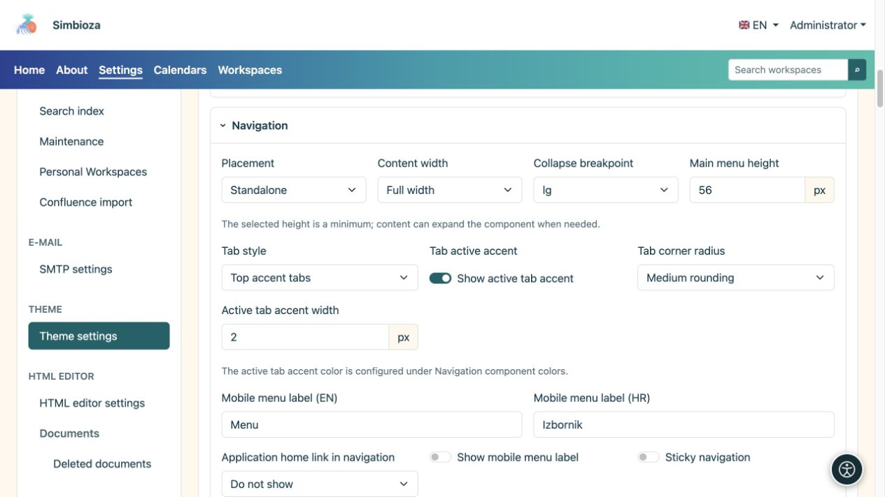
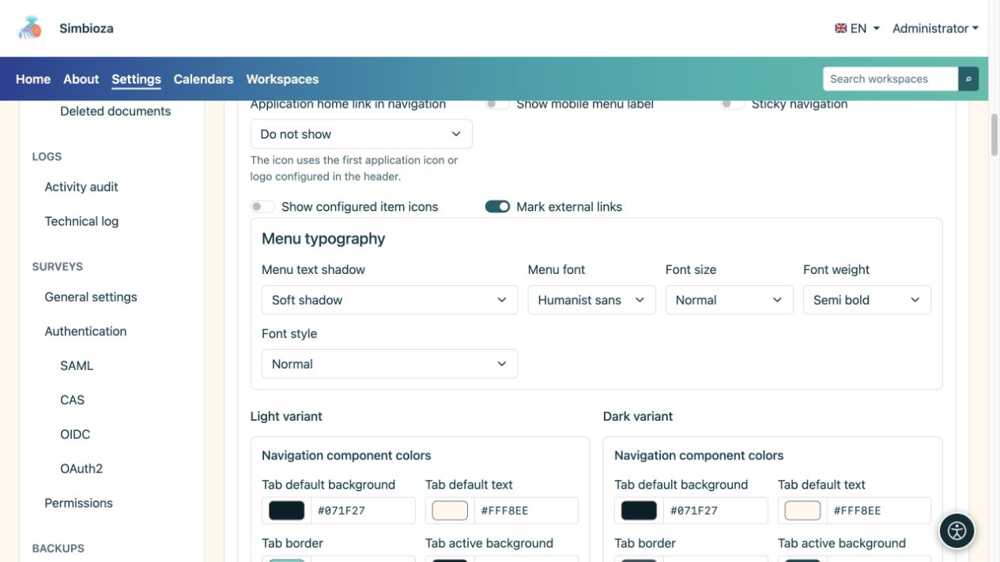
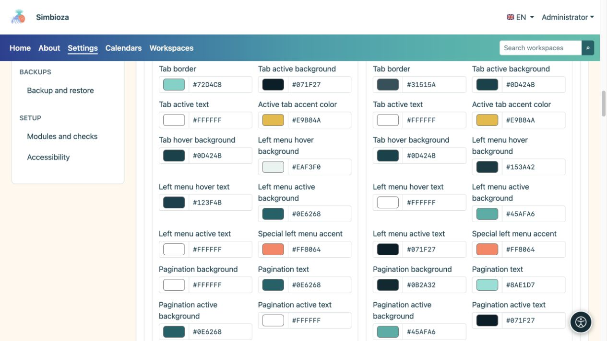

# Configure navigation appearance

[Themes](teme_en.md)

Theme controls how navigation looks. To add pages, submenus or links, or decide who sees an item, use [Menus](izbornici_en.md).

## Choose position and behaviour

Open **Navigation** in the theme editor.

| Setting | Available choices | Effect |
| --- | --- | --- |
| Placement | Standalone / Inside hero | Its own strip below the header or navigation on the hero background. |
| Width | Full width / Wide / sm / md / lg / xl / xxl | The same [container families](teme-zaglavlje_en.md) as the header. |
| Mobile navigation breakpoint | sm / md / lg / xl / xxl | Below the chosen size, navigation uses mobile mode; a larger breakpoint enables it sooner. |
| Application home link in navigation | Hidden / Application name / Application icon | A mark or name at the start of navigation, not a new arbitrary menu item. |
| Menu text shadow | None / Soft shadow / Contrast outline | Emphasises lettering without changing its background. |

**Sticky navigation** applies only in standalone placement. It is unavailable inside the hero. **Main menu height** is a minimum; more items or larger lettering may increase the strip.

For mobile, enter a short label in available languages and enable its display if you want text beside the icon. **Show configured item icons** and **Mark external links** control additional indicators, not destinations.

<figure>

<figcaption>Presentation is separate from the items maintained by the Menus module.</figcaption>
</figure>

## Set menu typography

| Field | Choices |
| --- | --- |
| Menu font | System UI / Rounded system / Humanist sans / Readable serif / Monospace |
| Font size | Small / Normal / Large / Extra large |
| Font weight | Normal / Medium / Semibold / Bold |
| Font style | Normal / Italic |

Change one value and inspect longer labels. Very large lettering and many items need more space; check wrapping and mobile navigation before saving.

<figure>

<figcaption>Navigation may use a different font from the theme's base font.</figcaption>
</figure>

## Navigation and tab colours

Light and dark variants have separate colours. Configure menu backgrounds/gradients, text and active items, mobile navigation, breadcrumbs, pagination and the side menu. Five gradient colours run from left to right.

Application tabs have separate structural choices:

| Field | Choices |
| --- | --- |
| Tab style | Standard tabs / Top-accent tabs |
| Corners | No rounding / Small rounding / Medium rounding |

**Show active-tab accent** and its thickness control the selection indicator separately. Default, active and hover states must remain distinguishable. Content tabs inserted in HTML Editor have [their own colour group](teme-boje-komponente_en.md), separate from the main menu.

<figure>

<figcaption>Check active states as well as the menu at rest.</figcaption>
</figure>

**Result:** the saved theme presents the same items with a new layout and colours. Check a real page, an open submenu, the active item and mobile mode. A theme colour cannot add an item missing because of configuration or access permissions.
