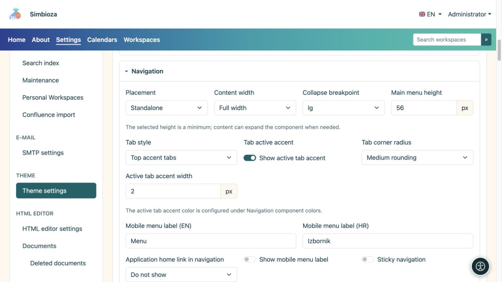
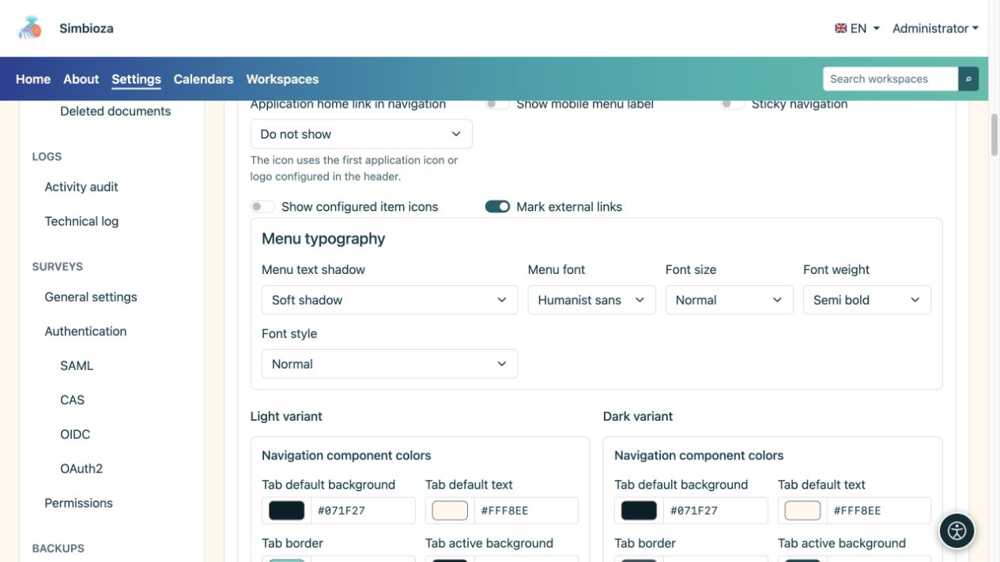
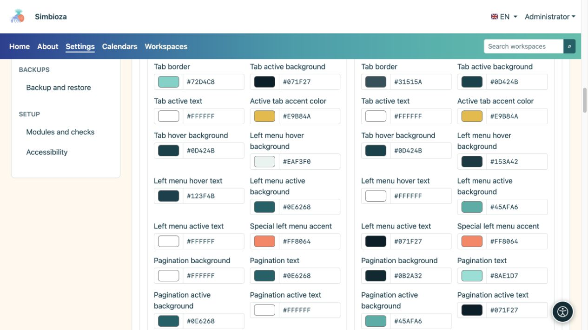

# Configurar la apariencia de la navegación

> Las capturas de pantalla muestran la interfaz en inglés.

[Temas](teme_es.md)

El tema controla el aspecto de la navegación. Para agregar páginas, submenús o enlaces, o decidir quién ve un elemento, utilice [Menús](izbornici_es.md).

## Elija posición y comportamiento.

Abra **Navegación** en el editor de temas.

| Configuración | Opciones disponibles | Efecto |
| --- | --- | --- |
| Colocación | Independiente/Elemento principal interno | Su propia franja debajo del encabezado o navegación en el fondo del elemento principal. |
| Ancho | Ancho completo / Ancho / sm / md / lg / xl / xxl | Las mismas [familias de contenedores](teme-zaglavlje_es.md) que el encabezado. |
| Punto de interrupción de la navegación móvil | sm / md / lg / xl / xxl | Por debajo del tamaño elegido, la navegación utiliza el modo móvil; un punto de interrupción más grande lo permite antes. |
| Enlace de inicio de la aplicación en la navegación. | Oculto / Nombre de la aplicación / Icono de la aplicación | Una marca o nombre al inicio de la navegación, no un nuevo elemento de menú arbitrario. |
| Sombra del texto del menú | Ninguno / Sombra suave / Contorno de contraste | Resalta las letras sin cambiar su fondo. |

**La navegación fija** se aplica solo en ubicaciones independientes. No está disponible dentro del elemento principal. **La altura del menú principal** es mínima; más elementos o letras más grandes pueden aumentar la tira.

Para dispositivos móviles, ingrese una etiqueta corta en los idiomas disponibles y habilite su visualización si desea texto al lado del ícono. **Mostrar iconos de elementos configurados** y **Marcar enlaces externos** controlan indicadores adicionales, no destinos.

<figure>

<figcaption>La presentación es independiente de los elementos mantenidos por el módulo Menús.</figcaption>
</figure>

## Establecer tipografía de menú

| Campo | Opciones |
| --- | --- |
| Fuente del menú | Interfaz de usuario del sistema / Sistema redondeado / Humanista sans / Serif legible / Monoespaciado |
| Tamaño de fuente | Pequeño / Normal / Grande / Extra grande |
| Peso de fuente | Normal / Medio / Seminegrita / Negrita |
| Estilo de fuente | Normal/cursiva |

Cambie un valor e inspeccione etiquetas más largas. Letras muy grandes y muchos artículos necesitan más espacio; compruebe el embalaje y la navegación móvil antes de guardar.

<figure>

<figcaption>La navegación puede utilizar una fuente diferente a la fuente base del tema.</figcaption>
</figure>

## Colores de navegación y pestañas

Las variantes claras y oscuras tienen colores separados. Configure fondos/degradados de menú, texto y elementos activos, navegación móvil, rutas de navegación, paginación y el menú lateral. Cinco colores degradados van de izquierda a derecha.

Las pestañas de aplicación tienen opciones estructurales separadas:

| Campo | Opciones |
| --- | --- |
| Estilo de pestaña | Pestañas estándar/pestañas con acento superior |
| Esquinas | Sin redondeo / Redondeo pequeño / Redondeo medio |

**Mostrar acento de pestaña activa** y su grosor controlan el indicador de selección por separado. Los estados predeterminado, activo y flotante deben seguir siendo distinguibles. Las pestañas de contenido insertadas en HTML Editor tienen [su propio grupo de colores](teme-boje-komponente_es.md), separadas del menú principal.

<figure>

<figcaption>Consulte los estados activos así como el menú en reposo.</figcaption>
</figure>

**Resultado:** el tema guardado presenta los mismos elementos con un nuevo diseño y colores. Consulte una página real, un submenú abierto, el elemento activo y el modo móvil. Un color de tema no puede agregar un elemento que falta debido a la configuración o los permisos de acceso.
