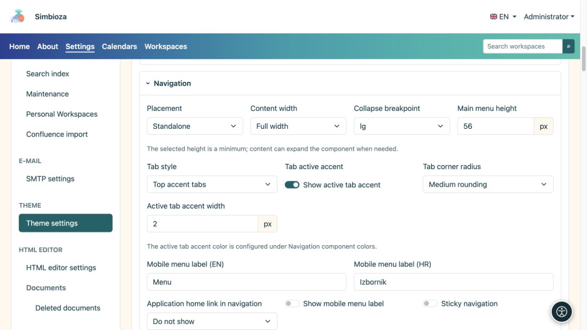
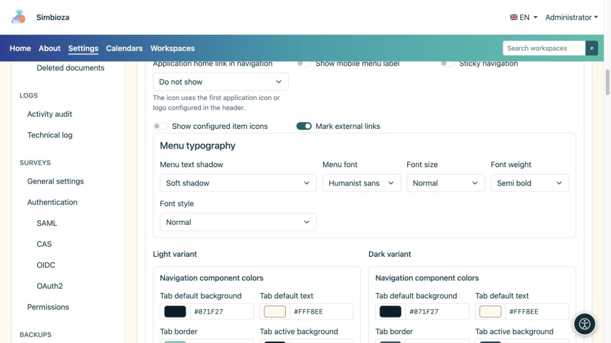
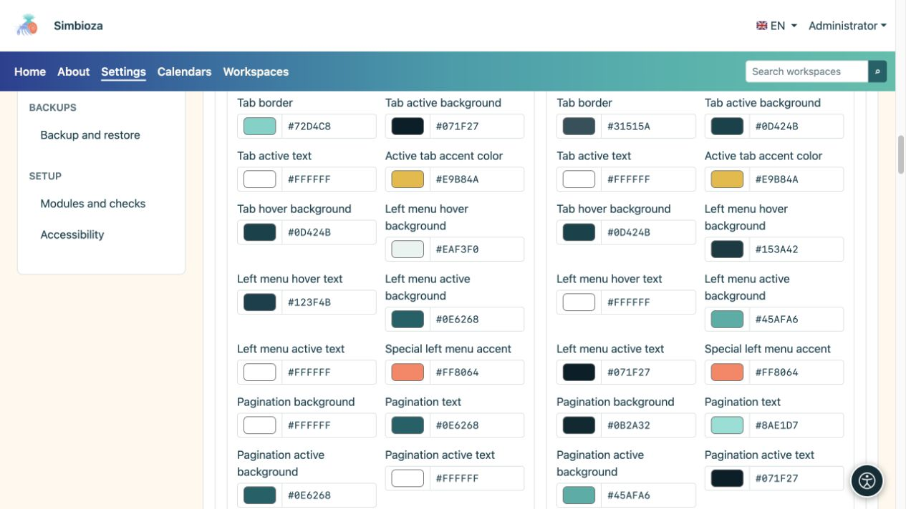

# Configurer l’apparence de la navigation

> Les captures d’écran présentent l’interface en anglais.

[Thèmes](teme_fr.md)

Le thème contrôle l’apparence de la navigation. Pour ajouter des pages, des sous-menus ou des liens, ou décider qui voit un élément, utilisez [Menus](izbornici_fr.md).

## Choisir la position et le comportement

Ouvrez **Navigation** dans l'éditeur de thème.

| Paramètre | Choix disponibles | Effet |
| --- | --- | --- |
| Placement | Autonome / Bandeau principal intérieur | Sa propre bande sous l'en-tête ou la navigation sur l'arrière-plan du bandeau principal. |
| Largeur | Pleine largeur / Large / sm / md / lg / xl / xxl | Les mêmes [familles de conteneurs](teme-zaglavlje_fr.md) que l'en-tête. |
| Point d'arrêt de navigation mobile | sm/md/lg/xl/xxl | En dessous de la taille choisie, la navigation utilise le mode mobile ; un point d'arrêt plus grand le permet plus tôt. |
| Lien d'accueil de l'application dans la navigation | Masqué / Nom de l'application / Icône de l'application | Une marque ou un nom au début de la navigation, pas un nouvel élément de menu arbitraire. |
| Ombre du texte du menu | Aucun / Ombre douce / Contour contrasté | Met en valeur le lettrage sans changer son arrière-plan. |

**Navigation persistante** s'applique uniquement en placement autonome. Il n'est pas disponible à l'intérieur du bandeau principal. **La hauteur du menu principal** est un minimum ; plus d'articles ou des lettres plus grandes peuvent augmenter la bande.

Pour mobile, saisissez une courte étiquette dans les langues disponibles et activez son affichage si vous souhaitez du texte à côté de l'icône. **Afficher les icônes des éléments configurés** et **Marquer les liens externes** contrôlent des indicateurs supplémentaires, pas des destinations.

<figure>

<figcaption>La présentation est distincte des éléments gérés par le module Menus.</figcaption>
</figure>

## Définir la typographie du menu

| Champ | Choix |
| --- | --- |
| Police des menus | Interface utilisateur système / Système arrondi / Sans humaniste / Serif lisible / Monospace |
| Taille de la police | Petit / Normal / Grand / Très grand |
| Poids de la police | Normal / Moyen / Semi-gras / Gras |
| Style de police | Normal / Italique |

Modifiez une valeur et inspectez les étiquettes plus longues. Les très grandes lettres et de nombreux objets nécessitent plus d'espace ; vérifiez l'emballage et la navigation mobile avant d'enregistrer.

<figure>

<figcaption>La navigation peut utiliser une police différente de la police de base du thème.</figcaption>
</figure>

## Couleurs de navigation et d'onglets

Les variantes claires et foncées ont des couleurs distinctes. Configurez les arrière-plans/dégradés des menus, le texte et les éléments actifs, la navigation mobile, le fil d'Ariane, la pagination et le menu latéral. Cinq couleurs dégradées s'étendent de gauche à droite.

Les onglets d'application proposent des choix structurels distincts :

| Champ | Choix |
| --- | --- |
| Style d'onglet | Onglets standards / Onglets avec accent supérieur |
| Coins | Pas d'arrondi / Petit arrondi / Arrondi moyen |

**Afficher l'accent de la tabulation active** et son épaisseur contrôlent l'indicateur de sélection séparément. Les états par défaut, actif et en survol doivent rester distincts. Les onglets de contenu insérés dans HTML Editor ont [leur propre groupe de couleurs](teme-boje-komponente_fr.md), distinct du menu principal.

<figure>

<figcaption>Vérifiez les états actifs ainsi que le menu au repos.</figcaption>
</figure>

**Résultat :** le thème enregistré présente les mêmes éléments avec une nouvelle disposition et de nouvelles couleurs. Vérifiez une vraie page, un sous-menu ouvert, l'élément actif et le mode mobile. Une couleur de thème ne peut pas ajouter un élément manquant en raison de la configuration ou des autorisations d'accès.
