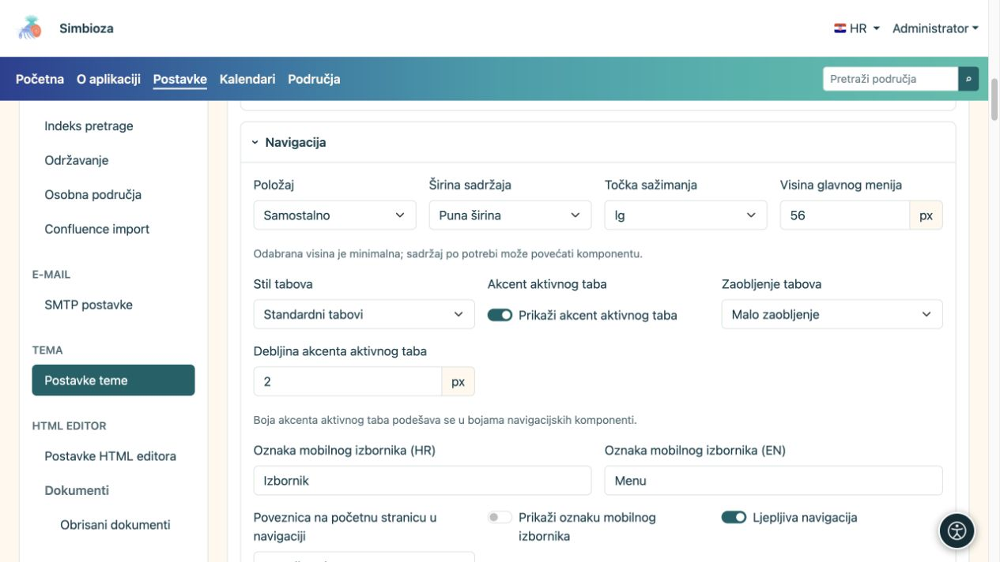
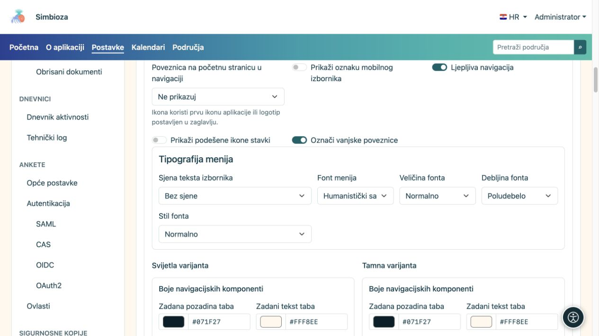
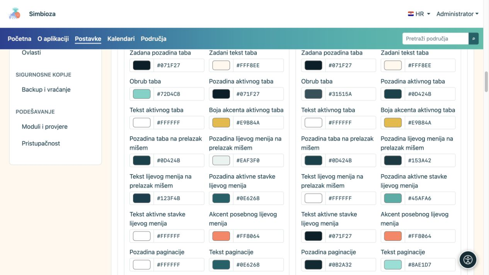

# Podesite izgled navigacije

[Teme](teme_hr.md)

Tema uređuje kako izbornik izgleda. Za dodavanje stranice, podizbornika, poveznice ili ograničenje tko vidi stavku koristite [Izbornike](izbornici_hr.md).

## Odaberite položaj i ponašanje

Otvorite **Navigacija** u editoru teme.

| Postavka | Svi ponuđeni odabiri | Učinak |
| --- | --- | --- |
| Položaj | Samostalno / Unutar hero elementa | Vlastiti pojas ispod zaglavlja ili navigacija na hero podlozi. |
| Širina | Puna širina / Široko / sm / md / lg / xl / xxl | Iste [porodice širina](teme-zaglavlje_hr.md) kao u zaglavlju. |
| Prijelom mobilne navigacije | sm / md / lg / xl / xxl | Ispod odabrane veličine zaslona koristi se mobilni izbornik; veći odabir ranije uključuje mobilni način. |
| Poveznica na početnu stranicu u navigaciji | Ne prikazuj / Naziv aplikacije / Ikona aplikacije | Znak ili naziv na početku navigacije, ne nova proizvoljna stavka izbornika. |
| Sjena teksta izbornika | Bez sjene / Blaga sjena / Kontrastni obrub | Dodatno ističe slova, bez izmjene pozadine. |

**Ljepljiva navigacija** vrijedi samo u samostalnom položaju. Kada je navigacija unutar heroa, taj je izbor nedostupan. **Visina glavnog menija** je minimalna; više stavki ili veća slova mogu povećati pojas.

Za mobitel unesite kratku oznaku na dostupnim jezicima i uključite njezin prikaz ako uz ikonu želite i tekst. Prekidači **Prikaži podešene ikone stavki** i **Označi vanjske poveznice** određuju dodatne oznake; ne mijenjaju odredišta.

<figure>

<figcaption>Odvojite izgled navigacije od sadržaja koji održava modul Izbornici.</figcaption>
</figure>

## Podesite slova izbornika

| Polje | Ponuđeni odabiri |
| --- | --- |
| Font menija | Sistemski UI / Zaobljeni sistemski / Humanistički sans / Čitljivi serif / Monospace |
| Veličina fonta | Malo / Normalno / Veliko / Vrlo veliko |
| Debljina fonta | Normalno / Srednje / Poludebelo / Debelo |
| Stil fonta | Normalno / Kurziv |

Odaberite jednu promjenu i pregledajte dulje stavke. Vrlo velika slova i velik broj stavki traže više mjesta; provjerite prijelom i mobilni izbornik prije spremanja.

<figure>

<figcaption>Font navigacije može se razlikovati od osnovnog fonta cijele teme.</figcaption>
</figure>

## Boje navigacije i tabova

Svijetla i tamna varijanta imaju zasebne boje. Podesite pozadinu/gradijent izbornika, boju slova i aktivne stavke, mobilni izbornik te komponente kao što su breadcrumbs, paginacija i lijevi meni. Pet boja gradijenta slaže se s lijeva na desno.

Za aplikacijske tabove postoje odvojeni izbori:

| Polje | Ponuđeni odabiri |
| --- | --- |
| Stil tabova | Standardni tabovi / Tabovi s gornjim akcentom |
| Zaobljenje | Bez zaobljenja / Malo zaobljenje / Srednje zaobljenje |

**Prikaži akcent aktivnog taba** i njegova debljina zasebno podešavaju oznaku izbora. Boje zadane i aktivne stavke te stavke pri prelasku pokazivačem moraju ostati međusobno prepoznatljive. Sadržajni tabovi koje autor umeće u HTML editor imaju [vlastitu grupu boja](teme-boje-komponente_hr.md), odvojenu od glavnog izbornika.

<figure>

<figcaption>Podesite i aktivno stanje; nemojte procjenjivati samo mirni prikaz izbornika.</figcaption>
</figure>

**Rezultat:** spremljena tema prikazuje iste stavke novim rasporedom i bojama. Provjerite stvarnu stranicu, otvoren podizbornik, aktivnu stavku i mobilni prikaz. Ako stavka nedostaje zbog ovlasti ili nije postavljena, boja teme je neće dodati.
