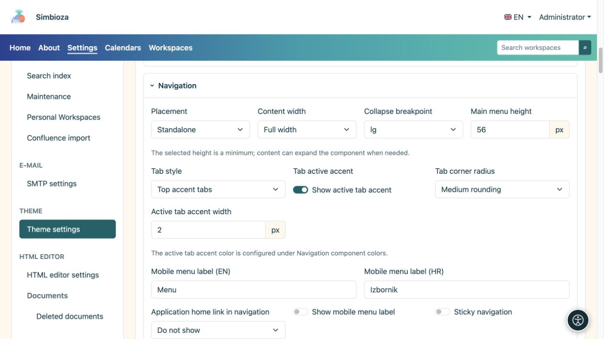
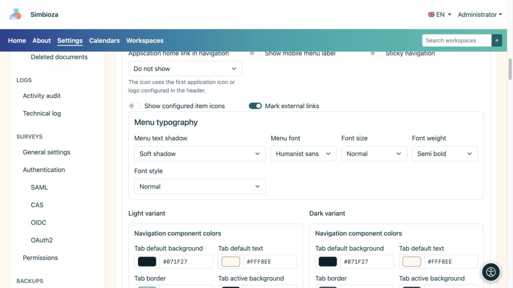
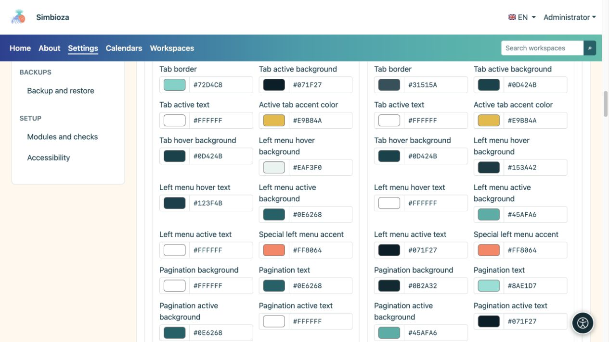

# Configura l'aspetto della navigazione

> Le schermate mostrano l’interfaccia in inglese.

[Temi](teme_it.md)

Il tema controlla l'aspetto della navigazione. Per aggiungere pagine, sottomenu o collegamenti oppure decidere chi può vedere un elemento, utilizzare [Menu](izbornici_it.md).

## Scegli posizione e comportamento

Apri **Navigazione** nell'editor del tema.

| Impostazione | Scelte disponibili | Effetto |
| --- | --- | --- |
| Posizionamento | Separata / All'interno della sezione principale | Una barra propria sotto l'intestazione oppure la navigazione sullo sfondo della sezione principale. |
| Larghezza | Larghezza intera / Largo / sm / md / lg / xl / xxl | Le stesse [famiglie di contenitori](teme-zaglavlje_it.md) dell'intestazione. |
| Soglia per la navigazione mobile | sm/md/lg/xl/xxl | Al di sotto della dimensione scelta, la navigazione usa la modalità mobile; una soglia più grande la attiva prima. |
| Collegamento alla home dell'applicazione nella navigazione | Nascosto/Nome dell'applicazione/Icona dell'applicazione | Un marchio o un nome all'inizio della navigazione, non una nuova voce di menu arbitraria. |
| Ombra del testo del menu | Nessuno/Ombra morbida/Contorno contrastato | Enfatizza i caratteri senza modificarne lo sfondo. |

**Navigazione fissa** si applica soltanto alla posizione separata. Non è disponibile all'interno della sezione principale. **Altezza del menu principale** è un valore minimo; più elementi o caratteri più grandi possono aumentare l'altezza della barra.

Per i dispositivi mobili, inserisci una breve etichetta nelle lingue disponibili e abilita la sua visualizzazione se desideri del testo accanto all'icona. **Mostra icone degli elementi configurati** e **Segna collegamenti esterni** controllano indicatori aggiuntivi, non destinazioni.

<figure>

<figcaption>La presentazione è separata dagli elementi gestiti dal modulo Menu.</figcaption>
</figure>

## Imposta la tipografia del menu

| Campo | Scelte |
| --- | --- |
| Carattere del menu | Interfaccia di sistema / Sistema arrotondato / Sans umanista / Serif leggibile / Monospazio |
| Dimensione del carattere | Piccolo/Normale/Grande/Extra grande |
| Peso del carattere | Normale / Medio / Semigrassetto / Grassetto |
| Stile del carattere | Normale/corsivo |

Cambia un valore e controlla le etichette più lunghe. Caratteri molto grandi e numerosi elementi richiedono più spazio; verifica gli elementi che vanno a capo e la navigazione mobile prima di salvare.

<figure>

<figcaption>La navigazione potrebbe utilizzare un carattere diverso dal carattere di base del tema.</figcaption>
</figure>

## Colori della navigazione e delle schede

Le varianti chiare e scure hanno colori separati. Configura sfondi/sfumature dei menu, testo ed elementi attivi, navigazione mobile, breadcrumb, impaginazione e menu laterale. Cinque colori sfumati vanno da sinistra a destra.

Le schede dell'applicazione hanno scelte strutturali separate:

| Campo | Scelte |
| --- | --- |
| Stile scheda | Schede standard/Schede con accento principale |
| Angoli | Nessun arrotondamento / Arrotondamento piccolo / Arrotondamento medio |

**Mostra accento della scheda attiva** e il suo spessore controllano separatamente l'indicatore di selezione. Gli stati predefinito, attivo e al passaggio del mouse devono rimanere distinguibili. Le schede dei contenuti inserite nell'editor HTML hanno un [proprio gruppo di colori](teme-boje-komponente_it.md), separato dal menu principale.

<figure>

<figcaption>Controlla gli stati attivi e il menu a riposo.</figcaption>
</figure>

**Risultato:** il tema salvato presenta gli stessi elementi con un nuovo layout e colori. Controlla una pagina reale, un sottomenu aperto, l'elemento attivo e la modalità mobile. Un colore del tema non può aggiungere un elemento mancante a causa della configurazione o delle autorizzazioni di accesso.
