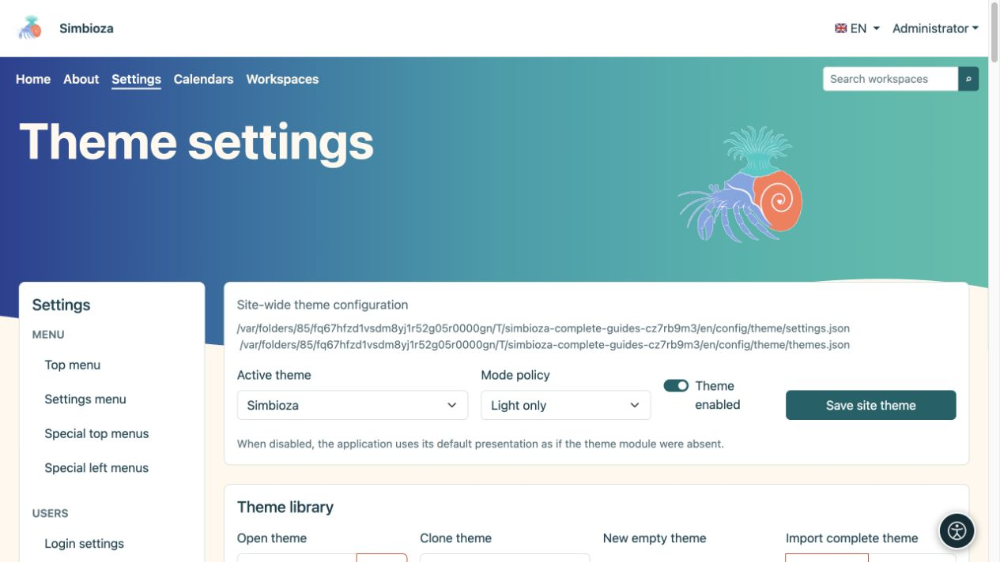
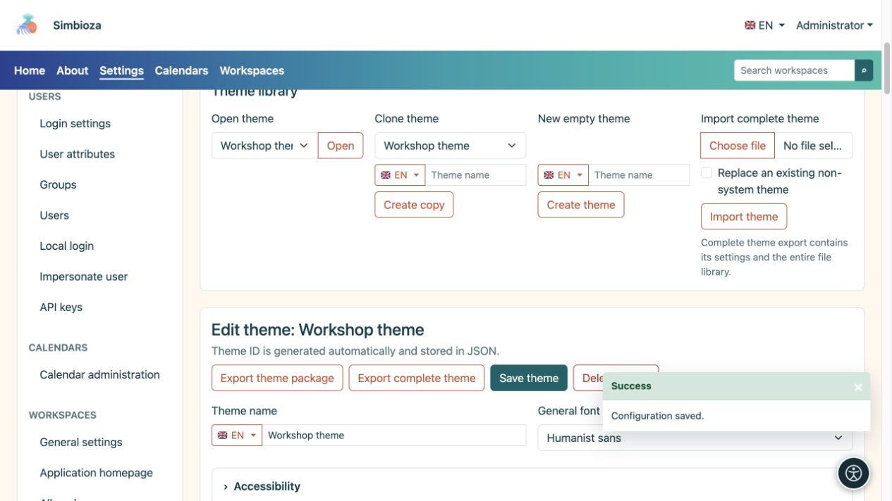
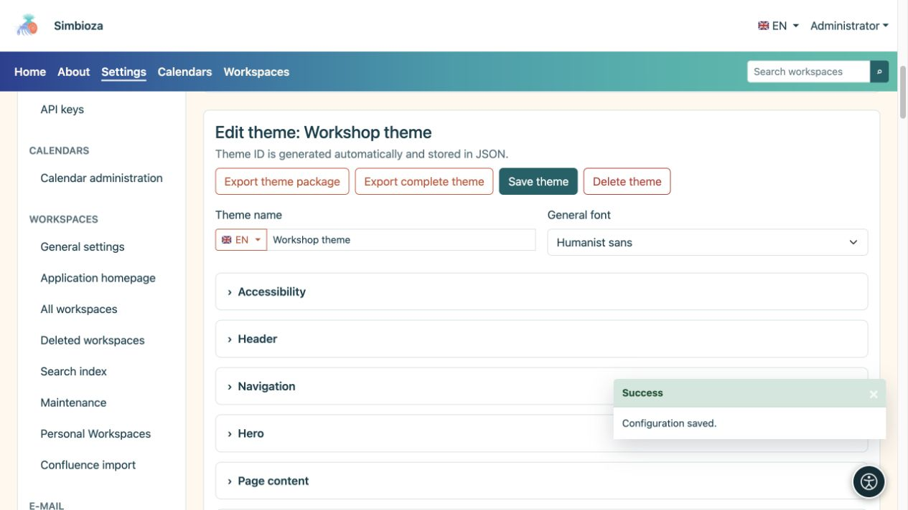
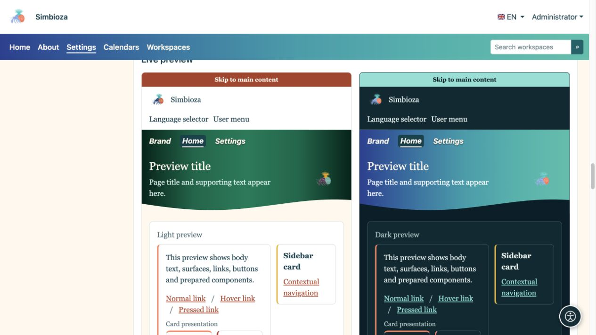
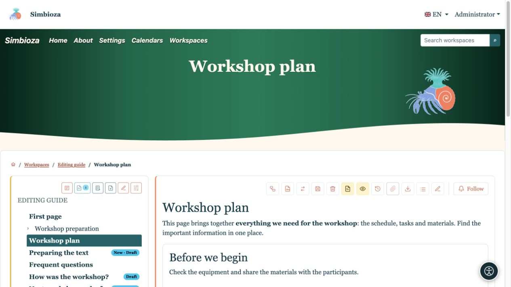
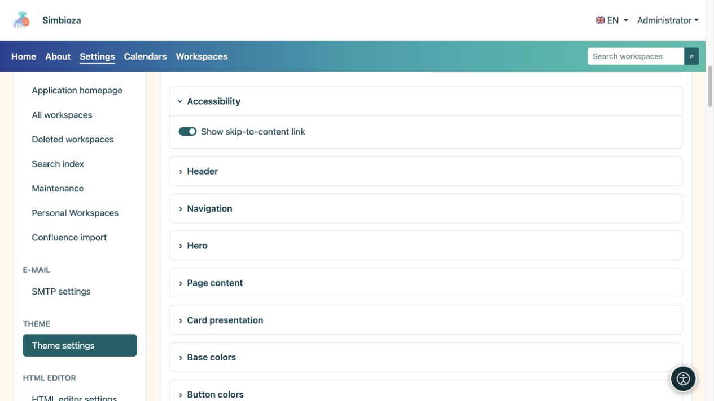

# Ein Design auswählen oder eine eigene Kopie erstellen

> Die Bildschirmaufnahmen zeigen die englische Benutzeroberfläche.

[Designs](teme_de.md)

**Für:** Administratoren; Arbeitsbereichsmanager verwenden ihren separaten Arbeitsbereichs-Designeditor. Sie müssen zunächst weder Code noch Konfigurationsdateien bearbeiten.

## Wenden Sie ein vorhandenes Design an

1. Öffnen Sie **Einstellungen → Design-Einstellungen**.
2. Wählen Sie oben das **Aktive Design**.
3. Wählen Sie die **Modusrichtlinie** anhand der folgenden Tabelle aus.
4. Lassen Sie **Design aktiviert** aktiviert, um die Designtische Präsentation zu verwenden.
5. Wählen Sie **Site-Design speichern** und öffnen Sie die Startseite oder eine andere echte Seite.

| Modusrichtlinie | Wirkung |
| --- | --- |
| Automatisch | Unterstützt helles und dunkles Erscheinungsbild; Verwendet die persönliche Auswahl, sofern verfügbar, ansonsten die Systemeinstellung. |
| Nur Licht | Die Installation nutzt die helle Variante; die persönliche Auswahl kann diese Richtlinie nicht außer Kraft setzen. |
| Nur dunkel | Die Installation nutzt die dunkle Variante; die persönliche Auswahl kann diese Richtlinie nicht außer Kraft setzen. |

**Ergebnis:** Die Installation verwendet das ausgewählte Design und die ausgewählte Anzeigerichtlinie. Durch Deaktivieren von **Design aktiviert** wird die Standardpräsentation der Anwendung wiederhergestellt. Der Administratorbildschirm bleibt verfügbar, um ihn erneut zu aktivieren.

<figure>

<figcaption>Dieses Formular ändert die Site-Auswahl unabhängig von der Bearbeitung eines Designs.</figcaption>
</figure>

## Kopieren Sie ein Design, bevor Sie es anpassen

1. Wählen Sie in der **Designbibliothek** unter **Design klonen** das nächstgelegene vorhandene Design aus.
2. Geben Sie einen Namen ein, z. B. **Workshop-Design**. Verwenden Sie die Flaggenauswahl, um den Namen bei Bedarf in einer anderen verfügbaren Sprache einzugeben.
3. Wählen Sie **Kopie erstellen**.
4. Überprüfen Sie, ob der Editor den Namen Ihrer Kopie anzeigt, bevor Sie Änderungen vornehmen.

**Ergebnis:** Sie haben ein separates Design; das Original bleibt erhalten. Durch das Öffnen, Kopieren oder Bearbeiten eines Designs wird es nicht global ausgewählt. Um die gespeicherte Kopie anzuwenden, wählen Sie sie oben als **Aktives Design** aus und speichern Sie die Site-Einstellungen.

**Design öffnen → Öffnen** wählt aus, was Sie bearbeiten. **Neues leeres Design → Design erstellen** beginnt mit Standardwerten. **Komplettes Design importieren** überträgt ein vorbereitetes ZIP; siehe [Dateien und Export](teme-datoteke_de.md).

<figure>

<figcaption>Erstellen Sie eine benannte Kopie, bevor Sie Ihr eigenes Erscheinungsbild entwickeln.</figcaption>
</figure>

## Ändern Sie den Namen und die Basisschriftart

Der Designsame und andere mehrsprachige Textfelder verfügen über eine Sprachauswahl. Wählen Sie eine Sprache, geben Sie den Text ein und speichern Sie das Design. Dadurch wird keine Übersetzung Ihres Seiteninhalts erstellt.

| Schriftart | Wirkung und Verwendung |
| --- | --- |
| System-Benutzeroberfläche | Ein vertrautes Erscheinungsbild basierend auf dem Betriebssystem. |
| Abgerundetes System | Weichere Buchstabenformen, sofern das System sie bereitstellt. |
| Humanistische Sans | Einfache Business-Typografie ohne Serifen. |
| Lesbare Serife | Buchstaben mit deutlichen Schlussstrichen für einen redaktionellen oder buchähnlichen Eindruck. |
| Monospace | Gleich breite Zeichen für ein technisches oder Retro-Feeling. |

Da es sich hierbei um verfügbare Schriftfamilien handelt, kann das genaue Erscheinungsbild je nach Gerät variieren. Die Menütypografie wird separat unter [Navigation](teme-navigacija_de.md) konfiguriert.

<figure>

<figcaption>Speichern Sie das geöffnete Design hier. Wählen Sie das aktive Design im separaten globalen Formular aus.</figcaption>
</figure>

## Vorschau, Speichern und Überprüfen

Öffnen Sie den gewünschten Einstellungsbereich. Die Vorschauen unterhalb des Editors werden aktualisiert, wenn sich die Werte ändern. **Design speichern** speichert Einstellungen in allen Abschnitten; für das Hochladen und Löschen von Dateien werden separate Aktionen verwendet. Öffnen Sie nach dem Speichern erneut eine echte Seite.

Wählen Sie beispielsweise **Lesbare Serife** auf der Kopie aus, platzieren Sie die Navigation innerhalb des Hero-Bereichs und schreiben Sie den Text kursiv. Die Vorschau zeigt die Richtung der Änderung; eine echte Seite zeigt ihre Wirkung auf Überschriften, Langtext und Navigation.

<figure>

<figcaption>Die Vorschau kombiniert Typografie- und Navigationspositionsänderungen.</figcaption>
</figure>

<figure>

<figcaption>Die gleichen Einstellungen für echte Inhalte: Serifentyp, Anwendungsname und kursive Navigation.</figcaption>
</figure>

## Zugänglichkeit und Rückkehr zu einem vertrauten Design

Lassen Sie **Link zum Inhalt anzeigen** aktiviert: Dies hilft Tastaturbenutzern, wiederholte Navigation zu vermeiden. Überprüfen Sie den sichtbaren Fokus, die Lesbarkeit und beide Anzeigemodi. Textschatten können einem farbenfrohen Hero-Bereich helfen, ersetzen jedoch nicht die entsprechende Textfarbe.

<figure>

<figcaption>Der Link unterstützt die Tastaturnavigation, anstatt die Seite zu schmücken.</figcaption>
</figure>

Um zurückzukehren, wählen Sie das zuvor aktive Design aus und speichern Sie die globalen Einstellungen. Sie können ein Benutzerdesign löschen, es sei denn, es ist als Systemdesign geschützt. Das letzte verbleibende Design kann nicht gelöscht werden. Durch das Löschen eines aktiven Benutzerdesigns wird ein sicherer Ersatz ausgewählt. Behalten Sie zunächst Ihre eigene Kopie mit einem [vollständigen Export](teme-datoteke_de.md).
