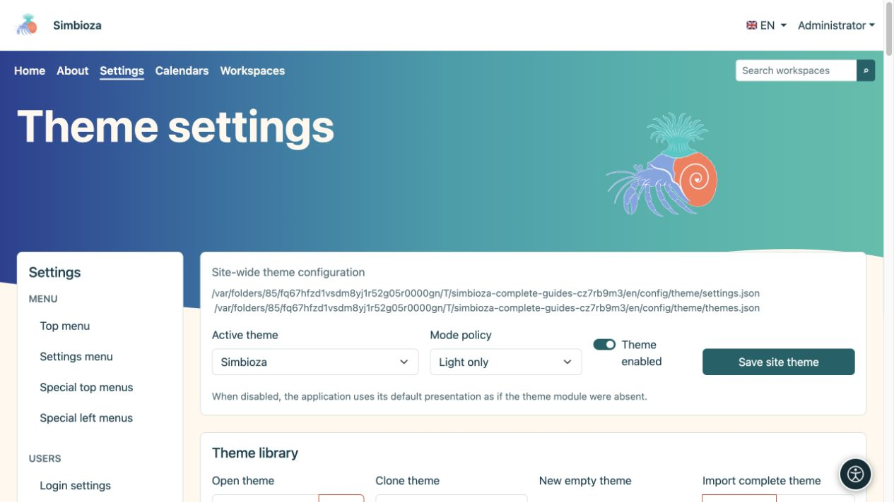
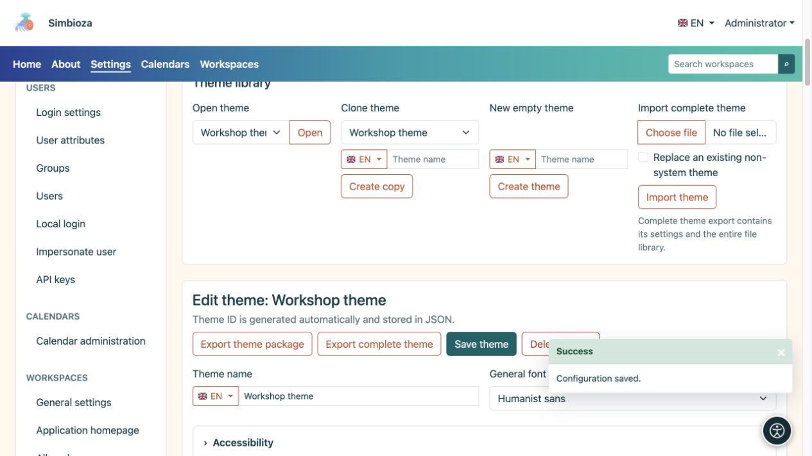
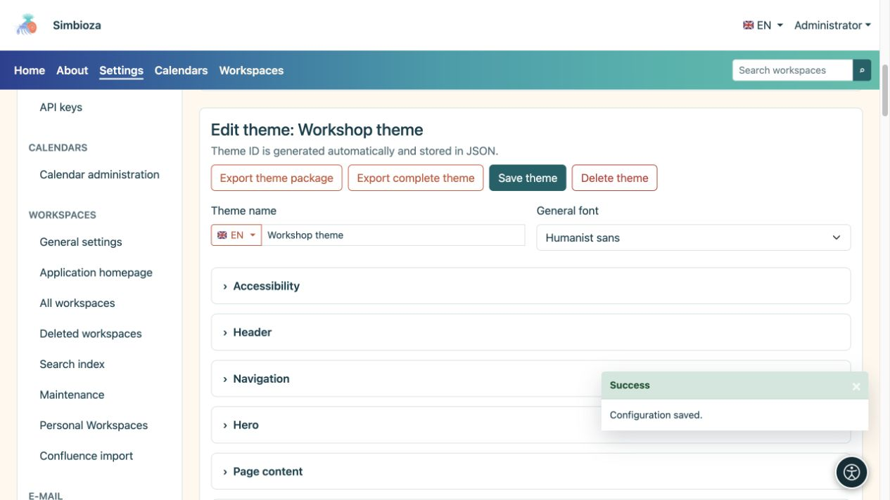
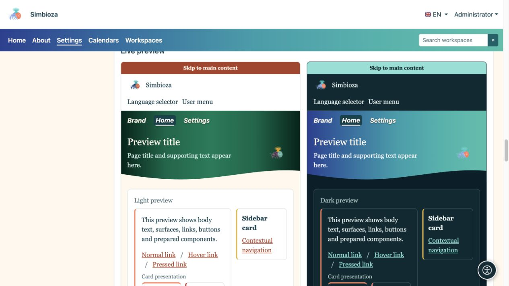
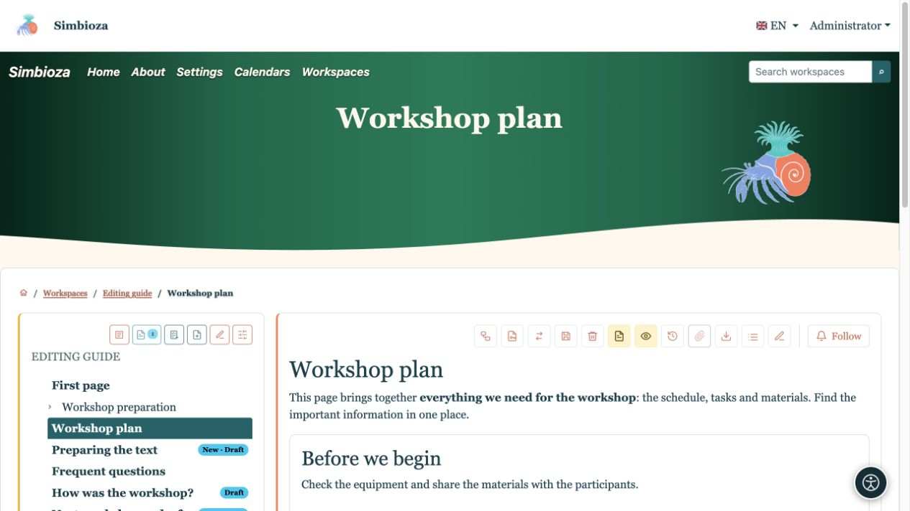
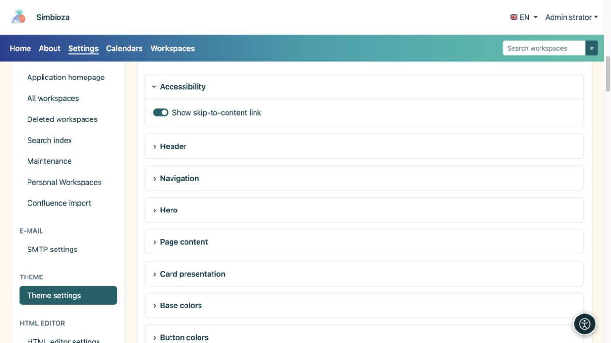

# Choose a theme or make your own copy

[Themes](teme_en.md)

**For:** administrators; workspace managers use their separate workspace theme editor. You do not need to edit code or configuration files to begin.

## Apply an existing theme

1. Open **Settings → Theme settings**.
2. Choose the **Active theme** at the top.
3. Choose the **Mode policy** using the table below.
4. Keep **Theme enabled** on to use themed presentation.
5. Select **Save site theme** and open Home or another real page.

| Mode policy | Effect |
| --- | --- |
| Automatic | Supports light and dark appearance; uses personal selection where available, otherwise the system setting. |
| Light only | The installation uses the light variant; personal selection cannot override this policy. |
| Dark only | The installation uses the dark variant; personal selection cannot override this policy. |

**Result:** the installation uses the selected theme and display policy. Disabling **Theme enabled** restores the application's default presentation; the administrator screen remains available to enable it again.

<figure>

<figcaption>This form changes the site selection separately from editing a theme.</figcaption>
</figure>

## Copy a theme before customising it

1. In **Theme library**, choose the closest existing design under **Clone theme**.
2. Enter a name, such as **Workshop theme**. Use the flag selector to enter its name in another available language if needed.
3. Select **Create copy**.
4. Check that the editor shows your copy's name before making changes.

**Result:** you have a separate theme; the original is retained. Opening, copying or editing a theme does not select it globally. To apply the saved copy, choose it as the **Active theme** above and save the site settings.

**Open theme → Open** selects what you edit. **New empty theme → Create theme** starts with default values. **Import complete theme** transfers a prepared ZIP; see [Files and export](teme-datoteke_en.md).

<figure>

<figcaption>Create a named copy before developing your own appearance.</figcaption>
</figure>

## Change the name and base font

The theme name and other multilingual text fields have a language selector. Choose a language, enter its text and save the theme. This does not create a translation of your page content.

| Font | Effect and use |
| --- | --- |
| System UI | A familiar appearance based on the operating system. |
| Rounded system | Softer letter shapes where the system provides them. |
| Humanist sans | Straightforward business typography without serifs. |
| Readable serif | Letters with distinct finishing strokes, for an editorial or book-like feel. |
| Monospace | Equal-width characters, for a technical or retro feel. |

These are available font families, so the exact appearance may vary between devices. Menu typography is configured separately under [Navigation](teme-navigacija_en.md).

<figure>

<figcaption>Save the open theme here; choose the active theme in the separate global form.</figcaption>
</figure>

## Preview, save and check

Open the settings section you need. Previews below the editor update as values change. **Save theme** saves settings across its sections; uploading and deleting files use separate actions. After saving, open a real page again.

For example, select **Readable serif** on the copy, place navigation inside the hero and make its type italic. Preview shows the direction of the change; a real page shows its effect on headings, long text and navigation.

<figure>

<figcaption>The preview combines typography and navigation-position changes.</figcaption>
</figure>

<figure>

<figcaption>The same settings on real content: serif type, application name and italic navigation.</figcaption>
</figure>

## Accessibility and returning to a familiar design

Keep **Show skip-to-content link** enabled: it helps keyboard users bypass repeated navigation. Check visible focus, readability and both display modes. Text shadow can help over a colourful hero but does not replace an appropriate text colour.

<figure>

<figcaption>The link assists keyboard navigation rather than decorating the page.</figcaption>
</figure>

To return, choose the previous active theme and save global settings. You may delete a user theme unless it is protected as a system theme; the last remaining theme cannot be deleted. Deleting an active user theme selects a safe replacement. Keep your own copy with a [complete export](teme-datoteke_en.md) first.
