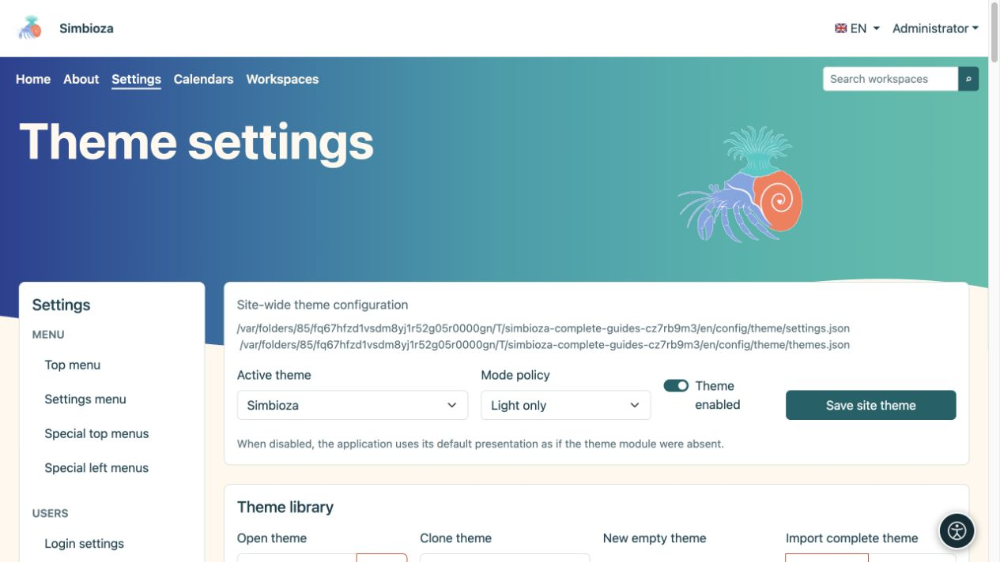
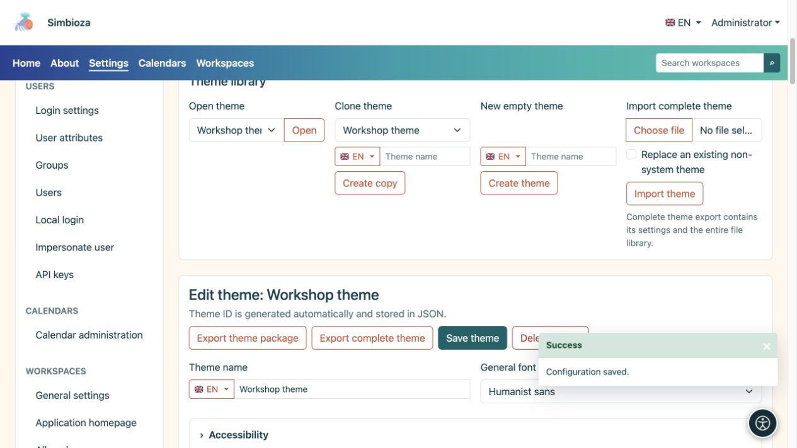
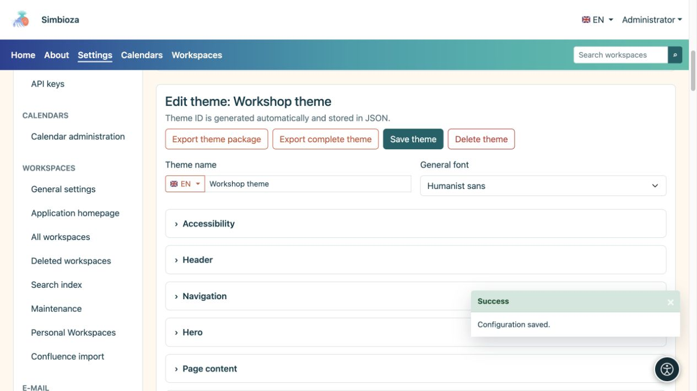
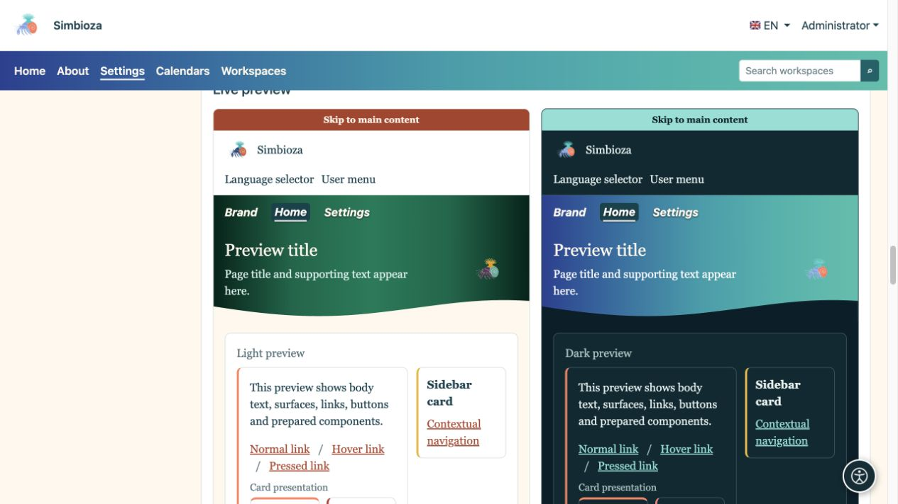
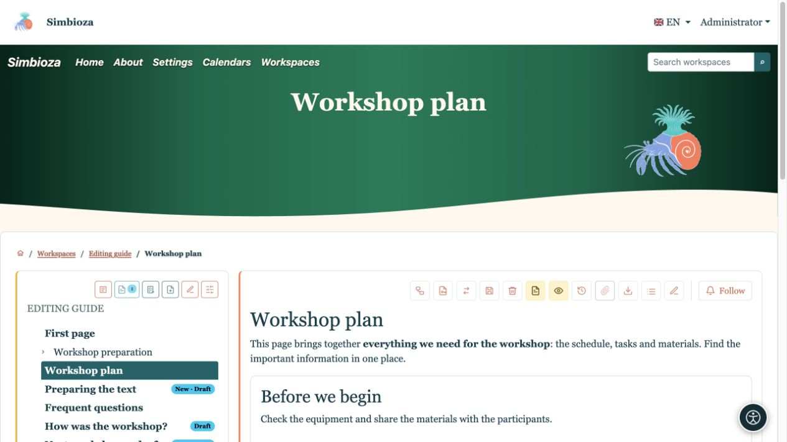
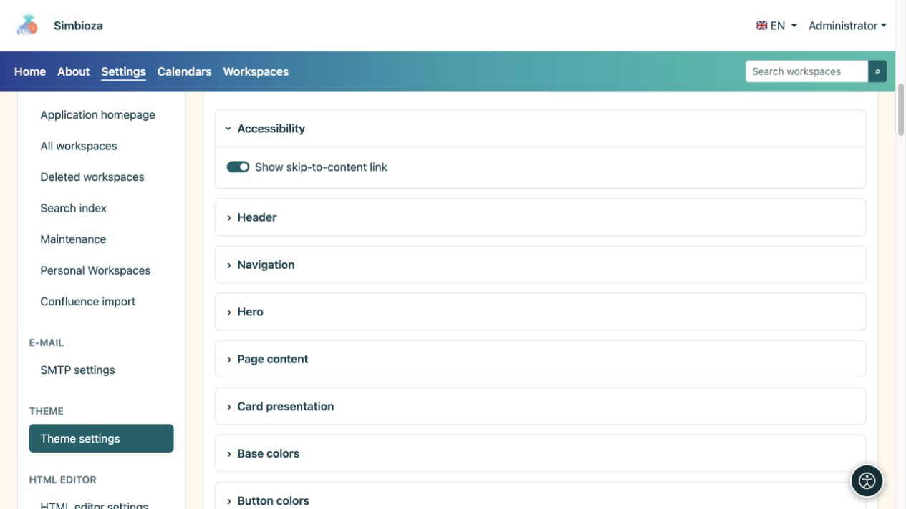

# Elegir un tema o crear una copia propia

> Las capturas de pantalla muestran la interfaz en inglés.

[Temas](teme_es.md)

**Para:** administradores; Los gestores del espacio de trabajo utilizan su editor de temas de espacio de trabajo independiente. No es necesario editar el código ni los archivos de configuración para comenzar.

## Aplicar un tema existente

1. Abra **Configuración → Configuración del tema**.
2. Elija el **Tema activo** en la parte superior.
3. Elija la **Política de modo** usando la siguiente tabla.
4. Mantenga **Tema habilitado** activado para usar presentaciones temáticas.
5. Seleccione **Guardar tema del sitio** y abra Inicio u otra página real.

| Política de modo | Efecto |
| --- | --- |
| Automático | Soporta apariencia clara y oscura; utiliza la selección personal cuando esté disponible; de ​​lo contrario, la configuración del sistema. |
| Solo claro | La instalación utiliza la variante ligera; La selección personal no puede anular esta política. |
| Solo oscuro | La instalación utiliza la variante oscura; La selección personal no puede anular esta política. |

**Resultado:** la instalación utiliza el tema y la política de visualización seleccionados. Al desactivar **Tema habilitado** se restaura la presentación predeterminada de la aplicación; la pantalla del administrador permanece disponible para habilitarlo nuevamente.

<figure>

<figcaption>Este formulario cambia la selección del sitio por separado de la edición de un tema.</figcaption>
</figure>

## Copia un tema antes de personalizarlo

1. En **Biblioteca de temas**, elija el diseño existente más cercano en **Clonar tema**.
2. Introduzca un nombre, como **Tema del taller**. Utilice el selector de banderas para ingresar su nombre en otro idioma disponible si es necesario.
3. Seleccione **Crear copia**.
4. Verifique que el editor muestre el nombre de su copia antes de realizar cambios.

**Resultado:** tiene un tema independiente; se conserva el original. Abrir, copiar o editar un tema no lo selecciona globalmente. Para aplicar la copia guardada, selecciónela como **Tema activo** arriba y guarde la configuración del sitio.

**Abrir tema → Abrir** selecciona lo que editas. **Nuevo tema vacío → Crear tema** comienza con los valores predeterminados. **Importar tema completo** transfiere un ZIP preparado; consulte [Archivos y exportación](teme-datoteke_es.md).

<figure>

<figcaption>Crea una copia con nombre antes de desarrollar su propia apariencia.</figcaption>
</figure>

## Cambiar el nombre y la fuente base

El nombre del tema y otros campos de texto multilingües tienen un selector de idioma. Elija un idioma, ingrese su texto y guarde el tema. Esto no crea una traducción del contenido de su página.

| Fuente | Efecto y uso |
| --- | --- |
| Interfaz de usuario del sistema | Una apariencia familiar basada en el sistema operativo. |
| Sistema redondeado | Formas de letras más suaves donde el sistema las proporciona. |
| Sans humanista | Tipografía empresarial sencilla y sin serifas. |
| Serif legible | Letras con distintos trazos finales, para una sensación editorial o de libro. |
| monoespacio | Caracteres de igual ancho, para una sensación técnica o retro. |

Estas son familias de fuentes disponibles, por lo que la apariencia exacta puede variar entre dispositivos. La tipografía del menú se configura por separado en [Navegación](teme-navigacija_es.md).

<figure>

<figcaption>Guarde el tema abierto aquí; elija el tema activo en el formulario global separado.</figcaption>
</figure>

## Vista previa, guardar y comprobar

Abra la sección de configuración que necesita. Las vistas previas debajo del editor se actualizan a medida que cambian los valores. **Guardar tema** guarda la configuración en todas sus secciones; cargar y eliminar archivos utiliza acciones separadas. Después de guardar, abra nuevamente una página real.

Por ejemplo, seleccione **Serif legible** en la copia, coloque la navegación dentro del elemento principal y escriba en cursiva. La vista previa muestra la dirección del cambio; una página real muestra su efecto en los títulos, el texto extenso y la navegación.

<figure>

<figcaption>La vista previa combina cambios de tipografía y posición de navegación.</figcaption>
</figure>

<figure>

<figcaption>Las mismas configuraciones en contenido real: tipo serif, nombre de la aplicación y navegación en cursiva.</figcaption>
</figure>

## Accesibilidad y vuelta a un diseño familiar

Mantenga habilitado **Mostrar enlace para saltar al contenido**: ayuda a los usuarios del teclado a evitar la navegación repetida. Verifique el enfoque visible, la legibilidad y ambos modos de visualización. La sombra del texto puede ayudar a un elemento principal colorido, pero no reemplaza el color de texto apropiado.

<figure>

<figcaption>El enlace ayuda a la navegación con el teclado en lugar de decorar la página.</figcaption>
</figure>

Para regresar, elija el tema activo anterior y guarde la configuración global. Puede eliminar un tema de usuario a menos que esté protegido como tema del sistema; el último tema restante no se puede eliminar. Al eliminar un tema de usuario activo, se selecciona un reemplazo seguro. Guarde su propia copia con una [exportación completa](teme-datoteke_es.md) primero.
