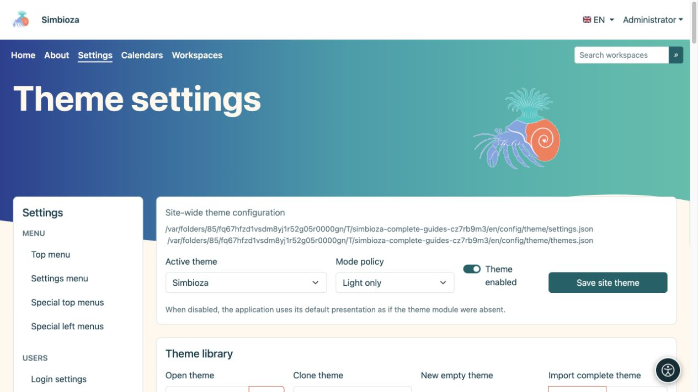
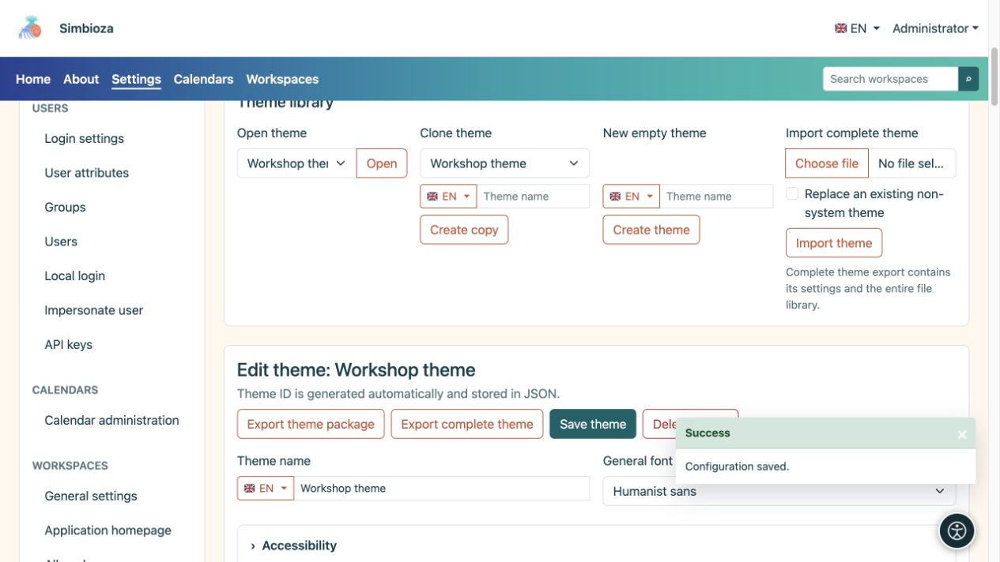
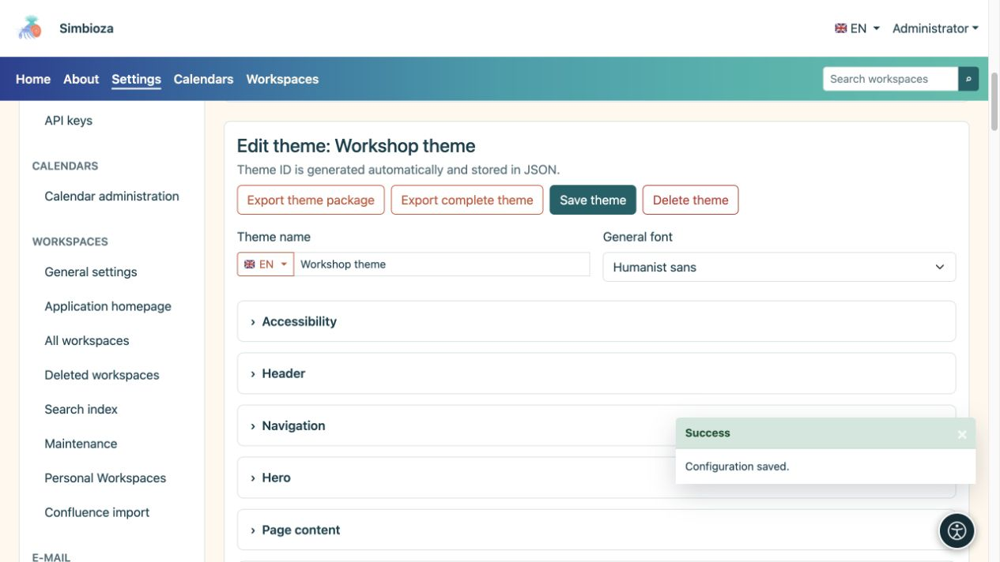
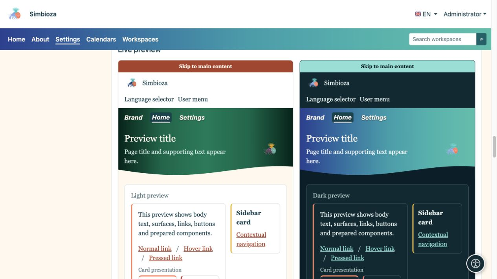
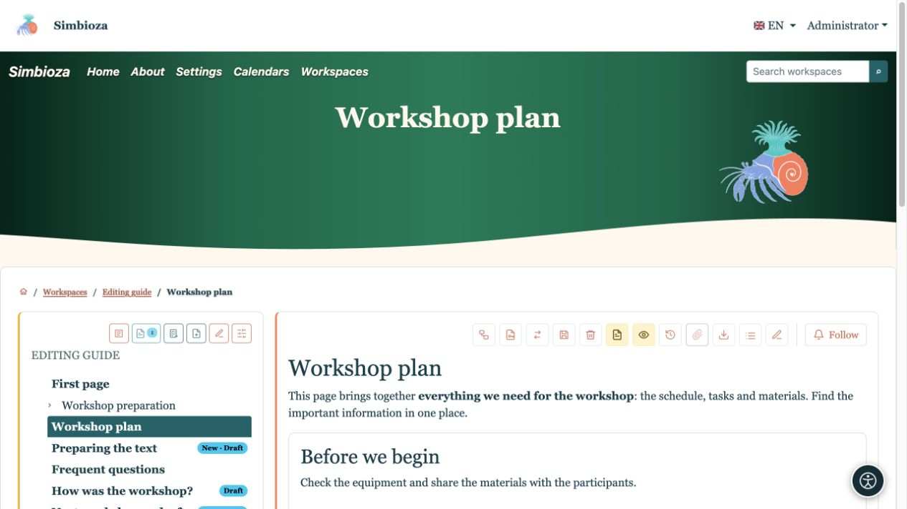
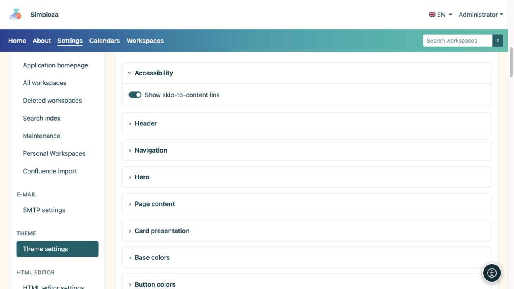

# Choisir un thème ou créer votre propre copie

> Les captures d’écran présentent l’interface en anglais.

[Thèmes](teme_fr.md)

**Pour :** les administrateurs ; les gestionnaires d'espace de travail utilisent leur éditeur de thème d'espace de travail distinct. Vous n'avez pas besoin de modifier le code ou les fichiers de configuration pour commencer.

## Appliquer un thème existant

1. Ouvrez **Paramètres → Paramètres du thème**.
2. Choisissez le **Thème actif** en haut.
3. Choisissez la **stratégie de mode** à l'aide du tableau ci-dessous.
4. Laissez **Thème activé** activé pour utiliser la présentation thématique.
5. Sélectionnez **Enregistrer le thème du site** et ouvrez Accueil ou une autre page réelle.

| Politique de mode | Effet |
| --- | --- |
| Automatique | Prend en charge l'apparence claire et sombre ; utilise la sélection personnelle lorsqu'elle est disponible, sinon le paramètre système. |
| Lumière seulement | L'installation utilise la variante lumineuse ; la sélection personnelle ne peut pas outrepasser cette politique. |
| Sombre seulement | L'installation utilise la variante sombre ; la sélection personnelle ne peut pas outrepasser cette politique. |

**Résultat :** l'installation utilise le thème et la politique d'affichage sélectionnés. La désactivation de **Thème activé** restaure la présentation par défaut de l'application ; l'écran administrateur reste disponible pour le réactiver.

<figure>

<figcaption>Ce formulaire modifie la sélection du site séparément de la modification d'un thème.</figcaption>
</figure>

## Copiez un thème avant de le personnaliser

1. Dans **Bibliothèque de thèmes**, choisissez le design existant le plus proche sous **Thème Cloner**.
2. Saisissez un nom, tel que **Thème de l'atelier**. Utilisez le sélecteur de drapeau pour saisir son nom dans une autre langue disponible si nécessaire.
3. Sélectionnez **Créer une copie**.
4. Vérifiez que l'éditeur affiche le nom de votre copie avant d'apporter des modifications.

**Résultat :** vous avez un thème distinct ; l'original est conservé. Ouvrir, copier ou modifier un thème ne le sélectionne pas globalement. Pour appliquer la copie enregistrée, choisissez-la comme **Thème actif** ci-dessus et enregistrez les paramètres du site.

**Ouvrir le thème → Ouvrir** sélectionne ce que vous modifiez. **Nouveau thème vide → Créer un thème** commence avec les valeurs par défaut. **Importer le thème complet** transfère un ZIP préparé ; voir [Fichiers et export](teme-datoteke_fr.md).

<figure>

<figcaption>Créez une copie nommée avant de développer votre propre apparence.</figcaption>
</figure>

## Changer le nom et la police de base

Le nom du thème et les autres champs de texte multilingues disposent d'un sélecteur de langue. Choisissez une langue, saisissez son texte et enregistrez le thème. Cela ne crée pas de traduction du contenu de votre page.

| Fonte | Effet et utilisation |
| --- | --- |
| Interface utilisateur du système | Une apparence familière basée sur le système d’exploitation. |
| Système arrondi | Formes de lettres plus douces là où le système les propose. |
| Humaniste sans | Typographie commerciale simple sans empattements. |
| Serif lisible | Des lettres avec des traits de finition distincts, pour une sensation éditoriale ou de livre. |
| Monospace | Caractères de même largeur, pour un côté technique ou rétro. |

Il s'agit de familles de polices disponibles, leur apparence exacte peut donc varier d'un appareil à l'autre. La typographie du menu est configurée séparément sous [Navigation](teme-navigacija_fr.md).

<figure>

<figcaption>Enregistrez le thème ouvert ici ; choisissez le thème actif dans le formulaire global séparé.</figcaption>
</figure>

## Prévisualiser, enregistrer et vérifier

Ouvrez la section des paramètres dont vous avez besoin. Les aperçus sous l'éditeur sont mis à jour à mesure que les valeurs changent. **Enregistrer le thème** enregistre les paramètres dans ses sections ; le téléchargement et la suppression de fichiers utilisent des actions distinctes. Après avoir enregistré, ouvrez à nouveau une vraie page.

Par exemple, sélectionnez **Readable serif** sur la copie, placez la navigation à l'intérieur du bandeau principal et mettez son type en italique. L'aperçu montre la direction du changement ; une vraie page montre son effet sur les titres, le texte long et la navigation.

<figure>

<figcaption>L'aperçu combine les changements de typographie et de position de navigation.</figcaption>
</figure>

<figure>

<figcaption>Les mêmes paramètres sur le contenu réel : type serif, nom de l'application et navigation en italique.</figcaption>
</figure>

## Accessibilité et retour à un design familier

Gardez **Afficher le lien d'accès au contenu** activé : cela aide les utilisateurs du clavier à éviter la navigation répétée. Vérifiez la mise au point visible, la lisibilité et les deux modes d'affichage. L'ombre du texte peut aider sur un bandeau principal coloré mais ne remplace pas une couleur de texte appropriée.

<figure>

<figcaption>Le lien facilite la navigation au clavier plutôt que de décorer la page.</figcaption>
</figure>

Pour revenir, choisissez le thème actif précédent et enregistrez les paramètres globaux. Vous pouvez supprimer un thème utilisateur à moins qu'il ne soit protégé en tant que thème système ; le dernier thème restant ne peut pas être supprimé. La suppression d'un thème utilisateur actif sélectionne un remplacement sûr. Conservez d'abord votre propre copie avec un [export complet](teme-datoteke_fr.md).
