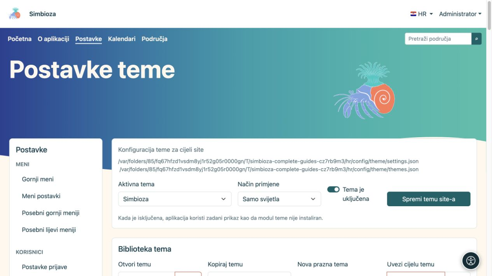
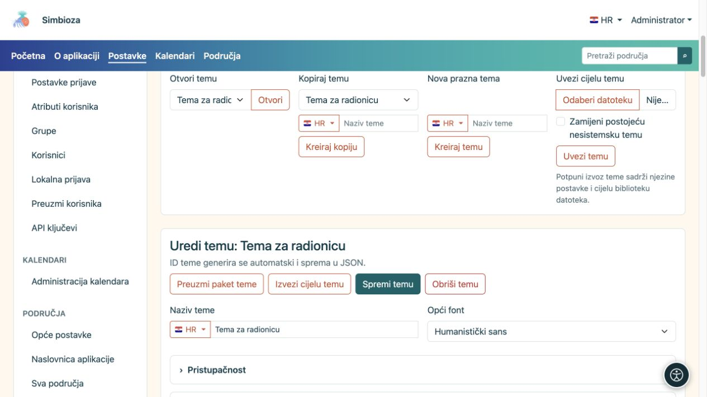
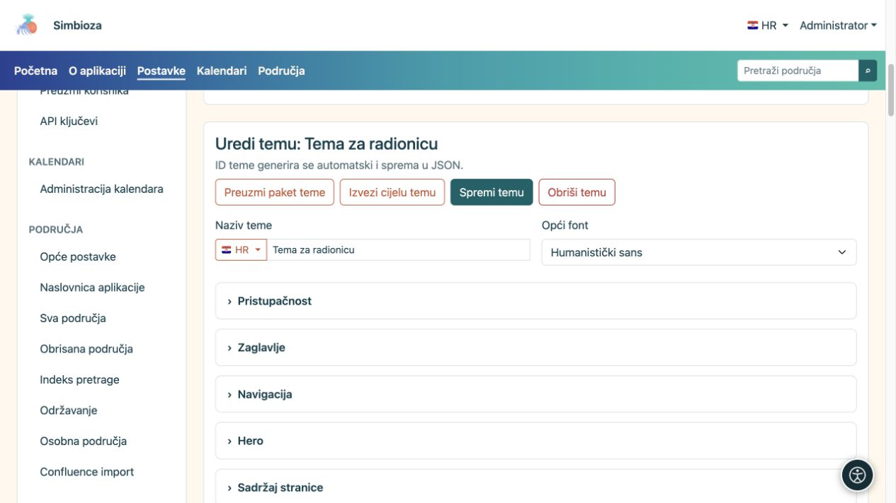
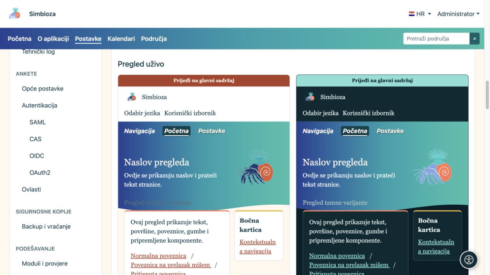
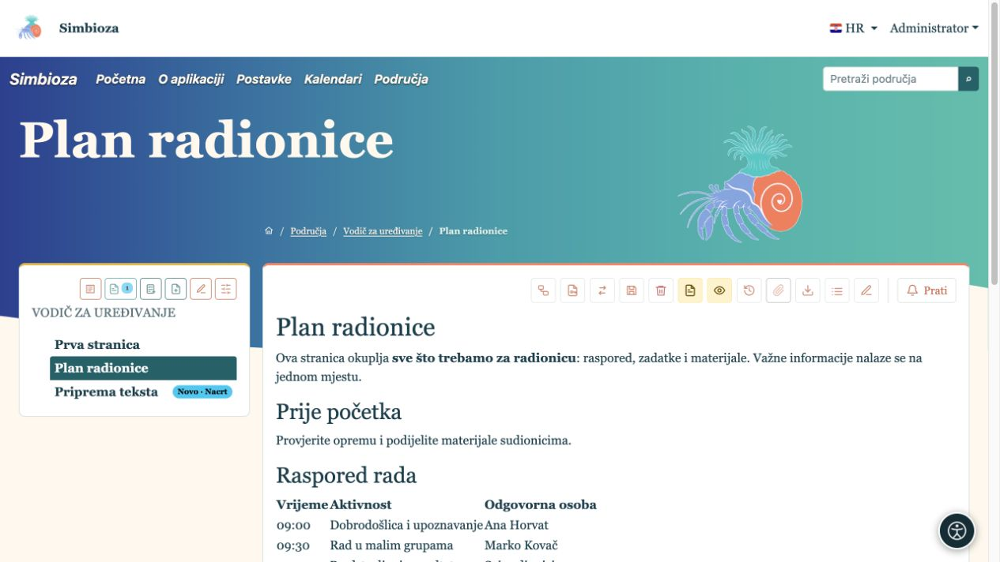
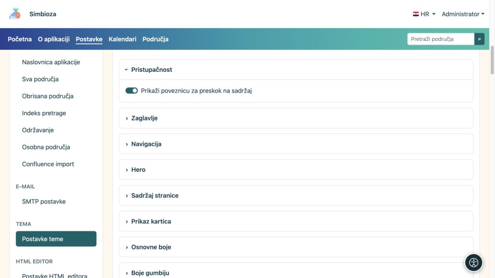

# Odaberite temu ili napravite svoju kopiju

[Teme](teme_hr.md)

**Za koga:** za administratora; upravitelj područja koristi svoj zaseban editor teme. Za početak ne trebate uređivati kod ni konfiguracijske datoteke.

## Primijenite postojeću temu

1. Otvorite **Postavke → Postavke teme**.
2. Na vrhu odaberite **Aktivna tema**.
3. Odaberite **Način primjene** prema tablici.
4. Ostavite **Tema je uključena** ako želite koristiti module teme.
5. Odaberite **Spremi temu site-a** i otvorite Početnu ili drugu stvarnu stranicu.

| Način primjene | Učinak |
| --- | --- |
| Automatski | Podržava svijetli i tamni prikaz; primjenjuje se osobni izbor gdje je dostupan, inače sistemska postavka. |
| Samo svijetla | Instalacija koristi svijetlu varijantu; osobni izbor ne nadjačava to pravilo. |
| Samo tamna | Instalacija koristi tamnu varijantu; osobni izbor ne nadjačava to pravilo. |

**Rezultat:** instalacija koristi odabranu temu i pravilo prikaza. Isključivanje **Tema je uključena** vraća zadani prikaz aplikacije; administratorski ekran ostaje dostupan za ponovno uključivanje.

<figure>

<figcaption>Ova forma mijenja odabir za site, odvojeno od uređivanja pojedine teme.</figcaption>
</figure>

## Kopirajte temu prije vlastitih prilagodbi

1. U **Biblioteci tema**, pod **Kopiraj temu**, odaberite najbliži postojeći izgled.
2. Unesite naziv, primjerice **Tema za radionicu**. Zastavicom unesite naziv na drugom dostupnom jeziku ako treba.
3. Odaberite **Kreiraj kopiju**.
4. U editoru provjerite naziv otvorene kopije pa nastavite s prilagodbama.

**Rezultat:** dobivate zasebnu temu; izvor ostaje sačuvan. Otvaranje, kopiranje ili uređivanje teme nije isto što i njezin globalni odabir. Za uključivanje spremljene kopije odaberite je gore kao **Aktivnu temu** i spremite postavke sitea.

**Otvori temu → Otvori** odabire što uređujete. **Nova prazna tema → Kreiraj temu** izrađuje početni izgled iz zadanih vrijednosti. **Uvezi cijelu temu** služi prijenosu pripremljenog ZIP-a; postupak je u [Datotekama i izvozu](teme-datoteke_hr.md).

<figure>

<figcaption>Za vlastiti izgled najprije napravite imenovanu kopiju.</figcaption>
</figure>

## Promijenite naziv i osnovni font

Naziv teme i druga višejezična tekstualna polja imaju jezični izbor. Promijenite jezik i unesite odgovarajući tekst, a zatim spremite temu. Jezični izbor ne stvara novi prijevod sadržaja vaših stranica.

| Font | Učinak i namjena |
| --- | --- |
| Sistemski UI | Poznat izgled prema operacijskom sustavu. |
| Zaobljeni sistemski | Mekši oblici slova, gdje ih sustav ima. |
| Humanistički sans | Jednostavan poslovni prikaz bez serifa. |
| Čitljivi serif | Slova s istaknutim završecima; primjerice urednički ili knjiški dojam. |
| Monospace | Znakovi jednake širine, primjerice tehnički ili retro dojam. |

To su porodice dostupnih fontova, pa se točan izgled može razlikovati po uređaju. Izgled slova izbornika podešava se zasebno u [Navigaciji](teme-navigacija_hr.md).

<figure>

<figcaption>Spremate postavke otvorene teme, a aktivnu temu birate u gornjoj globalnoj formi.</figcaption>
</figure>

## Pregledajte, spremite i provjerite

Otvorite željenu cjelinu postavki. Pregledi ispod editora osvježavaju se dok mijenjate vrijednosti. **Spremi temu** čuva promjene svih njezinih cjelina; prijenos i brisanje datoteka imaju vlastite radnje. Nakon spremanja ponovno otvorite stvarnu stranicu.

Primjer: na kopiji odaberite **Čitljivi serif**, a navigaciji podesite položaj unutar heroa i kurziv. Pregled pokazuje smjer promjene; stvarna stranica pokazuje učinak na naslove, dulji tekst i izbornik.

<figure>

<figcaption>Pregled kombinira promjenu tipografije i položaja navigacije.</figcaption>
</figure>

<figure>

<figcaption>Iste postavke na stvarnom sadržaju: serif font, naziv aplikacije i kurziv navigacije.</figcaption>
</figure>

## Pristupačnost i povrat na poznati izgled

Ostavite **Prikaži poveznicu za preskok na sadržaj** uključeno: korisniku tipkovnice omogućuje preskočiti ponavljajuću navigaciju. Provjerite vidljiv fokus, čitljivost i oba načina prikaza. Sjena slova može pomoći na šarenom herou, ali ne zamjenjuje dobru boju teksta.

<figure>

<figcaption>Poveznica je pomoć za navigaciju tipkovnicom, a ne ukrasni element.</figcaption>
</figure>

Za povrat odaberite raniju aktivnu temu i spremite globalne postavke. Korisničku temu možete ukloniti radnjom brisanja ako nije zaštićena kao sistemska; zadnja preostala tema ne može se ukloniti. Ako uklonite aktivnu korisničku temu, sustav odabire sigurnu zamjenu. Za čuvanje vlastite kopije prethodno napravite [potpuni izvoz](teme-datoteke_hr.md).
