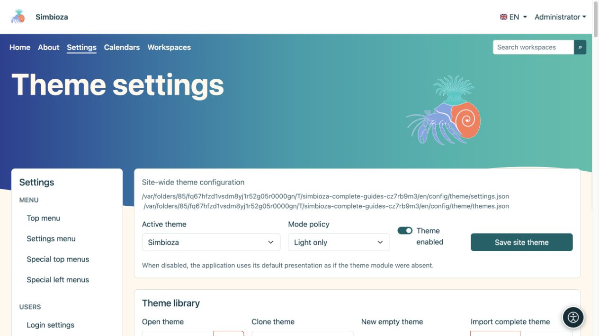
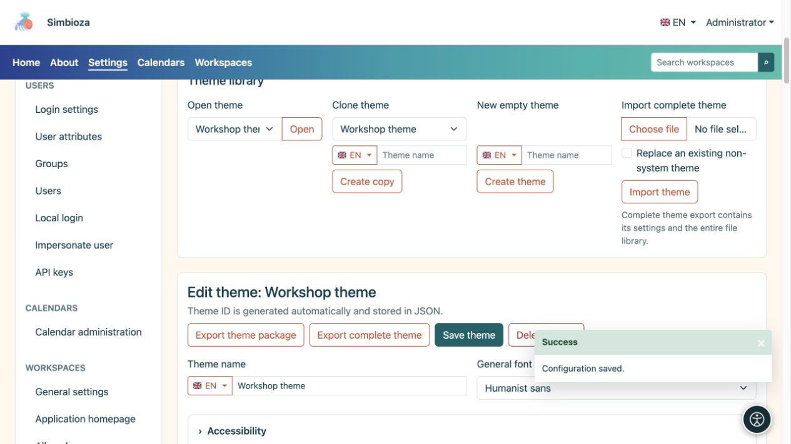
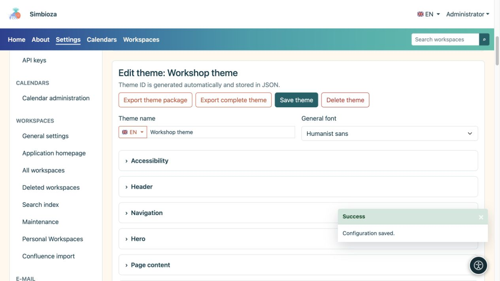
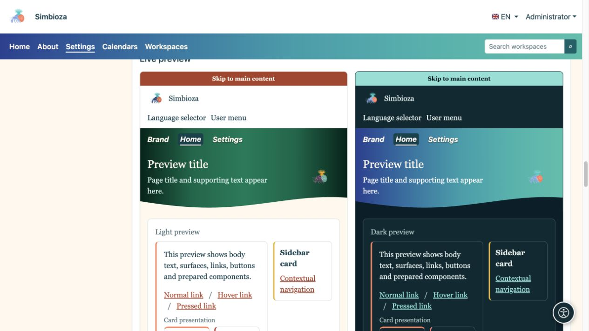
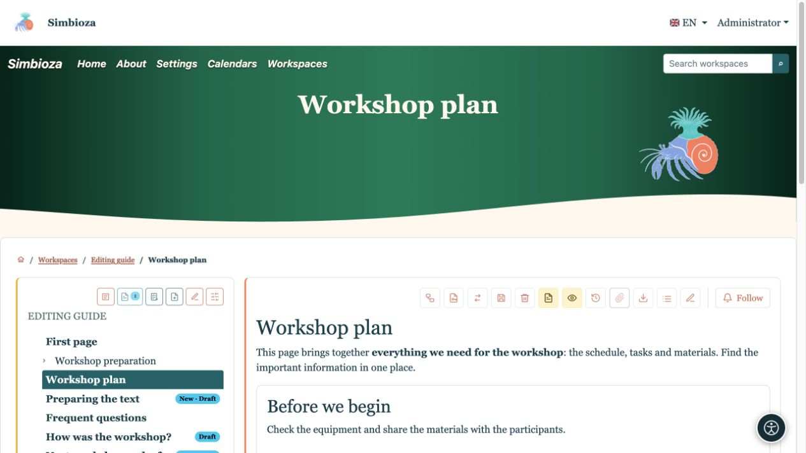
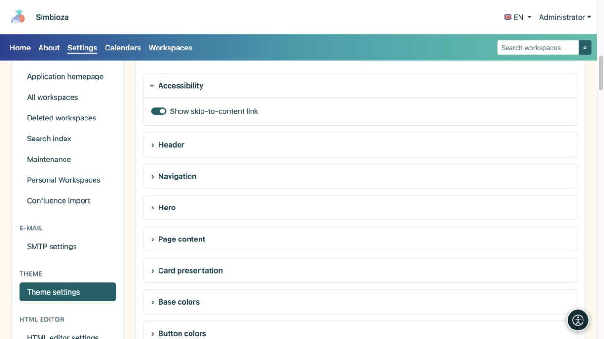

# Scegli un tema o crea la tua copia

> Le schermate mostrano l’interfaccia in inglese.

[Temi](teme_it.md)

**Per:** amministratori; i gestori dell'area di lavoro utilizzano il proprio editor di temi dell'area di lavoro separato. Non è necessario modificare il codice o i file di configurazione per iniziare.

## Applicare un tema esistente

1. Apri **Impostazioni → Impostazioni tema**.
2. Scegli il **Tema attivo** in alto.
3. Scegli la **Politica della modalità** utilizzando la tabella seguente.
4. Mantieni attivo **Tema abilitato** per utilizzare l'aspetto definito dal tema.
5. Seleziona **Salva tema sito** e apri la Home o un'altra pagina reale.

| Criterio della modalità di visualizzazione | Effetto |
| --- | --- |
| Automatico | Supporta l'aspetto chiaro e scuro; utilizza la selezione personale ove disponibile, altrimenti l'impostazione del sistema. |
| Solo chiaro | L'installazione usa la variante chiara; la scelta personale non può sostituire questo criterio. |
| Solo scuro | L'installazione utilizza la variante scura; la selezione personale non può prevalere su questa politica. |

**Risultato:** l'installazione utilizza il tema e il criterio di visualizzazione selezionati. Disabilitando **Tema abilitato** si ripristina la presentazione predefinita dell'applicazione; la schermata amministratore rimane disponibile per abilitarla nuovamente.

<figure>

<figcaption>Questo modulo modifica la selezione del sito separatamente dalla modifica di un tema.</figcaption>
</figure>

## Copia un tema prima di personalizzarlo

1. In **Libreria temi**, scegli il design esistente più simile in **Clona tema**.
2. Inserisci un nome, ad esempio **Tema workshop**. Se necessario, utilizza il selettore della bandiera per inserire il nome in un'altra lingua disponibile.
3. Seleziona **Crea copia**.
4. Controlla che l'editor mostri il nome della tua copia prima di apportare modifiche.

**Risultato:** hai un tema separato; l'originale viene mantenuto. L'apertura, la copia o la modifica di un tema non lo seleziona globalmente. Per applicare la copia salvata, selezionala come **Tema attivo** sopra e salva le impostazioni del sito.

**Apri tema → Apri** seleziona ciò che modifichi. **Nuovo tema vuoto → Crea tema** inizia con i valori predefiniti. **Importa tema completo** trasferisce un ZIP preparato; vedere [File ed esportazione](teme-datoteke_it.md).

<figure>

<figcaption>Crea una copia con nome prima di sviluppare il tuo aspetto.</figcaption>
</figure>

## Cambia il nome e il carattere di base

Il nome del tema e altri campi di testo multilingue hanno un selettore della lingua. Scegli una lingua, inserisci il testo e salva il tema. Questo non crea una traduzione del contenuto della tua pagina.

| Font | Effetto e utilizzo |
| --- | --- |
| Interfaccia utente del sistema | Un aspetto familiare basato sul sistema operativo. |
| Sistema arrotondato | Forme delle lettere più morbide dove il sistema le fornisce. |
| Sans umanista | Tipografia aziendale semplice senza grazie. |
| Serif leggibile | Lettere con tratti di finitura distinti, per un aspetto editoriale o simile a un libro. |
| Monospazio | Caratteri di uguale larghezza, per un tocco tecnico o retrò. |

Queste sono le famiglie di caratteri disponibili, quindi l'aspetto esatto può variare a seconda dei dispositivi. La tipografia del menu è configurata separatamente in [Navigazione](teme-navigacija_it.md).

<figure>

<figcaption>Salva qui il tema aperto; scegli il tema attivo nel modulo globale separato.</figcaption>
</figure>

## Visualizza l'anteprima, salva e controlla

Apri la sezione delle impostazioni di cui hai bisogno. Le anteprime sotto l'editor si aggiornano man mano che i valori cambiano. **Salva tema** salva le impostazioni nelle sue sezioni; il caricamento e l'eliminazione dei file utilizzano azioni separate. Dopo aver salvato, apri nuovamente una pagina reale.

Ad esempio, seleziona **Serif leggibile** sulla copia, posiziona la navigazione all'interno della sezione principale e rendi il suo tipo in corsivo. L'anteprima mostra la direzione del cambiamento; una pagina reale mostra i suoi effetti sui titoli, sul testo lungo e sulla navigazione.

<figure>

<figcaption>L'anteprima combina le modifiche alla tipografia e alla posizione di navigazione.</figcaption>
</figure>

<figure>

<figcaption>Le stesse impostazioni sul contenuto reale: tipo serif, nome dell'applicazione e navigazione in corsivo.</figcaption>
</figure>

## Accessibilità e ritorno a un design familiare

Mantieni abilitato **Mostra collegamento per saltare al contenuto**: aiuta chi usa la tastiera a evitare di ripercorrere la navigazione. Verifica la visibilità della selezione, la leggibilità e le due modalità di visualizzazione. L'ombra del testo può aiutare su una sezione principale colorata, ma non sostituisce un colore del testo adeguato.

<figure>

<figcaption>Il collegamento facilita la navigazione tramite tastiera anziché decorare la pagina.</figcaption>
</figure>

Per tornare, scegli il tema attivo precedente e salva le impostazioni globali. Puoi eliminare un tema utente a meno che non sia protetto come tema di sistema; l'ultimo tema rimanente non può essere eliminato. L'eliminazione di un tema utente attivo seleziona una sostituzione sicura. Conserva prima la tua copia con un'[esportazione completa](teme-datoteke_it.md).
