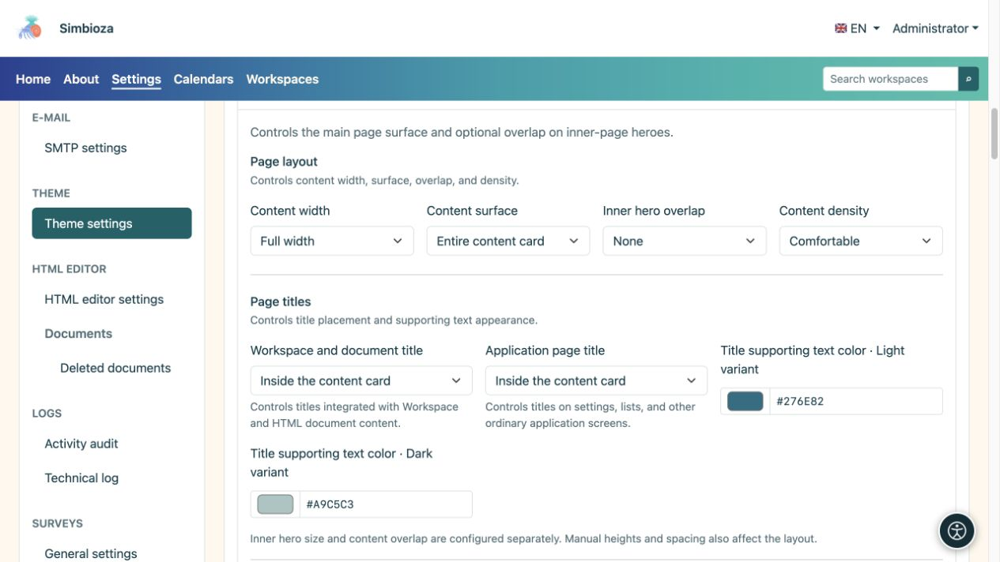
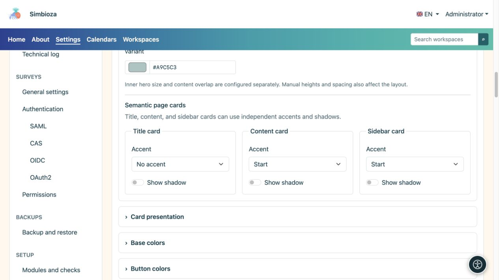
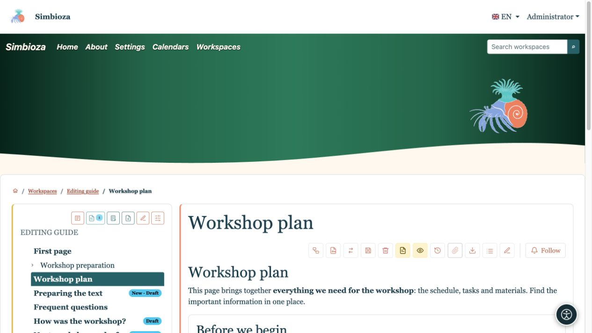
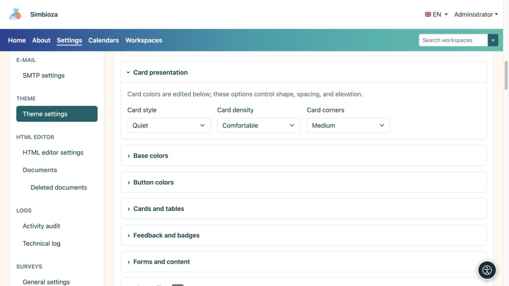

# Inhalt, Titel und Karten gestalten

> Die Bildschirmaufnahmen zeigen die englische Benutzeroberfläche.

[Designs](teme_de.md)

**Ziel:** Inhalten einen lesbaren Raum und einheitliche Oberflächen geben. Öffnen Sie **Seiteninhalt** und verwenden Sie dann **Karten** für die wiederholte Kartenform.

## Breite, Fläche und Überlappung

| Feld | Auswahlmöglichkeiten | Wirkung |
| --- | --- | --- |
| Inhaltsbreite | Volle Breite / Wide / sm / md / lg / xl / xxl | Rahmen für Text und Karten; siehe [Containerbreiten](teme-zaglavlje_de.md). |
| Inhaltsoberfläche | Keine Hauptinhaltskarte / nur Titelkarte / Vollständiger Inhalt auf einer Karte | Hauptinhalts-Wrapper. Vorhandene Innenmodulkarten werden nicht entfernt. |
| Überlappung des inneren Hero-Bereichs | Keine / Klein / Mittel / Groß | Hebt den Inhalt der Innenseite über seinen Hero-Bereich, sofern einer vorhanden ist. |
| Inhaltsdichte | Bequem/kompakt | Größe des Innenabstands. |

Verwenden Sie Überlappungen, um den Hero-Bereich und die Karten visuell zu verbinden. Wenn sich der Titel im Hero-Bereich befindet, lassen Sie Platz, damit er nicht von einer Karte verdeckt wird. Wenn der Titel in den Inhalt übergeht, bleibt der Hero-Bereich möglicherweise dekorativ. **Overlap wählt nicht die Größe des Hero-Bereichs der Startseite aus**: Die Größe der Startseite und der Innenseite wird separat konfiguriert.

<figure>

<figcaption>Diese Einstellungen ändern eher das Layout als Text oder Zugriffsberechtigungen.</figcaption>
</figure>

## Entscheiden Sie, wo Titel erscheinen

**Arbeitsbereichs- und Dokumenttitel** gilt für integrierte Arbeitsbereiche und HTML-Dokumentinhalte. **Der Titel der Anwendungsseite** gilt für Einstellungen, Listen und andere Anwendungsbildschirme. Beide bieten drei Möglichkeiten:

| Auswahl | Ergebnis |
| --- | --- |
| Im Hero-Bereich | Der Titel erscheint im hervorgehobenen oberen Bereich. |
| In einer separaten Titelkarte | Der Titel hat eine eigene Karte über dem Inhalt. |
| Inhaltskarte im Inneren | Der Titel erscheint am Anfang des Inhalts ohne separate Titelkarte. |

**Titelunterstützende Textfarbe** legt die Beschreibung neben einem Titel im hellen und dunklen Modus fest. Der Hero-Schriftzug hat seine eigenen Farben; Normale Karten verwenden ihre jeweiligen Oberflächenfarben. Überprüfen Sie, wo die Beschreibung tatsächlich erscheint.

## Akzent und Schatten sind getrennt

Konfigurieren Sie die Titelkarte, die Inhaltskarte und die Seitenkarten separat.

| Kontrolle | Auswahlmöglichkeiten / Wirkung |
| --- | --- |
| Akzent | Kein Akzent / Oben / Anfang: Keine hervorgehobene Linie, keine obere Linie oder eine Linie am Anfangsseitenrand. |
| Schatten zeigen | Aktiviert oder deaktiviert den Schatten für diesen Oberflächentyp. |

Akzent hebt eine Kante hervor; der Schatten trennt die Oberfläche vom Hintergrund. Kartenschatten ist kein Textschatten; Verwenden Sie für die Beschriftung [Hero](teme-hero_de.md) oder [Navigation](teme-navigacija_de.md). Rahmen- und Akzentfarben finden Sie in [Karten und Tabellen](teme-boje-komponente_de.md).

<figure>

<figcaption>Akzent und Schatten können unabhängig voneinander aktiviert werden.</figcaption>
</figure>

<figure>

<figcaption>Der Titel wurde auf die Inhaltskarte verschoben; Akzente im Inhalt und in der Seitenleiste bleiben getrennt.</figcaption>
</figure>

## Wiederholte Kartenform

| Feld | Auswahlmöglichkeiten | Zweck |
| --- | --- | --- |
| Kartenstil | Erhöht / ruhig / flach | Stärkere Trennung, leisere Trennung oder flachere Präsentation. |
| Kartendichte | Bequem/kompakt | Mehr oder weniger Innenraum. |
| Kartenecken | Quadratische Kanten / Klein / Mittel | Betrag der Rundung. |

<figure>

<figcaption>Dieser Abschnitt ändert seine Form; entsprechende Farben befinden sich in einer anderen Gruppe.</figcaption>
</figure>

**Überprüfen Sie:** Öffnen Sie eine Arbeitsbereichsseite, einen normalen Anwendungsbildschirm und eine schmale Ansicht. Sollte sich etwas von der Vorschau unterscheiden, prüfen Sie zunächst, welchen Titel und Kartentyp der Bildschirm verwendet.
