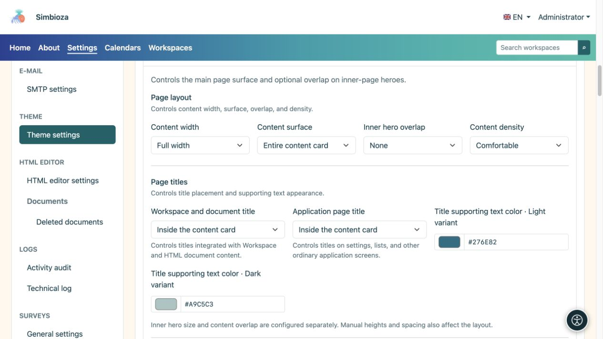
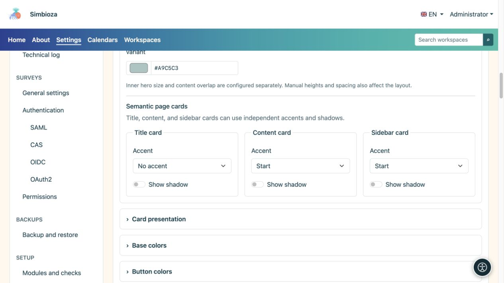
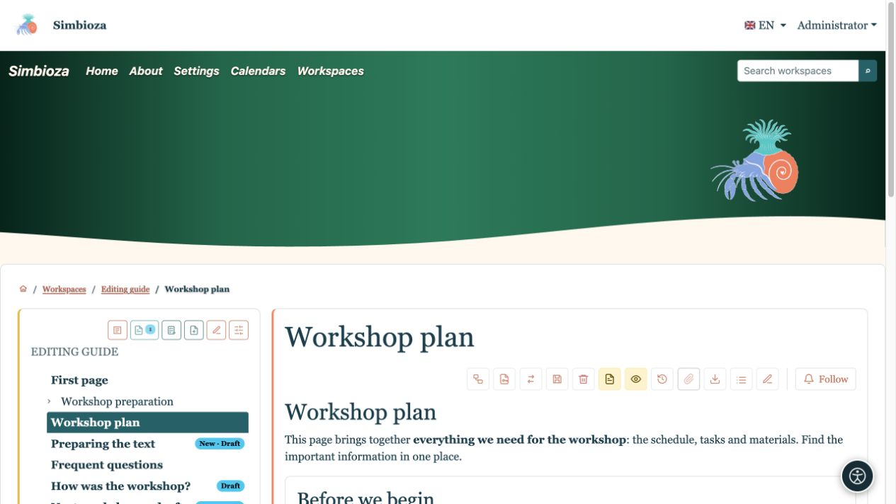
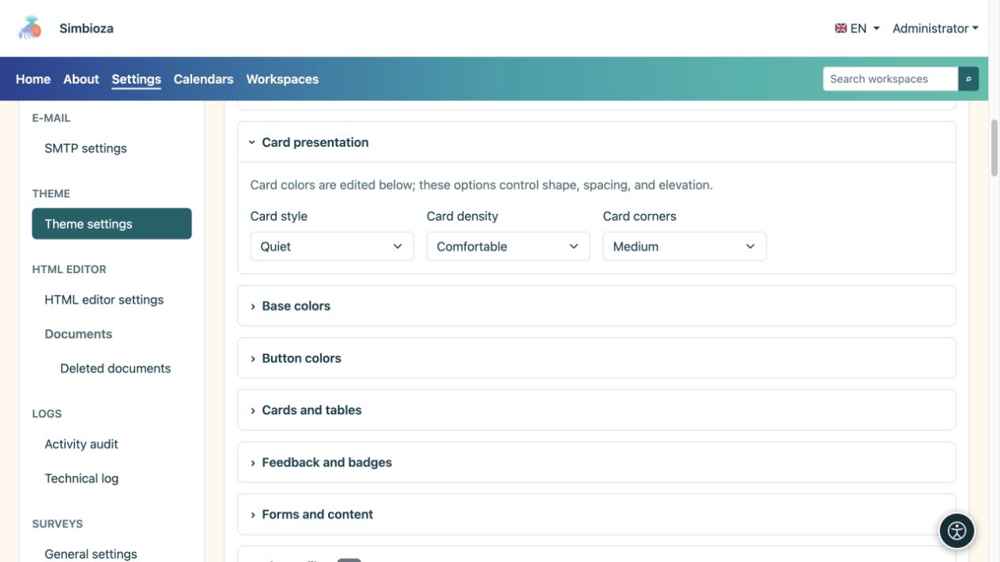

# Configure content, titles and cards

[Themes](teme_en.md)

**Goal:** give content a readable space and consistent surfaces. Open **Page content**, then use **Cards** for repeated-card shape.

## Width, surface and overlap

| Field | Choices | Effect |
| --- | --- | --- |
| Content width | Full width / Wide / sm / md / lg / xl / xxl | Frame for text and cards; see [container widths](teme-zaglavlje_en.md). |
| Content surface | No main content card / Title card only / Full content in a card | Main content wrapper. Existing inner module cards are not removed. |
| Inner hero overlap | None / Small / Medium / Large | Lifts inner-page content over its hero, when one exists. |
| Content density | Comfortable / Compact | Amount of internal spacing. |

Use overlap to connect the hero and cards visually. When the title is in the hero, leave room so a card does not cover it. When the title moves into content, the hero may remain decorative. **Overlap does not choose the home-page hero size**: home and inner-page sizes are configured separately.

<figure>

<figcaption>These settings change layout rather than text or access permissions.</figcaption>
</figure>

## Decide where titles appear

**Workspace and document title** applies to integrated workspace and HTML-document content. **Application page title** applies to settings, lists and other application screens. Both offer three choices:

| Choice | Result |
| --- | --- |
| In hero | The title appears in the highlighted top area. |
| In a separate title card | The title has its own card above content. |
| Inside content card | The title appears at the start of content without a separate title card. |

**Title supporting-text colour** sets the description beside a title in light and dark modes. Hero lettering has its own colours; ordinary cards use their respective surface colours. Check where the description actually appears.

## Accent and shadow are separate

Configure the title card, content card and side cards separately.

| Control | Choices / effect |
| --- | --- |
| Accent | No accent / Top / Start: no highlighted line, a top line or a line at the starting side edge. |
| Show shadow | Enables or disables shadow for that surface type. |

Accent highlights an edge; shadow separates the surface from its background. Card shadow is not text shadow; use [Hero](teme-hero_en.md) or [Navigation](teme-navigacija_en.md) for lettering. Border and accent colours are in [Cards and tables](teme-boje-komponente_en.md).

<figure>

<figcaption>Accent and shadow may be enabled independently.</figcaption>
</figure>

<figure>

<figcaption>The title has moved to the content card; accents on the content and sidebar remain separate.</figcaption>
</figure>

## Repeated-card shape

| Field | Choices | Purpose |
| --- | --- | --- |
| Card style | Raised / Quiet / Flat | Stronger separation, quieter separation or flatter presentation. |
| Card density | Comfortable / Compact | More or less internal space. |
| Card corners | Square edges / Small / Medium | Amount of rounding. |

<figure>

<figcaption>This section changes shape; corresponding colours are in another group.</figcaption>
</figure>

**Check:** open a workspace page, an ordinary application screen and a narrow view. If something differs from preview, first check which title and card type the screen uses.
