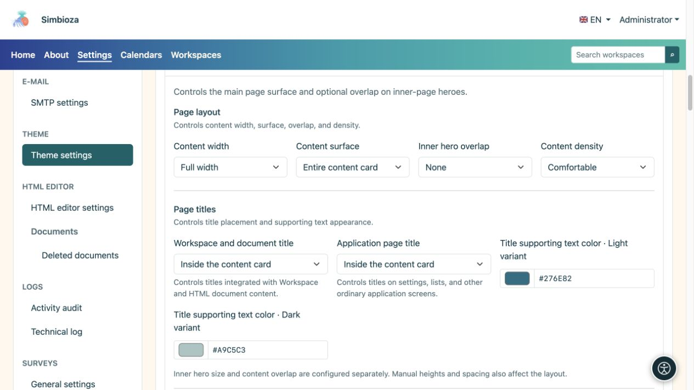
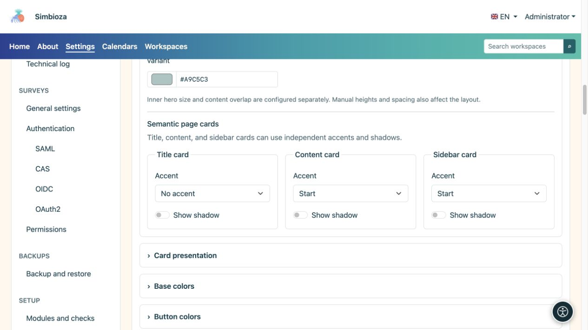
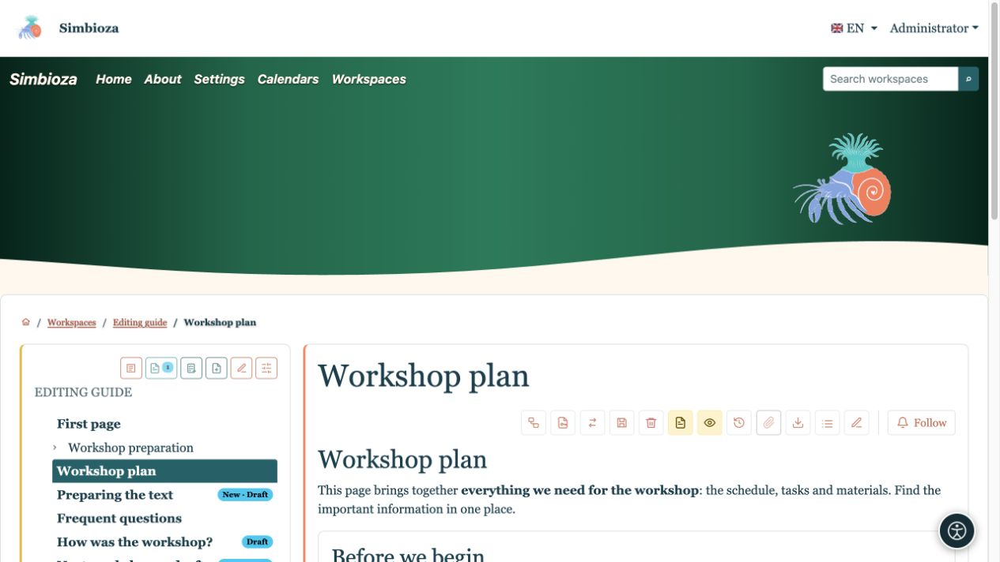
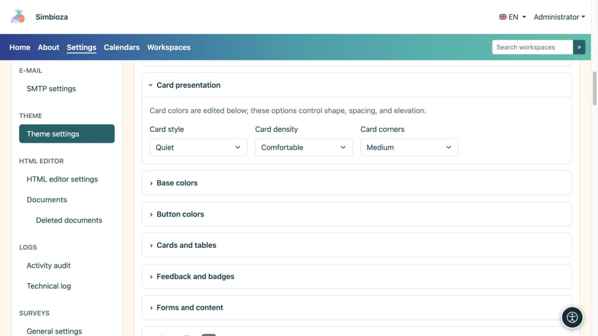

# Configurar contenidos, títulos y tarjetas

> Las capturas de pantalla muestran la interfaz en inglés.

[Temas](teme_es.md)

**Objetivo:** brindar al contenido un espacio legible y superficies consistentes. Abra **Contenido de la página** y luego use **Tarjetas** para obtener formas de tarjetas repetidas.

## Ancho, superficie y superposición

| Campo | Opciones | Efecto |
| --- | --- | --- |
| Ancho del contenido | Ancho completo / Ancho / sm / md / lg / xl / xxl | Marco para texto y tarjetas; consulte [anchos de contenedores](teme-zaglavlje_es.md). |
| Superficie de contenido | Sin tarjeta de contenido principal/Solo tarjeta de título/Contenido completo en una tarjeta | Envoltorio de contenido principal. Las tarjetas de módulo interno existentes no se eliminan. |
| Superposición de elemento principal interior | Ninguno / Pequeño / Mediano / Grande | Destaca el contenido de la página interior sobre su elemento principal, cuando existe uno. |
| Densidad de contenido | Cómodo / Compacto | Cantidad de espacio interno. |

Utilice la superposición para conectar visualmente al elemento principal y las cartas. Cuando el título esté en el elemento principal, deja espacio para que una carta no lo cubra. Cuando el título pasa al contenido, el elemento principal puede seguir siendo decorativo. **La superposición no elige el tamaño principal de la página de inicio**: los tamaños de la página de inicio y de la página interior se configuran por separado.

<figure>

<figcaption>Estas configuraciones cambian el diseño en lugar del texto o los permisos de acceso.</figcaption>
</figure>

## Decidir dónde aparecen los títulos

**El título del espacio de trabajo y del documento** se aplica al espacio de trabajo integrado y al contenido del documento HTML. **Título de la página de la aplicación** se aplica a configuraciones, listas y otras pantallas de la aplicación. Ambos ofrecen tres opciones:

| Elección | Resultado |
| --- | --- |
| en heroe | El título aparece en el área superior resaltada. |
| En una tarjeta de título separada | El título tiene su propia tarjeta encima del contenido. |
| Tarjeta de contenido interior | El título aparece al comienzo del contenido sin una tarjeta de título separada. |

**Color del texto de respaldo del título** establece la descripción junto al título en los modos claro y oscuro. Las letras de los elementos principales tienen sus propios colores; Las tarjetas normales utilizan sus respectivos colores de superficie. Compruebe dónde aparece realmente la descripción.

## El acento y la sombra están separados.

Configure la tarjeta de título, la tarjeta de contenido y las tarjetas laterales por separado.

| Control | Opciones / efecto |
| --- | --- |
| Acento | Sin acento / Arriba / Inicio: sin línea resaltada, una línea superior o una línea en el borde lateral inicial. |
| Mostrar sombra | Activa o desactiva la sombra para ese tipo de superficie. |

El acento resalta una ventaja; La sombra separa la superficie de su fondo. La sombra de la tarjeta no es una sombra de texto; use [Elemento principal](teme-hero_es.md) o [Navegación](teme-navigacija_es.md) para letras. Los colores de borde y acento se encuentran en [Tarjetas y tablas](teme-boje-komponente_es.md).

<figure>

<figcaption>El acento y la sombra se pueden habilitar de forma independiente.</figcaption>
</figure>

<figure>

<figcaption>El título se ha movido a la tarjeta de contenido; los acentos en el contenido y la barra lateral permanecen separados.</figcaption>
</figure>

## Forma de tarjeta repetida

| Campo | Opciones | Finalidad |
| --- | --- | --- |
| Estilo de tarjeta | Elevado / Silencioso / Plano | Separación más fuerte, separación más tranquila o presentación más plana. |
| Densidad de la tarjeta | Cómodo / Compacto | Más o menos espacio interno. |
| Esquinas de la tarjeta | Bordes cuadrados / Pequeño / Mediano | Cantidad de redondeo. |

<figure>

<figcaption>Esta sección cambia de forma; Los colores correspondientes están en otro grupo.</figcaption>
</figure>

**Compruebe:** abre una página de espacio de trabajo, una pantalla de aplicación normal y una vista estrecha. Si algo difiere de la vista previa, primero verifique qué título y tipo de tarjeta usa la pantalla.
