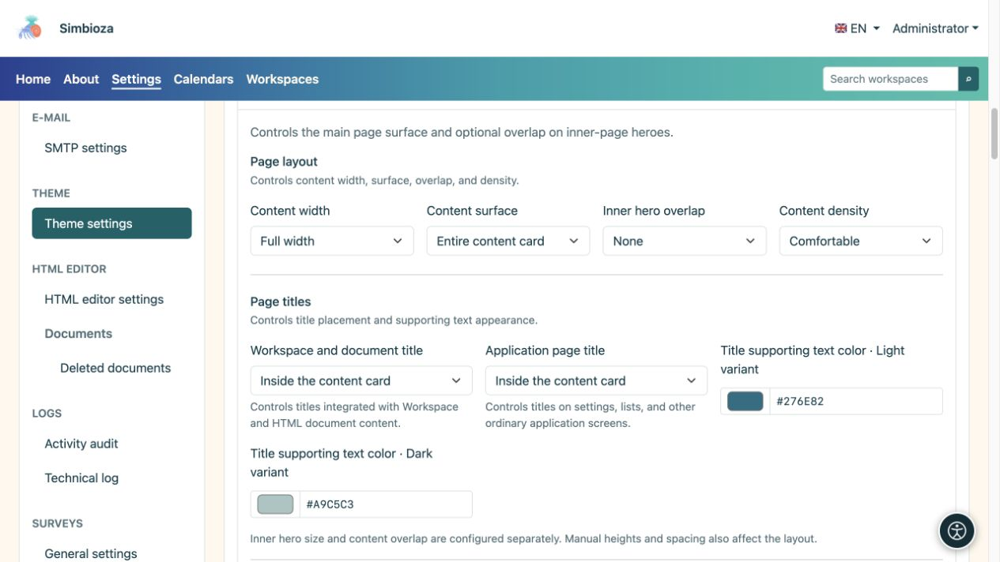
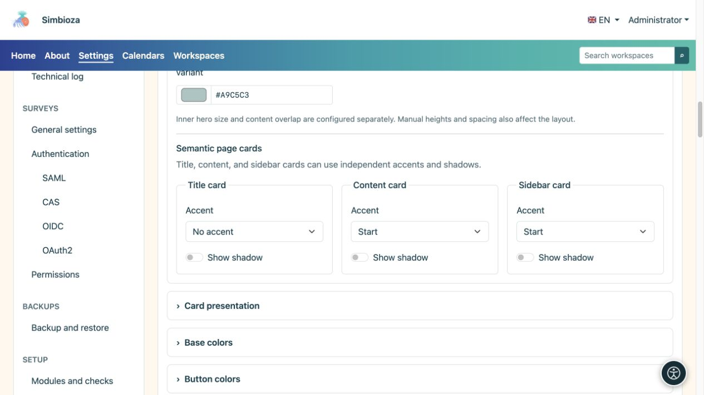
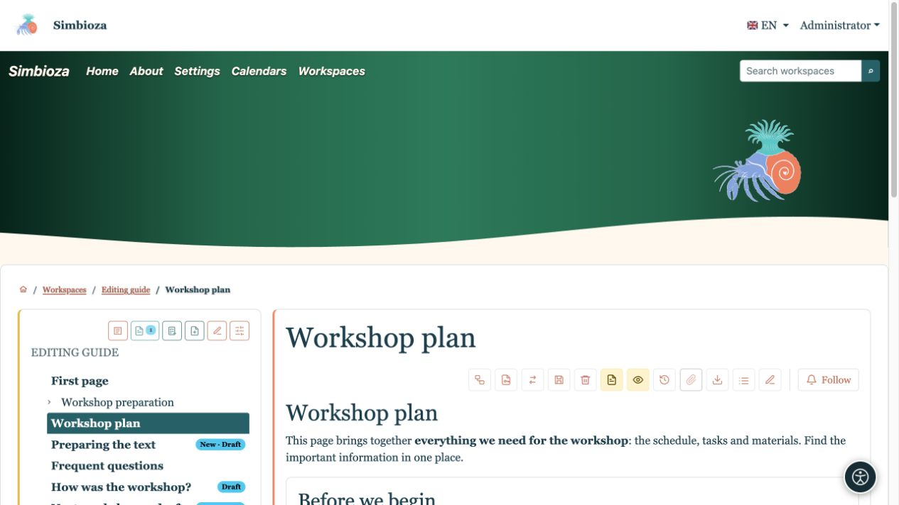
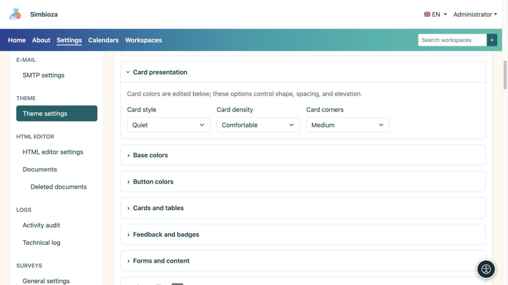

# Configurer le contenu, les titres et les cartes

> Les captures d’écran présentent l’interface en anglais.

[Thèmes](teme_fr.md)

**Objectif :** donner au contenu un espace lisible et des surfaces cohérentes. Ouvrez **Contenu de la page**, puis utilisez **Cartes** pour créer une forme de carte répétée.

## Largeur, surface et chevauchement

| Champ | Choix | Effet |
| --- | --- | --- |
| Largeur du contenu | Pleine largeur / Large / sm / md / lg / xl / xxl | Cadre pour texte et cartes ; voir [largeurs des conteneurs](teme-zaglavlje_fr.md). |
| Surface du contenu | Pas de carte de contenu principal / Carte de titre uniquement / Contenu complet dans une carte | Wrapper de contenu principal. Les cartes de module interne existantes ne sont pas retirées. |
| Chevauchement du bandeau principal intérieur | Aucun / Petit / Moyen / Grand | Élève le contenu de la page intérieure sur son bandeau principal, lorsqu'il existe. |
| Densité du contenu | Confortable / Compact | Quantité d'espacement interne. |

Utilisez le chevauchement pour connecter visuellement le bandeau principal et les cartes. Lorsque le titre est dans le bandeau principal, laissez de la place pour qu'une carte ne le recouvre pas. Lorsque le titre passe au contenu, le bandeau principal peut rester décoratif. **Le chevauchement ne choisit pas la taille principale de la page d'accueil** : les tailles de la page d'accueil et de la page intérieure sont configurées séparément.

<figure>

<figcaption>Ces paramètres modifient la mise en page plutôt que le texte ou les autorisations d'accès.</figcaption>
</figure>

## Décidez où les titres apparaissent

**Le titre de l'espace de travail et du document** s'applique à l'espace de travail intégré et au contenu du document HTML. **Le titre de la page d'application** s'applique aux paramètres, aux listes et aux autres écrans d'application. Les deux proposent trois choix :

| Choix | Résultat |
| --- | --- |
| En bandeau principal | Le titre apparaît dans la zone supérieure en surbrillance. |
| Dans une carte de titre séparée | Le titre possède sa propre fiche au-dessus du contenu. |
| Carte de contenu interne | Le titre apparaît au début du contenu sans carte de titre distincte. |

**La couleur du texte de support du titre** définit la description à côté d'un titre en modes clair et sombre. Le lettrage du bandeau principal a ses propres couleurs ; les cartes ordinaires utilisent leurs couleurs de surface respectives. Vérifiez où la description apparaît réellement.

## L'accent et l'ombre sont séparés

Configurez séparément la carte de titre, la carte de contenu et les cartes latérales.

| Contrôle | Choix / effet |
| --- | --- |
| Accent | Pas d'accent / Haut / Début : pas de ligne en surbrillance, une ligne du haut ou une ligne au bord latéral de départ. |
| Afficher l'ombre | Active ou désactive l'ombre pour ce type de surface. |

L’accent met un bord en valeur ; l’ombre sépare la surface de son arrière-plan. L’ombre de la carte est distincte de celle du texte ; utilisez [Bandeau principal](teme-hero_fr.md) ou [Navigation](teme-navigacija_fr.md) pour les lettres. Les couleurs des bordures et des accents se règlent dans [Cartes et tableaux](teme-boje-komponente_fr.md).

<figure>

<figcaption>L'accent et l'ombre peuvent être activés indépendamment.</figcaption>
</figure>

<figure>

<figcaption>Le titre a été déplacé vers la fiche de contenu ; les accents sur le contenu et la barre latérale restent séparés.</figcaption>
</figure>

## Forme de carte répétée

| Champ | Choix | But |
| --- | --- | --- |
| Style de carte | Elevé / Calme / Plat | Séparation plus marquée, séparation plus discrète ou présentation plus plate. |
| Densité de la carte | Confortable / Compact | Plus ou moins d'espace intérieur. |
| Coins de cartes | Bords carrés / Petit / Moyen | Montant de l'arrondi. |

<figure>

<figcaption>Cette section change de forme ; les couleurs correspondantes sont dans un autre groupe.</figcaption>
</figure>

**Vérifiez :** ouvrez une page d'espace de travail, un écran d'application ordinaire et une vue étroite. Si quelque chose diffère de l'aperçu, vérifiez d'abord le titre et le type de carte utilisés par l'écran.
