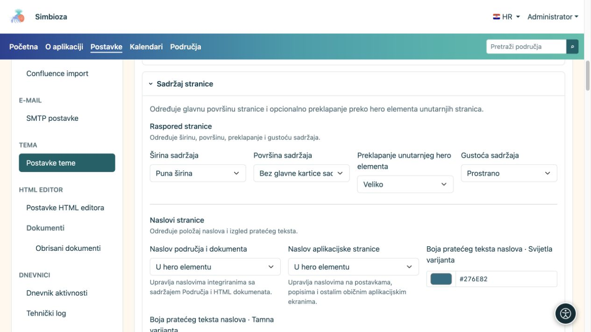
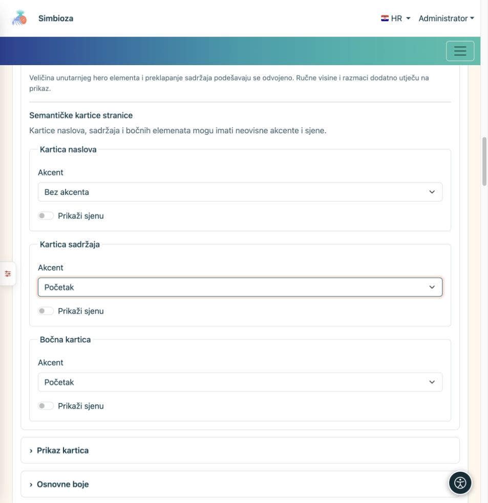
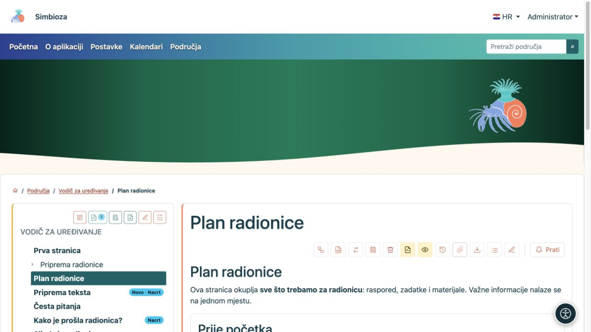
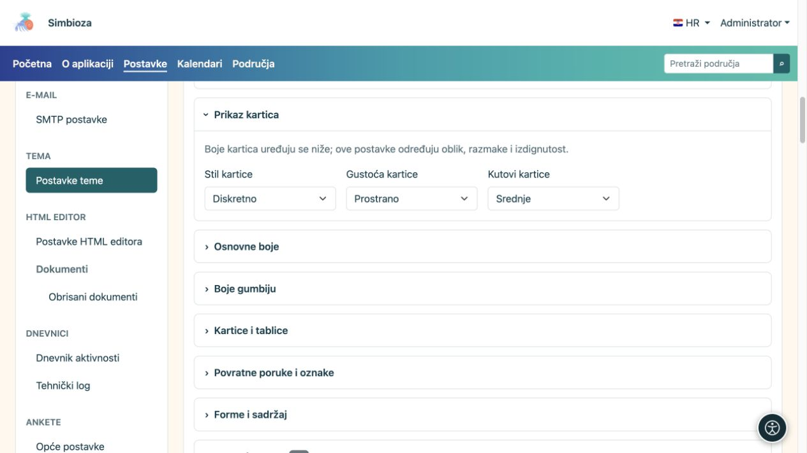

# Podesite sadržaj, naslove i kartice

[Teme](teme_hr.md)

**Cilj:** sadržaj smjestiti u pregledan prostor i dosljedno urediti njegove površine. Otvorite **Sadržaj stranice**, a oblik ponavljajućih kartica podesite pod **Kartice**.

## Širina, površina i preklapanje

| Polje | Odabiri | Što mijenja |
| --- | --- | --- |
| Širina sadržaja | Puna širina / Široko / sm / md / lg / xl / xxl | Raspoloživi okvir teksta i kartica; [objašnjenje širina](teme-zaglavlje_hr.md). |
| Površina sadržaja | Bez glavne kartice sadržaja / Samo kartica naslova / Cijeli sadržaj u kartici | Glavni omotač sadržaja. Postojeće unutarnje kartice drugih modula time se ne brišu. |
| Preklapanje unutarnjeg hero elementa | Bez preklapanja / Malo / Srednje / Veliko | Podizanje glavnoga sadržaja preko heroa unutarnje stranice, kada hero postoji. |
| Gustoća sadržaja | Prostrano / Kompaktno | Količina unutarnjih razmaka. |

Preklapanje koristite za povezan vizual heroa i kartica. Kada je naslov u hero elementu, ostavite dovoljno mjesta da ga kartica ne prekrije. Kada je naslov premješten u sadržaj, pozadina heroa može ostati dekorativna. **Preklapanje ne bira naslovničku veličinu heroa**: veličine unutarnjih stranica i naslovnice podešavaju se odvojeno.

<figure>

<figcaption>Ove postavke mijenjaju raspored, a ne tekst ili prava stranice.</figcaption>
</figure>

## Odlučite gdje je naslov

**Naslov područja i dokumenta** odnosi se na integrirani sadržaj područja i HTML dokumenata. **Naslov aplikacijske stranice** odnosi se na postavke, popise i ostale aplikacijske ekrane. Za oba su ponuđene tri mogućnosti:

| Odabir | Rezultat |
| --- | --- |
| U hero elementu | Naslov je u istaknutoj gornjoj površini. |
| U zasebnoj kartici naslova | Naslov dobiva vlastitu karticu iznad sadržaja. |
| Unutar kartice sadržaja | Naslov se nalazi na početku sadržaja, bez zasebne naslovne kartice. |

**Boja pratećeg teksta naslova** određuje opis uz naslov u svijetloj i tamnoj varijanti. Hero ima svoje boje slova; obične kartice imaju boje pripadajuće površine. Zato provjerite stvarno mjesto na kojem se opis prikazuje.

## Akcent i sjena nisu ista stvar

Zasebno podesite karticu naslova, karticu sadržaja i bočne kartice.

| Kontrola | Odabiri / učinak |
| --- | --- |
| Akcent | Bez akcenta / Gore / Početak: bez istaknute crte, crta na vrhu ili uz početni bočni rub. |
| Prikaži sjenu | Uključuje ili isključuje sjenu te vrste površine. |

Akcent ističe rub, a sjena odvaja površinu od pozadine. Sjena kartice nije sjena slova; za slova koristite postavke [heroa](teme-hero_hr.md) ili [navigacije](teme-navigacija_hr.md). Boje rubova i akcenata nalaze se u grupi [Kartice i tablice](teme-boje-komponente_hr.md).

<figure>

<figcaption>Akcent i sjena mogu se uključivati neovisno.</figcaption>
</figure>

<figure>

<figcaption>Primjer učinka položaja naslova i akcenta na stvarnom sadržaju.</figcaption>
</figure>

## Oblik ponavljajućih kartica

| Polje | Odabiri | Namjena |
| --- | --- | --- |
| Stil kartice | Izdignuto / Diskretno / Ravno | Jače izdvajanje, mirnije izdvajanje ili ravniji prikaz. |
| Gustoća kartice | Prostrano / Kompaktno | Više ili manje unutarnjeg prostora. |
| Kutovi kartice | Četvrtasti rubovi / Malo / Srednje | Stupanj zaobljenja. |

<figure>

<figcaption>Ovdje mijenjate oblik; pripadajuće boje uređuju se u zasebnoj grupi.</figcaption>
</figure>

**Provjerite:** otvorite stranicu područja, običnu aplikacijsku stranicu i uski prikaz. Ako nešto izgleda drukčije od pregleda, najprije provjerite koju vrstu naslova i kartice taj ekran koristi.
