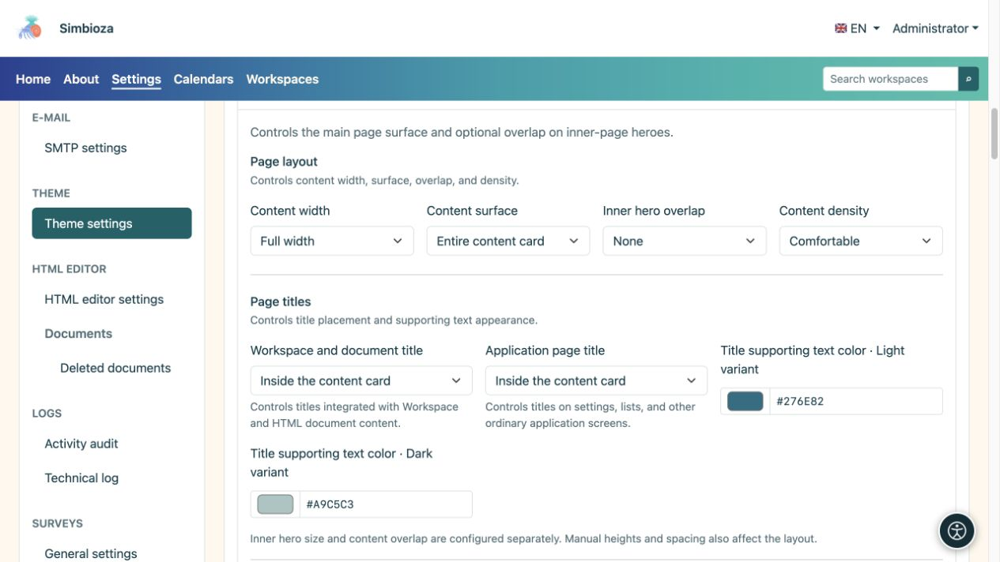
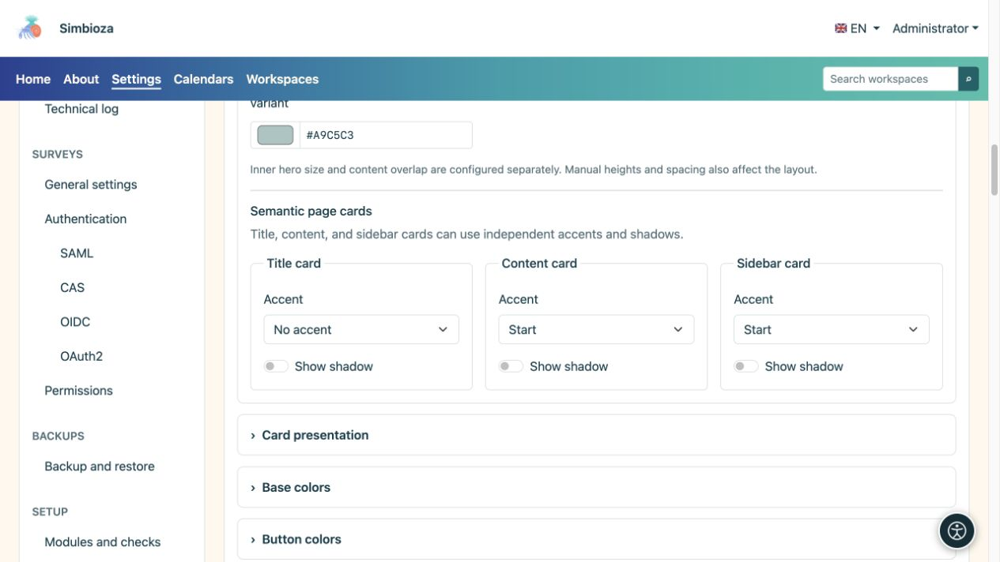
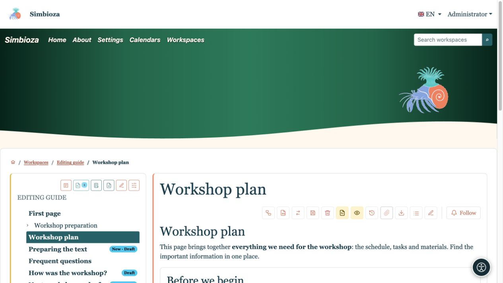
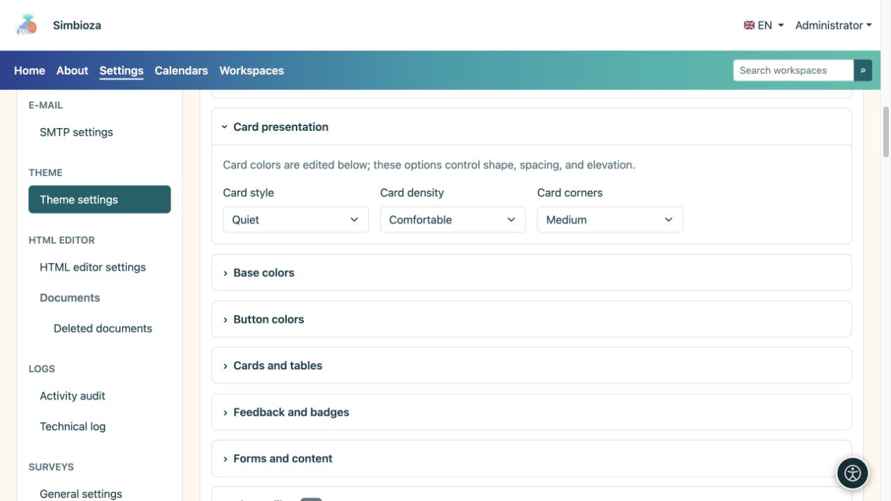

# Configura contenuti, titoli e riquadri

> Le schermate mostrano l’interfaccia in inglese.

[Temi](teme_it.md)

**Obiettivo:** offrire ai contenuti uno spazio leggibile e riquadri coerenti. Apri **Contenuto della pagina**, quindi usa **Riquadri** per la forma dei riquadri ripetuti.

## Larghezza, superficie e sovrapposizione

| Campo | Scelte | Effetto |
| --- | --- | --- |
| Larghezza del contenuto | Larghezza intera / Largo / sm / md / lg / xl / xxl | Cornice per testo e riquadri; consulta [larghezze dei contenitori](teme-zaglavlje_it.md). |
| Superficie del contenuto | Nessuna scheda del contenuto principale/Solo scheda del titolo/Contenuto completo in una scheda | Wrapper del contenuto principale. Le schede del modulo interno esistenti non vengono rimosse. |
| Sovrapposizione alla sezione principale delle pagine interne | Nessuno/Piccolo/Medio/Grande | Solleva il contenuto delle pagine interne sopra la relativa sezione principale, quando presente. |
| Densità del contenuto | Comodo/Compatto | Quantità di spaziatura interna. |

Usa la sovrapposizione per collegare visivamente la sezione principale e i riquadri. Quando il titolo si trova nella sezione principale, lascia spazio affinché un riquadro non lo copra. Quando il titolo passa nel contenuto, la sezione principale può rimanere decorativa. **La sovrapposizione non determina le dimensioni della sezione principale della pagina iniziale**: le dimensioni della pagina iniziale e delle pagine interne si configurano separatamente.

<figure>

<figcaption>Queste impostazioni modificano il layout anziché il testo o le autorizzazioni di accesso.</figcaption>
</figure>

## Decidi dove appaiono i titoli

**Il titolo dell'area di lavoro e del documento** si applica all'area di lavoro integrata e al contenuto del documento HTML. **Titolo della pagina dell'applicazione** si applica alle impostazioni, agli elenchi e ad altre schermate dell'applicazione. Entrambi offrono tre scelte:

| Scelta | Risultato |
| --- | --- |
| Nella sezione principale | Il titolo appare nell'area superiore evidenziata. |
| In un riquadro del titolo separato | Il titolo ha una propria scheda sopra il contenuto. |
| All'interno della scheda dei contenuti | Il titolo appare all'inizio del contenuto senza un riquadro del titolo separato. |

**Colore del testo di supporto del titolo** imposta la descrizione accanto al titolo nelle modalità chiara e scura. Il testo della sezione principale ha i propri colori; i normali riquadri usano i rispettivi colori di sfondo. Controlla dove compare effettivamente la descrizione.

## Accento e ombra sono separati

Configura la scheda titolo, la scheda contenuto e le schede laterali separatamente.

| Controllare | Scelte/effetto |
| --- | --- |
| Accento | Nessun accento/Alto/Inizio: nessuna linea evidenziata, una linea superiore o una linea sul bordo laterale iniziale. |
| Mostra ombra | Abilita o disabilita l'ombra per quel tipo di superficie. |

L'accento evidenzia un bordo; l'ombra separa il riquadro dallo sfondo. L'ombra del riquadro è distinta da quella del testo; per i caratteri usa [Sezione principale](teme-hero_it.md) o [Navigazione](teme-navigacija_it.md). I colori dei bordi e degli accenti si trovano in [Riquadri e tabelle](teme-boje-komponente_it.md).

<figure>

<figcaption>Accento e ombra possono essere abilitati indipendentemente.</figcaption>
</figure>

<figure>

<figcaption>Il titolo è stato spostato nella scheda contenuti; gli accenti sul contenuto e sulla barra laterale rimangono separati.</figcaption>
</figure>

## Forma di scheda ripetuta

| Campo | Scelte | Scopo |
| --- | --- | --- |
| Stile della scheda | Rialzato / Sobrio / Piatto | Separazione più marcata, più discreta oppure aspetto più piatto. |
| Densità della scheda | Comodo/Compatto | Più o meno spazio interno. |
| Angoli delle schede | Bordi squadrati / Piccolo / Medio | Quantità di arrotondamento. |

<figure>

<figcaption>Questa sezione cambia forma; i colori corrispondenti sono in un altro gruppo.</figcaption>
</figure>

**Verifica:** apri una pagina di un'area di lavoro, una normale schermata dell'applicazione e una vista stretta. Se qualcosa differisce dall'anteprima, controlla prima quale tipo di titolo e di riquadro usa la schermata.
