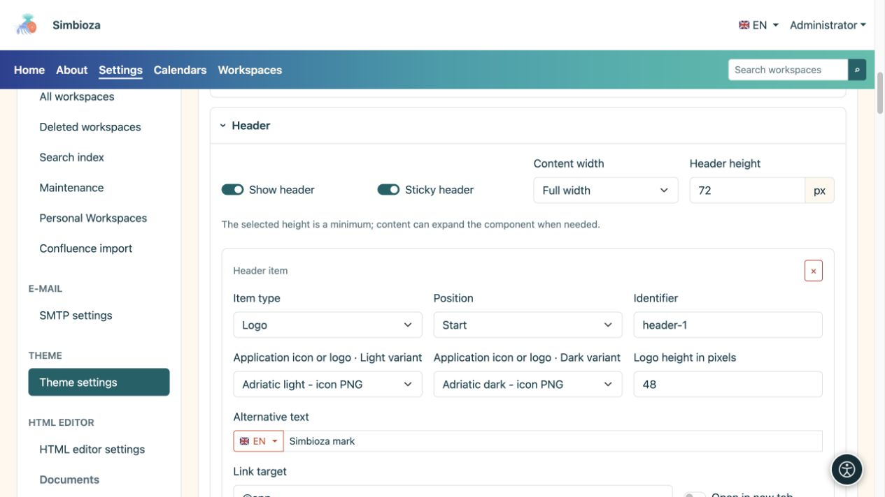
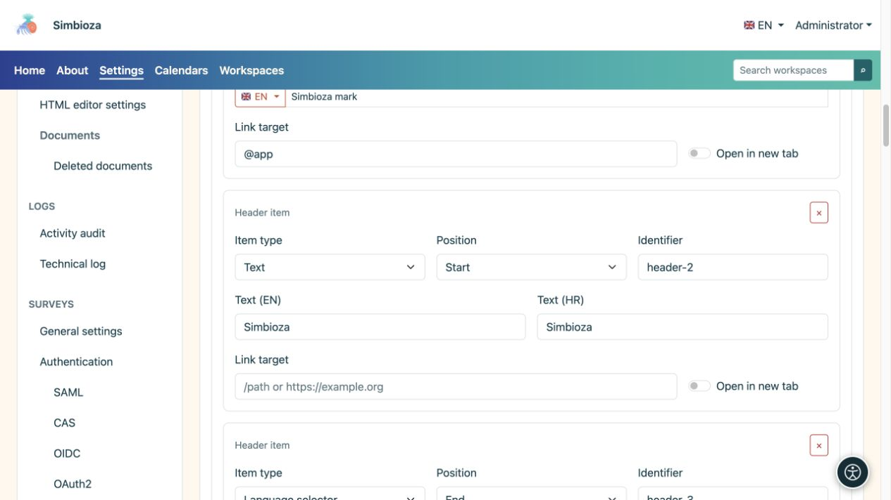
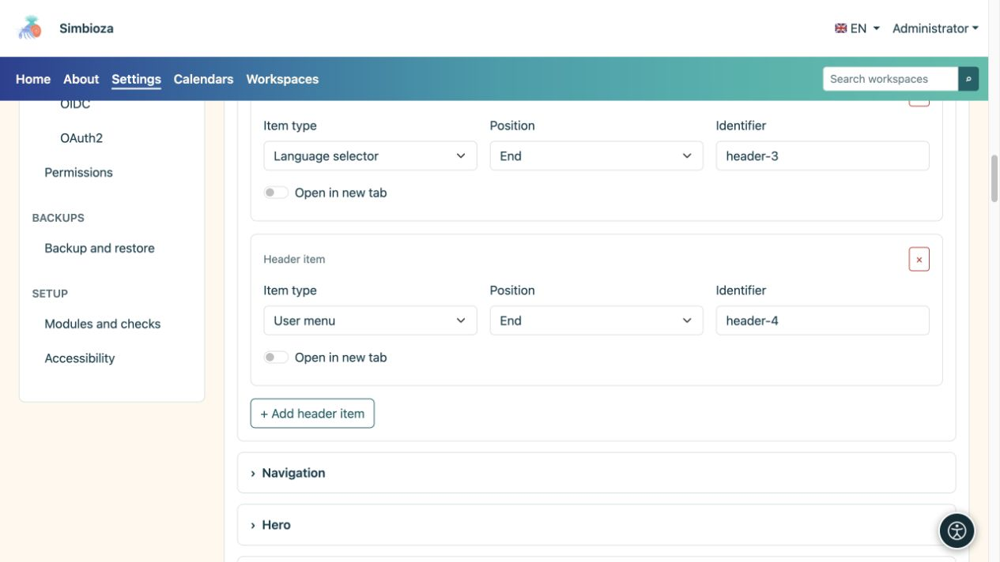

# Die Kopfzeile gestalten

> Die Bildschirmaufnahmen zeigen die englische Benutzeroberfläche.

[Designs](teme_de.md)

**Ziel:** Anzeige der Markierung, des Namens und der erforderlichen Steuerelemente oben. Erweitern Sie **Kopfzeile** im geöffneten Design.

## Aktivieren Sie die Kopfzeile und legen Sie den Leerraum fest

**Kopfzeile anzeigen** aktiviert den oberen Streifen. **Sticky-Header** sorgt dafür, dass er beim Scrollen sichtbar bleibt. Die gewählte Höhe ist ein Minimum: Der Inhalt benötigt möglicherweise mehr Platz.

| Breitenauswahl | Bedeutung |
| --- | --- |
| Volle Breite | Nutzt die verfügbare Breite mit Seitenabstand. |
| Breit | Ein breiter Grundriss mit kontrolliertem Seitenraum. |
| sm, md, lg, xl, xxl | Responsive Container, die durch die entsprechende Bildschirmgröße eine begrenzte Breite gewinnen; Vergleichen Sie sie in der Vorschau. |

<figure>

<figcaption>Höhe, Breite und Elemente der Kopfzeile werden in einem Abschnitt konfiguriert.</figcaption>
</figure>

## Fügen Sie einen Eintrag hinzu

1. Wählen Sie **Header-Element hinzufügen**.
2. Wählen Sie den **Eintragstyp** und die **Position**.
3. Füllen Sie nur die für diesen Typ angezeigten Felder aus.
4. Überprüfen Sie die Kopfzeile und wählen Sie **Design speichern**.

| Eintragstyp | Felder und Ergebnis |
| --- | --- |
| Text | Ein Name oder ein kurzer Text in verfügbaren Sprachen, optional mit einem Link. |
| Logo | Helle und dunkle Dateien, Höhe, alternativer Text und ein optionaler Link. |
| Sprachauswahl | Zeigt das verfügbare Sprachsteuerelement der Anwendung an. |
| Kontomenü | Zeigt von der Anwendung bereitgestellte Anmelde- oder Girokontosteuerelemente an. |

**Position: Start/Ende** gruppiert das Element am Anfang oder Ende der Kopfzeile. **Bezeichner** ist der technische Schlüssel der Zeile, nicht ihr sichtbarer Name; Behalten Sie einen vorhandenen Wert bei, es sei denn, Sie müssen ihn ändern. Die Schaltfläche „ד entfernt das Element, nicht die Logodatei.

<figure>

<figcaption>Text und Logo haben eigene Felder; Sprach- und Kontosteuerelemente stammen aus der Anwendung.</figcaption>
</figure>

<figure>

<figcaption>Sprach- und Kontosteuerelemente sind separate Kopfzeilenelemente. Mit der Schaltfläche unten wird ein weiteres Element hinzugefügt.</figcaption>
</figure>

## Legen Sie die Marke oder den Namen fest

Wählen Sie ein Logo aus der Bibliothek; Fügen Sie unter [Designdateien](teme-datoteke_de.md) eine fehlende hinzu. Helle und dunkle Selektoren können unterschiedliche Versionen derselben Marke verwenden. **Keine Datei ausgewählt** bedeutet, dass kein Bild ausgewählt ist.

Geben Sie alternativen Text ein, der die Markierung beschreibt, und legen Sie deren Höhe in Pixel fest. Ein übergroßes Bild kann die gesamte Kopfzeile vergrößern. Ein Text- oder Logoelement kann einen Link und **In einem neuen Tab öffnen** haben; ein gewöhnlicher Home-Link muss keinen weiteren Tab öffnen.

**Überprüfen Sie:** Die Namens-, Sprach- und Kontosteuerung bleibt auf einem schmalen Bildschirm nutzbar und der Text ist in beiden Modi lesbar. Durch das Ausblenden der Sprachsteuerung der Kopfzeile werden keine Übersetzungen gelöscht, und durch das Entfernen eines Kontoelements werden die Benutzerberechtigungen nicht geändert.
