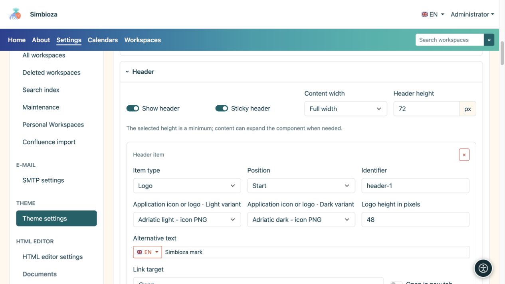
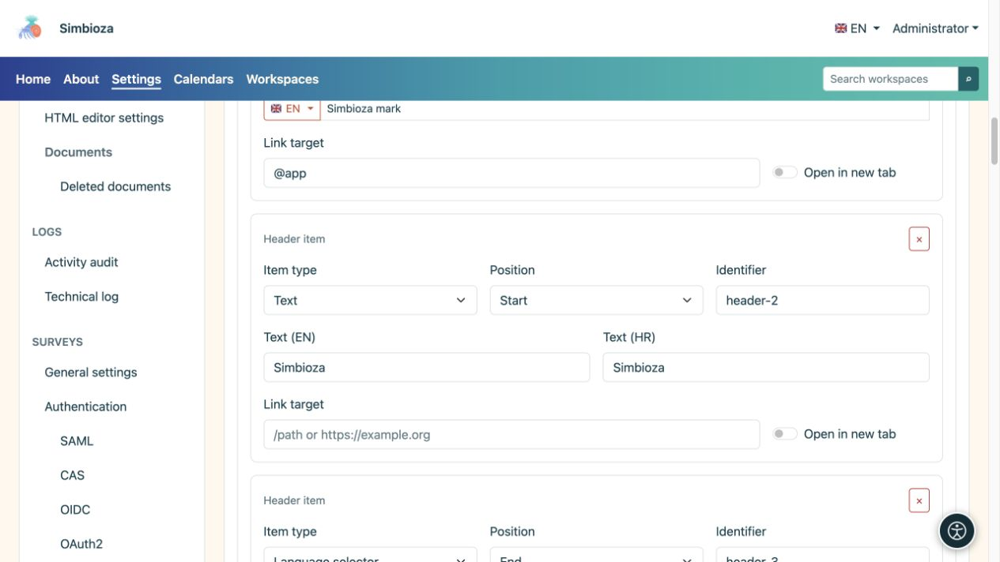
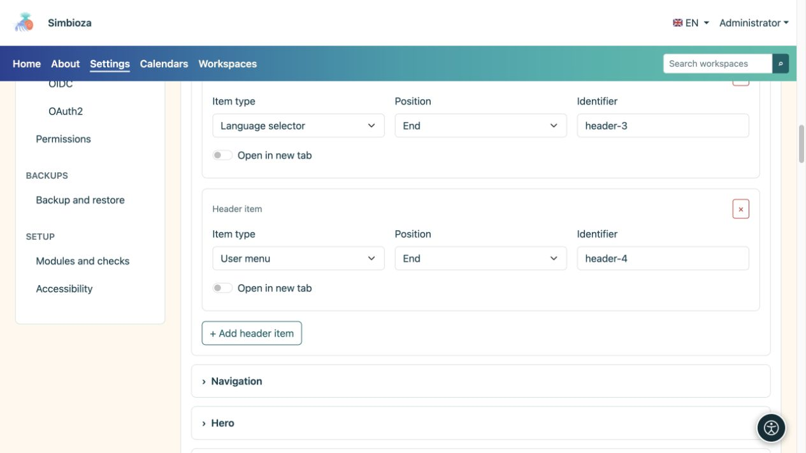

# Build the header

[Themes](teme_en.md)

**Goal:** display the mark, name and required controls at the top. Expand **Header** in the open theme.

## Enable the header and set its space

**Show header** enables the top strip. **Sticky header** keeps it visible while scrolling. The selected height is a minimum: content may need more space.

| Width choice | Meaning |
| --- | --- |
| Full width | Uses available width with side spacing. |
| Wide | A broad layout with controlled side space. |
| sm, md, lg, xl, xxl | Responsive containers that gain a limited width from the corresponding screen size; compare them in preview. |

<figure>

<figcaption>Header height, width and items are configured in one section.</figcaption>
</figure>

## Add an item

1. Select **Add header item**.
2. Choose its **Item type** and **Position**.
3. Complete only the fields shown for that type.
4. Inspect the header and select **Save theme**.

| Item type | Fields and result |
| --- | --- |
| Text | A name or short text in available languages, with an optional link. |
| Logo | Light and dark files, height, alternative text and an optional link. |
| Language selector | Displays the application's available-language control. |
| Account menu | Displays sign-in or current-account controls supplied by the application. |

**Position: Start / End** groups the item at the start or end of the header. **Identifier** is the row's technical key, not its visible name; keep an existing value unless you need to change it. The × button removes the item, not the logo file.

<figure>

<figcaption>Text and logo have their own fields; language and account controls come from the application.</figcaption>
</figure>

<figure>

<figcaption>Language and account controls are separate header items; the button below adds another item.</figcaption>
</figure>

## Set the mark or name

Choose a logo from the library; add a missing one under [Theme files](teme-datoteke_en.md). Light and dark selectors may use different versions of the same mark. **No file selected** means no image is chosen.

Enter alternative text describing the mark and set its height in pixels. An oversized image may increase the whole header. A text or logo item may have a link and **Open in a new tab**; an ordinary home link need not open another tab.

**Check:** the name, language and account controls remain usable on a narrow screen and text is readable in both modes. Hiding the header's language control does not delete translations, and removing an account item does not change user permissions.
