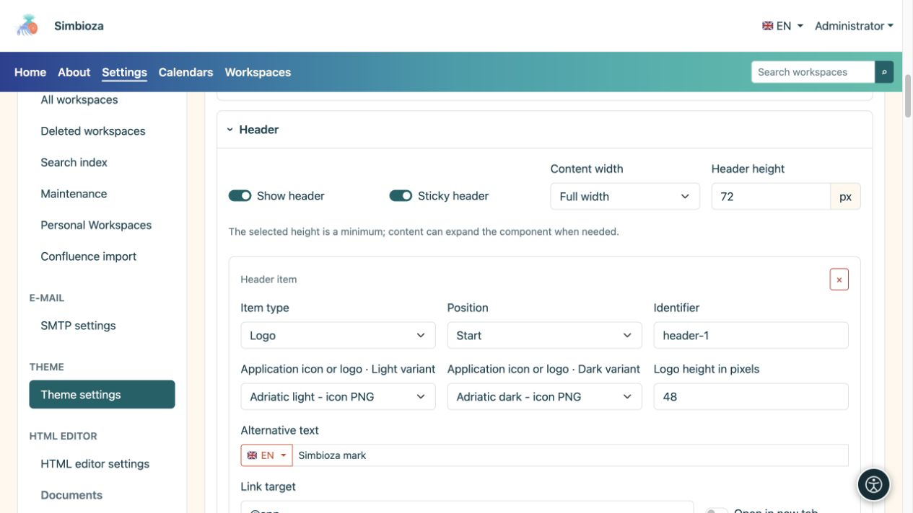
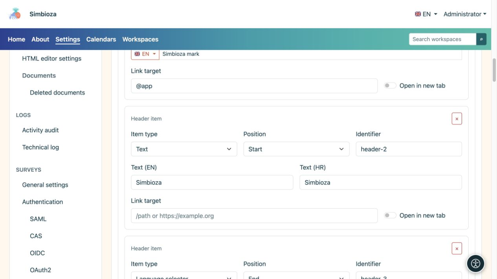
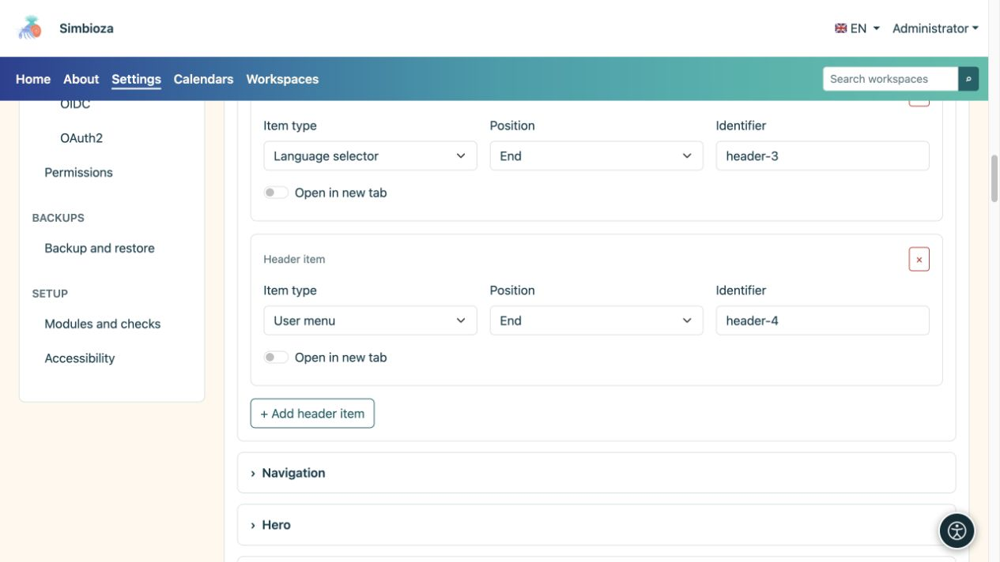

# Diseñar la cabecera

> Las capturas de pantalla muestran la interfaz en inglés.

[Temas](teme_es.md)

**Objetivo:** mostrar la marca, el nombre y los controles requeridos en la parte superior. Expanda **Encabezado** en el tema abierto.

## Habilite el encabezado y establezca su espacio.

**Mostrar encabezado** habilita la franja superior. **Encabezado fijo** lo mantiene visible mientras se desplaza. La altura seleccionada es mínima: el contenido puede necesitar más espacio.

| elección de ancho | Significado |
| --- | --- |
| Ancho completo | Utiliza el ancho disponible con espacio lateral. |
| Ancho | Un diseño amplio con espacio lateral controlado. |
| sm, maryland, lg, xl, xxl | Contenedores responsivos que obtienen un ancho limitado del tamaño de pantalla correspondiente; compararlos en la vista previa. |

<figure>

<figcaption>La altura, el ancho y los elementos del encabezado se configuran en una sola sección.</figcaption>
</figure>

## Agregar un artículo

1. Seleccione **Agregar elemento de encabezado**.
2. Elija su **Tipo de elemento** y **Posición**.
3. Complete solo los campos que se muestran para ese tipo.
4. Inspeccione el encabezado y seleccione **Guardar tema**.

| tipo de artículo | Campos y resultado |
| --- | --- |
| Texto | Un nombre o texto breve en los idiomas disponibles, con un enlace opcional. |
| Logo | Archivos claros y oscuros, altura, texto alternativo y un enlace opcional. |
| Selector de idioma | Muestra el control de idioma disponible de la aplicación. |
| Menú de cuenta | Muestra los controles de inicio de sesión o de cuenta actual proporcionados por la aplicación. |

**Posición: Inicio/Fin** agrupa el elemento al inicio o al final del encabezado. **Identificador** es la clave técnica de la fila, no su nombre visible; mantenga un valor existente a menos que necesite cambiarlo. El botón × elimina el elemento, no el archivo del logotipo.

<figure>

<figcaption>El texto y el logotipo tienen sus propios campos; Los controles de idioma y cuenta provienen de la aplicación.</figcaption>
</figure>

<figure>

<figcaption>Los controles de idioma y de cuenta son elementos de encabezado separados; el botón de abajo agrega otro elemento.</figcaption>
</figure>

## Establecer la marca o el nombre

Elija un logotipo de la biblioteca; agregue uno que falta en [Archivos de tema](teme-datoteke_es.md). Los selectores claros y oscuros pueden utilizar diferentes versiones de la misma marca. **No hay ningún archivo seleccionado** significa que no se ha elegido ninguna imagen.

Ingrese un texto alternativo que describa la marca y establezca su altura en píxeles. Una imagen de gran tamaño puede aumentar todo el encabezado. Un elemento de texto o logotipo puede tener un enlace y **Abrir en una pestaña nueva**; un enlace de inicio normal no necesita abrir otra pestaña.

**Compruebe:** el nombre, el idioma y los controles de la cuenta siguen siendo utilizables en una pantalla estrecha y el texto se puede leer en ambos modos. Ocultar el control de idioma del encabezado no elimina las traducciones y eliminar un elemento de la cuenta no cambia los permisos del usuario.
