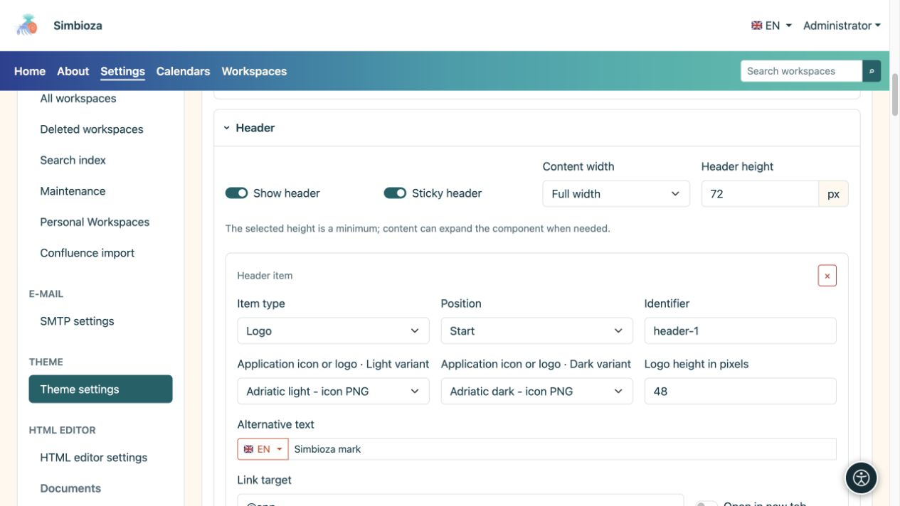
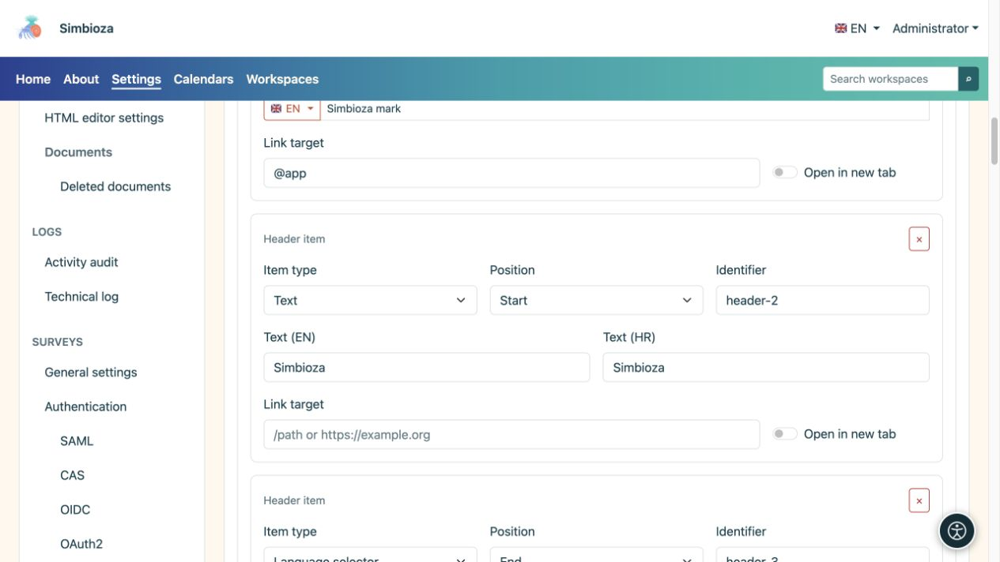
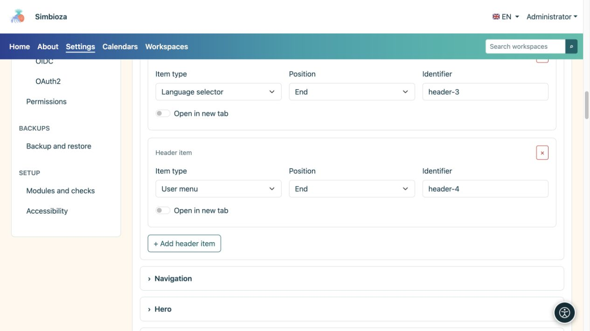

# Composer l’en-tête

> Les captures d’écran présentent l’interface en anglais.

[Thèmes](teme_fr.md)

**Objectif :** afficher la marque, le nom et les contrôles requis en haut. Développez **En-tête** dans le thème ouvert.

## Activer l'en-tête et définir son espace

**Afficher l'en-tête** active la bande supérieure. **L'en-tête collant** le maintient visible lors du défilement. La hauteur sélectionnée est un minimum : le contenu peut nécessiter plus d'espace.

| Choix de la largeur | Signification |
| --- | --- |
| Pleine largeur | Utilise la largeur disponible avec espacement latéral. |
| Large | Une disposition large avec un espace latéral contrôlé. |
| sm, md, lg, xl, xxl | Conteneurs réactifs qui gagnent une largeur limitée par rapport à la taille d'écran correspondante ; comparez-les en aperçu. |

<figure>

<figcaption>La hauteur, la largeur et les éléments de l'en-tête sont configurés dans une seule section.</figcaption>
</figure>

## Ajouter un article

1. Sélectionnez **Ajouter un élément d'en-tête**.
2. Choisissez son **Type d'élément** et sa **Position**.
3. Remplissez uniquement les champs affichés pour ce type.
4. Inspectez l'en-tête et sélectionnez **Enregistrer le thème**.

| Type d'article | Champs et résultat |
| --- | --- |
| Texte | Un nom ou un court texte dans les langues disponibles, avec un lien facultatif. |
| Logo | Fichiers clairs et sombres, hauteur, texte alternatif et lien facultatif. |
| Sélecteur de langue | Affiche le contrôle de langue disponible de l'application. |
| Menu du compte | Affiche les contrôles de connexion ou de compte courant fournis par l'application. |

**Position : Début / Fin** regroupe l'élément au début ou à la fin de l'en-tête. **Identifiant** est la clé technique de la ligne, pas son nom visible ; conservez une valeur existante sauf si vous devez la modifier. Le bouton × supprime l'élément, pas le fichier du logo.

<figure>

<figcaption>Le texte et le logo ont leurs propres champs ; les contrôles de langue et de compte proviennent de l’application.</figcaption>
</figure>

<figure>

<figcaption>Les contrôles de langue et de compte sont des éléments d'en-tête distincts ; le bouton ci-dessous ajoute un autre élément.</figcaption>
</figure>

## Définir la marque ou le nom

Choisissez un logo dans la bibliothèque ; ajoutez-en un manquant sous [Fichiers de thème](teme-datoteke_fr.md). Les sélecteurs clairs et foncés peuvent utiliser différentes versions de la même marque. **Aucun fichier sélectionné** signifie qu'aucune image n'est choisie.

Saisissez un texte alternatif décrivant la marque et définissez sa hauteur en pixels. Une image surdimensionnée peut agrandir tout l’en-tête. Un élément de texte ou de logo peut avoir un lien et **Ouvrir dans un nouvel onglet** ; un lien d'accueil ordinaire n'a pas besoin d'ouvrir un autre onglet.

**Vérifiez :** les contrôles de nom, de langue et de compte restent utilisables sur un écran étroit et le texte est lisible dans les deux modes. Le fait de masquer le contrôle de langue de l'en-tête ne supprime pas les traductions, et la suppression d'un élément de compte ne modifie pas les autorisations de l'utilisateur.
