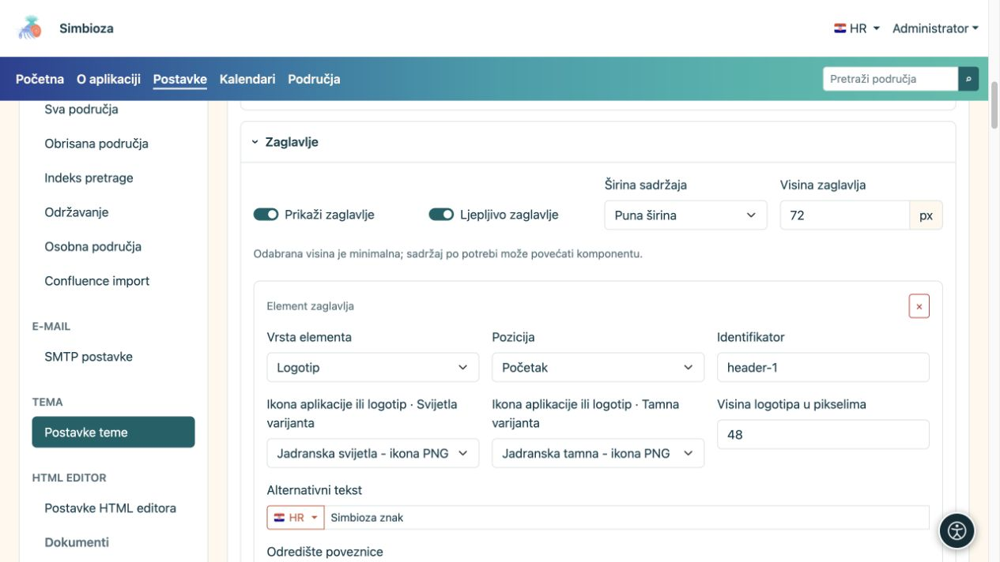
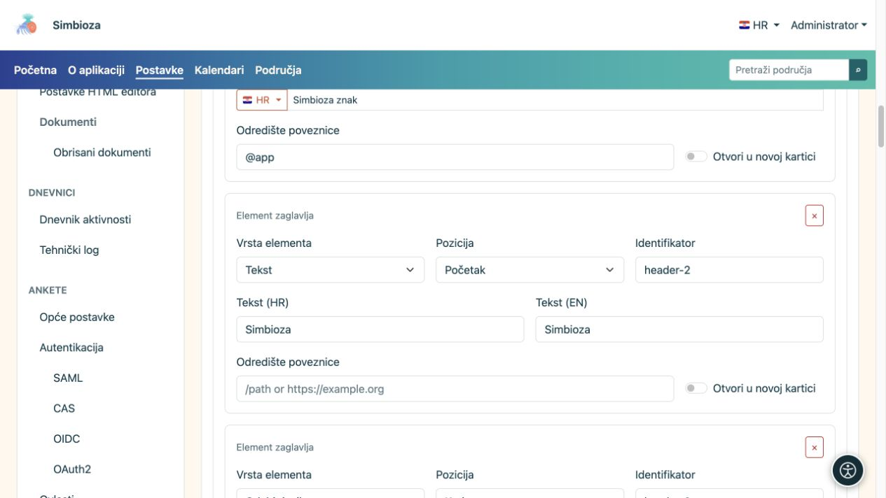
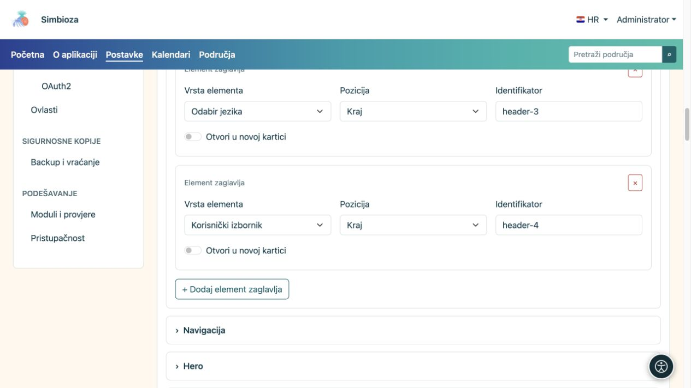

# Složite zaglavlje

[Teme](teme_hr.md)

**Cilj:** na vrhu prikazati znak, naziv i potrebne kontrole. U otvorenoj temi proširite **Zaglavlje**.

## Uključite zaglavlje i odredite prostor

**Prikaži zaglavlje** uključuje gornji pojas. **Ljepljivo zaglavlje** zadržava ga pri pomicanju stranice. Visina je minimalna: sadržaj po potrebi može zatražiti više prostora.

| Odabir širine | Značenje |
| --- | --- |
| Puna širina | Koristi raspoloživu širinu uz bočne razmake. |
| Široko | Širok raspored s kontroliranim bočnim prostorom. |
| sm, md, lg, xl, xxl | Prilagodljivi spremnici koji dobivaju ograničenu širinu od pripadajuće veličine zaslona; usporedite ih u pregledu. |

<figure>

<figcaption>Visina, širina i sadržaj zaglavlja podešavaju se u istoj cjelini.</figcaption>
</figure>

## Dodajte element

1. Odaberite **Dodaj element zaglavlja**.
2. Odaberite **Vrstu elementa** i **Poziciju**.
3. Ispunite samo polja koja se pojave za tu vrstu.
4. Pregledajte zaglavlje pa odaberite **Spremi temu**.

| Vrsta elementa | Što ispuniti / rezultat |
| --- | --- |
| Tekst | Naziv ili kratak tekst na dostupnim jezicima; po želji poveznicu. |
| Logotip | Datoteku za svijetlu i tamnu varijantu, visinu, alternativni tekst i po želji poveznicu. |
| Odabir jezika | Prikazuje aplikacijsku kontrolu dostupnih jezika. |
| Korisnički izbornik | Prikazuje prijavu ili kontrole aktualnog računa prema aplikaciji. |

**Pozicija: Početak / Kraj** grupira element uz početak ili kraj zaglavlja. **Identifikator** je tehnička oznaka retka, a ne vidljivi naziv; postojeću zadržite ako je nemate razlog mijenjati. Gumb × uklanja taj element, ne datoteku logotipa.

<figure>

<figcaption>Tekst i logotip imaju svoja polja; jezik i korisnički izbornik preuzimaju se iz aplikacije.</figcaption>
</figure>

<figure>

<figcaption>Jezik i račun su zasebni elementi zaglavlja; gumb ispod dodaje novi element.</figcaption>
</figure>

## Postavite znak ili naziv

Za logotip odaberite datoteku iz biblioteke; ako je nema, dodajte je kroz [Datoteke teme](teme-datoteke_hr.md). Svijetli i tamni izbornik mogu koristiti različite varijante istoga znaka. **Nije odabrana datoteka** znači da nema odabrane slike.

Unesite alternativni tekst koji opisuje znak i odredite njegovu visinu u pikselima. Prevelika slika može povećati cijelo zaglavlje. Za tekst ili logo možete zadati poveznicu i **Otvori u novoj kartici**; obična početna poveznica ne mora otvarati novu karticu.

**Provjerite:** vidite li naziv, jezik i račun na uskom zaslonu te je li tekst čitljiv u oba prikaza. Skrivanjem kontrole jezika u zaglavlju ne brišete prijevode, a uklanjanjem korisničkog elementa ne mijenjate ovlasti računa.
