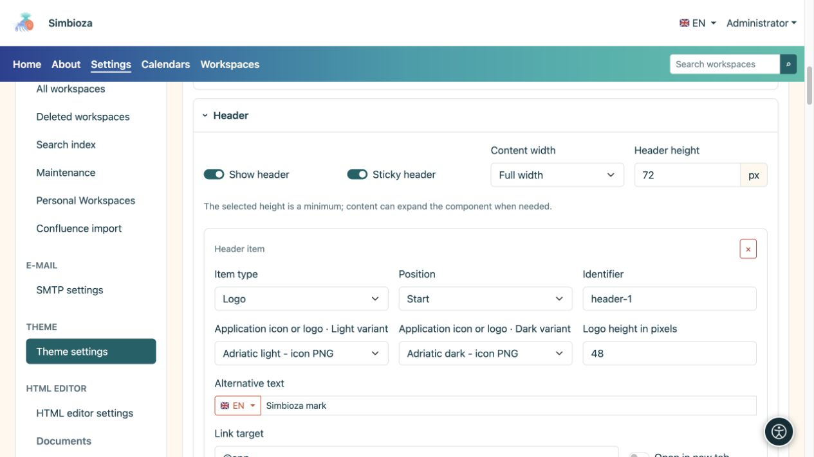
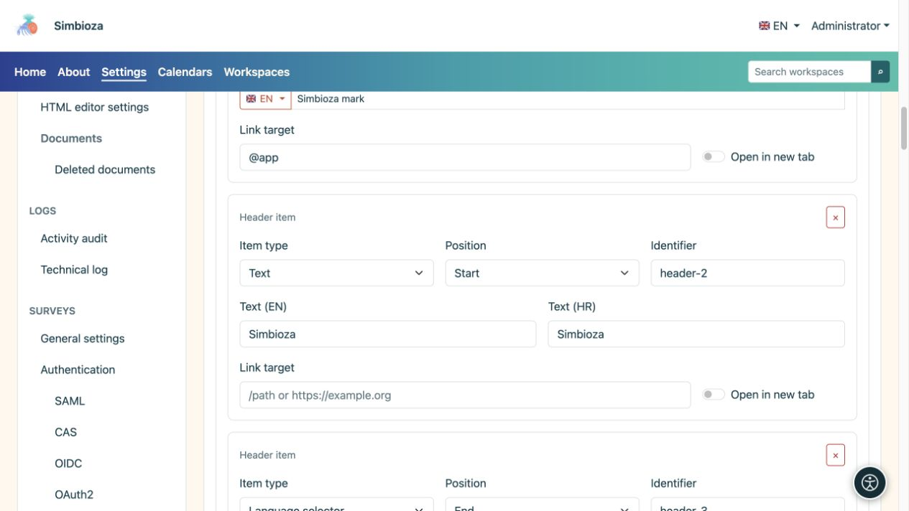
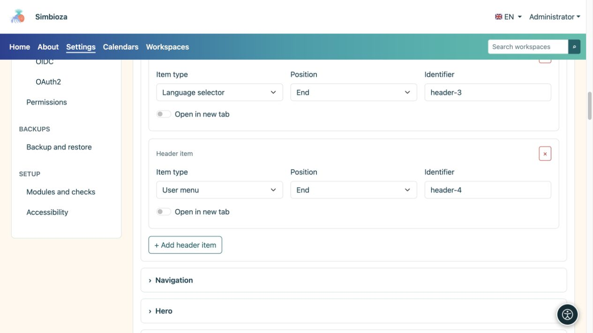

# Costruisci l'intestazione

> Le schermate mostrano l’interfaccia in inglese.

[Temi](teme_it.md)

**Obiettivo:** mostrare marchio, nome e comandi richiesti nella parte superiore. Espandi **Intestazione** nel tema aperto.

## Abilita l'intestazione e imposta il suo spazio

**Mostra intestazione** abilita la striscia superiore. **Intestazione fissa** lo mantiene visibile durante lo scorrimento. L'altezza selezionata è minima: il contenuto potrebbe richiedere più spazio.

| Scelta della larghezza | Significato |
| --- | --- |
| Tutta la larghezza | Utilizza la larghezza disponibile con la spaziatura laterale. |
| Largo | Un layout ampio con spazio laterale controllato. |
| sm, md, lg, xl, xxl | Contenitori che si adattano allo schermo e assumono una larghezza limitata a partire dalla dimensione corrispondente; confrontali nell'anteprima. |

<figure>

<figcaption>L'altezza, la larghezza e gli elementi dell'intestazione sono configurati in un'unica sezione.</figcaption>
</figure>

## Aggiungi un elemento

1. Seleziona **Aggiungi elemento di intestazione**.
2. Scegli il **Tipo di elemento** e la **Posizione**.
3. Compila solo i campi visualizzati per quella tipologia.
4. Esamina l'intestazione e seleziona **Salva tema**.

| Tipo di elemento | Campi e risultato |
| --- | --- |
| Testo | Un nome o un breve testo nelle lingue disponibili, con un collegamento facoltativo. |
| Logo | File chiari e scuri, altezza, testo alternativo e un collegamento opzionale. |
| Selettore della lingua | Visualizza il controllo della lingua disponibile dell'applicazione. |
| Menu dell'account | Mostra i comandi di accesso o dell'account corrente forniti dall'applicazione. |

**Posizione: Inizio/Fine** raggruppa l'elemento all'inizio o alla fine dell'intestazione. **Identificatore** è la chiave tecnica della riga, non il suo nome visibile; mantenere un valore esistente a meno che non sia necessario modificarlo. Il pulsante × rimuove l'elemento, non il file del logo.

<figure>

<figcaption>Testo e logo hanno i propri campi; i controlli della lingua e dell'account provengono dall'applicazione.</figcaption>
</figure>

<figure>

<figcaption>I controlli della lingua e dell'account sono elementi di intestazione separati; il pulsante qui sotto aggiunge un altro elemento.</figcaption>
</figure>

## Impostare il marchio o il nome

Scegli un logo dalla libreria; aggiungine uno mancante in [File del tema](teme-datoteke_it.md). I selettori chiaro e scuro possono utilizzare versioni diverse dello stesso marchio. **Nessun file selezionato** significa che non è stata scelta alcuna immagine.

Inserisci un testo alternativo che descriva il marchio e imposta l'altezza in pixel. Un'immagine troppo grande può aumentare l'intera intestazione. Un elemento di testo o logo può avere un collegamento e **Apri in una nuova scheda**; un normale collegamento alla pagina iniziale non richiede una nuova scheda.

**Verifica:** il nome, la lingua e i controlli dell'account rimangono utilizzabili su uno schermo stretto e il testo è leggibile in entrambe le modalità. Nascondere il controllo della lingua dell'intestazione non elimina le traduzioni e la rimozione di un elemento dell'account non modifica le autorizzazioni dell'utente.
