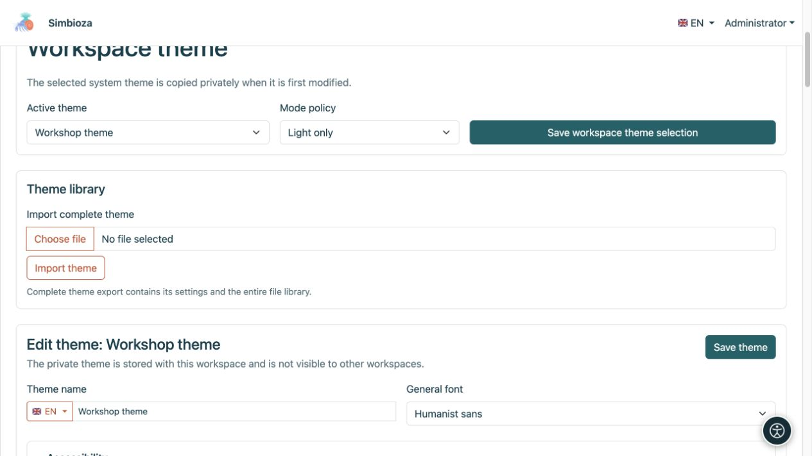
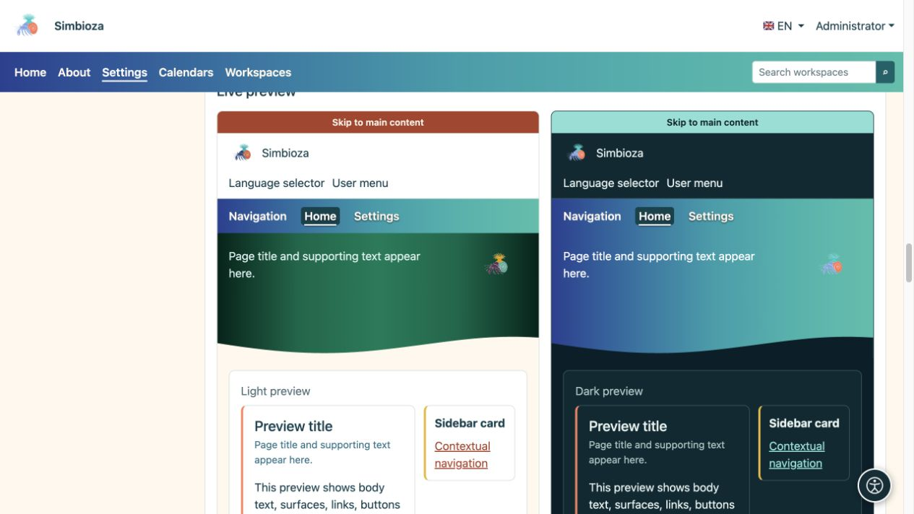
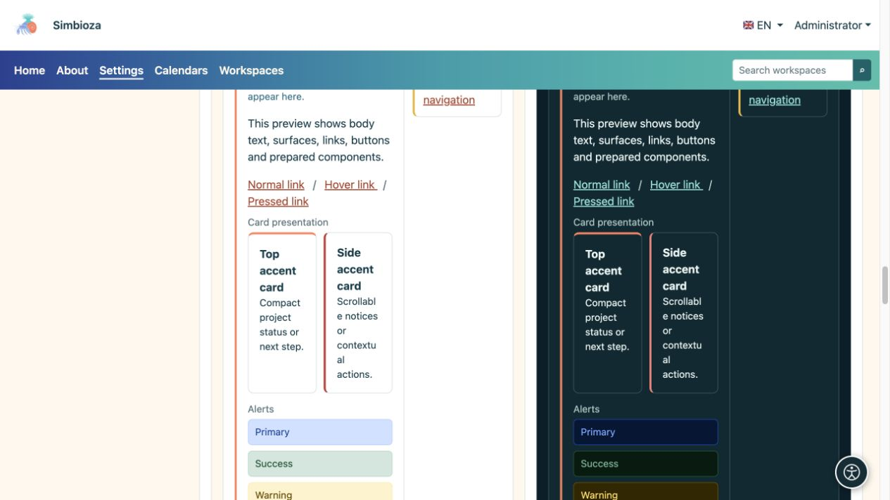
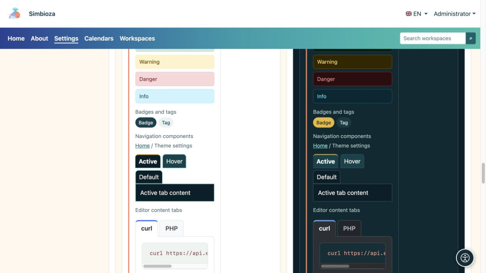

# Designs – das Erscheinungsbild von Simbioza

> Die Bildschirmaufnahmen zeigen die englische Benutzeroberfläche.

Ein Design steuert Farben, Typografie, Header, Navigation und Oberflächen. Der gleiche Inhalt kann ruhig und professionell, farbenfroh oder illustrativ aussehen. **Durch das Ändern des Designs werden Seiten, Umfrageantworten oder Zugriffsberechtigungen nicht geändert.**

## Wählen Sie Ihre Aufgabe

| Ziel | Anleitung |
| --- | --- |
| Wählen Sie ein Design aus, kopieren Sie es oder ändern Sie seine Schriftart | [Erste Schritte](teme-pocetak_de.md) |
| Ändern Sie oben die Markierung, den Namen und die Steuerelemente | [Kopfzeile](teme-zaglavlje_de.md) |
| Ändern Sie Menüposition, Typografie und Farben | [Navigation](teme-navigacija_de.md) |
| Passen Sie den großen Farbbereich mit einem Titel oder Bild an | [Hero-Bereich](teme-hero_de.md) |
| Ändern Sie Breite, Titelplatzierung, Akzente und Schatten | [Inhalte und Karten](teme-sadrzaj-kartice_de.md) |
| Passen Sie Schaltflächen, Tabellen, Formulare und andere Elemente an | [Farben und Komponenten](teme-boje-komponente_de.md) |
| Fügen Sie ein Bild hinzu, übertragen Sie ein Design oder exportieren Sie Beispiele | [Dateien, Import und Export](teme-datoteke_de.md) |

## Wer darf das Erscheinungsbild verändern?

Ein Administrator öffnet **Einstellungen → Designeinstellungen**, um das Erscheinungsbild der Installation zu ändern. Sofern verfügbar, öffnet ein Arbeitsbereichsmanager **Arbeitsbereichsdesign bearbeiten** in [seinen Arbeitsbereichseinstellungen](podrucja-upravljanje_de.md). Sein privates Design gilt nur dort und verändert nicht das globale Erscheinungsbild anderer Arbeitsbereiche.

Leser benötigen diese Einstellungen nicht. Wenn der Administrator den automatischen Modus wählt und im Profil eine persönliche Auswahl verfügbar ist, können Benutzer zwischen hellem, dunklem oder System-Erscheinungsbild wählen. Das ändert das Design nicht für jeden.

## Erkennen Sie die drei Seitenbereiche

- **Kopfzeile:** die obere Leiste mit der Markierung, dem Namen, der Sprache und dem Kontomenü.
- **Navigation:** Elemente wie Startseite, Kalender und Arbeitsbereiche. Das Design steuert ihre Präsentation; [Menüs](izbornici_de.md) steuert Elemente, Ziele und Sichtbarkeit.
- **Hero:** ein größerer Bereich mit Titel, Beschreibung und optionalem Bild. Der Hauptinhalt und die Karten folgen unten oder können bei der Konfiguration teilweise überlappen.

<figure>

<figcaption>Der Arbeitsbereichsmanager speichert diese Arbeitsbereichsauswahl, ohne das globale Site-Design zu ändern.</figcaption>
</figure>

## Überprüfen Sie das Ergebnis

Der Editor verfügt über separate helle und dunkle Vorschauen. Vergleichen Sie Header, Navigation, Hero, Schaltflächen und Inhaltselemente. Öffnen Sie dann eine echte Seite: Ein kurzer Demonstrationstitel ersetzt nicht die Überprüfung eines langen echten Titels, einer breiten Tabelle oder einer mobilen Navigation.

<figure>

<figcaption>Die Live-Vorschau zeigt, wie verwandte Einstellungen zusammenarbeiten.</figcaption>
</figure>

<figure>

<figcaption>Vergleichen Sie die Lesbarkeit von Karten und Warnungen vor hellem und dunklem Hintergrund.</figcaption>
</figure>

<figure>

<figcaption>Die Vorschau umfasst Abzeichen, Navigationsstatus und Editor-Inhaltsregisterkarten.</figcaption>
</figure>

**Ein einfacher Ausgangspunkt:** Kopieren Sie das nächstgelegene vorhandene Design, ändern Sie eine Gruppe von Einstellungen, überprüfen Sie beide Varianten und speichern Sie. Dadurch wird jede Änderung leichter verständlich.
