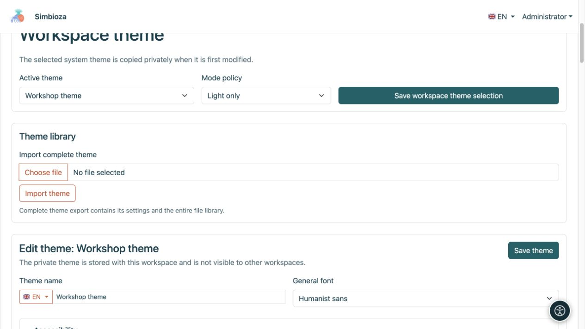
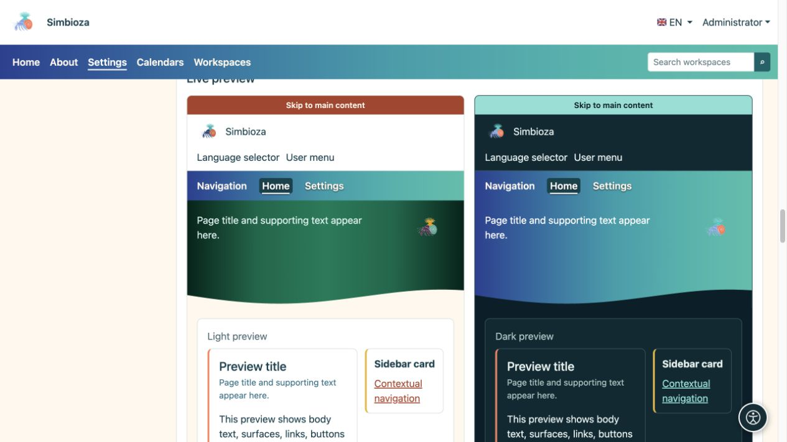
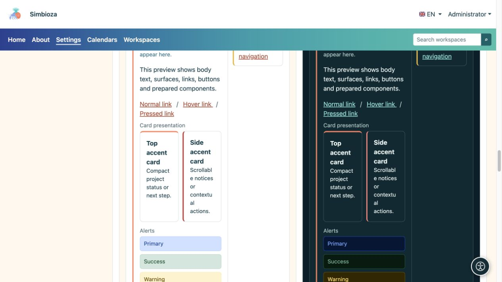
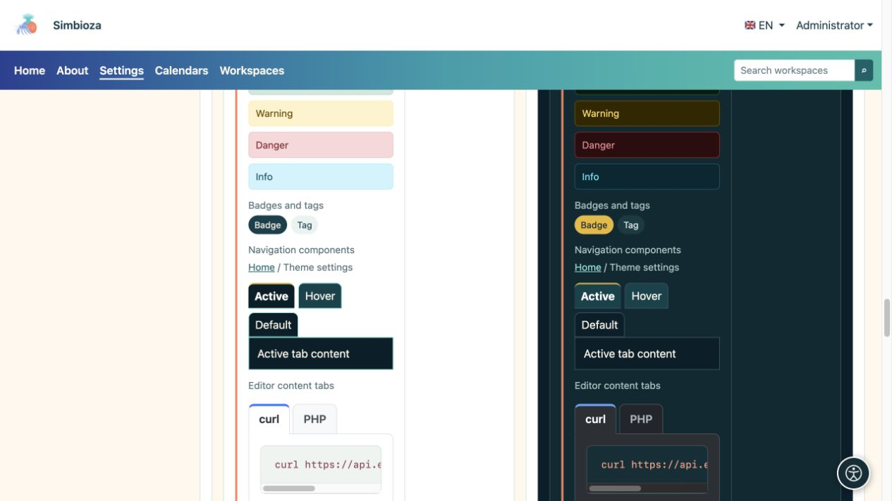

# Themes — Simbioza's appearance

A theme controls colours, typography, the header, navigation and surfaces. The same content can look quiet and professional, colourful or illustration-led. **Changing the theme does not change pages, survey responses or access permissions.**

## Choose your task

| Goal | Guide |
| --- | --- |
| Choose or copy a theme, or change its font | [Getting started](teme-pocetak_en.md) |
| Change the mark, name and controls at the top | [Header](teme-zaglavlje_en.md) |
| Change menu position, typography and colours | [Navigation](teme-navigacija_en.md) |
| Adjust the large coloured area with a title or image | [Hero](teme-hero_en.md) |
| Change width, title placement, accents and shadows | [Content and cards](teme-sadrzaj-kartice_en.md) |
| Adjust buttons, tables, forms and other elements | [Colours and components](teme-boje-komponente_en.md) |
| Add an image, transfer a theme or export examples | [Files, import and export](teme-datoteke_en.md) |

## Who may change the appearance?

An administrator opens **Settings → Theme settings** to change the installation's appearance. Where available, a workspace manager opens **Edit workspace theme** in [their workspace settings](podrucja-upravljanje_en.md). Its private theme applies there only and does not change other workspaces' global appearance.

Readers do not need these settings. If the administrator selects automatic mode and personal selection is available in the profile, users may choose light, dark or system appearance. That does not edit the theme for everyone.

## Recognise the three page areas

- **Header:** the top strip with the mark, name, language and account menu.
- **Navigation:** items such as Home, Calendars and Workspaces. Theme controls their presentation; [Menus](izbornici_en.md) controls items, destinations and visibility.
- **Hero:** a larger area with a title, description and optional image. Main content and cards follow below, or may partially overlap it when configured.

<figure>

<figcaption>The workspace manager saves this workspace selection without changing the global site theme.</figcaption>
</figure>

## Inspect the result

The editor has separate light and dark previews. Compare the header, navigation, hero, buttons and content elements. Then open a real page: a short demonstration title does not replace checking a long real title, a wide table or mobile navigation.

<figure>

<figcaption>Live preview shows how related settings work together.</figcaption>
</figure>

<figure>

<figcaption>Compare card and alert readability against the light and dark backgrounds.</figcaption>
</figure>

<figure>

<figcaption>The preview includes badges, navigation states and editor content tabs.</figcaption>
</figure>

**An easy starting point:** copy the closest existing theme, change one group of settings, inspect both variants and save. This makes each change easier to understand.
