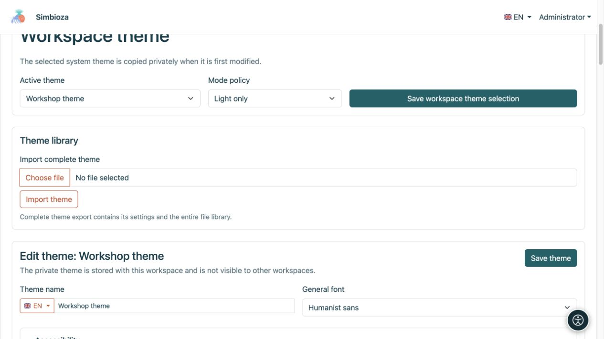
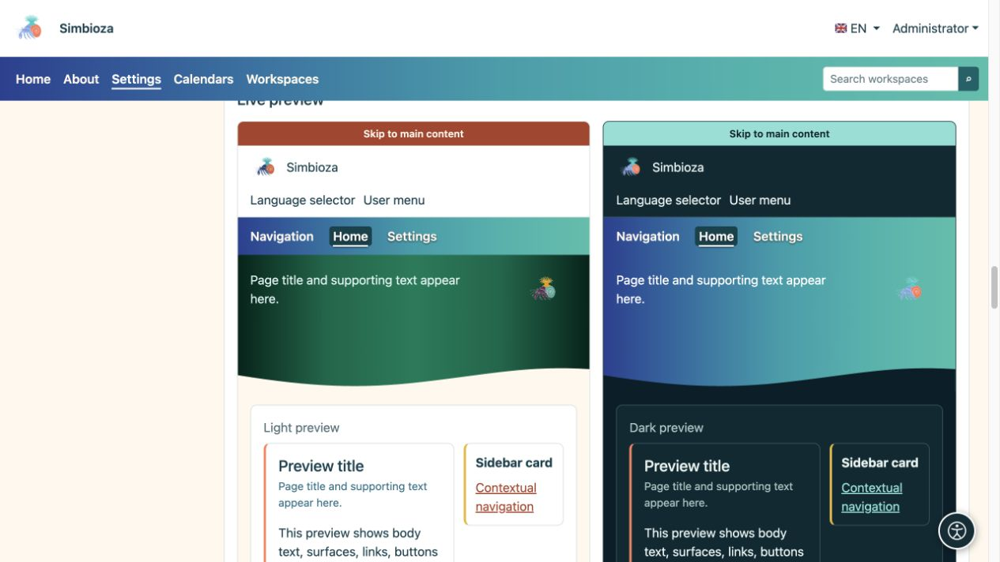
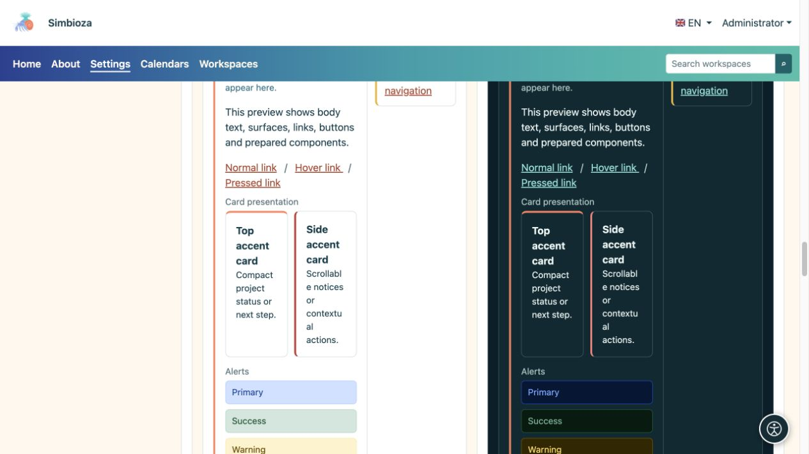
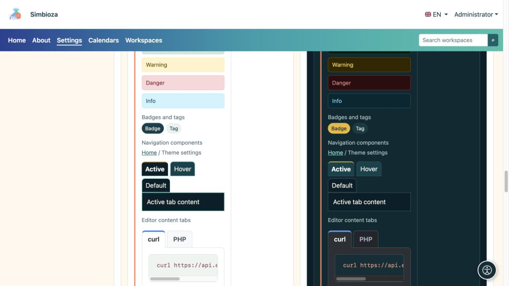

# Temas: la apariencia de Simbioza

> Las capturas de pantalla muestran la interfaz en inglés.

Un tema controla los colores, la tipografía, el encabezado, la navegación y las superficies. El mismo contenido puede parecer tranquilo y profesional, colorido o estar basado en ilustraciones. **Cambiar el tema no cambia las páginas, las respuestas de la encuesta ni los permisos de acceso.**

## Elija su tarea

| Meta | Guía |
| --- | --- |
| Elija o copie un tema, o cambie su fuente | [Empezando](teme-pocetak_es.md) |
| Cambiar la marca, el nombre y los controles en la parte superior | [Encabezado](teme-zaglavlje_es.md) |
| Cambiar la posición del menú, la tipografía y los colores. | [Navegación](teme-navigacija_es.md) |
| Ajusta el área coloreada grande con un título o imagen | [Elemento principal](teme-hero_es.md) |
| Cambiar el ancho, la ubicación del título, los acentos y las sombras. | [Contenido y tarjetas](teme-sadrzaj-kartice_es.md) |
| Ajustar botones, tablas, formularios y otros elementos. | [Colores y componentes](teme-boje-komponente_es.md) |
| Añade una imagen, transfiere un tema o exporta ejemplos | [Archivos, importar y exportar](teme-datoteke_es.md) |

## ¿Quién puede cambiar la apariencia?

Un administrador abre **Configuración → Configuración del tema** para cambiar la apariencia de la instalación. Cuando esté disponible, un administrador de espacio de trabajo abre **Editar tema del espacio de trabajo** en [la configuración de su espacio de trabajo](podrucja-upravljanje_es.md). Su tema privado se aplica allí únicamente y no cambia la apariencia global de otros espacios de trabajo.

Los lectores no necesitan esta configuración. Si el administrador selecciona el modo automático y la selección personal está disponible en el perfil, los usuarios pueden elegir la apariencia clara, oscura o del sistema. Eso no edita el tema para todos.

## Reconocer las tres áreas de la página.

- **Encabezado:** la franja superior con la marca, nombre, idioma y menú de cuenta.
- **Navegación:** elementos como Inicio, Calendarios y Espacios de trabajo. El tema controla su presentación; [Menús](izbornici_es.md) controla elementos, destinos y visibilidad.
- **Elemento principal:** un área más grande con título, descripción e imagen opcional. El contenido principal y las tarjetas se encuentran a continuación, o pueden superponerse parcialmente cuando se configuran.

<figure>

<figcaption>El gestor del espacio de trabajo guarda esta selección de espacio de trabajo sin cambiar el tema global del sitio.</figcaption>
</figure>

## inspeccionar el resultado

El editor tiene vistas previas claras y oscuras separadas. Compare el encabezado, la navegación, el elemento principal, los botones y los elementos de contenido. Luego abra una página real: un título breve de demostración no reemplaza la consulta de un título real largo, una tabla amplia o la navegación móvil.

<figure>

<figcaption>La vista previa en vivo muestra cómo funcionan juntas las configuraciones relacionadas.</figcaption>
</figure>

<figure>

<figcaption>Compare la legibilidad de las tarjetas y las alertas con fondos claros y oscuros.</figcaption>
</figure>

<figure>

<figcaption>La vista previa incluye insignias, estados de navegación y pestañas de contenido del editor.</figcaption>
</figure>

**Un punto de partida sencillo:** copie el tema existente más cercano, cambie un grupo de configuraciones, inspeccione ambas variantes y guarde. Esto hace que cada cambio sea más fácil de entender.
