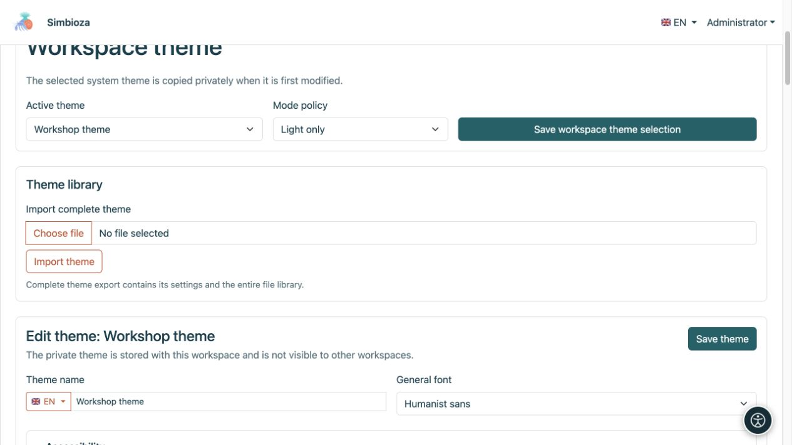
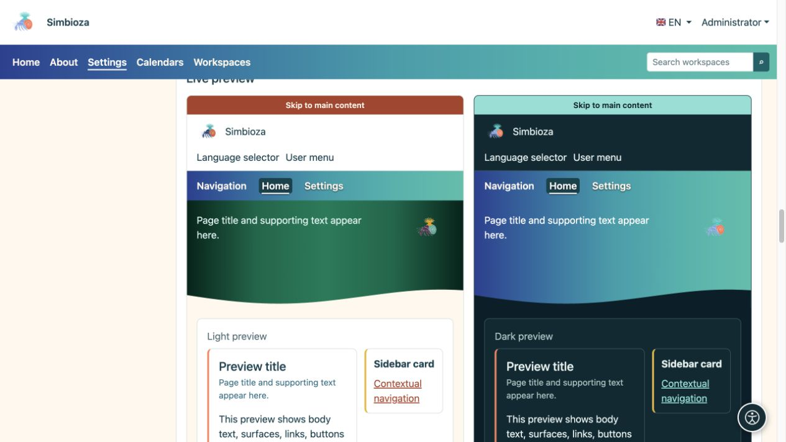
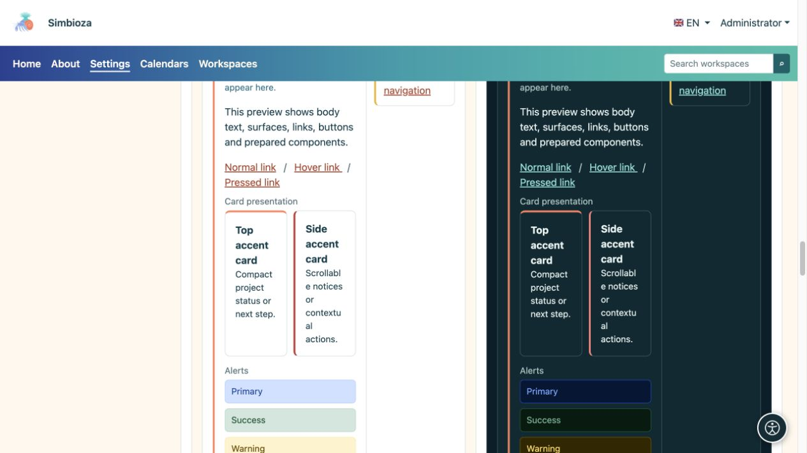
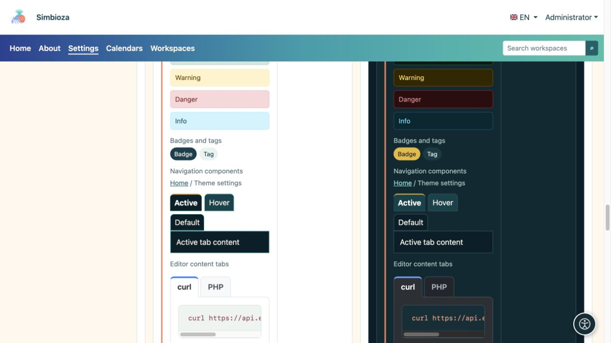

# Thèmes — l’apparence de Simbioza

> Les captures d’écran présentent l’interface en anglais.

Un thème détermine les couleurs, la typographie, l’en-tête, la navigation et les surfaces. Le même contenu peut avoir une apparence sobre et professionnelle, colorée ou illustrée. **Changer de thème ne modifie ni les pages, ni les réponses aux sondages, ni les droits d’accès.**

## Choisissez votre tâche

| Objectif | Guide |
| --- | --- |
| Choisir ou copier un thème, ou changer sa police | [Premiers pas](teme-pocetak_fr.md) |
| Modifier le logo, le nom et les commandes en haut de page | [En-tête](teme-zaglavlje_fr.md) |
| Modifier la position du menu, la typographie et les couleurs | [Navigation](teme-navigacija_fr.md) |
| Adapter la grande zone colorée contenant un titre ou une image | [Bandeau principal](teme-hero_fr.md) |
| Modifier la largeur, la position des titres, les accents et les ombres | [Contenu et cartes](teme-sadrzaj-kartice_fr.md) |
| Adapter les boutons, tableaux, formulaires et autres éléments | [Couleurs et composants](teme-boje-komponente_fr.md) |
| Ajouter une image, transférer un thème ou exporter des exemples | [Fichiers, importation et exportation](teme-datoteke_fr.md) |

## Qui peut modifier l’apparence ?

Un administrateur ouvre **Paramètres → Paramètres du thème** pour modifier l’apparence de l’installation. Lorsque cette option est disponible, le responsable d’un espace de travail ouvre **Modifier le thème de l’espace de travail** dans [les paramètres de son espace](podrucja-upravljanje_fr.md). Le thème privé ne s’applique qu’à cet espace et ne modifie pas l’apparence globale des autres espaces de travail.

Les lecteurs n’ont pas besoin de ces paramètres. Si l’administrateur choisit le mode automatique et que le choix personnel est disponible dans le profil, les utilisateurs peuvent sélectionner une apparence claire, sombre ou celle du système. Ce choix ne modifie pas le thème pour tout le monde.

## Reconnaître les trois zones de la page

- **En-tête :** le bandeau supérieur contenant le logo, le nom, la langue et le menu du compte.
- **Navigation :** les éléments tels qu’Accueil, Calendriers et Espaces de travail. Le thème détermine leur présentation ; les [menus](izbornici_fr.md) déterminent les éléments, les destinations et leur visibilité.
- **Bandeau principal :** une zone plus grande contenant un titre, une description et, éventuellement, une image. Le contenu principal et les cartes apparaissent en dessous ou peuvent la chevaucher partiellement, selon les paramètres.

<figure>

<figcaption>Le responsable de l’espace de travail enregistre ce choix pour cet espace sans modifier le thème global du site.</figcaption>
</figure>

## Examiner le résultat

L’éditeur propose des aperçus distincts pour les apparences claire et sombre. Comparez l’en-tête, la navigation, le bandeau principal, les boutons et les éléments de contenu. Ouvrez ensuite une vraie page : un court titre de démonstration ne remplace pas la vérification d’un titre réel plus long, d’un tableau large ou de la navigation sur téléphone.

<figure>

<figcaption>L’aperçu en direct montre comment les différents paramètres fonctionnent ensemble.</figcaption>
</figure>

<figure>

<figcaption>Comparez la lisibilité des cartes et des alertes sur les fonds clair et sombre.</figcaption>
</figure>

<figure>

<figcaption>L’aperçu comprend les badges, les états de navigation et les onglets de contenu de l’éditeur.</figcaption>
</figure>

**Pour commencer simplement :** copiez le thème existant le plus proche du résultat souhaité, modifiez un groupe de paramètres, examinez les deux variantes et enregistrez. Vous comprendrez ainsi plus facilement l’effet de chaque modification.
