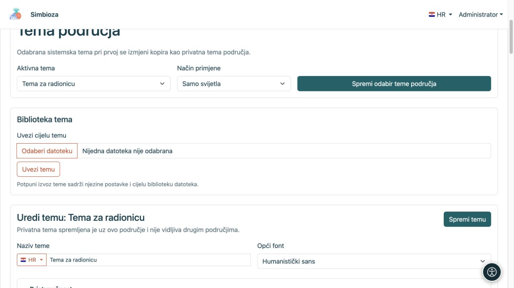
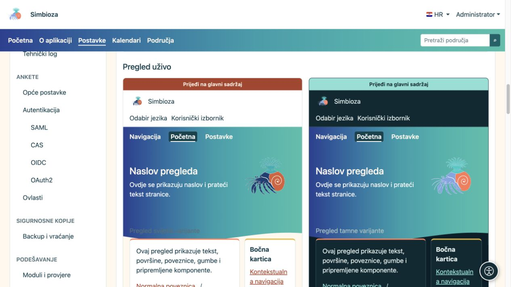
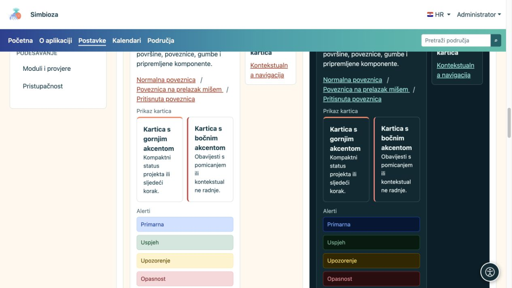
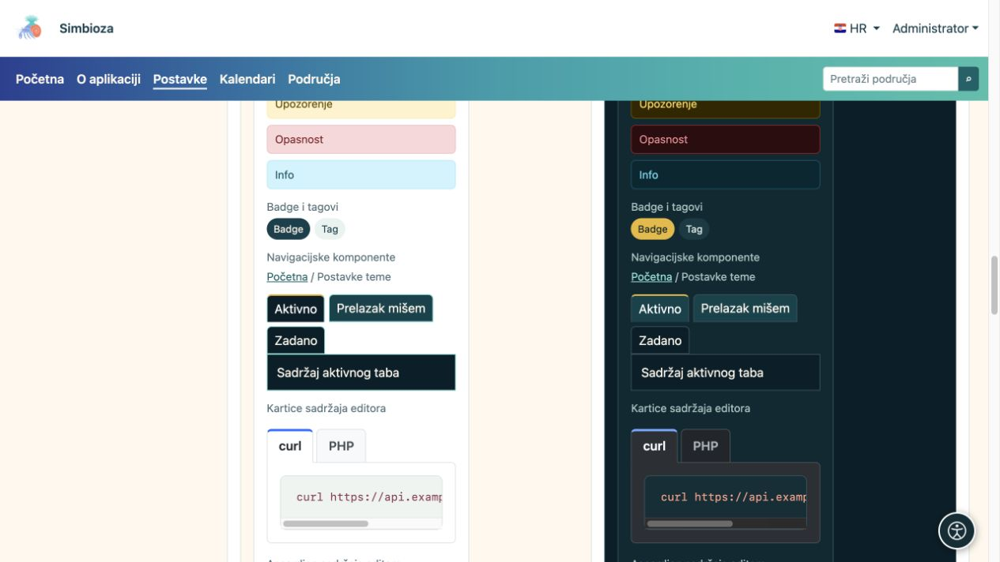

# Teme — izgled Simbioze

Tema određuje boje, slova, zaglavlje, izbornike i raspored površina. Isti sadržaj možete prikazati mirno i poslovno, šareno ili s izraženim ilustracijama. **Promjena teme ne mijenja stranice, odgovore anketa ni prava pristupa.**

## Odaberite svoj zadatak

| Želite… | Uputa |
| --- | --- |
| Odabrati temu, napraviti kopiju ili promijeniti font | [Početak rada s temama](teme-pocetak_hr.md) |
| Promijeniti znak, naziv i kontrole na vrhu | [Zaglavlje](teme-zaglavlje_hr.md) |
| Promijeniti položaj, slova i boje izbornika | [Navigacija](teme-navigacija_hr.md) |
| Urediti veliki obojeni dio s naslovom ili slikom | [Hero element](teme-hero_hr.md) |
| Promijeniti širinu, položaj naslova, akcente i sjene | [Sadržaj i kartice](teme-sadrzaj-kartice_hr.md) |
| Podesiti gumbe, tablice, obrasce i ostale elemente | [Boje i komponente](teme-boje-komponente_hr.md) |
| Dodati sliku, prenijeti temu ili napraviti izvoz | [Datoteke, uvoz i izvoz](teme-datoteke_hr.md) |

## Tko može mijenjati izgled?

Administrator otvara **Postavke → Postavke teme** i mijenja izgled instalacije. Upravitelj područja, ako je ta mogućnost dostupna, otvara **Uredi temu područja** u [postavkama svojeg područja](podrucja-upravljanje_hr.md). Njegova privatna tema vrijedi samo ondje; time ne mijenja globalni izgled drugih područja.

Običnom čitatelju ove postavke nisu potrebne. Ako je administrator odabrao automatski način i osobni je izbor dostupan u profilu, korisnik može birati svijetli, tamni ili sistemski prikaz. To nije uređivanje teme za sve.

## Upoznajte tri dijela stranice

- **Zaglavlje** je gornji pojas sa znakom, nazivom, jezikom i korisničkim izbornikom.
- **Navigacija** su stavke poput Početna, Kalendari i Područja. Tema određuje njihov izgled; [Izbornici](izbornici_hr.md) određuju stavke, odredišta i vidljivost.
- **Hero element** je veća površina s naslovom, opisom i mogućom slikom. Glavni tekst i kartice slijede ispod ili se, prema postavci, djelomice podižu preko nje.

<figure>

<figcaption>Upravitelj područja sprema odabir za svoje područje; time ne mijenja globalnu temu sitea.</figcaption>
</figure>

## Kako pregledati rezultat

U editoru su odvojeni pregledi svijetle i tamne varijante. U njima usporedite zaglavlje, navigaciju, hero, gumbe i sadržajne elemente. Zatim otvorite stvarnu stranicu: kraći demonstracijski naslov nije zamjena za provjeru dugačkog stvarnog naslova, širine tablice ili mobilnog izbornika.

<figure>

<figcaption>Pregled uživo pokazuje kako povezane postavke djeluju zajedno.</figcaption>
</figure>

<figure>

<figcaption>Usporedite čitljivost kartica i poruka na svijetloj i tamnoj podlozi.</figcaption>
</figure>

<figure>

<figcaption>Pregled uključuje oznake, stanja navigacije i sadržajne tabove editora.</figcaption>
</figure>

**Najlakši početak:** kopirajte najbližu postojeću temu, promijenite jednu skupinu postavki, pregledajte obje varijante i spremite. Tako lakše vidite učinak svake promjene.
