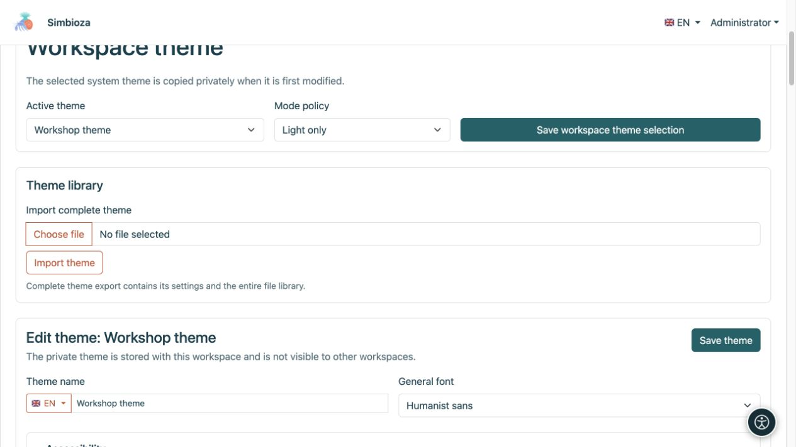
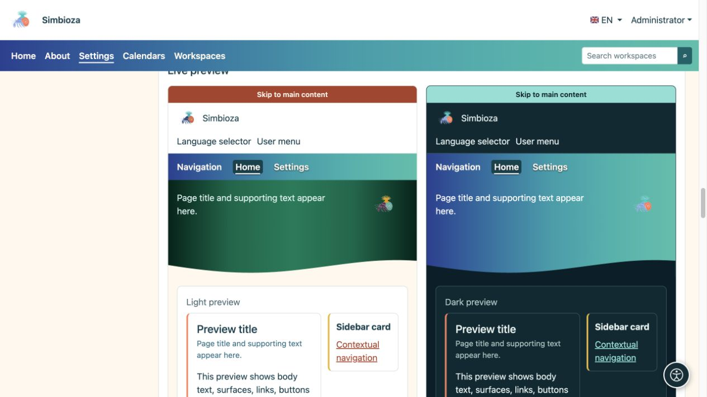
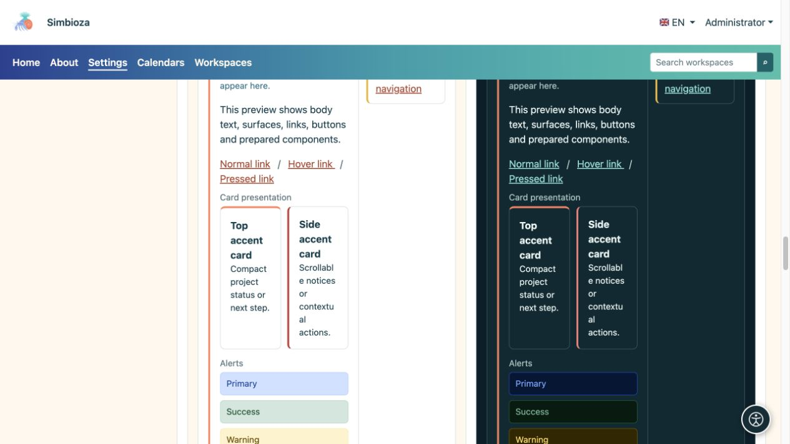
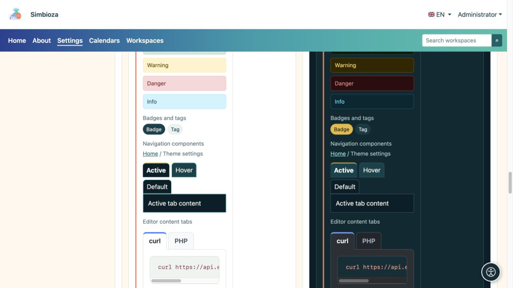

# Temi: aspetto di Simbioza

> Le schermate mostrano l’interfaccia in inglese.

Un tema controlla i colori, la tipografia, l'intestazione, la navigazione e le superfici. Lo stesso contenuto può apparire tranquillo e professionale, colorato o guidato da illustrazioni. **La modifica del tema non modifica le pagine, le risposte al sondaggio o le autorizzazioni di accesso.**

## Scegli il tuo compito

| Obiettivo | Guida |
| --- | --- |
| Scegli o copia un tema oppure modificane il carattere | [Per iniziare](teme-pocetak_it.md) |
| Cambiare marchio, nome e comandi in alto | [Intestazione](teme-zaglavlje_it.md) |
| Cambia la posizione del menu, la tipografia e i colori | [Navigazione](teme-navigacija_it.md) |
| Regola l'ampia area colorata con un titolo o un'immagine | [Sezione principale](teme-hero_it.md) |
| Modifica larghezza, posizionamento del titolo, accenti e ombre | [Contenuti e schede](teme-sadrzaj-kartice_it.md) |
| Regola pulsanti, tabelle, moduli e altri elementi | [Colori e componenti](teme-boje-komponente_it.md) |
| Aggiungi un'immagine, trasferisci un tema o esporta esempi | [File, importazione ed esportazione](teme-datoteke_it.md) |

## Chi può cambiare aspetto?

Un amministratore apre **Impostazioni → Impostazioni tema** per modificare l'aspetto dell'installazione. Ove disponibile, un gestore dell'area di lavoro apre **Modifica tema dell'area di lavoro** in [impostazioni dell'area di lavoro](podrucja-upravljanje_it.md). Il suo tema privato si applica solo lì e non modifica l'aspetto globale di altre aree di lavoro.

I lettori non hanno bisogno di queste impostazioni. Se l'amministratore seleziona la modalità automatica e nel profilo è disponibile la selezione personale, gli utenti possono scegliere l'aspetto chiaro, scuro o di sistema. Ciò non modifica il tema per tutti.

## Riconoscere le tre aree della pagina

- **Intestazione:** la striscia superiore con il marchio, il nome, la lingua e il menu dell'account.
- **Navigazione:** elementi come Home, Calendari e Aree di lavoro. Il tema controlla la loro presentazione; [Menu](izbornici_it.md) controlla elementi, destinazioni e visibilità.
- **Sezione principale:** un'area più ampia con titolo, descrizione e immagine opzionale. I contenuti principali e le schede seguono di seguito o potrebbero sovrapporsi parzialmente una volta configurati.

<figure>

<figcaption>Il gestore dell'area di lavoro salva la selezione dell'area di lavoro senza modificare il tema globale del sito.</figcaption>
</figure>

## Ispeziona il risultato

L'editor ha anteprime chiare e scure separate. Confronta l'intestazione, la navigazione, la sezione principale, i pulsanti e gli elementi di contenuto. Poi apri una pagina reale: un breve titolo dimostrativo non sostituisce la verifica di un titolo reale lungo, di una tabella ampia o della navigazione mobile.

<figure>

<figcaption>L'anteprima dal vivo mostra come le impostazioni correlate interagiscono.</figcaption>
</figure>

<figure>

<figcaption>Confronta la leggibilità delle schede e degli avvisi con gli sfondi chiari e scuri.</figcaption>
</figure>

<figure>

<figcaption>L'anteprima include badge, stati di navigazione e schede dei contenuti dell'editor.</figcaption>
</figure>

**Un semplice punto di partenza:** copia il tema esistente più vicino, modifica un gruppo di impostazioni, controlla entrambe le varianti e salva. Ciò rende ogni modifica più facile da comprendere.
