# Seiten bearbeiten

> Die Bildschirmaufnahmen zeigen die englische Benutzeroberfläche.

Erfahren Sie, wie Sie eine Seite erstellen, Text, Bilder und andere Inhalte hinzufügen und sie für die Leser vorbereiten. Sie arbeiten in einem visuellen Editor, ähnlich wie in einem Textverarbeitungsprogramm. **Für die alltägliche Bearbeitung müssen Sie weder HTML kennen noch Programmiercode schreiben.**

Befolgen Sie für Ihre erste Seite die Schritte [Seitenerstellung](#new-page), [grundlegende Formatierung](#text) und [Speichern und Veröffentlichen](#saving). Kehren Sie bei Bedarf zu den anderen Abschnitten zurück. Für Umfragen gibt es eigene [separate Leitfäden](ankete_de.md).

## 1. Erstellen Sie eine neue Seite oder öffnen Sie eine vorhandene

1. Öffnen Sie **Arbeitsbereiche** und wählen Sie den Arbeitsbereich aus, in dem Sie arbeiten möchten.
2. Um eine Seite zu erstellen, wählen Sie das Symbol **Neue Seite** neben der Arbeitsbereichsstruktur aus. Bewegen Sie den Mauszeiger über ein Symbol, um seinen Namen zu lesen.
3. Geben Sie den **Seitentitel** ein. Überprüfen Sie die Sprache, den Ziel-**Arbeitsbereich** und die **Übergeordnete Seite**. Das übergeordnete Element bestimmt, wo die neue Seite in der Baumstruktur angezeigt wird. Wählen Sie **Baumwurzel** für die oberste Ebene. Das Formular gibt an, für welche Primärsprache ein Titel erforderlich ist.
4. Sie können **Slug** leer lassen: Das System leitet es aus dem Titel ab. Dabei handelt es sich um den kurzen Teil der Webadresse der Seite. Vermeiden Sie es daher, ihn später ohne Angabe von Gründen zu ändern.
5. Wählen Sie **Erstellen und bearbeiten**. Die neue Seite wird im Editor geöffnet.

**Ergebnis:** Die Seite existiert an der ausgewählten Stelle und ist bereit für den Inhalt. Das Erstellen der Seite und das Eingeben von Text erfolgen getrennt von der Veröffentlichung für Leser.

<figure>
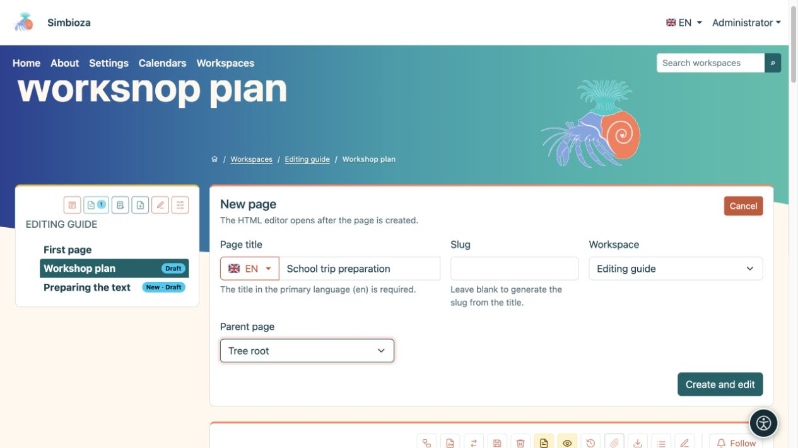
<figcaption>Neue Seite: Geben Sie einen Titel ein, überprüfen Sie dessen Sprache und Position in der Baumstruktur und wählen Sie dann „Erstellen und bearbeiten“ aus.</figcaption>
</figure>

Um eine vorhandene Seite zu ändern, öffnen Sie sie in der Baumstruktur und wählen Sie den Bleistift **Bearbeiten**. Wenn die Aktion „Erstellen“ oder „Bearbeiten“ fehlt, bitten Sie einen Administrator oder Arbeitsbereichsmanager, Ihre Berechtigungen zu überprüfen.

Eine Installation ohne Arbeitsbereiche verfügt möglicherweise über **HTML-Seiten** und **Inhalt verwalten**. Erstellen Sie dort eigenständige Seiten und bearbeiten Sie deren Inhalte mit demselben Editor. Wenn Arbeitsbereiche später installiert werden, funktionieren eigenständige Seiten so lange weiter, bis ein Administrator sie explizit in einen Arbeitsbereich verschiebt.

## 2. Finden Sie sich im Editor zurecht

Dokumentdetails, Sprachauswahl und Speicheraktionen stehen oben. Die **Symbolleiste** befindet sich direkt über dem Inhalt, den Sie bearbeiten. **Anhänge** unterhalb des Inhalts enthalten mit der Seite verknüpfte Dateien.

<figure>
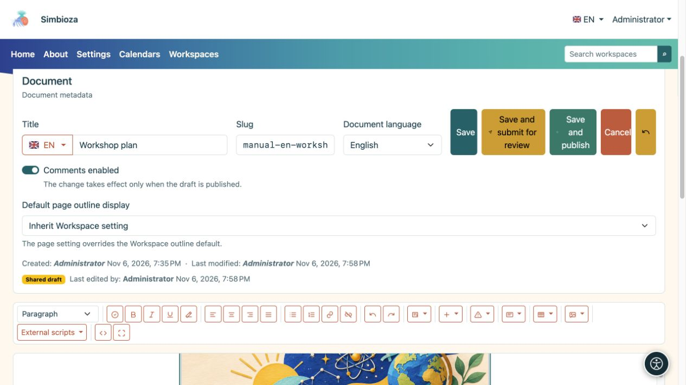
<figcaption>Oben im Editor: Dokumentdetails und Speicheraktionen über der Symbolleiste.</figcaption>
</figure>

Sofern angeboten, erlaubt **Kommentare aktiviert** neue Kommentare; bestehende Kommentare bleiben bestehen, wenn neue Kommentare ausgeschaltet werden. Auf einer Arbeitsbereichsseite folgt diese Änderung auf die Veröffentlichung. **Standardanzeige des Seiteninhaltsverzeichnisses** kann die Arbeitsbereichseinstellung übernehmen oder **Anzeigen/Ausblenden** für diese Seite auswählen.

Klicken Sie auf die Stelle, an der Sie etwas eingeben oder einfügen möchten. Wählen Sie vorhandene Wörter aus, bevor Sie sie formatieren. Um einen ganzen Absatz zu formatieren, platzieren Sie die Einfügemarke darin.

Bewegen Sie den Mauszeiger über eine Bildschaltfläche, um den Namen zu lesen. In einem schmaleren Fenster erstreckt sich die Symbolleiste über mehrere Zeilen. Verwenden Sie Tab und Umschalt+Tab, um zwischen Schaltflächen und Feldern zu wechseln. Aktivieren Sie eine fokussierte Schaltfläche mit der Eingabetaste oder der Leertaste.

| Symbolleistengruppe | Was es bewirkt |
| --- | --- |
| **Format** | Absätze, Überschriften, Zitate oder vorformatierter Text. |
| **Dokument prüfen** | Überprüft Überschriften, Bilder, Links und Tabellen vor der Veröffentlichung. |
| **Fett**, **Kursiv**, **Unterstrichen**, **Formatierung entfernen** | Formatiert den ausgewählten Text. |
| Vier Ausrichtungstasten | Links-, zentrierte, rechte oder Blocksatzausrichtung. |
| **Ungeordnete Liste**, **Geordnete Liste**, **Verknüpfung**, **Verknüpfung aufheben** | Listen und Links. |
| **Rückgängigmachen**, **Wiederherstellen** | Macht normale Textänderungen in der aktuellen Bearbeitungssitzung rückgängig oder wiederholt sie. |
| **Dynamische Elemente** | Tabs, Akkordeon, Dropdown-Inhalte, Diagramme, Zeitleisten und verfügbare Integrationen. |
| **Einfügen**, **Bootstrap-Warnungen**, **Karten** | Spalten, eine horizontale Linie, eingebettete Inhalte und hervorgehobene Abschnitte. |
| **Tabelle**, **Medien** | Funktioniert auf der ausgewählten Tabelle, dem Bild oder anderen Medien. |
| **Externe Skripte** | Zusätzliche Funktionen, die von einem Administrator vorbereitet und genehmigt wurden. |
| **Quellcode**, **Vollbild** | Erweiterte HTML-Ansicht oder mehr Platz für visuelle Bearbeitung. |

Einige Funktionen werden nur angezeigt, wenn das entsprechende Modul aktiviert ist und Sie über die erforderlichen Berechtigungen verfügen. Ein nicht verfügbarer Tabellen- oder Medienbefehl bedeutet oft einfach, dass Sie noch keine Tabellenzelle oder kein Bild ausgewählt haben.

<figure>
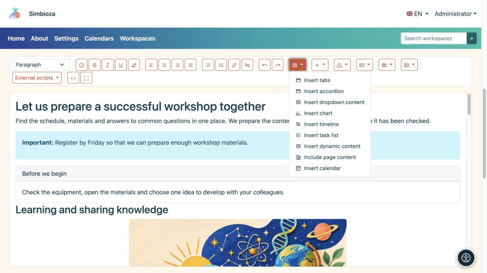
<figcaption>Dynamische Elemente öffnen die Einstellungen für komplexere Inhalte. Verfügbare Integrationen hängen von den installierten Modulen ab.</figcaption>
</figure>

## 3. Text schreiben und formatieren

### Überschriften, Absätze und Listen

1. Schreiben Sie einen kurzen Eröffnungsabsatz, in dem Sie das Thema der Seite erläutern.
2. Geben Sie für einen neuen Abschnitt eine Überschrift ein, platzieren Sie die Einfügemarke darin und wählen Sie unter **Format** die Ebene aus. Der Seitentitel ist bereits die Hauptüberschrift; Hauptabschnitte beginnen normalerweise mit **Überschrift 2**, gefolgt von **Überschrift 3** für Unterabschnitte.
3. Verwenden Sie **Ungeordnete Liste** für Elemente und **Geordnete Liste** für Schritte, die nacheinander ausgeführt werden müssen.
4. Wählen Sie einige Wörter aus und setzen Sie sie zur Hervorhebung fett oder kursiv. Um unerwünschte eingefügte Stile zu entfernen, markieren Sie den Text und wählen Sie **Formatierung entfernen**.

**Ergebnis:** Die Seite verfügt über klare Abschnitte, die den Lesern und Hilfstechnologien die Navigation erleichtern. Verwenden Sie keinen gewöhnlichen fett gedruckten Absatz als Ersatz für eine echte Überschrift.

Verwenden Sie **Anführungszeichen** für zitierte Wörter. **Vorformatiert** behält Leerzeichen und das Layout eines kurzen Textbeispiels bei. Die Linksausrichtung eignet sich am besten für längere Absätze. Durch die Rechtfertigung können große Lücken zwischen Wörtern entstehen.

### Links

1. Wählen Sie Wörter aus, die irgendwo hinführen sollen, z. B. „Bewerbungsvoraussetzungen“.
2. Wählen Sie **Link**.
3. Geben Sie für eine externe Seite die Webadresse ein und wählen Sie **URL-Link einfügen**. Wählen Sie für eine Simbioza-Seite unter **Interner Link** einen Arbeitsbereich und eine Seite aus und bestätigen Sie dann.
4. Für eine lange Liste verwenden Sie die Suche und **Mehr laden**. Der Picker bietet Seiten an, die Sie auswählen können.

**Verknüpfung aufheben** behält die Wörter bei und entfernt ihr Ziel. Öffnen Sie nach dem Speichern den Link in der Seitenansicht, um ihn zu überprüfen.

## 4. Trennen Sie Abschnitte durch Spalten, Warnungen und Karten

| Du willst… | Was zu tun | Ergebnis |
| --- | --- | --- |
| Zwei oder drei parallele Abschnitte | **Einfügen → Zwei Spalten / Drei Spalten**, dann den Text in jeder Spalte ersetzen. | Inhalte werden auf einem breiten Bildschirm nebeneinander angezeigt und auf einem schmalen Bildschirm gestapelt. |
| Eine kurze wichtige Anmerkung | Öffnen Sie **Bootstrap-Benachrichtigungen**, wählen Sie einen Stil und ersetzen Sie den Beispieltext. | Die Botschaft fällt auf. Beginnen Sie mit einem klaren Wort wie „Wichtig“; Farbe allein reicht nicht aus. |
| Ein separates Feld mit zugehörigen Informationen | **Karten → Karte mit Titel / Karte ohne Titel**. Füllen Sie den Textkörper und ggf. den Header aus. | Eine Zusammenfassung, ein Kontakt oder ein verwandter Abschnitt wird vom umgebenden Text getrennt. |
| Ein einfacher Teiler | **Einfügen → Horizontale Regel**. | Eine horizontale Linie trennt zwei Abschnitte. |

Verwenden Sie Spalten und Karten für kurze verwandte Inhalte und Überschriften für die Struktur eines längeren Artikels. Ersetzen Sie immer den gesamten eingefügten Beispieltext.

## 5. Tabs: mehrere Alternativen an einem Ort

Tabs eignen sich gut für Alternativen innerhalb eines Themas, etwa „Vor der Ankunft“, „Programm“ und „Kontakt“. Leser wählen einen Tab-Titel aus, um dessen Inhalt anzuzeigen.

1. Platzieren Sie die Einfügemarke dort, wo der Block stehen soll, und öffnen Sie **Dynamische Elemente → Tabulatoren einfügen**.
2. Geben Sie **2 bis 6 Titel** ein, einen pro Zeile, und wählen Sie **Einfügen**.
3. Füllen Sie im Haupteditor den Inhalt für jede Registerkarte aus. Dort können Sie auch Titel bearbeiten. Während der Bearbeitung werden die Inhalte so angelegt, dass Sie jeden einzelnen bearbeiten können.
4. Speichern und prüfen Sie den Seitenaufruf: Wenn Sie einen Titel auswählen, sollte der entsprechende Inhalt angezeigt werden.

<figure>
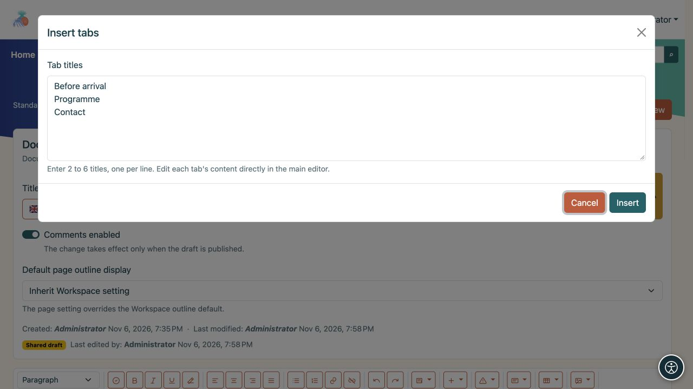
<figcaption>In diesem Beispiel werden drei Registerkarten erstellt. Nachdem Sie sie eingefügt haben, schreiben Sie ihre Körper im Haupteditor.</figcaption>
</figure>

Der Stift neben dem Block öffnet seine Einstellungen erneut. **Tabs entfernen** entfernt den gesamten Block. Durch das Entfernen eines Titels aus der Titelliste wird auch sein Inhalt entfernt. Titel und Inhalte gemeinsam ändern; Durch das Umschreiben oder Neuanordnen von Titelzeilen wird der zugehörige Text nicht automatisch verschoben.

## 6. Akkordeon: Abschnitte, die der Leser erweitern kann

Ein Akkordeon passt zu häufig gestellten Fragen oder mehreren kurzen Prozeduren. Leser wählen einen Fragetitel aus, um dessen Antwort zu öffnen. Sie können mehrere Abschnitte gleichzeitig geöffnet halten.

1. Wählen Sie **Dynamische Elemente → Akkordeon einfügen**.
2. Geben Sie **1 bis 12 Titel** ein, einen pro Zeile, und wählen Sie dann **Einfügen** aus.
3. Füllen Sie im Haupteditor den Text unter jedem Titel aus. Sie können Links, Bilder, Tabellen und andere Inhalte hinzufügen.
4. Öffnen und schließen Sie in der Seitenansicht einzelne Abschnitte, um deren Titel und Inhalt zu überprüfen.

<figure>
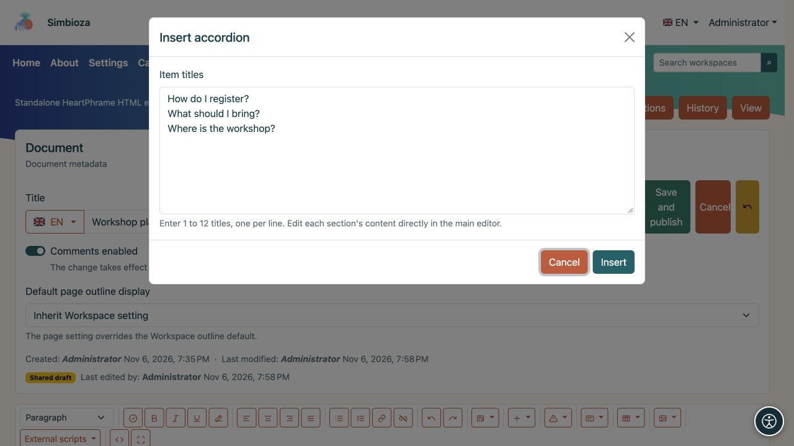
<figcaption>Jede Zeile wird zu einem Akkordeonabschnittstitel; Schreiben Sie die Antworten nach dem Einfügen des Blocks.</figcaption>
</figure>

Verwenden Sie den Bleistift des Blocks, um die Anzahl der Abschnitte zu ändern. Ein neuer Titel erhält einen leeren Textkörper; Durch das Entfernen eines Titels wird auch sein Hauptteil entfernt. **Akkordeon entfernen** entfernt die gesamte Gruppe.

## 7. Dropdown-Inhalt: eine erweiterbare Notiz

Für eine einzelne zusätzliche Notiz oder Erklärung wählen Sie **Dynamische Elemente → Dropdown-Inhalt einfügen**.

1. Geben Sie einen **Titel** ein, der den Inhalt klar beschreibt.
2. Aktivieren Sie **Inhalt beim Laden der Seite erweitert anzeigen**, wenn Leser den Text sofort sehen sollen.
3. Wählen Sie **Einfügen** und füllen Sie den Text unter dem Titel im Haupteditor aus.

<figure>
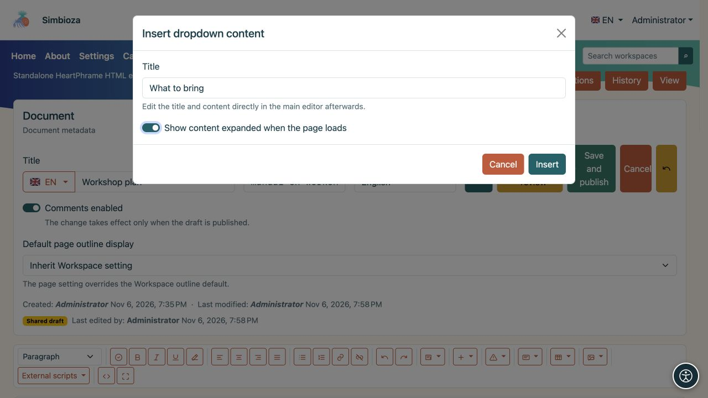
<figcaption>Die Einstellung für erweiterten Inhalt bestimmt, was ein Leser sieht, wenn die Seite geladen wird.</figcaption>
</figure>

Der Textkörper bleibt im Editor geöffnet, sodass Sie ihn bearbeiten können. Der Seitenaufruf folgt Ihrem gewählten Ausgangszustand; Leser wählen den Titel aus, um ihn zu öffnen oder zu schließen. Der Bleistift des Blocks öffnet seine Einstellungen und bietet die Entfernung an.

Tabulatoren, Akkordeon- und Dropdown-Inhalte können formatierten Text und andere Elemente enthalten. Halten Sie die wichtigsten Informationen der Seite sichtbar, ohne dass die Leser einen ausgeblendeten Abschnitt öffnen müssen.

<figure>
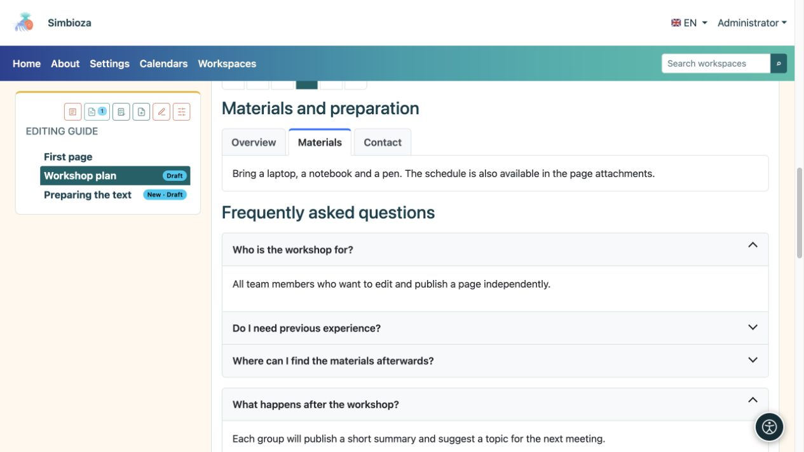
<figcaption>Das Ergebnis für den Leser: Die ausgewählte Registerkarte zeigt Materialien an, während die Auswahl einer Überschrift eine Antwort oder eine zusätzliche Notiz öffnet.</figcaption>
</figure>

## 8. Tabellen, Sortierung und Zeilenanzahl

### Erstellen und bearbeiten Sie eine Tabelle

Wählen Sie **Tabelle → Tabelle einfügen** und füllen Sie die vorbereiteten Zellen aus. Verwenden Sie die erste Zeile für Spaltenüberschriften wie „Name“, „Status“ und „Fälligkeitsdatum“.

Um eine Tabelle zu ändern, klicken Sie zunächst auf die entsprechende Zelle und öffnen Sie **Tabelle** erneut:

- **Zeile oben/unten einfügen** und **Zeile löschen** wirken sich auf die Zeile dieser Zelle aus.
- **Spalte links/rechts einfügen** und **Spalte löschen** wirken sich auf die jeweilige Spalte aus.
- **Mit Zelle rechts/unten zusammenführen** verbindet Zellen; **Zelle teilen** trennt eine zuvor zusammengeführte Zelle.

Verwenden Sie Tabellen für Daten statt Seitenlayout. Verwenden Sie [Spalten](#layout), um Inhalte anzuordnen.

### Lassen Sie die Leser Zeilen sortieren und durchsuchen

1. Klicken Sie auf eine Tabellenzelle.
2. Öffnen Sie **Tabelle → Tabelleneinstellungen**.
3. Aktivieren Sie **Sortierung und Seitennavigation**.
4. Wählen Sie **Anfangszeilen pro Seite**: **10, 25, 50, 100 oder Alle**.
5. Wählen Sie **Anwenden** und speichern Sie dann die Seite.

<figure>
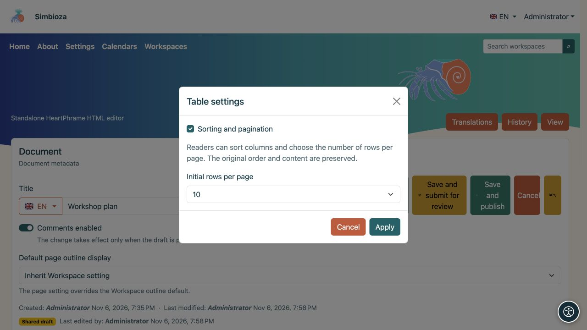
<figcaption>Diese Einstellungen gelten für die ausgewählte Tabelle. Leser können die Zeilenanzahl nachträglich ändern.</figcaption>
</figure>

**Ergebnis:** Leser wählen eine Spaltenüberschrift aus, um sie aufsteigend zu sortieren, wählen sie erneut für die absteigende Reihenfolge und ein drittes Mal für die ursprüngliche Reihenfolge aus. Pfeile zeigen die Richtung an. Sie können eine Zeilenanzahl neben der Tabelle auswählen und Seiten mit den Schaltflächen zum Seitenwechsel durchsuchen. **Alle** zeigt jede Zeile an.

Aktivieren Sie dies **separat für jede Tabelle**. Der Editor zeigt weiterhin jede Zeile an; die Sortierung eines Lesers verändert die gespeicherten Daten nicht. Es ist kein externes Skript erforderlich. Die Steuerelemente funktionieren auch bei HTML-Exporten und beim Drucken werden alle Zeilen angezeigt.

Diese Funktion benötigt eine Kopfzeile, die gleiche Anzahl von Zellen in jeder Datenzeile, keine zusammengeführten Zellen und keine in einer Zelle verschachtelte Tabelle. Behalten Sie für eine komplexere Tabelle die normale Ansicht bei oder teilen Sie die Daten in einfachere Tabellen auf.

<figure>
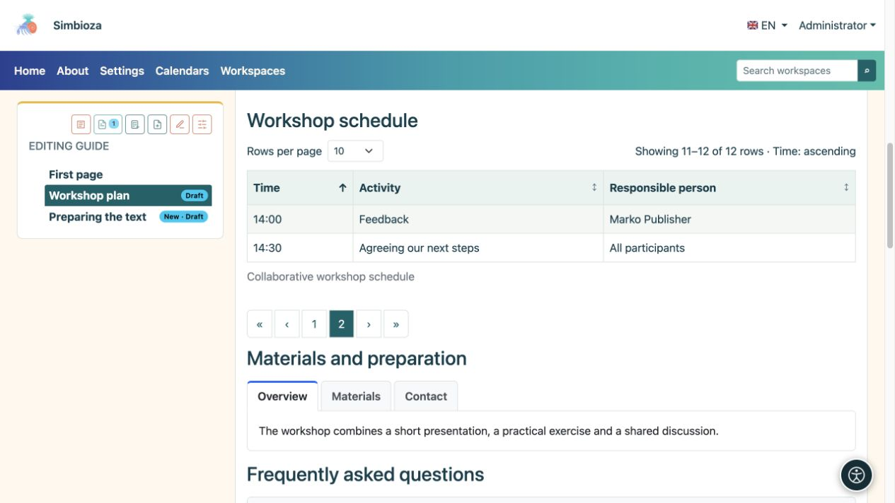
<figcaption>Leseransicht: 10 Zeilen pro Seite sind ausgewählt. Seite zwei zeigt die verbleibenden zwei Zeilen, 11–12 von 12. Der Kopfpfeil zeigt die Sortierung an.</figcaption>
</figure>

## 9. Laden Sie ein Bild, Video oder eine andere Datei hoch

1. Öffnen Sie unter dem Inhalt **Anhänge**, wählen Sie **Anhang hinzufügen / Dateien auswählen** und dann **Hochladen**. Warten Sie, bis der Upload abgeschlossen ist.
2. Geben Sie neben der Datei einen **Anzeigenamen** ein. Dies ist der Name, den die Leser sehen sollen. er kann klarer sein als der ursprüngliche Dateiname.
3. Geben Sie für ein Bild **Alternativtext** ein: eine kurze Beschreibung der vermittelten Informationen. Zum Beispiel „Raumaufteilung mit markiertem Eingang“ statt „image1.png“.
4. **Beschriftung** ist eine kurze Notiz neben dem eingelegten Medium; **Beschreibung** bietet zusätzliche Informationen zum Anhang. Wählen Sie **Metadaten speichern**.
5. Setzen Sie die Einfügemarke an die Stelle, an der die Datei erscheinen soll, und wählen Sie neben dem Anhang **Einfügen** aus.

**Ergebnis:** ein Bild oder Video erscheint im Inhalt; eine andere Datei wird als Link zum Öffnen oder Herunterladen angezeigt. Durch das alleinige Hochladen wird keine Datei in den Text eingefügt.

<figure>
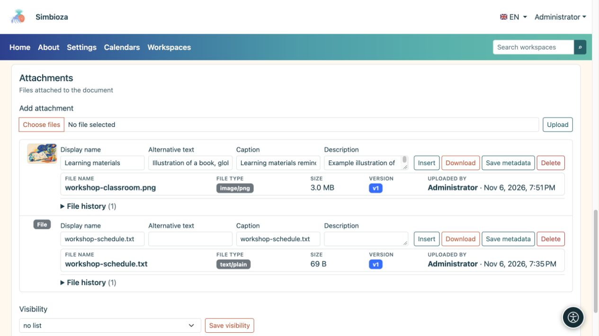
<figcaption>Geben Sie neben dem hochgeladenen Bild beschreibende Informationen ein und speichern Sie die Metadaten. Einfügen fügt den ausgewählten Anhang zum Inhalt hinzu.</figcaption>
</figure>

### Mediengröße, Abstand und Ausrichtung

Wählen Sie ein eingefügtes Bild oder ein anderes Medium aus und öffnen Sie **Medien**. Wählen Sie eine Breite von **25 %, 50 %, 75 % oder 100 %**, einen Abstand von **nein, klein, mittel oder groß** und eine Ausrichtung von **links, mittig oder rechts**. **Medien zurücksetzen** stellt die ursprünglichen Darstellungseinstellungen wieder her.

**Bildalternativtext bearbeiten** ändert die Beschreibung des ausgewählten Bildes. Verwenden Sie **Bild als dekorativ markieren** nur, wenn das Bild keine Informationen vermittelt, z. B. eine dekorative Trennwand. Eine sichtbare Beschriftung ersetzt keinen alternativen Text.

Für einen Screenshot ist es normalerweise am einfachsten, die volle Breite zu lesen. Überprüfen Sie die Seite in einem schmalen Fenster, nachdem Sie Änderungen vorgenommen haben.

<figure>
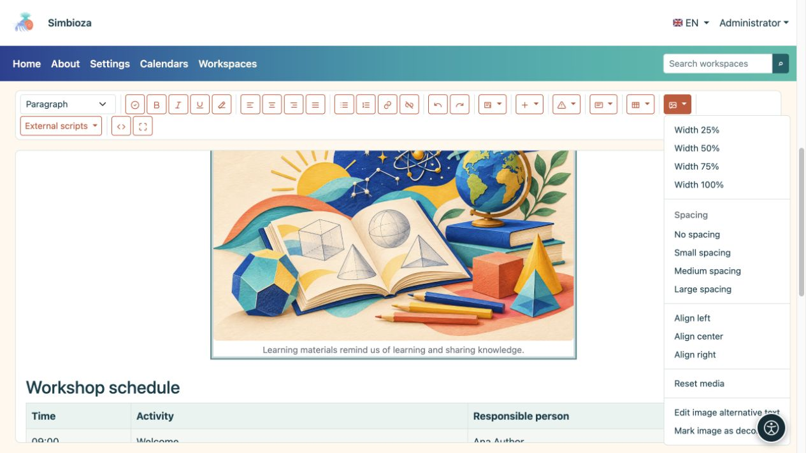
<figcaption>Wählen Sie zunächst das Bild aus und legen Sie dann mit „Medien“ dessen Aussehen und Beschreibung fest.</figcaption>
</figure>

### Anhangslisten und Verlauf

Die **Sichtbarkeit** im Abschnitt „Anhänge“ steuert, wer die Anhang-**Liste** sieht: keine Liste, alle, einschließlich Gäste oder authentifizierte Benutzer. Es gewährt selbst keinen Zugriff auf eine private Seite oder Datei.

Sie können eine Datei herunterladen, ihre Metadaten ändern und sie mit den entsprechenden Berechtigungen löschen. Wenn der **Dateiversionsverlauf** verfügbar ist, überprüfen Sie frühere Versionen und stellen Sie bei Bedarf eine wieder her. Das Entfernen eines Bildes aus dem Text und das Löschen seines Anhangs sind unterschiedliche Aktionen: Das Löschen der Datei kann sich auf Orte auswirken, an denen sie verwendet wird.

## 10. Inhalte von einem anderen Dienst einbetten

Für Inhalte wie eine interaktive Lernaktivität oder ein von einem anderen Dienst bereitgestelltes Video öffnen Sie **Einfügen → Eingebetteten Inhalt einfügen**.

1. Fügen Sie den **Iframe-Code oder die HTTPS-URL** des Anbieters ein.
2. Geben Sie einen **barrierefreien Titel** ein, z. B. „Übung: Geometrische Formen identifizieren“.
3. Legen Sie die **Höhe** fest und, falls erforderlich, **Vollbild zulassen**.
4. Wählen Sie **Einfügen**, speichern und überprüfen Sie die Seite. Benutzen Sie für spätere Änderungen den Bleistift des Blocks.

Sollte der Inhalt nicht angezeigt werden, kann der Anbieter die Einbettung verbieten oder eine gesonderte Anmeldung verlangen. Wenn ein zusätzliches Skript erforderlich ist, bitten Sie den Administrator, eine unterstützte Integration vorzubereiten. Fügen Sie keinen unbekannten Programmiercode selbst ein.

## 11. Vergleichen Sie numerische Daten mit einem Diagramm

1. Wählen Sie **Dynamische Elemente → Diagramm einfügen**.
2. Wählen Sie **Bar, Linie, Fläche, Kuchen oder Donut**. Ein Balkendiagramm eignet sich gut zum Vergleich der Teilnehmerzahlen pro Monat.
3. Geben Sie einen Titel, Kategorien und numerische Werte ein. **Kategorie hinzufügen** fügt eine weitere Kategorie hinzu; **Serie hinzufügen** fügt einen zweiten Satz von Werten hinzu, z. B. ein weiteres Jahr.
4. Fügen Sie ggf. Achsennamen und eine Beschreibung hinzu. Wählen Sie eine Legende, Ausrichtung, Aussehen, Breite und Ausrichtung. Der Hintergrund kann dem Design folgen.
5. Wählen Sie **Diagramm einfügen** und überprüfen Sie die Seitenansicht.

**Ergebnis:** Die von Ihnen eingegebenen Werte werden als Diagramm angezeigt. Sie werden nicht automatisch aus einer Umfrage oder einer anderen Tabelle geholt. Verwenden Sie den Stift des Diagramms, um seine Werte oder sein Erscheinungsbild zu ändern. In den Einstellungen ist auch die Entfernung möglich.

<figure>
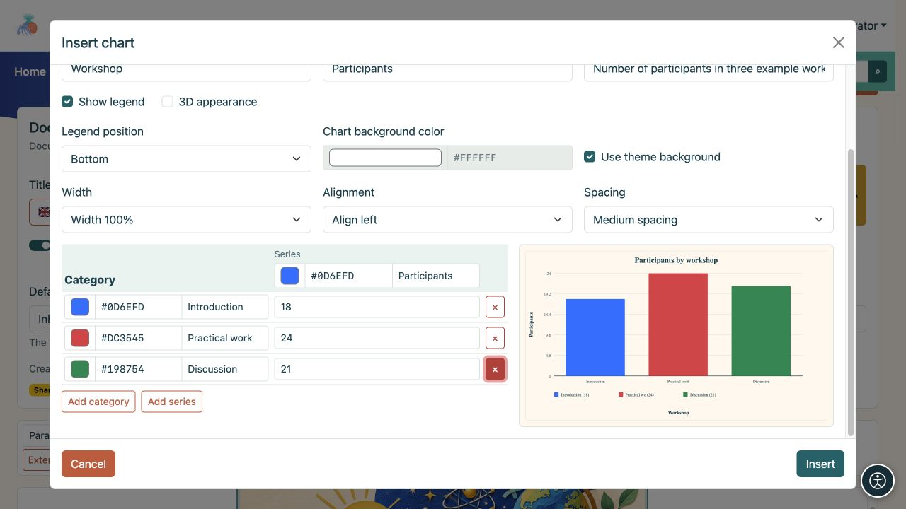
<figcaption>Ein Diagramm mit drei Kategorien. Die Vorschau zeigt den Effekt, wenn Sie seine Werte und sein Erscheinungsbild ändern.</figcaption>
</figure>

## 12. Zeigen Sie Aktivitäten auf einer Zeitleiste an

1. Wählen Sie **Dynamische Elemente → Zeitleiste einfügen**.
2. Geben Sie einen Titel sowie den Beginn und das Ende des Zeitraums ein, den Sie anzeigen möchten.
3. Wählen Sie die Zeitskala aus: **Tage, Wochen, Monate oder Quartale**.
4. Verwenden Sie **Gruppe hinzufügen**, um eine Gruppe hinzuzufügen, z. B. „Veranstaltungsvorbereitung“ und Aktivitäten mit Start- und Enddatum. Fügen Sie bei Bedarf weitere Gruppen und wichtige Datumsmarkierungen hinzu.
5. Wählen Sie **Zeitleiste einfügen** und prüfen Sie, ob jede Aktivität in den gewählten Zeitraum passt.

**Ergebnis:** Auf der Seite wird angezeigt, wann jede Aktivität beginnt und endet. Hierbei handelt es sich um eine Präsentation des von Ihnen eingegebenen Plans und nicht um einen automatischen Kalender oder einen Erinnerungsdienst. Verwenden Sie den Bleistift des Blocks, um seine Einstellungen erneut zu öffnen.

<figure>
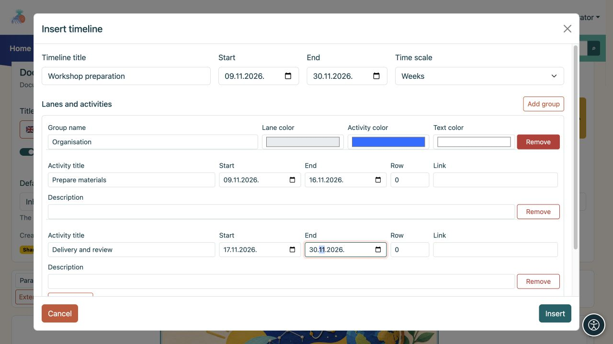
<figcaption>Ein Beispiel für eine Zeitleiste: eine Spur mit zwei Aktivitäten und individuellen Start- und Enddaten.</figcaption>
</figure>

## 13. Daten aus anderen Teilen von Simbioza anzeigen

Diese Menüeinträge **Dynamische Elemente** hängen von den installierten Modulen ab. Wenn ein Eintrag fehlt, fragen Sie einen Administrator, ob diese Funktion in Ihrer Installation verfügbar ist.

| Besonderheit | Was zu tun | Was Leser sehen |
| --- | --- | --- |
| **Aufgabenliste einfügen** | Geben Sie einen Titel und Aufgaben ein, eine pro Zeile. Wählen Sie eine Liste oder Tabelle und wer den Status ändern darf. | Aufgaben und deren Status entsprechend den ausgewählten Berechtigungen. |
| **Kalender einfügen** | Wählen Sie einen oder mehrere angebotene Kalender, einen Titel, eine Monats-/Wochen-/Tagesansicht und das aktuelle oder ein festes Datum. | Ereignisse aus Kalendern, auf die der Leser zugreifen kann. Durch das Einbetten werden die Kalenderberechtigungen nicht geändert. |
| **Seiteninhalt einschließen** | Suchen Sie nach einem Arbeitsbereich und einer Seite. Verwenden Sie bei Bedarf **Mehr laden** und bestätigen Sie dann. | Der Inhalt der ausgewählten Seite ohne Beibehaltung einer zweiten Kopie; der Lesezugriff wird weiterhin geprüft. |
| **Dynamischen Inhalt einfügen** | Wählen Sie eine Seiteneigenschaftentabelle, eine Anhangsgalerie, eine Arbeitsbereichssuche oder aktuelle Änderungen aus. Legen Sie Arbeitsbereiche, einen Titel, Filter und die Anzahl der Elemente fest. | Eine aktuelle Ansicht der erreichbaren Seiten und deren Daten. |

Verwenden Sie den Stift des eingefügten Blocks, um seine Einstellungen zu ändern. Einige Blöcke erscheinen als Einstellungszusammenfassung im Editor. Speichern und öffnen Sie die Seitenansicht, um ihr endgültiges Erscheinungsbild zu überprüfen.

### Eigenschaften für eine Seitentabelle

Für eine Projektübersicht mit Spalten wie „Status“ und „Fälligkeitsdatum“ fügen Sie zunächst konsistent benannte Eigenschaften und Werte zu den Quellseiten hinzu. Wählen Sie im dynamischen Block **Seiten- und Eigenschaftentabelle** und listen Sie diese Eigenschaften als Spalten auf. Wenn Daten fehlen, überprüfen Sie den genauen Eigenschaftsnamen, die ausgewählten Arbeitsbereiche, den Etikettenfilter und die Leseberechtigungen für die Quellseite. Weitere Informationen zu Eigenschaften und Seiteneinstellungen finden Sie unter [Arbeitsbereiche](podrucja_de.md).

### Von einem Administrator erstellte externe Skripte

1. Öffnen Sie **Externe Skripte**.
2. Wenn ein Skript ein **eingekreistes ?** hat, wählen Sie es aus und lesen Sie die Anweisungen. Das Fragezeichen erscheint nur, wenn Anweisungen vorhanden sind; Durch das Lesen wird das Skript nicht aktiviert.
3. Wählen Sie das benötigte Skript aus und speichern Sie die Seite. Die Auswahl wird mit dieser Inhaltsversion beibehalten.

Es werden nur genehmigte Skripte angezeigt. Wenn die Anweisungen eine Änderung des Quellcodes erfordern, von der Sie nicht wissen, wie Sie sie durchführen sollen, bitten Sie einen Administrator oder einen erfahrenen Redakteur, ein Beispiel für Ihre Seite vorzubereiten. **Integrierte Tabellensortierung und Seitennavigation erfordern kein externes Skript.**

Überprüfen Sie die Skripte auf der veröffentlichten Seite. Sie werden nicht im Editor, in den Entwürfen oder im Verlauf ausgeführt. Ein widerrufenes Skript wird nicht mehr ausgeführt. Der HTML-Export umfasst ausgewählte genehmigte Skripte; Remote-Skripte benötigen weiterhin eine Netzwerkverbindung.

## 14. Speichern, überprüfen und veröffentlichen Sie Ihre Arbeit

| Aktion | Bedeutung |
| --- | --- |
| **Speichern** | Speichert Änderungen als Entwurf. In einem Arbeitsbereich bleibt die vorhandene veröffentlichte Version für Leser sichtbar. |
| **Speichern und zur Überprüfung einreichen** | Speichert den Entwurf und übermittelt ihn an jemanden mit Veröffentlichungsberechtigung. Verwenden Sie es, wenn der Inhalt fertig ist, Sie ihn aber nicht selbst veröffentlichen. |
| **Speichern und veröffentlichen** | Mit Bearbeitungs- und Veröffentlichungsberechtigungen speichert der Inhalt den Inhalt und veröffentlicht ihn sofort. |
| **Stornieren** | Verlässt den Editor; Wenn die Änderungen nicht gespeichert werden, folgen Sie der Meldung, bevor Sie gehen. |

Das Einreichen zur Überprüfung und Veröffentlichung gilt für Arbeitsbereichsseiten. Eigenständige HTML-Seiten verwenden nicht denselben Arbeitsbereichsüberprüfungsprozess: Durch das Speichern wird der eigene Inhalt aktualisiert.

### Vor der Veröffentlichung prüfen

1. Wählen Sie in der Symbolleiste **Dokument prüfen**.
2. Korrigieren Sie gemeldete Probleme, z. B. eine leere Überschrift, eine übersprungene Überschriftenebene, ein Bild ohne Alternativtext oder eine Tabelle ohne Überschrift.
3. Wählen Sie **Erneut prüfen**. Der Check hilft, kann aber nicht beurteilen, ob Ihr Text verständlich ist oder alle Fakten stimmen.
4. Speichern Sie die Änderungen und öffnen Sie die **Vorschau**. Überprüfen Sie, welche Version und Sprache Sie sehen. Um unveröffentlichte Arbeitsbereichsänderungen zu überprüfen, wählen Sie **Vorschauentwurf**; das Speichern eines Entwurfs ersetzt nicht die normale veröffentlichte Seitenansicht.
5. Testen Sie Links, Registerkarten und erweiterbare Abschnitte. Überprüfen Sie Bilder, Daten und das Layout in einem schmalen Fenster.
6. Veröffentlichen oder zur Überprüfung einreichen. Öffnen Sie die Seite nach der Veröffentlichung erneut als Leser.

Ein nach einer Unterbrechung angebotener **lokaler Entwurf** wird nur in diesem Browser gespeichert. Es ersetzt nicht **Speichern**. Wenn ein anderer Redakteur den gemeinsamen Entwurf geändert hat, vergleichen Sie die angebotenen Versionen, bevor Sie Ihre Änderungen wiederherstellen.

**Gemeinsamen Entwurf verwerfen** entfernt unveröffentlichte gemeinsame Änderungen und kehrt zur letzten veröffentlichten Version zurück. Stimmen Sie sich vor der Bestätigung mit den anderen Bearbeitern ab. Bei einer neuen Seite, die **noch nie veröffentlicht wurde**, kann das Verwerfen des Entwurfs die Seite dauerhaft löschen. Lesen Sie die Bestätigung, bevor Sie fortfahren.

In der Seitenansicht sehen Sie je nach Status und Berechtigungen möglicherweise auch **Zur Überprüfung einreichen**, **Zurück zum Entwurf** oder **Veröffentlichen**. Ein Herausgeber kann einen Entwurf direkt veröffentlichen; eine vorherige Gutachtenabgabe ist nicht zwingend erforderlich. Wenn Sie nur über die Veröffentlichungsberechtigung verfügen, öffnen Sie **Vorschauentwurf**, überprüfen Sie den Inhalt und die Sprache und wählen Sie dann **Veröffentlichen** in der Aktionsleiste der Seite; Diese Berechtigung allein erlaubt keine Textbearbeitung. Eine archivierte Seite muss wieder in den Entwurfszustand versetzt und erneut veröffentlicht werden, bevor sie den Lesern zur Verfügung steht.

## 15. Übersetzen Sie eine Seite oder stellen Sie frühere Inhalte wieder her

### Eine andere Seitensprache

1. Wählen Sie unter **Dokumentsprache** die Sprache aus, die Sie bearbeiten möchten. Die angebotenen Sprachen werden in der Anwendung installiert und aktiviert.
2. Überprüfen Sie den Titel in dieser Sprache über das Menü neben **Titel**.
3. **Übersetzungen → Übersetzung kopieren** kann vorhandene Inhalte als Ausgangspunkt kopieren. Wählen Sie eine Ausgangs- und Zielsprache und dann **Zur Übersetzung kopieren**.
4. Übersetzen Sie den Text, Tab-Titel, Bildunterschriften und Bildbeschreibungen. Überprüfen und veröffentlichen Sie diese Sprachversion.

**Beim Kopieren wird der Text nicht automatisch übersetzt.** Eine vorhandene Zielübersetzung wird durch eine neue Version ersetzt. Sie müssen nicht in jede angebotene Sprache übersetzen; Veröffentlichen Sie nur diejenigen, für die Sie Inhalte vorbereitet haben.

### Verlauf

Öffnen Sie **Verlauf**. Wählen Sie neben einer älteren Version **Vorschau** aus, um sie zuerst zu lesen. Um den Inhalt wiederherzustellen, wählen Sie **Wiederherstellen** und folgen Sie der Bestätigung. Überprüfen Sie dann den aktuellen Entwurf und veröffentlichen Sie ihn bei Bedarf. Die Symbolleisten **Rückgängig** und **Wiederherstellen** verarbeiten normale Textänderungen in der aktuellen Bearbeitungssitzung. Sie decken nicht alle Änderungen an Medieneinstellungen oder Spezialblöcken ab. Verlassen Sie sich also nicht darauf, dass sie diese Einstellungen wiederherstellen. Wählen Sie vor größeren Änderungen **Speichern**; der Verlauf speichert gespeicherte Versionen.

## 16. Wer kann eine Seite lesen und bearbeiten?

Die meisten Seiten erben Arbeitsbereichsberechtigungen. Für das alltägliche Schreiben benötigen Sie lediglich die entsprechenden Bearbeitungsrechte; sie müssen die Zugangseinstellungen nicht selbst ändern. Ein Entwurf ohne veröffentlichte Version steht den jeweiligen Redakteuren, Verlegern und Managern zur Verfügung und nicht den normalen Lesern. Der Baum- und Seitenstatus weist darauf hin, dass es sich um einen Entwurf handelt.

Wenn Sie über die entsprechende Berechtigung verfügen, öffnen Sie **Seite und Berechtigungen verwalten** in der oberen Aktionsleiste der Seite. Unterscheiden Sie zwischen:

- **Einschränkungen für geerbte Berechtigungen:** bestehende Rechte für die Seite und ihre Nachkommen weiter einschränken. Sie fügen niemanden hinzu, der zuvor keinen Zugriff hatte.
- **Direkte Berechtigungen für Benutzer und Gruppen:** Ausnahmen für die ausgewählte Seite. Sie können Benutzer oder Gruppen auswählen; eine Ausnahme öffnet nicht automatisch andere Arbeitsbereichsseiten oder Nachkommen.

Öffnen Sie die durchsuchbare Benutzer- oder Gruppenauswahl, suchen Sie den Empfänger und fügen Sie ihn hinzu. Wenn es mehr Ergebnisse gibt, suchen oder laden Sie weitere angebotene Eintrag. Aktivieren Sie **Lesen**, **Bearbeiten** und **Veröffentlichen** und wählen Sie dann **Direkte Berechtigungen speichern**. Zum Bearbeiten und Veröffentlichen gehört das Lesen; das alleinige Veröffentlichen umfasst noch keine Bearbeitung. Das separate Einschränkungspanel gilt für einzelne Benutzer, die bereits über geerbte Rechte verfügen, nicht für ganze Gruppen.

Die Zielgruppe **Öffentlich** gewährt Lesezugriff, auch für Gäste. Es kann keine Bearbeitung oder Veröffentlichung gewährt werden. Dadurch kann eine veröffentlichte Seite innerhalb eines privaten Arbeitsbereichs öffentlich gemacht werden, während der verbleibende private Inhalt geschützt bleibt; es wird kein Entwurf veröffentlicht. Der Arbeitsbereich wird dann möglicherweise unter den verfügbaren Arbeitsbereichen angezeigt, in seiner Baumstruktur werden jedoch nur Inhalte angezeigt, auf die der Leser zugreifen darf.

<figure>

<figcaption>Direkte Berechtigungen für eine einzelne Seite: Ein Benutzer, eine Gruppe und die öffentliche Zielgruppe haben unterschiedliche Rechte.</figcaption>
</figure>

Durch das Ändern von Berechtigungen können Inhalte für andere zugänglich gemacht werden. Wenn Sie unsicher sind, bitten Sie einen Administrator oder Arbeitsbereichsmanager, den Zugriff zu konfigurieren. Bitten Sie anschließend den beabsichtigten Leser, die Seite zu öffnen; die Ansicht eines Administrators ist kein Beweis dafür, dass der Zugriff für alle anderen korrekt ist. Weitere Einzelheiten finden Sie unter [Arbeitsbereichsberechtigungen](podrucja_de.md).

## 17. Andere Seitenaktionen

In der oberen Aktionsleiste der Seite werden nur Aktionen angezeigt, die in Ihrer Installation und für Ihr Konto verfügbar sind. Bewegen Sie den Mauszeiger über ein Symbol, um seinen Namen zu lesen.

<figure>
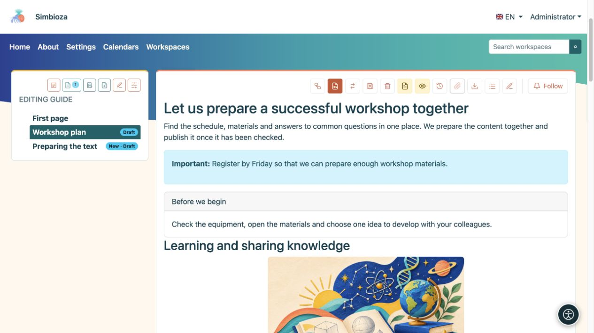
<figcaption>Aktionen auf veröffentlichten Seiten: Die angebotenen Symbole hängen von Ihren Berechtigungen und aktivierten Funktionen ab.</figcaption>
</figure>

- **Anhänge anzeigen / Anhänge ausblenden** öffnet oder schließt die Dateiliste. **Inhaltsverzeichnis anzeigen / Inhaltsverzeichnis ausblenden** zeigt die Liste der Überschriften auf der Seite an oder blendet sie aus.
- **Verlauf** öffnet gespeicherte Versionen; das Flaggenmenü wählt eine vorhandene Übersetzung aus.
- **Seite kopieren oder verschieben** ist für Arbeitsbereichsmanager verfügbar. Wählen Sie „Kopieren“ oder „Verschieben“, einen Zielarbeitsbereich und einen übergeordneten Arbeitsbereich und ob der Verlauf und direkte Berechtigungen/Einschränkungen übertragen werden sollen. Inhalte, Übersetzungen und Anhänge reisen zusammen. Bei einer Kopie bleibt das Original erhalten; Durch einen Umzug wird es nach erfolgreicher Übertragung entfernt. Es wird nur die ausgewählte Seite kopiert; das Verschieben einer Seite mit Nachkommen ist nicht verfügbar. Überprüfen Sie anschließend die Zielberechtigungen.
- **Seite nach HTML exportieren** lädt ein ZIP herunter, das `index.html` und zugehörige lokale Dateien enthält. Extrahieren Sie es, bevor Sie die Datei HTML öffnen. Bei Arbeitsbereichsseiten wird dadurch die veröffentlichte Version exportiert und nicht ein unveröffentlichter Entwurf. Es handelt sich nicht um ein Backup zur Wiederherstellung des gesamten Arbeitsbereichs.
- Öffnen Sie für eine PDF-Datei **Drucken → Als PDF speichern** im Browser. Überprüfen Sie vor dem Speichern die Druckvorschau und das Layout.
- **Seite und Teilbaum löschen** entfernt auch Nachkommen; Lesen Sie die Bestätigung sorgfältig durch. Veröffentlichte Seiten verwenden eine wiederherstellbare Löschfunktion, während das Löschen eines neuen, nie veröffentlichten Dokuments über den Editor dauerhaft sein kann. Fragen Sie einen Administrator nach der Wiederherstellung, anstatt davon auszugehen, dass jede Löschung rückgängig gemacht werden kann.
- Sofern aktiviert, unterstützen **Folgen** und Kommentare Änderungsbenachrichtigungen und Diskussionen.

Im Editor zeigt **Quellcode** für erfahrene Redakteure HTML an; Dies ist für die oben genannten Verfahren nicht erforderlich. **Vollbild** gibt Inhalten mehr Platz; Verwenden Sie dasselbe Symbol, um zu den Dokumentdetails zurückzukehren und Aktionen zu speichern.

## 18. Wenn etwas unerwartet ist

| Was Sie sehen | Was zu tun |
| --- | --- |
| Keine Bearbeitungs- oder Veröffentlichungsaktion. | Überprüfen Sie das Konto und den Arbeitsbereich. Bitten Sie einen Manager oder Administrator, Ihre Berechtigungen zu überprüfen. |
| Sie haben den Text geändert, aber die Leser sehen immer noch die alte Seite. | Speichern Sie den Entwurf und prüfen Sie, ob noch eine Veröffentlichung erforderlich ist. Überprüfen Sie auch die Sprache. |
| Ein Tabellen- oder Bildbefehl bewirkt nichts. | Klicken Sie zunächst auf eine Tabellenzelle oder wählen Sie das Bild selbst aus und wiederholen Sie dann den Befehl. |
| Dropdown-Inhalte bleiben im Editor geöffnet. | Dies ist die Bearbeitungsansicht. Überprüfen Sie den Ausgangszustand in der Seitenansicht. |
| Tabulatoren oder Akkordeons haben Titel, aber keinen Fließtext. | Füllen Sie nach dem Einfügen den Hauptteil jedes Abschnitts im Haupteditor aus. |
| Sortierung und Zeilenzählung fehlen. | Aktivieren Sie sie in **den Einstellungen dieser Tabelle**, überprüfen Sie die einfache Kopfzeile und sehen Sie sich die gespeicherte Seite an. |
| Eine Datei wurde hochgeladen, fehlt jedoch im Text. | Platzieren Sie die Einfügemarke im Inhalt und wählen Sie dann neben dem Anhang **Einfügen** aus. |
| Sie sehen einen Kalender, eine eingebundene Seite oder eine dynamische Liste, ein Leser jedoch nicht. | Überprüfen Sie auch ihre Rechte am Quellinhalt. Beim Einbetten werden keine privaten Daten geöffnet. |
| Ein Skript fehlt oder funktioniert nicht. | Lesen Sie die Anweisungen und überprüfen Sie die veröffentlichte Ansicht. Ein Administrator bereitet Skripte vor und genehmigt sie. |
| Eingefügter Text hat einen inkonsistenten Stil. | Wenden Sie **Formatierung entfernen** an und legen Sie dann Überschriften und Listen erneut fest. |
| Durch das Rückgängigmachen werden eine geänderte Bildbreite oder andere Blockeinstellungen nicht wiederhergestellt. | Stellen Sie diese Einstellungen über das Menü wieder her. Speichern Sie vor größeren Änderungen. Wählen Sie **Abbrechen**, um nicht gespeicherte Änderungen zu verwerfen. Bereits gespeicherte Änderungen bleiben gespeichert. |

Bevor Sie fertig sind, überprüfen Sie **Inhalt, Speicherung, die ausgewählte Sprache, Links und den erwarteten Zugriff des Lesers**. Für die meisten Seiten sind diese wichtiger als die Anzahl der dekorativen Elemente, die Sie einfügen.
