# Editing pages

This guide is for editors who create and maintain pages inside Simbioza workspaces. It explains page creation, titles and slugs, every HTML editor toolbar control and submenu, attachments, page properties, dynamic elements, publishing, translations, and access rights. You do not need to know HTML.

**All examples are test data.** The screenshots use the dedicated *\[Guide\] Page editing examples* workspace, purpose-made users, and fictional projects. Your names, calendars, and users will differ, but the steps are the same.

## 1. Before you start: workspace and permissions

This chapter describes pages inside a Workspace. The workspace defines the base set of users and permissions, the default table-of-contents display, and the page tree. You need **Add** to create a page, **Edit** to change existing content, **Publish** to make a draft live, and **View** to read content without editing it.

1.  Open **Workspaces** and select the relevant workspace.
2.  In the left-hand tree, select the page under which the new page should appear. Select the workspace root to create a top-level page.
3.  Choose the add-item button, enter a title, and select **Page (HTML document)** .
4.  Save the item. Simbioza creates the document and opens it in the HTML editor.

Create pages belonging to a Workspace from its tree. Existing standalone HTML pages can coexist with Workspaces: they keep their addresses and permissions until an administrator moves them through **Settings → HTML editor → Pages outside Workspaces → Move to a Workspace**. Installing Workspaces does not move them automatically. The move transfers translations, history and attachments and reconciles links; check the destination permissions before confirming.

## 2. Title, slug, and language

The **Title** is visible in the tree, page heading, and links, and it can be translated. The **HR** / **EN** menu beside the title selects the title language. The **Document language** menu selects the content version you are editing. These settings are related but separate: before publishing English, make sure that both the English title and the English content have been entered.

The **slug** is the stable, readable part of the page address, such as `project-orion` . Use lowercase letters, no spaces or accented characters, and hyphens between words. Keep it short and descriptive. Avoid changing a slug after the page is in use because bookmarks and incoming links may stop working.

**Comments enabled** controls whether readers may comment on the published page; a change takes effect when the draft is published. **Default page table-of-contents display** inherits the workspace setting unless you explicitly choose *Show* or *Hide* for this page.

 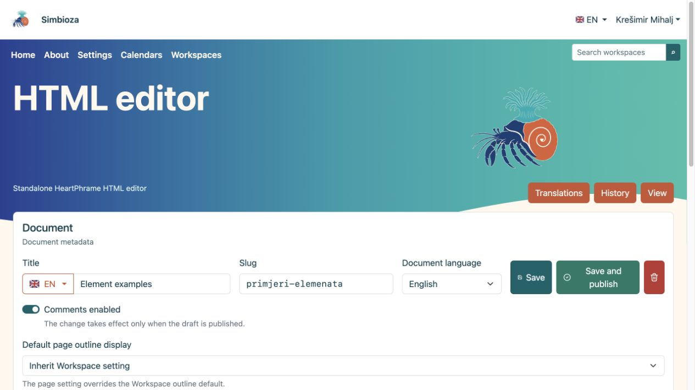 Editor overview: translations, history, and preview are at the top, followed by the title, slug, document language, and save actions. The toolbar and editable content are below the document details. 

## 3. Save, publish, preview, translations, and history

- **Save** stores a draft without replacing the live version. Use it frequently while editing.
- **Save and publish** saves the draft and makes it the current published version. Check content and permissions first.
- **Preview** shows the reader-facing page. Dynamic blocks are resolved here with real data and ACL checks.
- **History** lists earlier versions and lets an authorised editor restore older content.
- **Translations** can copy one version as a starting point. Translate the title, body, image descriptions, and every visible label before publishing; do not leave a partially translated page live.
- **Delete document** moves it to the trash. First check whether an *Include page content* block depends on it. Administrators can restore it or delete it permanently; permanent deletion cannot be undone.

## 4. Basic text editing

Click in the body and type as in a normal word processor. Select text before applying inline formatting; for a paragraph-level action, place the caret anywhere in that paragraph. Do not imitate headings by enlarging or bolding normal text. Real heading levels build the page contents and provide an accessible structure.

- **Format** : Paragraph is normal text; Headings 1–5 create hierarchy; Block quote marks a quotation; Preformatted preserves spacing for short technical examples. The page title is the main heading. Start the body with Heading 2 for major sections and Heading 3 for subsections, without skipping levels.
- **Check document** finds empty headings, broken hierarchy, images without alternative text, and missing internal links. Run it before every publication.
- **Bold, Italic, and Underline** emphasise selected text. Use underlining sparingly because readers may mistake it for a link.
- **Clear formatting** removes unwanted styling, especially after pasting from Word or another website.
- **Align left, centre, right, and Justify** apply to the current paragraph. Left alignment is the most readable choice for long text.
- **Bulleted list** is for unordered items; **Numbered list** is for steps that must be followed in sequence. Enter creates a new item; pressing Enter twice ends the list.
- **Link** turns selected text into an internal or external link. Use descriptive link text such as “application rules”, not “click here”. **Unlink** keeps the text but removes the link.
- **Undo** reverses the latest edit and **Redo** reapplies an undone edit. This short-term history only applies to the current editor session.

## 5. Insert layouts, alerts, and cards

### Columns and horizontal rule

The **Insert** menu offers **Two columns** , **Three columns** , and **Horizontal rule** . Columns are suitable for short parallel sections, not long articles; on a narrow screen they stack vertically. A horizontal rule separates large sections visually but does not replace a meaningful heading.

 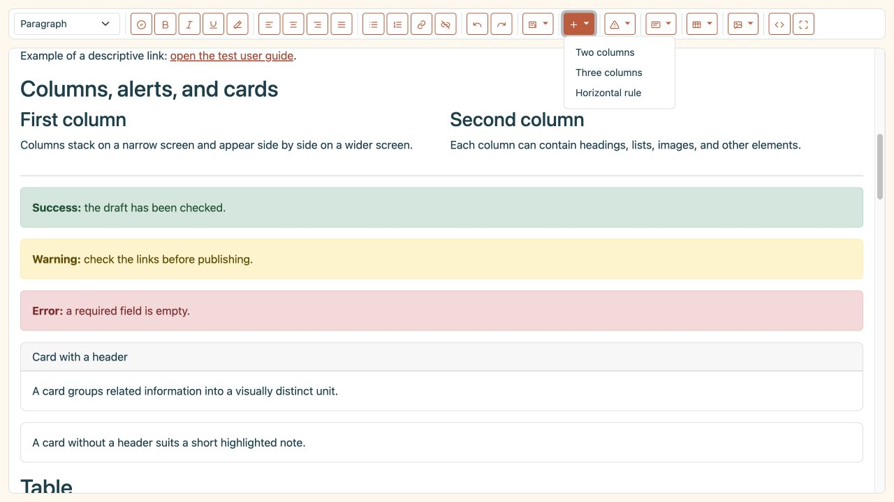 Insert adds a prepared structure at the caret. Click into every new column and replace all placeholder content. 

### Bootstrap alerts

An alert highlights one short important message. The eight choices are **primary** for a general highlight, **secondary** for supplementary information, **success** for a positive result, **danger** for a critical error or prohibition, **warning** for required caution, **info** for an explanation, and **light** / **dark** for neutral emphasis. Colour must not carry the meaning alone; start with an explicit word such as “Important”, “Warning”, or “Success”.

 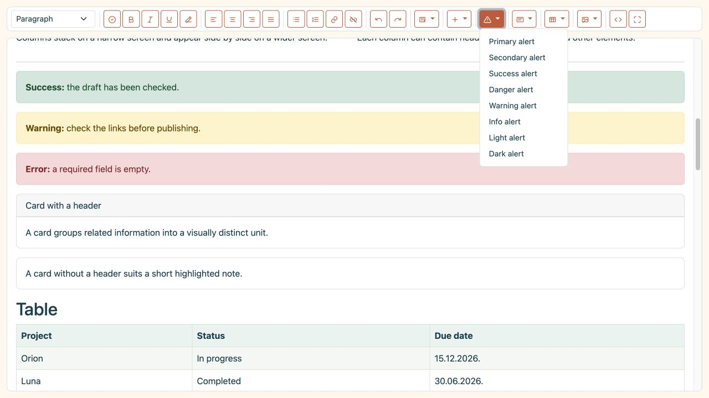 Choose a style that matches the meaning and replace the placeholder text. Avoid long sequences of colourful boxes because they make the page harder to scan. 

### Cards

**Card with header** inserts a bordered block with a header and body, useful for a project summary, contact card, or related group. **Card without header** inserts only the body. Keep the card header short and continue to use real headings for the page's semantic structure.

 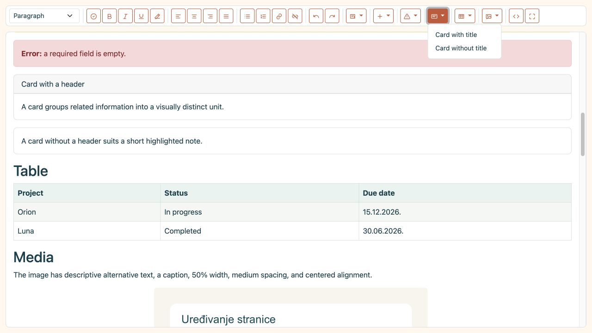 The card appears at the caret. Edit the header and body separately and remove every placeholder. 

## 6. Tables

Choose **Insert table** and select the number of rows and columns. Use tables for data with a genuine row-and-column relationship, never merely to position page content.

- **Insert row above/below** adds a row relative to the cell containing the caret; **Delete row** removes the entire row.
- **Insert column left/right** adds a column; **Delete column** removes it.
- **Merge with cell right/below** creates a larger shared cell. Use merged cells sparingly because complex tables are harder for screen-reader users.
- **Split cell** reverses a previous merge for the selected cell.

Give the first row clear column headings. Preview the table in a narrow window after substantial changes; a very wide table will require horizontal scrolling.

 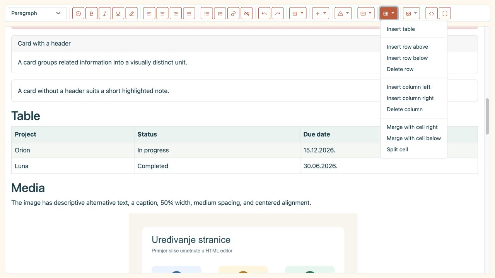 Commands act relative to the cell containing the caret. If an action is unavailable, click inside the relevant table cell first. 

### Enable sorting and pagination for one table

1. Click a cell in the existing table.
2. Open **Table → Table settings**.
3. Enable **Sorting and pagination** and choose the initial row count: **10, 25, 50, 100 or All**.
4. Select **Apply**, then save and publish the page.

Readers click a column heading to sort ascending, click again for descending order, and click a third time to restore the original order. Arrows show the direction. Changing the row count or page does not alter saved content. The editor still shows all rows. Printing shows every row, and the controls also work in HTML exports.

Enable this separately for each table. No external scripts or DataTables are needed. Use one header row, the same cell count in every body row, no merged cells and no nested tables. Complex tables keep the ordinary view. Existing tables remain unchanged until this option is enabled.

## 7. Attachments, images, and the Media menu

1.  In **Attachments** , choose one or more files and click **Upload** .
2.  For an image, add meaningful alternative text that conveys the image's information. Mark a purely decorative image appropriately instead of repeating nearby text.
3.  Add a description or caption when the reader needs more context.
4.  Place the caret in the content and click **Insert** on the attachment card.
5.  Check attachment visibility. A public page must not depend on an image that guests cannot access.

With an image selected, **Media** offers **25%, 50%, 75%, and 100%** widths; **no, small, medium, and large** spacing; **left, centre, and right** alignment; and **Reset media** . Width remains responsive. A UI screenshot usually needs 100%; a small illustration often works at 25–50%.

 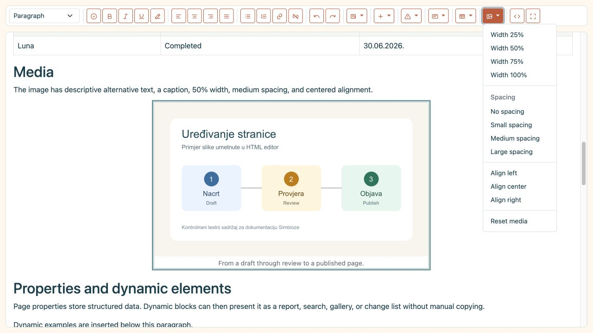 Media commands apply to the selected image or media item. If nothing changes, click the image itself rather than the adjacent paragraph. 

### Embedded iframe content

For H5P, Facebook, and other trusted services, open **Insert** and choose **Insert embedded content**. Paste the complete iframe block supplied by the provider, or enter only its HTTPS URL.

1.  Enter a short **accessible title** that describes the iframe content.
2.  Set the height in pixels and enable fullscreen only when the provider supports it.
3.  Choose **Insert**. The editor normalises the width to 100% of the available space and retains only supported security attributes.

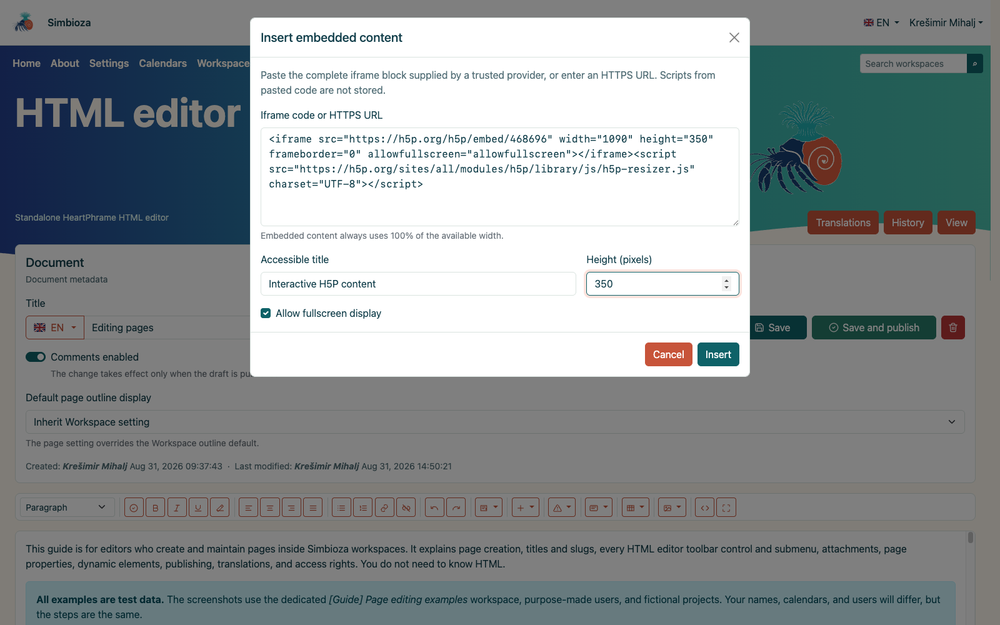The dialog accepts a complete iframe block or an HTTPS URL. Saved content always uses 100% of the available width.

**Security:** embed content only from providers you trust. Arbitrary JavaScript from pasted code is neither stored nor executed. Scripts extracted from imports become candidates for administrator review; a familiar URL alone is not approval. Only locally approved scripts selected for the page run. An administrator first reviews and approves the exact H5P resizer code or URL.

An iframe without JavaScript, such as a Facebook embedded post, works directly. To change an existing block, choose its pencil icon. If imported Confluence HTML contains an unknown script or multiple iframes in one macro, Simbioza leaves it for manual review.

### External scripts and their instructions

If a page needs an additional function prepared by an administrator, open **External scripts** and select the approved script. The choice is saved with that page version. A small **circled question mark** opens usage instructions when they exist; reading instructions does not enable the script. They explain whether a table ID or another marker is needed in the HTML source.

If the script is unavailable, ask the administrator. **Settings → HTML editor → External scripts** manages the library, optional CSS, additional code, translated instructions and approval. Revoked or unapproved scripts do not run. Scripts do not execute in the editor, draft or history: test the published view. HTML export includes only selected, approved scripts, storing inline code locally and retaining remote links. Remote code still needs a network connection.

## 8. Document check, source code, and fullscreen

### Document check

The checker is a final checklist, not a substitute for proofreading. Correct every reported item and choose **Check again** . Pay particular attention to image alternatives, heading order, and internal links. *No issues found* means the automated rules passed; you should still read the page in Preview.

 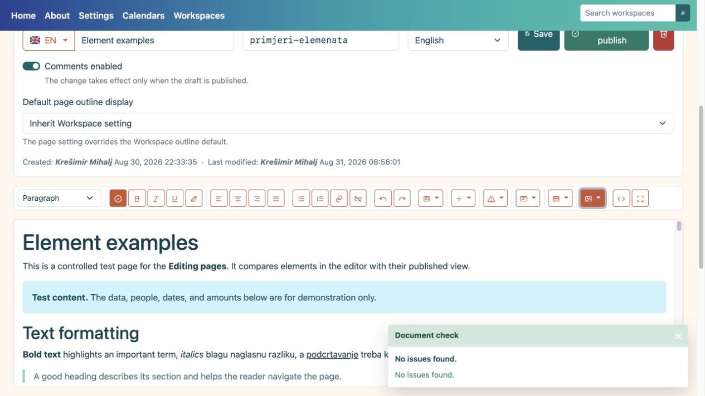 A successful check after correcting headings, images, and links. Run it again after later content changes. 

### Source code

**Source code** exposes the HTML and is intended for advanced editors who need to inspect or repair exact markup. Do not paste scripts, styles, or code from untrusted sources; unsupported content may be sanitised on save. Return to visual mode after a manual edit and run the document checker.

 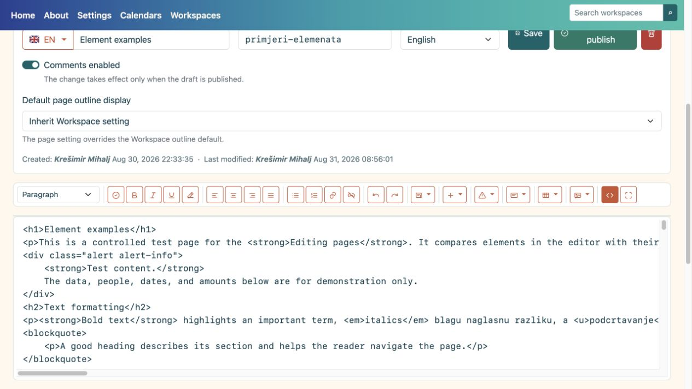 Source mode shows the current language version's structure. Do not alter dynamic-block attributes unless you understand their purpose. 

### Fullscreen

**Fullscreen** keeps the toolbar and body while hiding document metadata, leaving more room to edit. Project navigation remains only when the project theme makes it sticky. Click the same icon again to return to the normal view; save and publish actions are available outside fullscreen.

 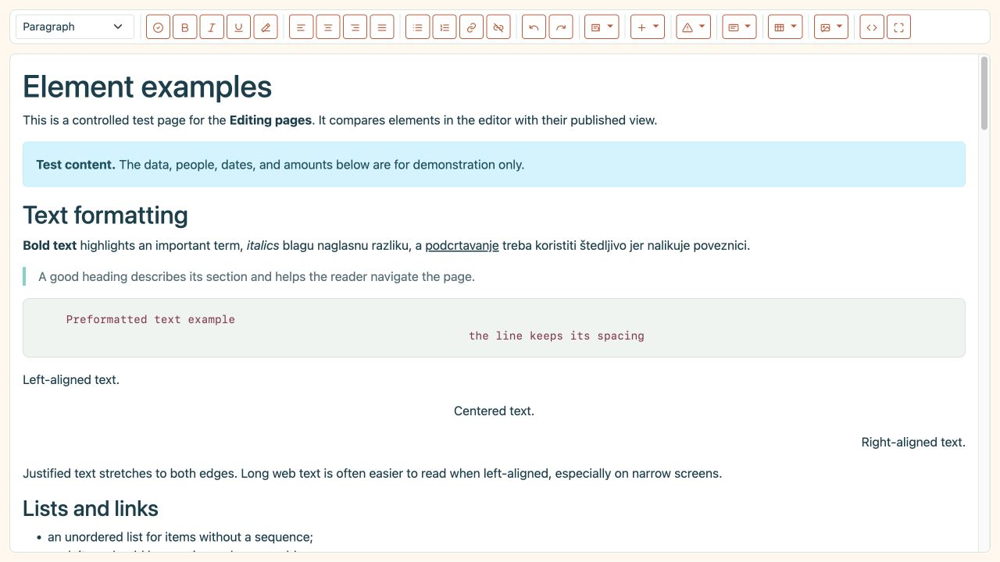 Correct fullscreen mode: the toolbar remains available and the title, slug, and document actions do not leave an empty gap above it. 

## 9. Dynamic elements

A dynamic element appears as a labelled placeholder or configuration summary in the editor, then becomes real data and interactive controls in Preview. Always preview after insertion. The output is permission-aware, and an administrator usually sees more than a normal reader.

 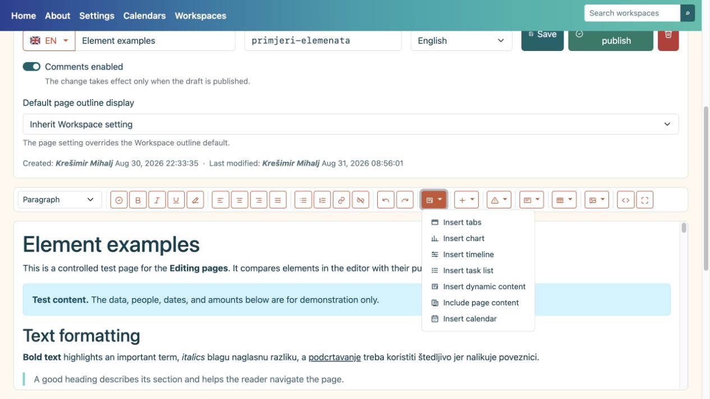 The menu contains tabs, chart, timeline, task list, dynamic content, included page content, and calendar. Each item opens a dedicated form. 

### 9.1 Tabs

Tabs place several short sections in the same area. Enter a distinct short label and content for each tab, use **+** to add another, and **Remove** to delete one. Do not hide essential instructions in the last tab; readers may not notice it. Use normal headings instead when the information is long or must be read in order.

 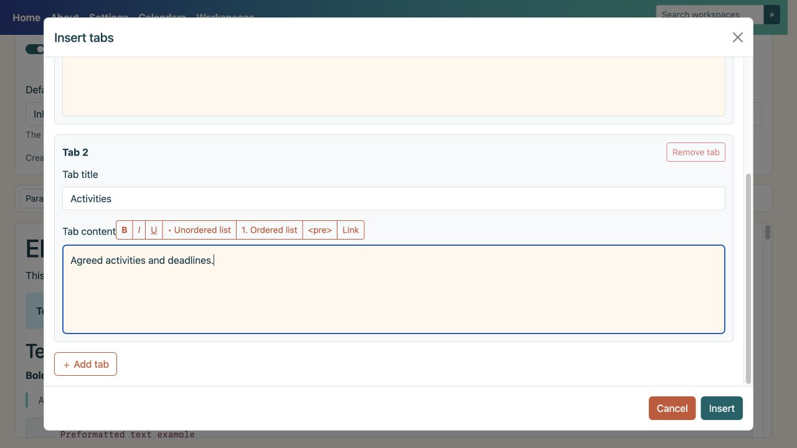 Prepare all tabs in one form. Make sure every tab has both a title and meaningful body before inserting the block. 

### 9.2 Chart

A chart turns numbers into a visual comparison. Enter a clear title, choose the chart type, and provide category labels and numeric values. Add data series when comparing multiple sets. A bar chart is suitable for categories, a line chart for change over time, and a pie chart only for a small number of parts of one whole. Use a consistent unit and state the main conclusion in nearby text so the meaning is not available only visually.

 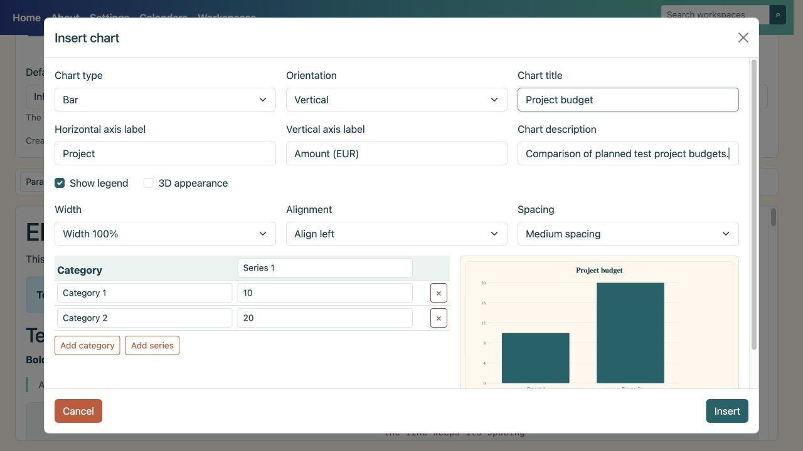 Replace every sample label and verify that each series contains the same number of values as there are categories. 

### 9.3 Timeline

A timeline displays dated activities. Set the visible start and end, scale, groups, activities, and milestones. An activity has a title, start date, end date, and group; a milestone marks one important date with no duration. Keep the range narrow enough to remain readable. Dates are static content in this block, so update them when the project plan changes.

 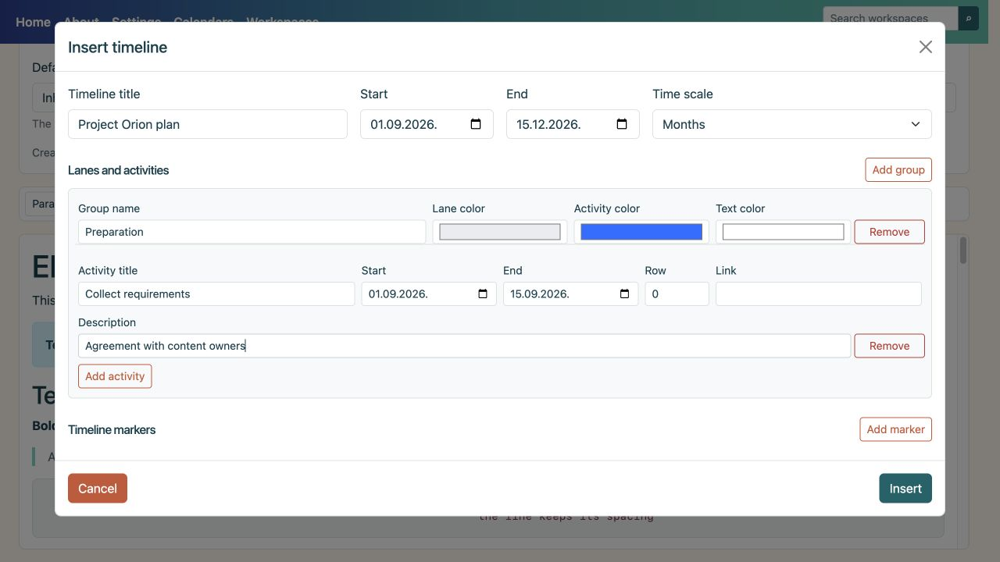 Groups separate work streams, activities have a duration, and milestones have one date. Preview the result to check label overlap. 

### 9.4 Task list

A task list lets authorised users tick items as complete. Enter a title and tasks, then choose who may change their state. Editor-only scope is suitable for an internal checklist; signed-in-reader scope allows a broader audience to update items. Anonymous visitors do not receive persistent personal state. Updates are attributed to a user when possible, so do not use the block for sensitive personal or HR information.

The ACL example places an editor list and a reader list on the same page. A view-only user sees the first locked and may operate the second. This tests the real reader experience rather than relying on the administrator's view.

 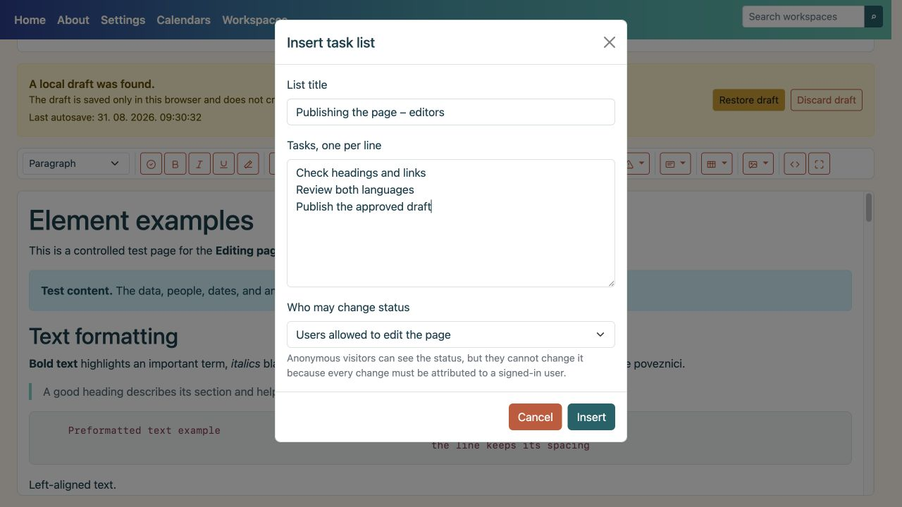 The editing scope is as important as the list itself. After publishing, verify it with a user who only has View permission. 

### 9.5 Dynamic content

Dynamic content refreshes from the current workspace state. Four types are available:

- **Pages and properties table** finds pages by workspace, tags, or other criteria and displays selected property columns. Use it for a project portfolio, directory, or deadline register. Property names must be consistent on all source pages.
- **Attachment gallery** presents images or files attached to pages. Each attachment's visibility and its source page's read permission still apply.
- **Workspace search** inserts a search limited to the workspace. Results only contain pages the current user may read.
- **Recent changes** lists newer edits. Keep the limit and scope reasonable so the activity list does not overwhelm the page.

 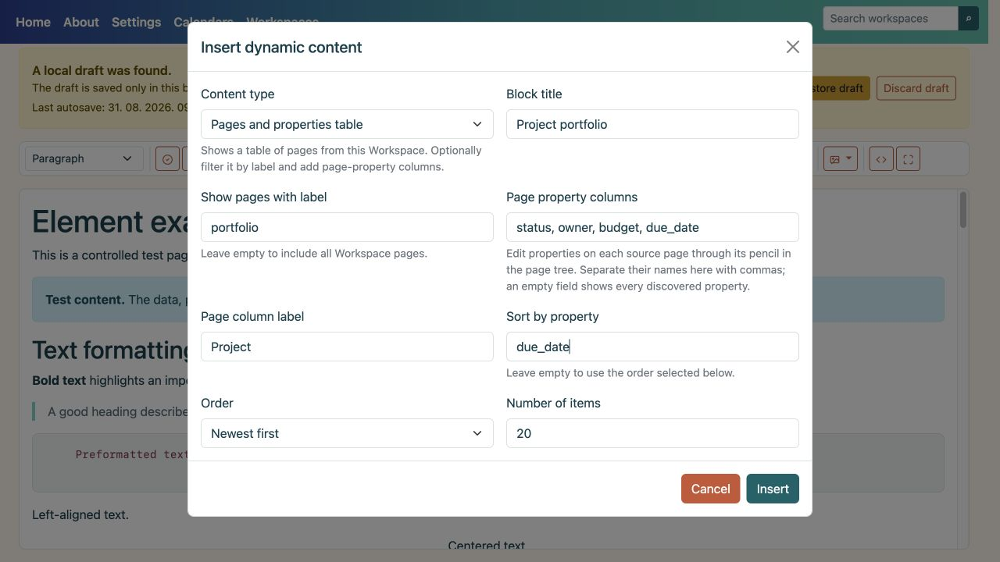 Select a type first, then complete its settings. An empty Preview usually means no page matches the filter or the reader cannot access the matching pages. 

### 9.6 Include page content

This block displays another page without copying it. Select its workspace and page. A later source update appears everywhere the page is included, making the block useful for shared contact information or a standard notice. Avoid circular inclusion and long inclusion chains. Readers must be allowed to view the source page; otherwise Simbioza shows a safe unavailable message rather than leaking the content.

 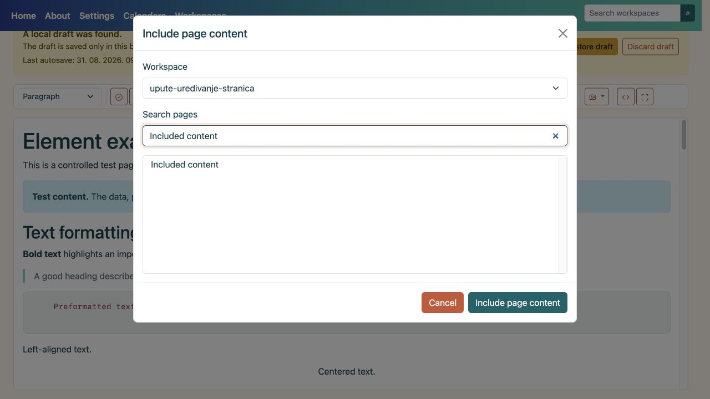 The editor shows a placeholder; Preview fetches the real page and applies the current user's read permission. 

### 9.7 Calendar

Select a calendar you are allowed to use, its view, and the initial period. Month view is useful for dates at a glance; list view is better for a sequence of events. Fix the initial month only when the page describes a specific period; a long-lived page normally starts from the current date.

Page access does not automatically grant calendar access. A reader who can view the page but not the embedded calendar receives an unavailable message, and no event details are exposed. The test example deliberately embeds one allowed and one denied calendar to demonstrate the distinction.

 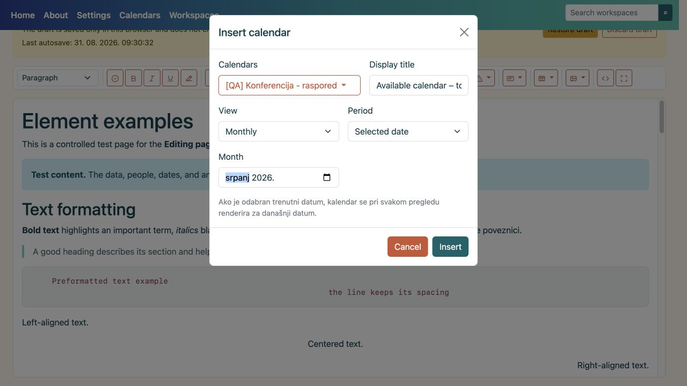 Insert and publish the calendar, then preview it as a normal reader. The administrator's view cannot prove that access restrictions work. 

## 10. Page properties

A property is structured data attached to a page. Unlike prose, it has a stable name and type, so a dynamic table can filter, sort, and display it as a column. Project pages might use `status` , `owner` , `budget` , and `due_date` .

Open **Tree item/page settings** . Under **Page properties** , enter a property name, type, and value. Use **+** to add multiple rows, edit existing values, and choose **Remove** for a property that is no longer needed. Save all changes together with **Save item** ; you do not have to close the dialog after every property.

- **text** : short free text, such as a contact or department code.
- **status** : a controlled business state such as Planned, In progress, or Completed. Spell the same states consistently on every page.
- **number** : a numeric value for sorting or comparison; do not include currency symbols or grouping spaces in the value.
- **date** : a date in the expected format, suitable for deadlines and time filters.
- **user** : the username of an existing user, useful for an owner or responsible editor.
- **link** : a complete address beginning with `https://` . Explain the destination in visible text.

**Page tags** are comma-separated group labels such as `portfolio, active, 2026`. They are not a replacement for valued properties: a tag places the page in a set, while a property provides a value for a report column.

 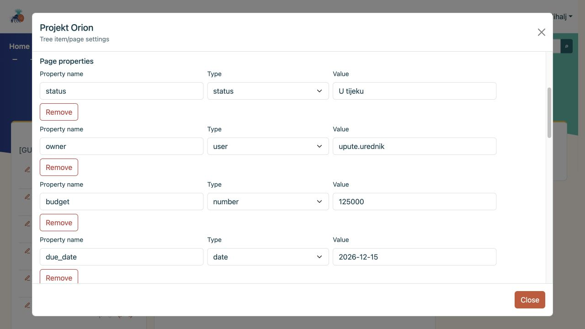 Multiple properties can be added and edited in one dialog. The example prepares data for a project table; Remove deletes only its row when the item is saved. 

### Pages and properties table

For a report, insert **Dynamic content → Pages and properties table** , choose the workspace, tag filter, and columns. The Orion and Luna example displays status, owner, budget, due date, contact, and project link. A new page with the same properties appears automatically when it matches the filter; the report page itself does not need manual editing.

 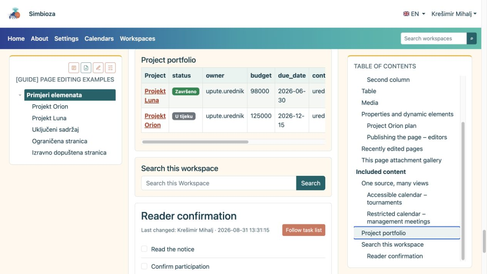 The published dynamic view combines structured properties and other live blocks. If one row has an empty value, check that source page's property name and type. 

## 11. Page access: inherited restrictions and direct permission

Workspace rights are the access foundation. Individual item settings add two different exception mechanisms:

### Inherited permission restrictions

A restriction removes a right the user already has from the workspace or group. It applies to the selected page and its descendants and cannot grant a new right. Select the user and disable only the rights that must be denied; removing the user from the table fully restores their inherited rights.

 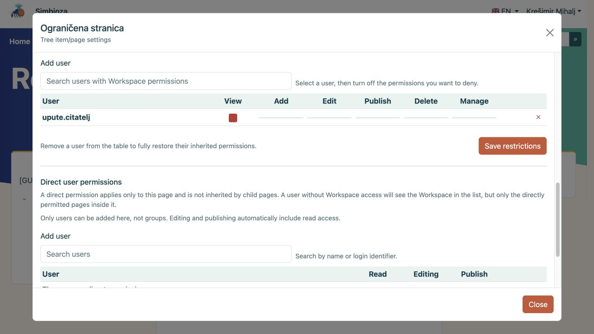 The legend distinguishes a retained inherited right, a denied inherited right, and a right the user never inherited. Restrictions apply to users, not whole groups. 

### Direct page permissions

A direct permission grants access to this page only and is not inherited by child pages. A user with no workspace access sees only directly permitted pages in the tree. You may grant Read, Edit, or Publish; Edit and Publish imply Read. You can add **users and groups**, including the public **Everyone** audience for a public page in a private Workspace. The exception exposes only the allowed page; other private pages and parent content remain hidden. The Workspace appears in the visitor’s list when it contains an accessible page. Check the result as the intended user or guest.

 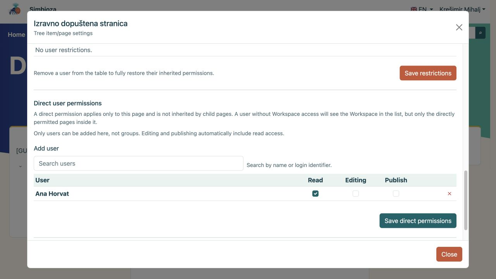 A direct permission is a one-page exception. Verify the outcome by impersonating that user or using a purpose-made test account. 

### How to test ACL behaviour

1.  Save permissions and publish the page.
2.  As administrator, confirm that the content is technically correct.
3.  Sign in or impersonate a view-only user. Check the tree, included page, both calendars, and both task lists.
4.  Check the direct-permission user and confirm they cannot see the rest of the workspace.
5.  Return to the administrator session. Do not infer normal-reader access from the administrator view because administrators bypass many restrictions.

## 12. Recommended publishing workflow

1.  Select the correct workspace and create the page at the correct place in the tree.
2.  Enter the title and check the slug. Add the other language's title.
3.  Write short paragraphs with proper heading hierarchy and descriptive links.
4.  Upload attachments, add alternative text, and only then insert them.
5.  Add properties and tags before building the dynamic table.
6.  Insert dynamic elements and save a draft.
7.  Run Check document and correct every finding.
8.  Preview both languages at narrow and wide widths.
9.  If the page contains restricted calendars, tasks, or included content, test at least one normal reader.
10. Choose Save and publish only after these checks, then open the published view once more.

## 13. Common problems

- **A change is missing from Preview:** it was saved as a draft only, or you are viewing a different document language.
- **The English page has a Croatian title:** the document language changed, but the title translation did not. Use the title-language menu and enter the EN title.
- **The dynamic table is empty:** check the workspace, tag filter, exact property names, and source-page read rights.
- **An image is broken for guests:** the attachment visibility or source-page access is too restrictive.
- **A calendar works for the administrator but not a reader:** the reader lacks separate calendar access. This is expected protection, not necessarily an error.
- **Table or media commands do nothing:** the caret is not in a table cell or the image is not selected.
- **Pasted Word content looks inconsistent:** select it, use Clear formatting, and reapply headings and lists.
- **A direct permission appears to expose child pages:** it should not. Check whether the user also belongs to a group with workspace rights.

**Final test:** “It looks correct to the administrator” is not enough. The page should pass the document checker, contain two complete language versions, load all attachments, and behave correctly for a restricted reader.

