# Editar páginas

> Las capturas de pantalla muestran la interfaz en inglés.

Aprenda a crear una página, añadir texto, imágenes y otros contenidos, y prepararla para los lectores. Trabajará en un editor visual, similar a un procesador de textos. **No necesita saber HTML ni escribir código de programación para la edición cotidiana.**

Para su primera página, siga [creación de página](#new-page), [formato básico](#text) y [guardado y publicación](#saving). Regrese a las otras secciones cuando las necesite. Las encuestas tienen sus propias [guías separadas](ankete_es.md).

## 1. Cree una página nueva o abra una existente

1. Abra **Espacios de trabajo** y elija el espacio de trabajo donde desea trabajar.
2. Para crear una página, seleccione el ícono **Nueva página** al lado del árbol del espacio de trabajo. Pase el cursor sobre un ícono para leer su nombre.
3. Ingrese el **Título de la página**. Verifique su idioma, el destino **Espacio de trabajo** y la **Página superior**. La página superior determina dónde aparece la nueva página en el árbol; elija **Raíz del árbol** para el nivel superior. El formulario indica qué idioma principal requiere un título.
4. Puede dejar **Slug** vacío: el sistema lo deriva del título. Es la parte corta de la dirección web de la página, así que evita cambiarla más tarde sin motivo alguno.
5. Seleccione **Crear y editar**. La nueva página se abre en el editor.

**Resultado:** la página existe en el lugar seleccionado y está lista para su contenido. Crear la página y escribir el texto es independiente de publicarla para los lectores.

<figure>
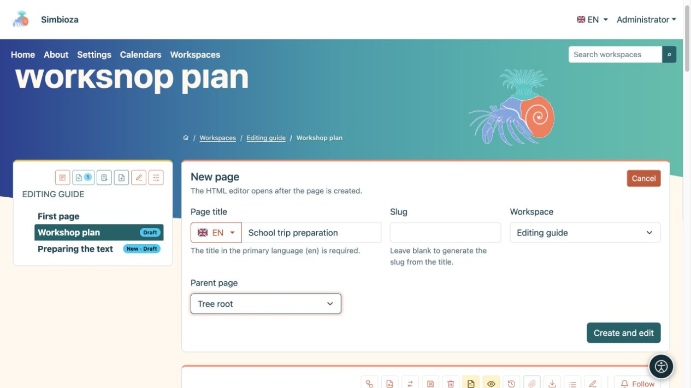
<figcaption>Nueva página: ingrese un título, verifique su idioma y posición en el árbol, luego seleccione Crear y editar.</figcaption>
</figure>

Para cambiar una página existente, ábrala desde el árbol y seleccione el lápiz **Editar**. Si falta la acción de crear o editar, pídale a un administrador o gestor del espacio de trabajo que verifique sus permisos.

Una instalación sin espacios de trabajo puede tener **HTML páginas** y **Administrar contenido**. Cree páginas independientes allí y edite su contenido con el mismo editor. Si los espacios de trabajo se instalan más adelante, las páginas independientes seguirán funcionando hasta que un administrador las mueva explícitamente a un espacio de trabajo.

## 2. Encuentra su camino en el editor

Los detalles del documento, la selección de idioma y las acciones para guardar se encuentran en la parte superior. La **barra de herramientas** se encuentra inmediatamente encima del contenido que editas. **Adjuntos**, debajo del contenido, contiene archivos asociados con la página.

<figure>
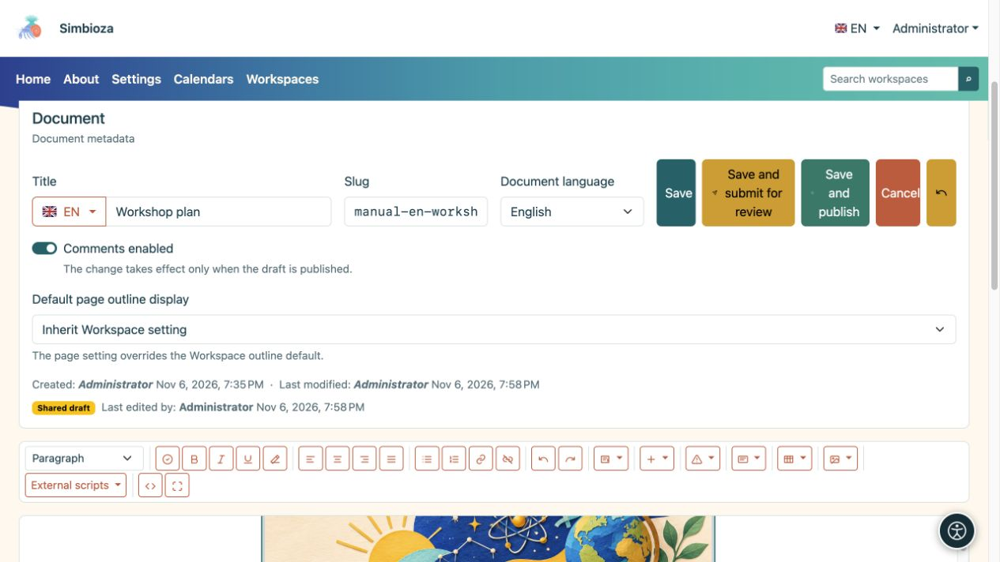
<figcaption>La parte superior del editor: detalles del documento y acciones para guardar encima de la barra de herramientas.</figcaption>
</figure>

Cuando se ofrece, **Comentarios habilitados** permite nuevos comentarios; Los comentarios existentes permanecen cuando se desactivan los nuevos comentarios. En una página de espacio de trabajo, este cambio sigue a la publicación. **Visualización de la tabla de contenido de la página predeterminada** puede heredar la configuración del espacio de trabajo o elegir **Mostrar/Ocultar** para esa página.

Haga clic donde desee escribir o insertar algo. Seleccione palabras existentes antes de formatearlas; para dar formato a un párrafo completo, coloque el cursor dentro de él.

Pase el cursor sobre el botón de una imagen para leer su nombre. En una ventana más estrecha, la barra de herramientas se ajusta a varias filas. Utilice Tab y Shift+Tab para moverse entre botones y campos; active un botón enfocado con Enter o Espacio.

| Grupo de barras de herramientas | que hace |
| --- | --- |
| **Formato** | Párrafos, títulos, citas o texto preformateado. |
| **Consultar documento** | Compruebe títulos, imágenes, enlaces y tablas antes de la publicación. |
| **Negrita**, **Cursiva**, **Subrayado**, **Eliminar formato** | Da formato al texto seleccionado. |
| Cuatro botones de alineación | Alineación de párrafos a la izquierda, al centro, a la derecha o justificado. |
| **Lista desordenada**, **Lista ordenada**, **Enlazar**, **Desvincular** | Listas y enlaces. |
| **Deshacer**, **Rehacer** | Invierte o repite cambios de texto ordinarios en la sesión de edición actual. |
| **Elementos dinámicos** | Pestañas, acordeón, contenido desplegable, gráficos, líneas de tiempo e integraciones disponibles. |
| **Insertar**, **Alertas Bootstrap**, **Tarjetas** | Columnas, regla horizontal, contenido incrustado y secciones resaltadas. |
| **Tabla**, **Medios** | Funciona en la tabla, imagen u otro medio seleccionado. |
| **Scripts externos** | Funciones adicionales preparadas y aprobadas por un administrador. |
| **Código fuente**, **Pantalla completa** | Vista avanzada HTML o más espacio para edición visual. |

Algunas funciones aparecen solo cuando el módulo correspondiente está habilitado y usted tiene los permisos necesarios. Una tabla o un comando multimedia no disponible a menudo simplemente significa que aún no ha seleccionado una celda o imagen de la tabla.

<figure>
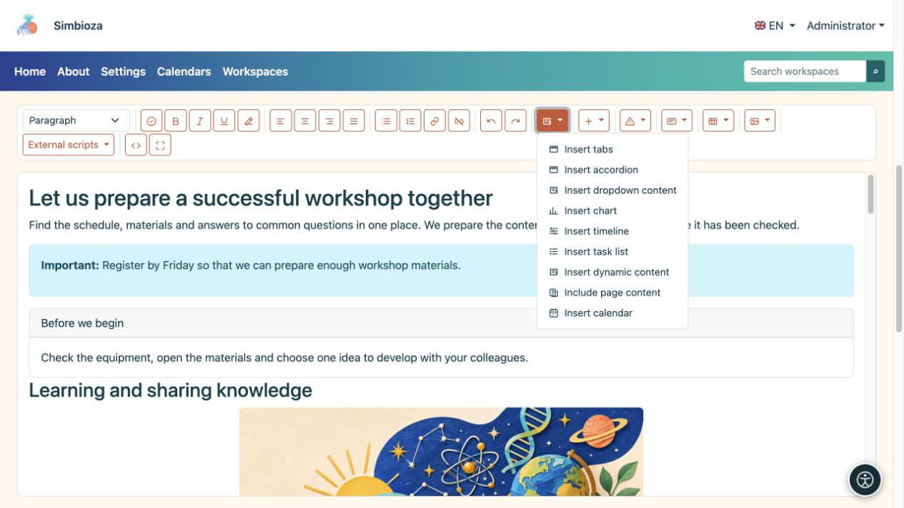
<figcaption>Los elementos dinámicos abren la configuración para contenido más complejo. Las integraciones disponibles dependen de los módulos instalados.</figcaption>
</figure>

## 3. Escribir y formatear texto

### Encabezados, párrafos y listas

1. Escribe un breve párrafo inicial que explique el tema de la página.
2. Para una nueva sección, escriba un encabezado, coloque el cursor en él y elija su nivel en **Formato**. El título de la página ya es el encabezado principal; Las secciones del cuerpo normalmente comienzan con el **Título 2**, seguido del **Título 3** para las subsecciones.
3. Utilice **Lista desordenada** para elementos y **Lista ordenada** para pasos que deben realizarse en secuencia.
4. Seleccione algunas palabras y aplíquelas en negrita o cursiva para darle énfasis. Para eliminar el estilo pegado no deseado, seleccione ese texto y elija **Eliminar formato**.

**Resultado:** la página tiene secciones claras, lo que facilita la navegación para los lectores y la tecnología de asistencia. No utilice un párrafo ordinario en negrita como sustituto de un título real.

Utilice **Cita** para palabras entre comillas. **Preformateado** conserva los espacios y el diseño de un ejemplo de texto breve. La alineación a la izquierda funciona mejor para párrafos más largos; La justificación puede introducir grandes espacios entre las palabras.

### Campo de golf

1. Seleccione palabras que deban llevar a alguna parte, como "Requisitos de solicitud".
2. Seleccione **Enlace**.
3. Para una página externa, ingrese la dirección web y seleccione **Insertar enlace URL**. Para una página Simbioza, elija un espacio de trabajo y una página en **Enlace interno** y luego confirme.
4. Para obtener una lista larga, utilice la búsqueda y **Cargar más**. El selector ofrece páginas que puede seleccionar.

**Desvincular** conserva las palabras y elimina su destino. Después de guardar, abra el enlace desde la vista de página para comprobarlo.

## 4. Secciones separadas con columnas, alertas y tarjetas.

| Quieres… | Qué hacer | Resultado |
| --- | --- | --- |
| Dos o tres tramos paralelos | **Insertar → Dos columnas / Tres columnas**, luego reemplaza el texto en cada columna. | El contenido aparece uno al lado del otro en una pantalla ancha y se acumula en una pantalla estrecha. |
| Una breve nota importante | Abra **Alertas Bootstrap**, elija un estilo y reemplace el texto de muestra. | El mensaje destaca. Comience con una palabra clara como "Importante"; El color por sí solo no es suficiente. |
| Un cuadro separado de información relacionada. | **Tarjetas → Tarjeta con título / Tarjeta sin título**. Rellene el cuerpo y, en su caso, el encabezado. | Un resumen, contacto o sección relacionada está separada del texto circundante. |
| Un divisor sencillo | **Insertar → Regla horizontal**. | Una línea horizontal separa dos secciones. |

Utilice columnas y tarjetas para contenido breve relacionado y encabezados para la estructura de un artículo más extenso. Reemplace siempre todo el texto de muestra insertado.

## 5. Pestañas: varias alternativas en un solo lugar

Las pestañas funcionan bien para alternativas dentro de un tema, como "Antes de la llegada", "Programa" y "Contacto". Los lectores seleccionan el título de una pestaña para ver su contenido.

1. Coloque el cursor donde debe ir el bloque y abra **Elementos dinámicos → Insertar pestañas**.
2. Ingrese **2 a 6 títulos**, uno por línea, y seleccione **Insertar**.
3. En el editor principal, complete el contenido de cada pestaña. También puede editar títulos allí. Durante la edición, los contenidos se disponen para que pueda trabajar en cada uno de ellos.
4. Guarde y verifique la vista de la página: al seleccionar un título debería mostrarse el contenido correspondiente.

<figure>
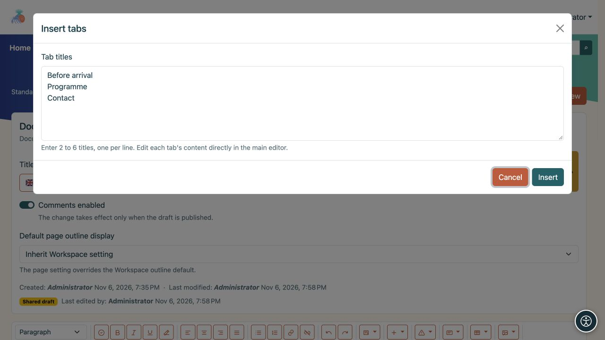
<figcaption>Este ejemplo crea tres pestañas. Después de insertarlos, escribe sus cuerpos en el editor principal.</figcaption>
</figure>

El lápiz al lado del bloque vuelve a abrir su configuración. **Quitar pestañas** elimina todo el bloque. Eliminar un título de la lista de títulos también elimina su contenido. Cambie títulos y contenidos juntos; reescribir o reorganizar las líneas de título no mueve automáticamente el texto asociado.

## 6. Acordeón: secciones que los lectores pueden ampliar

Un acordeón se adapta a preguntas frecuentes o a varios procedimientos breves. Los lectores seleccionan el título de una pregunta para abrir su respuesta. Pueden mantener abiertas varias secciones a la vez.

1. Elija **Elementos dinámicos → Insertar acordeón**.
2. Ingrese **1 a 12 títulos**, uno por línea, luego seleccione **Insertar**.
3. En el editor principal, complete el cuerpo debajo de cada título. Puede agregar enlaces, imágenes, tablas y otro contenido.
4. En la vista de página, abra y cierre secciones individuales para comprobar sus títulos y contenido.

<figure>
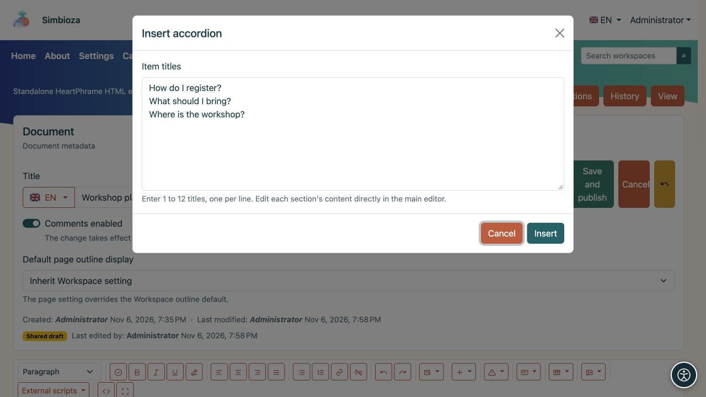
<figcaption>Cada línea se convierte en el título de una sección de acordeón; Escribe las respuestas después de insertar el bloque.</figcaption>
</figure>

Use el lápiz del bloque para cambiar el número de secciones. Un nuevo título recibe un cuerpo vacío; eliminar un título también elimina su cuerpo. **Quitar acordeón** elimina todo el grupo.

## 7. Contenido desplegable: una nota ampliable

Para obtener una única nota o explicación adicional, elija **Elementos dinámicos → Insertar contenido desplegable**.

1. Ingrese un **Título** que describa claramente lo que hay dentro.
2. Habilite **Mostrar contenido expandido cuando se carga la página** si los lectores deben ver el texto inmediatamente.
3. Seleccione **Insertar** y complete el cuerpo debajo del título en el editor principal.

<figure>
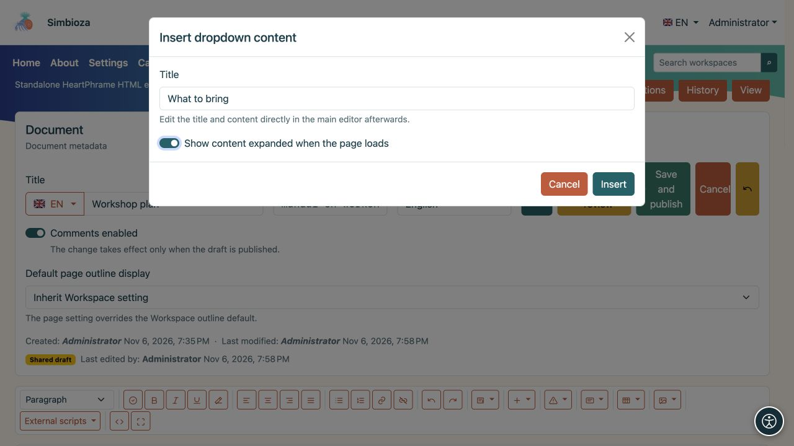
<figcaption>La configuración de contenido expandido determina lo que ve un lector cuando se carga la página.</figcaption>
</figure>

El cuerpo permanece abierto en el editor para que pueda editarlo. La vista de la página sigue el estado inicial elegido; los lectores seleccionan el título para abrirlo o cerrarlo. El lápiz del bloque abre su configuración y ofrece eliminación.

Las pestañas, el acordeón y el contenido desplegable pueden contener texto formateado y otros elementos. Mantenga visible la información más importante de la página sin necesidad de que los lectores abran una sección oculta.

<figure>
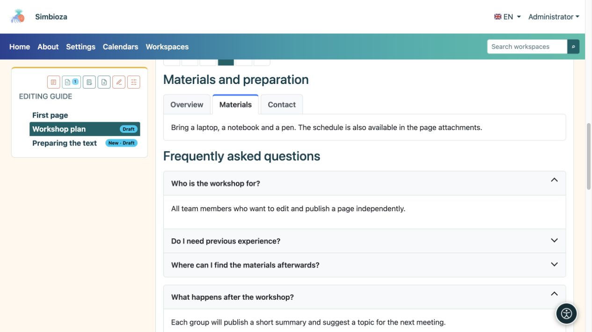
<figcaption>El resultado para los lectores: la pestaña seleccionada muestra materiales, mientras que al seleccionar un título se abre una respuesta o una nota adicional.</figcaption>
</figure>

## 8. Tablas, clasificación y recuento de filas.

### Crear y editar una tabla

Elija **Tabla → Insertar tabla** y complete las celdas preparadas. Utilice la primera fila para encabezados de columnas, como "Nombre", "Estado" y "Fecha de vencimiento".

Para cambiar una tabla, primero haga clic en la celda correspondiente y vuelva a abrir **Tabla**:

- **Insertar fila arriba/abajo** y **Eliminar fila** actúan en la fila de esa celda.
- **Insertar columna izquierda/derecha** y **Eliminar columna** actúan sobre su columna.
- **Fusionar con la celda derecha/abajo** une celdas; **Dividir celda** separa una celda previamente fusionada.

Utilice tablas para datos, en lugar de diseño de página. Utilice [columnas](#layout) para organizar el contenido.

### Permita que los lectores ordenen y exploren filas

1. Haga clic en una celda de la tabla.
2. Abra **Tabla → Configuración de tabla**.
3. Habilite **Clasificación y paginación**.
4. Elija **Filas iniciales por página**: **10, 25, 50, 100 o Todas**.
5. Seleccione **Aplicar** y luego guarde la página.

<figure>
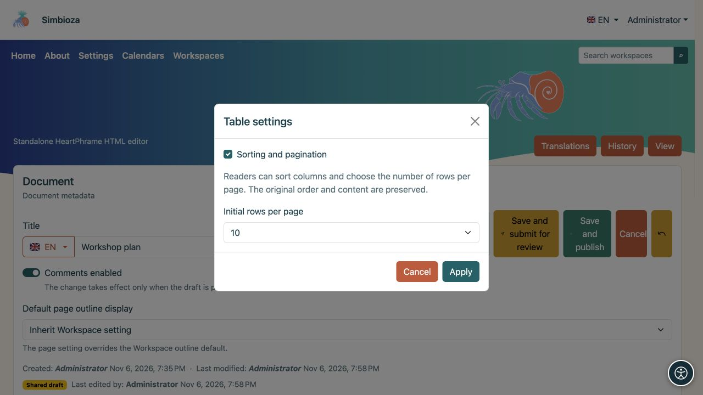
<figcaption>Esta configuración se aplica a la tabla seleccionada. Los lectores pueden cambiar el recuento de filas posteriormente.</figcaption>
</figure>

**Resultado:** los lectores seleccionan un encabezado de columna para ordenarlo de forma ascendente, lo seleccionan nuevamente para el orden descendente y una tercera vez para el orden original. Las flechas muestran la dirección. Pueden elegir un recuento de filas al lado de la tabla y explorar páginas con los controles de paginación. **Todo** muestra cada fila.

Habilite esto **por separado para cada tabla**. El editor todavía muestra cada fila; La clasificación de un lector no cambia los datos guardados. No se requiere ningún script externo. Los controles también funcionan en las exportaciones HTML y la impresión muestra todas las filas.

Esta característica necesita una fila de encabezado, la misma cantidad de celdas en cada fila de datos, sin celdas fusionadas y sin tablas anidadas dentro de una celda. Para una tabla más compleja, mantenga la vista normal o divida los datos en tablas más simples.

<figure>
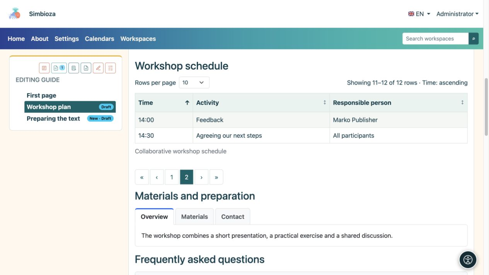
<figcaption>Vista de lector: se seleccionan 10 filas por página. La página dos muestra las dos filas restantes, 11 a 12 de 12. La flecha del encabezado indica la clasificación.</figcaption>
</figure>

## 9. Sube una imagen, video u otro archivo

1. Debajo del contenido, abra **Adjuntos**, elija **Agregar archivo adjunto/Elegir archivos** y luego **Cargar**. Espere a que finalice la carga.
2. Ingrese un **Nombre para mostrar** junto al archivo. Este es el nombre que desea que vean los lectores; puede ser más claro que el nombre del archivo original.
3. Para una imagen, ingrese **Texto alternativo**: una breve descripción de la información que transmite. Por ejemplo, "Disposición de la sala con la entrada marcada", en lugar de "image1.png".
4. **Subtítulo** es una nota breve al lado del medio insertado; **Descripción** proporciona información adicional sobre el archivo adjunto. Seleccione **Guardar metadatos**.
5. Coloque el cursor donde debería aparecer el archivo y seleccione **Insertar** junto al archivo adjunto.

**Resultado:** aparece una imagen o vídeo en el contenido; otro archivo aparece como un enlace para abrirlo o descargarlo. La carga por sí sola no inserta un archivo en el texto.

<figure>
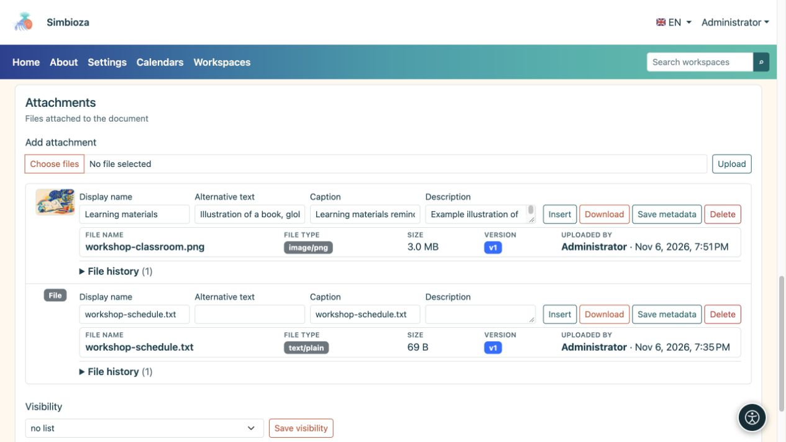
<figcaption>Ingrese información descriptiva al lado de la imagen cargada y guarde sus metadatos. Insertar agrega el archivo adjunto seleccionado al contenido.</figcaption>
</figure>

### Tamaño, espaciado y alineación del material

Seleccione una imagen insertada u otro medio y abra **Medios**. Elija un ancho de **25 %, 50 %, 75 % o 100 %**, **sin espaciado, pequeño, mediano o grande** y alineación **izquierda, central o derecha**. **Restablecer medios** restaura su configuración de apariencia inicial.

**Editar texto alternativo de imagen** cambia la descripción de la imagen seleccionada. Utilice **Marcar imagen como decorativa** solo cuando la imagen no transmita información, como un divisor decorativo. Un título visible no reemplaza el texto alternativo.

Un ancho completo suele ser más fácil de leer para una captura de pantalla. Consulte la página en una ventana estrecha después de realizar cambios.

<figure>
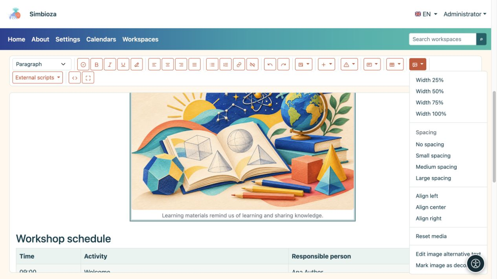
<figcaption>Primero seleccione la imagen, luego use Medios para configurar su apariencia y descripción.</figcaption>
</figure>

### Listas de archivos adjuntos e historial

**La visibilidad** en la sección de archivos adjuntos controla quién ve la **lista** de archivos adjuntos: ninguna lista, todos, incluidos los invitados o los usuarios autenticados. No otorga por sí mismo acceso a una página o archivo privado.

Puede descargar un archivo, cambiar sus metadatos y, con los permisos adecuados, eliminarlo. Cuando **Historial de archivos** esté disponible, revise las versiones anteriores y restaure una si es necesario. Eliminar una imagen del texto y eliminar su archivo adjunto son acciones diferentes: eliminar el archivo puede afectar los lugares que lo utilizan.

## 10. Incrustar contenido de otro servicio

Para contenido como una actividad de aprendizaje interactiva o un vídeo proporcionado por otro servicio, abra **Insertar → Insertar contenido incrustado**.

1. Pegue el **código Iframe del proveedor o la URL HTTPS**.
2. Ingresa un **Título accesible**, como “Ejercicio: identificar formas geométricas”.
3. Establezca la **Altura** y, si es necesario, **Permitir pantalla completa**.
4. Seleccione **Insertar**, guarde y revise la página. Utilice el lápiz del bloque para cambios posteriores.

Si el contenido no aparece, el proveedor puede prohibir la incrustación o solicitar un inicio de sesión por separado. Si se requiere un script adicional, solicite al administrador que prepare una integración compatible; No pegue usted mismo código de programación desconocido.

## 11. Compara datos numéricos con un gráfico.

1. Elija **Elementos dinámicos → Insertar gráfico**.
2. Seleccione **Barra, Línea, Área, Circular o Donut**. Un gráfico de barras funciona bien para comparar el número de participantes por mes.
3. Introduzca un título, categorías y valores numéricos. **Agregar categoría** agrega otra categoría; **Agregar serie** agrega un segundo conjunto de valores, como otro año.
4. Agregue nombres de ejes y una descripción si es útil; elija una leyenda, orientación, apariencia, ancho y alineación. El fondo puede seguir el tema.
5. Seleccione **Insertar gráfico** y verifique la vista de página.

**Resultado:** los valores que ingresó se muestran como un gráfico. No se obtienen automáticamente de una encuesta ni de otra tabla. Utilice el lápiz del gráfico para cambiar sus valores o su apariencia; su configuración también ofrece eliminación.

<figure>
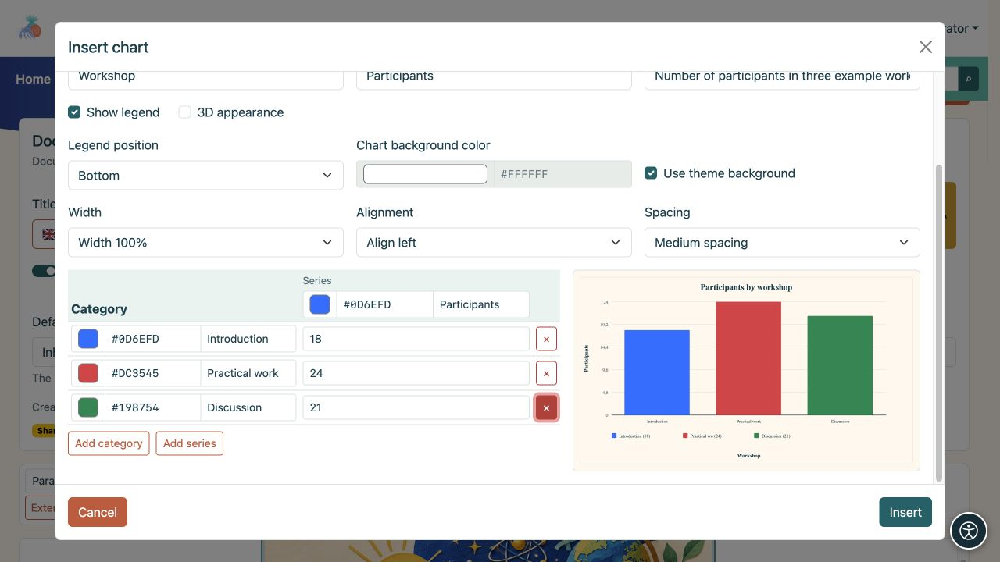
<figcaption>Un gráfico con tres categorías. La vista previa muestra el efecto a medida que cambia sus valores y apariencia.</figcaption>
</figure>

## 12. Muestra actividades en una línea de tiempo.

1. Elija **Elementos dinámicos → Insertar línea de tiempo**.
2. Ingrese un título y el inicio y el final del período que desea mostrar.
3. Seleccione la escala de tiempo: **Días, Semanas, Meses o Trimestres**.
4. Utilice **Agregar grupo** para agregar un grupo, como "Preparación de evento", y actividades con fechas de inicio y finalización. Agregue más grupos y marcadores de fechas importantes cuando sea necesario.
5. Seleccione **Insertar cronograma** y verifique que cada actividad se ajuste al período elegido.

**Resultado:** la página muestra cuándo comienza y termina cada actividad. Esta es una presentación del plan que ingresó, en lugar de un calendario automático o un servicio de recordatorio. Use el lápiz del bloque para reabrir su configuración.

<figure>
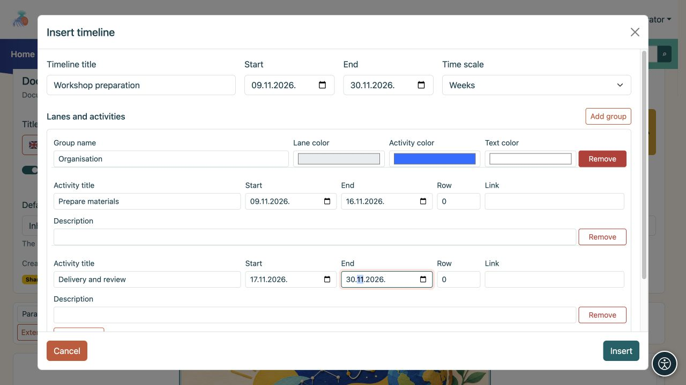
<figcaption>Un ejemplo de línea de tiempo: un carril con dos actividades y fechas de inicio y finalización individuales.</figcaption>
</figure>

## 13. Mostrar datos de otras partes de Simbioza

Estas entradas del menú **Elementos dinámicos** dependen de los módulos instalados. Si falta una entrada, pregunte a un administrador si esa característica está disponible en su instalación.

| Característica | Qué hacer | Lo que ven los lectores |
| --- | --- | --- |
| **Insertar lista de tareas** | Ingrese un título y tareas, una por línea. Elija una lista o tabla y quién puede cambiar los estados. | Tareas y sus estados, según los permisos seleccionados. |
| **Insertar calendario** | Elija uno o más calendarios ofrecidos, un título, vista de mes/semana/día y la fecha actual o fija. | Eventos de calendarios a los que puede acceder el lector. La inserción no cambia los permisos del calendario. |
| **Incluir contenido de la página** | Busque un espacio de trabajo y una página; use **Cargar más** cuando sea necesario y luego confirme. | El contenido de la página seleccionada sin mantener una segunda copia; el acceso del lector todavía está verificado. |
| **Insertar contenido dinámico** | Elija una tabla de propiedades de página, una galería de archivos adjuntos, una búsqueda de espacio de trabajo o cambios recientes. Establezca espacios de trabajo, un título, filtros y recuento de elementos. | Una vista actualizada de las páginas accesibles y sus datos. |

Utilice el lápiz del bloque insertado para cambiar su configuración. Algunos bloques aparecen como un resumen de configuración en el editor. Guarde y abra la vista de página para comprobar su apariencia final.

### Propiedades de una tabla de páginas

Para obtener una descripción general del proyecto con columnas como "Estado" y "Fecha de vencimiento", primero agregue propiedades y valores con nombres coherentes a las páginas de origen. En el bloque dinámico, elija **Tabla de páginas y propiedades** y enumere esas propiedades como columnas. Si faltan datos, verifique el nombre exacto de la propiedad, los espacios de trabajo seleccionados, el filtro de etiquetas y los permisos de lectura de la página de origen. Consulte [Espacios de trabajo](podrucja_es.md) para conocer las propiedades y la configuración de la página.

### Scripts externos preparados por un administrador.

1. Abra **Scripts externos**.
2. Si un script tiene un **¿encerrado en un círculo?**, selecciónelo y lea las instrucciones. El signo de interrogación aparece sólo cuando existen instrucciones; leerlos no habilita el script.
3. Seleccione el script que necesita y guarde la página. La selección se mantiene con esa versión de contenido.

Sólo aparecen los scripts aprobados. Si las instrucciones requieren un cambio en el código fuente que no sabe cómo realizar, pídale a un administrador o editor experimentado que prepare un ejemplo para su página. **La clasificación y paginación de tablas integradas no necesitan un script externo.**

Consulte los scripts en la página publicada; no se ejecutan en el editor, borradores ni historial. Un script revocado deja de ejecutarse. La exportación HTML incluye scripts aprobados seleccionados; Los scripts remotos aún necesitan una conexión de red.

## 14. Guarda, revisa y publica su trabajo.

| Acción | Significado |
| --- | --- |
| **Guardar** | Guarda los cambios como borrador. En un espacio de trabajo, la versión publicada existente permanece visible para los lectores. |
| **Guardar y enviar para revisión** | Guarda el borrador y lo envíe a alguien con permiso de publicación. Úselo cuando el contenido esté listo pero no lo publique usted mismo. |
| **Guardar y publicar** | Con permisos de edición y publicación, guarda el contenido y lo publica inmediatamente. |
| **Cancelar** | Sale del editor; Si los cambios no se guardan, siga el mensaje antes de salir. |

El envío para revisión y publicación se aplica a las páginas del espacio de trabajo. Las páginas independientes HTML no utilizan el mismo proceso de revisión del espacio de trabajo: guardar actualiza su propio contenido.

### Comprobar antes de publicar

1. Seleccione **Verificar documento** en la barra de herramientas.
2. Corrija los problemas informados, como un encabezado vacío, un nivel de encabezado omitido, una imagen sin texto alternativo o una tabla sin encabezado.
3. Seleccione **Verificar nuevamente**. La verificación ayuda, pero no puede juzgar si su texto es comprensible o si todos los datos son correctos.
4. Guarde los cambios y abra **Vista previa**. Compruebe qué versión e idioma está viendo. Para inspeccionar cambios no publicados en el espacio de trabajo, elija **Vista previa del borrador**; guardar un borrador no reemplaza la vista normal de la página publicada.
5. Enlaces de prueba, pestañas y secciones ampliables; verifique las imágenes, los datos y el diseño en una ventana estrecha.
6. Publicar o enviar para revisión. Después de la publicación, vuelva a abrir la página como lector.

Un **borrador local** ofrecido después de una interrupción se guarda solo en ese navegador. No reemplaza **Guardar**. Si otro editor cambió el borrador compartido, compare las versiones ofrecidas antes de restaurar sus cambios.

**Descartar borrador compartido** elimina los cambios compartidos sin publicar y vuelve a la última versión publicada. Coordínese con los demás editores antes de confirmar. En una página nueva que **nunca se ha publicado**, descartar el borrador puede eliminar la página de forma permanente; lea la confirmación antes de continuar.

En la vista de página también puede ver **Enviar para revisión**, **Volver al borrador** o **Publicar**, según el estado y los permisos. Una persona con permiso para publicar puede publicar un borrador directamente; No es obligatoria la presentación de una revisión previa. Si solo tiene permiso de publicación, abra **Vista previa del borrador**, verifique el contenido y el idioma, luego elija **Publicar** en la barra de acciones de la página; ese permiso por sí solo no permite la edición de texto. Una página archivada se debe volver a redactar y publicar nuevamente antes de que esté disponible para los lectores.

## 15. Traducir una página o restaurar contenido anterior

### Otro idioma de la pagina

1. En **Idioma del documento**, elija el idioma que desea editar. Los idiomas ofrecidos se instalan y habilitan en la aplicación.
2. Verifique el título en ese idioma usando el menú al lado de **Título**.
3. **Traducciones → Copiar traducción** puede copiar contenido existente como punto de partida. Elija un idioma de origen y de destino, luego **Copiar para traducción**.
4. Traducir el texto, títulos de pestañas, subtítulos y descripciones de imágenes; comprobar y publicar la versión en ese idioma.

**La copia no traduce el texto automáticamente.** Una traducción de destino existente se reemplaza por una nueva versión. No es necesario traducir a todos los idiomas ofrecidos; publique solo aquellos para los que haya preparado contenido.

### Historia

Abra **Historial**. Seleccione **Vista previa** junto a una versión anterior para leerla primero. Para recuperar su contenido, seleccione **Restaurar** y siga la confirmación. Luego verifique el borrador actual y publíquelo si es necesario. Las barras de herramientas **Deshacer** y **Rehacer** manejan cambios de texto normales en la sesión de edición actual. No cubren todos los cambios de configuración de medios o bloques especiales, por lo que no confíe en ellos para restaurar esas configuraciones. Seleccione **Guardar** antes de cambios más importantes; el historial mantiene las versiones guardadas.

## 16. ¿Quién puede leer y editar una página?

La mayoría de las páginas heredan los permisos del espacio de trabajo. Para escribir todos los días sólo necesitas los permisos de edición pertinentes; no es necesario que cambie la configuración de acceso usted mismo. Un borrador sin una versión publicada está disponible para los editores, editores y gestores relevantes, en lugar de para los lectores comunes. El árbol y el estado de la página lo identifican como borrador.

Cuando tenga permiso, abra **Administrar página y permisos** en la barra de acciones superior de la página. Distinguir entre:

- **Restricciones a los permisos heredados:** limita aún más los derechos existentes para la página y sus descendientes. No agregan a alguien que antes no tenía acceso.
- **Permisos directos para usuarios y grupos:** excepciones para la página seleccionada. Puede elegir usuarios o grupos; una excepción no abre automáticamente otras páginas o descendientes del espacio de trabajo.

Abra el selector de usuarios o grupos con capacidad de búsqueda, busque el destinatario y agréguelo. Si hay más resultados, busque o cargue artículos adicionales ofrecidos. Marque **Leer**, **Edición** y **Publicar**, luego seleccione **Guardar permisos directos**. La edición y publicación incluyen lectura; la publicación por sí sola no incluye la edición. El panel de restricción separado se aplica a usuarios individuales que ya tienen derechos heredados, no a grupos completos.

La audiencia **Pública** otorga acceso de lectura, incluso a los invitados. No puede conceder la edición ni la publicación. Esto puede hacer que una página publicada sea pública dentro de un espacio de trabajo privado mientras el contenido privado restante permanece protegido; no publica un borrador. El espacio de trabajo puede aparecer entonces entre los espacios de trabajo disponibles, pero su árbol muestra sólo el contenido al que el lector puede acceder.

<figure>
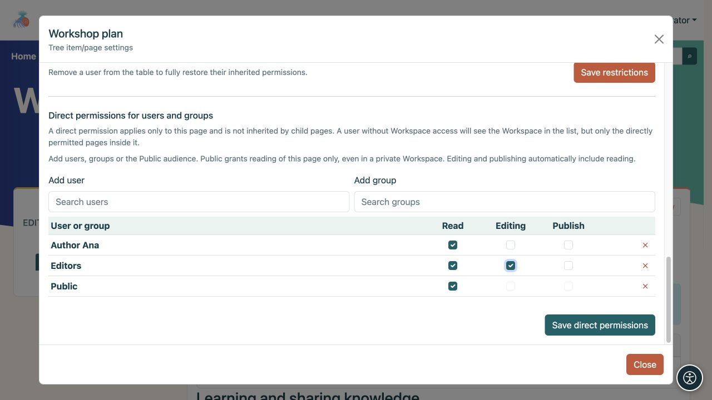
<figcaption>Permisos directos para una sola página: un usuario, un grupo y la audiencia Pública tienen derechos diferentes.</figcaption>
</figure>

Cambiar los permisos puede exponer el contenido a otros. Si no está seguro, solicite a un administrador o gestor del espacio de trabajo que configure el acceso. Luego, pida al lector previsto que abra la página; La opinión de un administrador no es prueba de que el acceso sea correcto para todos los demás. Consulte [Permisos del espacio de trabajo](podrucja_es.md) para obtener más detalles.

## 17. Otras acciones de la página

La barra de acciones superior de la página muestra solo las acciones disponibles en su instalación y para su cuenta. Pase el cursor sobre un ícono para leer su nombre.

<figure>
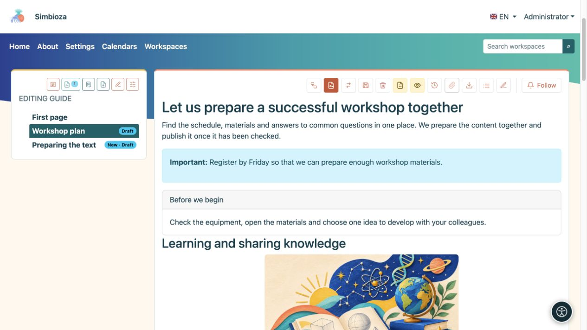
<figcaption>Acciones de página publicada: los íconos ofrecidos dependen de sus permisos y funciones habilitadas.</figcaption>
</figure>

- **Mostrar archivos adjuntos/Ocultar archivos adjuntos** abre o cierra la lista de archivos. **Mostrar tabla de contenido/Ocultar tabla de contenido** muestra u oculta la lista de encabezados dentro de la página.
- **Historial** abre versiones guardadas; el menú de banderas elige una traducción existente.
- **Copiar o mover página** está disponible para los gestores del espacio de trabajo. Elija copiar o mover, un espacio de trabajo de destino y una página superior, y si desea transferir el historial y los permisos/restricciones directas. El contenido, las traducciones y los archivos adjuntos viajan juntos. Una copia deja el original en su lugar; un movimiento lo elimina después de una transferencia exitosa. Sólo se copia la página elegida; mover una página con descendientes no está disponible. Verifique los permisos de destino después.
- **Exportar página a HTML** descarga un ZIP que contiene `index.html` y archivos locales asociados. Extráigalo antes de abrir el archivo HTML. Para las páginas del espacio de trabajo, esto exporta la versión publicada, en lugar de un borrador no publicado. No es una copia de seguridad para restaurar todo el espacio de trabajo.
- Para un PDF, abra **Imprimir → Guardar como PDF** del navegador. Verifique la vista previa de impresión y el diseño antes de guardar.
- **Eliminar página y subárbol** también elimina descendientes; Lea atentamente la confirmación. Las páginas publicadas utilizan la eliminación recuperable, mientras que la eliminación de un documento nuevo nunca publicado a través del editor puede ser permanente. Pregúntele a un administrador sobre la recuperación en lugar de asumir que cada eliminación se puede deshacer.
- Cuando están habilitados, **Seguir** y los comentarios admiten notificaciones de cambios y debates.

En el editor, **Código fuente** muestra HTML para editores experimentados; No es necesario para los procedimientos anteriores. **Pantalla completa** da más espacio al contenido; utilice el mismo icono para volver a los detalles del documento y guardar acciones.

## 18. Cuando algo es inesperado

| lo que ves | Qué hacer |
| --- | --- |
| Ninguna acción de edición o publicación. | Consulte la cuenta y el espacio de trabajo. Pídale a un gestor o administrador que verifique sus permisos. |
| Cambiaste el texto pero los lectores aún ven la página anterior. | Guarde el borrador y compruebe si aún es necesaria la publicación. Compruebe el idioma también. |
| Un comando de tabla o imagen no hace nada. | Primero haga clic en una celda de la tabla o seleccione la imagen misma, luego repita el comando. |
| El contenido desplegable permanece abierto en el editor. | Esta es la vista de edición. Verifique el estado inicial en la vista de página. |
| Las pestañas o el acordeón tienen títulos pero no texto del cuerpo. | Después de la inserción, complete el cuerpo de cada sección en el editor principal. |
| Faltan la clasificación y el recuento de filas. | Habilítelos en **la configuración de esa tabla**, verifique su encabezado simple y vea la página guardada. |
| Se carga un archivo pero no aparece en el texto. | Coloque el cursor en el contenido y luego elija **Insertar** junto al archivo adjunto. |
| Ves un calendario, una página incluida o una lista dinámica, pero el lector no. | Verifique también sus derechos sobre el contenido fuente. La inserción no abre datos privados. |
| Falta un script o no funciona. | Lea sus instrucciones y consulte la vista publicada. Un administrador prepara y aprueba scripts. |
| El texto pegado tiene un estilo inconsistente. | Aplique **Eliminar formato** y luego configure los encabezados y las listas nuevamente. |
| Deshacer no restaura el ancho de una imagen modificada ni otras configuraciones de bloque. | Restaure esas configuraciones a través de su menú. Guarde antes de cambios mayores. Elija **Cancelar** para descartar los cambios no guardados; los cambios ya guardados permanecen guardados. |

Antes de terminar, revisa **contenido, guardado, idioma seleccionado, enlaces y acceso esperado del lector**. Para la mayoría de las páginas, estos son más importantes que la cantidad de elementos decorativos que insertes.
