# Modifier les pages

> Les captures d’écran présentent l’interface en anglais.

Apprenez à créer une page, à ajouter du texte, des images et d'autres contenus, et à la préparer pour les lecteurs. Vous travaillez dans un éditeur visuel, un peu comme un traitement de texte. **Vous n'avez pas besoin de connaître HTML ou d'écrire du code de programmation pour l'édition quotidienne.**

Pour votre première page, suivez [création de page](#new-page), [formatage de base](#text) et [enregistrement et publication](#saving). Revenez aux autres sections lorsque vous en avez besoin. Les sondages ont leurs propres [guides séparés](ankete_fr.md).

## 1. Créez une nouvelle page ou ouvrez-en une existante

1. Ouvrez **Espaces de travail** et choisissez l'espace de travail dans lequel vous souhaitez travailler.
2. Pour créer une page, sélectionnez l'icône **Nouvelle page** à côté de l'arborescence de l'espace de travail. Passez la souris sur une icône pour lire son nom.
3. Saisissez le **Titre de la page**. Vérifiez sa langue, l'**Espace de travail** de destination et la **Page parentee**. Le parent détermine où la nouvelle page apparaît dans l'arborescence ; choisissez **Racine de l’arborescence** pour le niveau supérieur. Le formulaire indique quelle langue principale nécessite un titre.
4. Vous pouvez laisser **Slug** vide : le système le dérive du titre. Il s'agit de la partie courte de l'adresse Web de la page, évitez donc de la modifier ultérieurement sans raison.
5. Sélectionnez **Créer et modifier**. La nouvelle page s'ouvre dans l'éditeur.

**Résultat :** la page existe à l'endroit sélectionné et est prête à être contenue. La création de la page et la saisie du texte sont distinctes de sa publication auprès des lecteurs.

<figure>
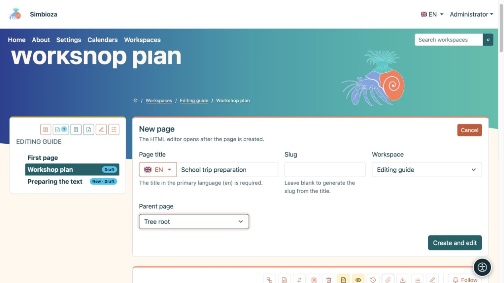
<figcaption>Nouvelle page : saisissez un titre, vérifiez sa langue et sa position dans l'arborescence, puis sélectionnez Créer et modifier.</figcaption>
</figure>

Pour modifier une page existante, ouvrez-la depuis l'arborescence et sélectionnez le crayon **Modifier**. Si l'action de création ou de modification est manquante, demandez à un administrateur ou à un gestionnaire d'espace de travail de vérifier vos autorisations.

Une installation sans Espaces de travail peut contenir des pages **HTML** et **Gérer le contenu**. Créez-y des pages autonomes et modifiez leur contenu avec le même éditeur. Si les espaces de travail sont installés ultérieurement, les pages autonomes continuent de fonctionner jusqu'à ce qu'un administrateur les déplace explicitement dans un espace de travail.

## 2. S'orienter dans l'éditeur

Les détails du document, la sélection de la langue et les actions de sauvegarde se trouvent en haut. La **barre d'outils** se trouve immédiatement au-dessus du contenu que vous modifiez. Les **Pièces jointes**, sous le contenu, contiennent les fichiers associés à la page.

<figure>
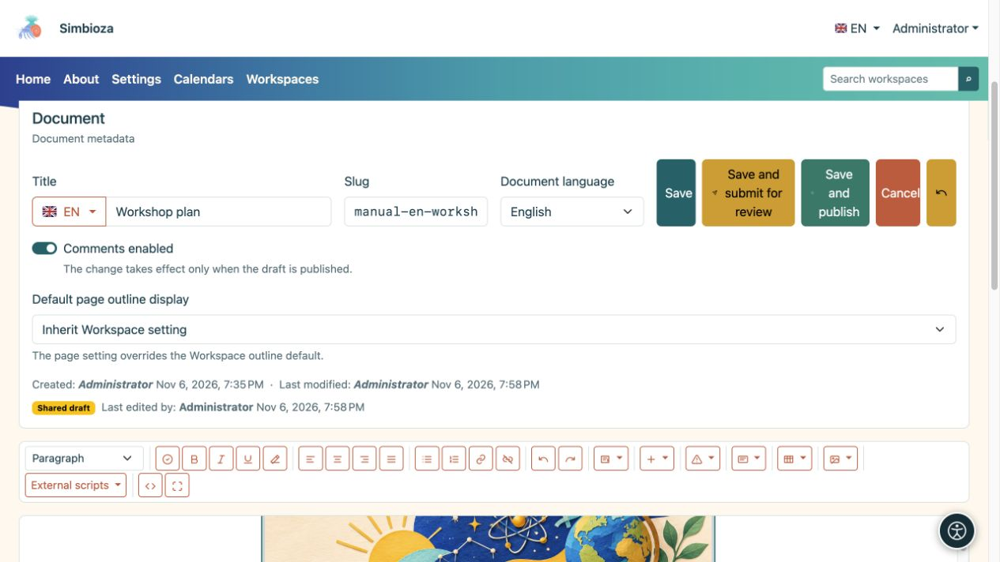
<figcaption>Le haut de l'éditeur : les détails du document et les actions d'enregistrement au-dessus de la barre d'outils.</figcaption>
</figure>

Lorsqu'il est proposé, **Commentaires activés** autorise de nouveaux commentaires ; les commentaires existants restent lorsque les nouveaux commentaires sont désactivés. Sur une page d'espace de travail, ce changement fait suite à la publication. **L'affichage de la table des matières de la page par défaut** peut hériter des paramètres de l'espace de travail ou choisir **Afficher/Masquer** pour cette page.

Cliquez à l'endroit où vous souhaitez taper ou insérer quelque chose. Sélectionnez les mots existants avant de les formater ; pour formater un paragraphe entier, placez le curseur à l'intérieur.

Passez la souris sur un bouton d'image pour lire son nom. Sur une fenêtre plus étroite, la barre d'outils s'enroule sur plusieurs lignes. Utilisez Tab et Shift+Tab pour vous déplacer entre les boutons et les champs ; activez un bouton ciblé avec Entrée ou Espace.

| Groupe de barre d'outils | Ce que ça fait |
| --- | --- |
| **Format** | Paragraphes, titres, citations ou texte préformaté. |
| **Vérifier le document** | Vérifie les titres, les images, les liens et les tableaux avant la publication. |
| **Gras**, **Italique**, **Souligné**, **Supprimer la mise en forme** | Formate le texte sélectionné. |
| Quatre boutons d'alignement | Alignement des paragraphes à gauche, au centre, à droite ou justifié. |
| **Liste non ordonnée**, **Liste ordonnée**, **Lien**, **Dissocier** | Listes et liens. |
| **Annuler**, **Rétablir** | Annule ou répète les modifications de texte ordinaires dans la session d'édition en cours. |
| **Éléments dynamiques** | Onglets, accordéon, contenu déroulant, graphiques, chronologies et intégrations disponibles. |
| **Insérer**, **Alertes Bootstrap**, **Cartes** | Des colonnes, une règle horizontale, du contenu intégré et des sections mises en surbrillance. |
| **Tableau**, **Médias** | Fonctionne sur le tableau, l'image ou tout autre support sélectionné. |
| **Scripts externes** | Fonctionnalités supplémentaires préparées et approuvées par un administrateur. |
| **Code source**, **Plein écran** | Vue avancée HTML ou plus d'espace pour l'édition visuelle. |

Certaines fonctionnalités n'apparaissent que lorsque le module correspondant est activé et que vous disposez des autorisations nécessaires. Une commande de tableau ou de média indisponible signifie souvent simplement que vous n'avez pas encore sélectionné de cellule ou d'image de tableau.

<figure>
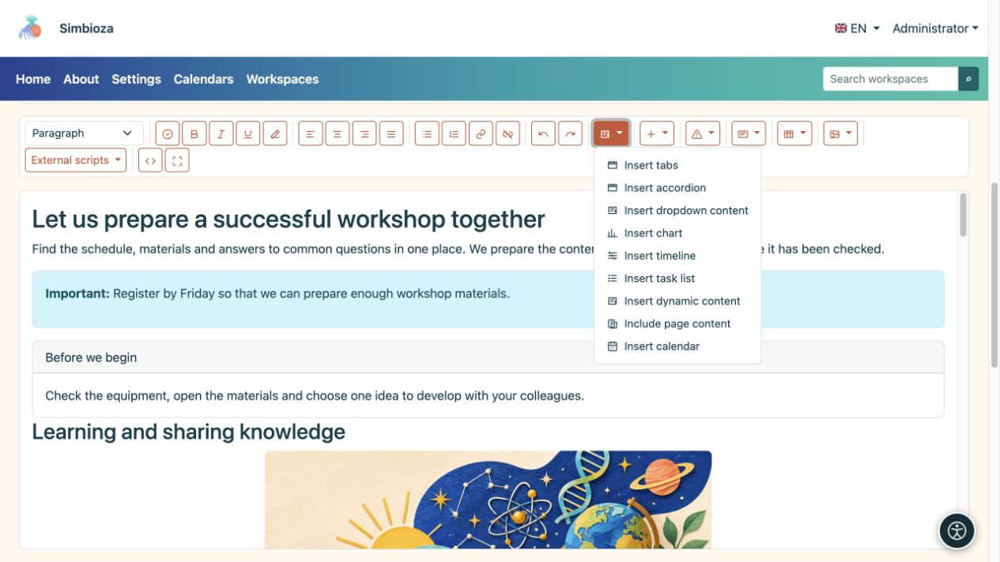
<figcaption>Les éléments dynamiques ouvrent les paramètres pour un contenu plus complexe. Les intégrations disponibles dépendent des modules installés.</figcaption>
</figure>

## 3. Écrire et formater le texte

### Titres, paragraphes et listes

1. Écrivez un court paragraphe d'ouverture expliquant le sujet de la page.
2. Pour une nouvelle section, tapez un titre, placez-y le curseur et choisissez son niveau sous **Format**. Le titre de la page est déjà le titre principal ; Les sections du corps commencent normalement par **Titre 2**, suivi de **Titre 3** pour les sous-sections.
3. Utilisez la **Liste non ordonnée** pour les éléments et la **Liste ordonnée** pour les étapes qui doivent se dérouler dans l'ordre.
4. Sélectionnez quelques mots et appliquez du gras ou de l'italique pour les mettre en valeur. Pour supprimer le style collé indésirable, sélectionnez ce texte et choisissez **Supprimer le formatage**.

**Résultat :** la page comporte des sections claires, ce qui facilite la navigation des lecteurs et des technologies d'assistance. N'utilisez pas de paragraphe en gras ordinaire pour remplacer un véritable titre.

Utilisez **Quote** pour les mots cités. **Préformaté** préserve les espaces et la mise en page d'un court exemple de texte. L'alignement à gauche fonctionne mieux pour les paragraphes plus longs ; la justification peut introduire de grands écarts entre les mots.

### Liens

1. Sélectionnez des mots qui doivent mener quelque part, tels que « Exigences de candidature ».
2. Sélectionnez **Lien**.
3. Pour une page externe, saisissez l'adresse Web et sélectionnez **Insérer un lien URL**. Pour une page Simbioza, choisissez un espace de travail et une page sous **Lien interne**, puis confirmez.
4. Pour une longue liste, utilisez la recherche et **Charger plus**. Le sélecteur propose des pages que vous pouvez sélectionner.

**Dissocier** conserve les mots et supprime leur destination. Après avoir enregistré, ouvrez le lien depuis la vue page pour le vérifier.

## 4. Sections séparées avec des colonnes, des alertes et des cartes

| Tu veux… | Ce qu'il faut faire | Résultat |
| --- | --- | --- |
| Deux ou trois sections parallèles | **Insérer → Deux colonnes / Trois colonnes**, puis remplacez le texte dans chaque colonne. | Le contenu apparaît côte à côte sur un écran large et s'empile sur un écran étroit. |
| Une petite note importante | Ouvrez les **Alertes Bootstrap**, choisissez un style et remplacez l'exemple de texte. | Le message ressort. Commencez par un mot clair tel que « Important » ; la couleur seule ne suffit pas. |
| Une boîte séparée d'informations connexes | **Cartes → Carte avec titre / Carte sans titre**. Remplissez le corps et, le cas échéant, l'en-tête. | Un résumé, un contact ou une section connexe est séparé du texte qui l’entoure. |
| Un simple diviseur | **Insérer → Règle horizontale**. | Une ligne horizontale sépare deux sections. |

Utilisez des colonnes et des cartes pour un contenu connexe court et des titres pour la structure d'un article plus long. Remplacez toujours tous les exemples de texte insérés.

## 5. Onglets : plusieurs alternatives en un seul endroit

Les onglets fonctionnent bien pour les alternatives au sein d'un même sujet, telles que « Avant l'arrivée », « Programme » et « Contact ». Les lecteurs sélectionnent le titre d'un onglet pour voir son contenu.

1. Placez le curseur à l'endroit où le bloc doit aller et ouvrez **Éléments dynamiques → Insérer des onglets**.
2. Saisissez **2 à 6 titres**, un par ligne, puis sélectionnez **Insérer**.
3. Dans l'éditeur principal, remplissez le contenu de chaque onglet. Vous pouvez également y éditer des titres. Lors de l'édition, les contenus sont disposés de manière à ce que vous puissiez travailler sur chacun d'entre eux.
4. Enregistrez et vérifiez la vue de la page : la sélection d'un titre doit afficher le contenu correspondant.

<figure>
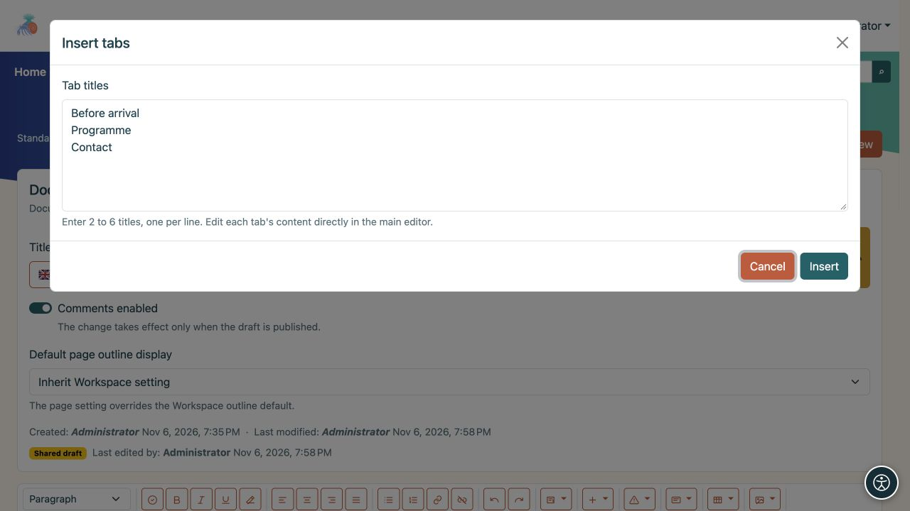
<figcaption>Cet exemple crée trois onglets. Après les avoir insérés, écrivez leurs corps dans l'éditeur principal.</figcaption>
</figure>

Le crayon à côté du bloc rouvre ses paramètres. **Supprimer les onglets** supprime tout le bloc. Supprimer un titre de la liste de titres supprime également son contenu. Changez les titres et le contenu ensemble ; la réécriture ou la réorganisation des lignes de titre ne déplace pas automatiquement le texte associé.

## 6. Accordéon : les sections que les lecteurs peuvent développer

Un accordéon convient aux questions fréquemment posées ou à plusieurs procédures courtes. Les lecteurs sélectionnent le titre d'une question pour ouvrir sa réponse. Ils peuvent garder plusieurs sections ouvertes à la fois.

1. Choisissez **Éléments dynamiques → Insérer un accordéon**.
2. Saisissez **1 à 12 titres**, un par ligne, puis sélectionnez **Insérer**.
3. Dans l'éditeur principal, remplissez le corps sous chaque titre. Vous pouvez ajouter des liens, des images, des tableaux et d'autres contenus.
4. Dans la vue page, ouvrez et fermez des sections individuelles pour vérifier leurs titres et leur contenu.

<figure>
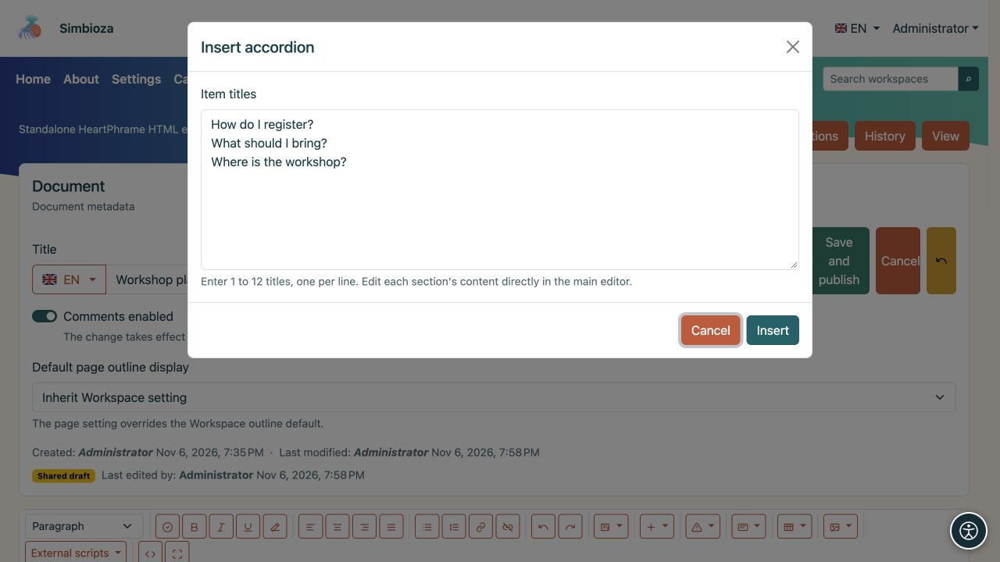
<figcaption>Chaque ligne devient un titre de section en accordéon ; écrivez les réponses après avoir inséré le bloc.</figcaption>
</figure>

Utilisez le crayon du bloc pour modifier le nombre de sections. Un nouveau titre reçoit un corps vide ; supprimer un titre supprime également son corps. **Supprimer l'accordéon** supprime l'intégralité du groupe.

## 7. Contenu déroulant : une note extensible

Pour une seule note ou explication supplémentaire, choisissez **Éléments dynamiques → Insérer du contenu déroulant**.

1. Saisissez un **Titre** qui décrit clairement le contenu.
2. Activez **Afficher le contenu développé lors du chargement de la page** si les lecteurs doivent voir le texte immédiatement.
3. Sélectionnez **Insérer** et remplissez le corps sous le titre dans l'éditeur principal.

<figure>
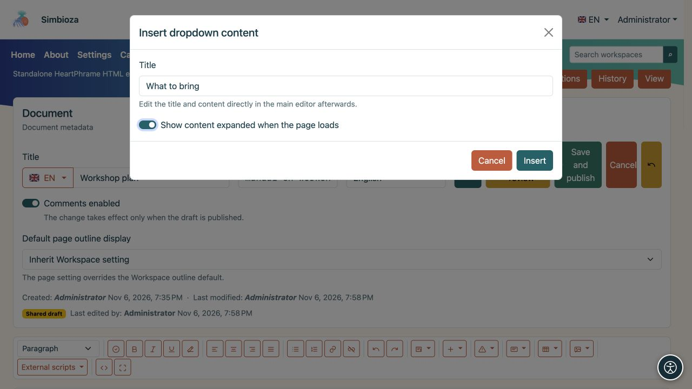
<figcaption>Le paramètre de contenu étendu détermine ce qu'un lecteur voit lors du chargement de la page.</figcaption>
</figure>

Le corps reste ouvert dans l'éditeur afin que vous puissiez le modifier. La page vue suit l'état initial que vous avez choisi ; les lecteurs sélectionnent le titre pour l’ouvrir ou le fermer. Le crayon du bloc ouvre ses paramètres et propose la suppression.

Le contenu des onglets, de l'accordéon et des listes déroulantes peut contenir du texte formaté et d'autres éléments. Gardez les informations les plus importantes de la page visibles sans obliger les lecteurs à ouvrir une section masquée.

<figure>
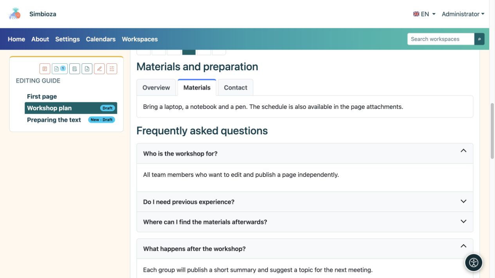
<figcaption>Le résultat pour les lecteurs : l'onglet sélectionné affiche les supports, tandis que la sélection d'une rubrique ouvre une réponse ou une note complémentaire.</figcaption>
</figure>

## 8. Tableaux, tri et nombre de lignes

### Créer et modifier un tableau

Choisissez **Tableau → Insérer un tableau** et remplissez les cellules préparées. Utilisez la première ligne pour les en-têtes de colonnes, tels que « Nom », « Statut » et « Date d'échéance ».

Pour modifier un tableau, cliquez d'abord sur la cellule concernée et rouvrez **Tableau** :

- **Insérer une ligne au-dessus/en dessous** et **Supprimer une ligne** agissent sur la ligne de cette cellule.
- **Insérer une colonne à gauche/à droite** et **Supprimer une colonne** agissent sur sa colonne.
- **Fusionner avec la cellule de droite/en bas** rejoint les cellules ; **Split cell** sépare une cellule précédemment fusionnée.

Utilisez des tableaux pour les données plutôt que la mise en page. Utilisez [colonnes](#layout) pour organiser le contenu.

### Laissez les lecteurs trier et parcourir les lignes

1. Cliquez sur une cellule du tableau.
2. Ouvrez **Tableau → Paramètres du tableau**.
3. Activez **Tri et pagination**.
4. Choisissez les **Lignes initiales par page** : **10, 25, 50, 100 ou Toutes**.
5. Sélectionnez **Appliquer**, puis enregistrez la page.

<figure>
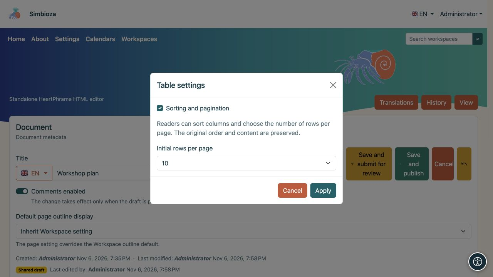
<figcaption>Ces paramètres s'appliquent à la table sélectionnée. Les lecteurs peuvent ensuite modifier le nombre de lignes.</figcaption>
</figure>

**Résultat :** les lecteurs sélectionnent un en-tête de colonne pour trier par ordre croissant, le sélectionnent à nouveau pour l'ordre décroissant et une troisième fois pour l'ordre d'origine. Les flèches indiquent la direction. Ils peuvent choisir un nombre de lignes à côté du tableau et parcourir les pages avec les contrôles de pagination. **Tout** affiche chaque ligne.

Activez ceci **séparément pour chaque table**. L'éditeur affiche toujours chaque ligne ; le tri d'un lecteur ne modifie pas les données enregistrées. Aucun script externe n'est requis. Les contrôles fonctionnent également dans les exportations HTML et l'impression affiche toutes les lignes.

Cette fonctionnalité nécessite une ligne d'en-tête, le même nombre de cellules dans chaque ligne de données, aucune cellule fusionnée et aucun tableau imbriqué dans une cellule. Pour un tableau plus complexe, conservez la vue ordinaire ou divisez les données en tableaux plus simples.

<figure>
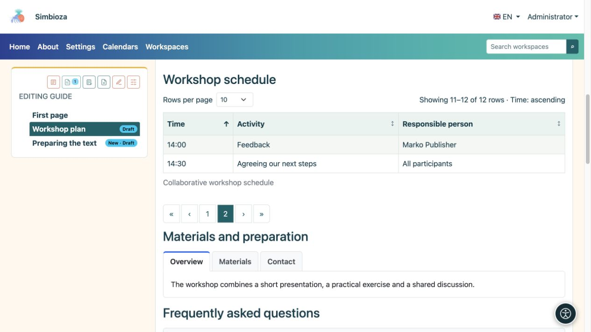
<figcaption>Vue Lecteur : 10 lignes par page sont sélectionnées. La deuxième page montre les deux lignes restantes, 11 à 12 sur 12. La flèche d'en-tête indique le tri.</figcaption>
</figure>

## 9. Téléchargez une image, une vidéo ou un autre fichier

1. Sous le contenu, ouvrez **Pièces jointes**, choisissez **Ajouter une pièce jointe/Choisir des fichiers**, puis **Télécharger**. Attendez la fin du téléchargement.
2. Saisissez un **Nom d'affichage** à côté du fichier. C'est le nom que vous voulez que les lecteurs voient ; il peut être plus clair que le nom du fichier d'origine.
3. Pour une image, saisissez **Texte alternatif** : une brève description des informations qu'elle véhicule. Par exemple, « Disposition de la pièce avec l'entrée marquée », plutôt que « image1.png ».
4. **Légende** est une courte note à côté du média inséré ; **Description** fournit des informations supplémentaires sur la pièce jointe. Sélectionnez **Enregistrer les métadonnées**.
5. Placez le curseur à l'endroit où le fichier doit apparaître et sélectionnez **Insérer** à côté de la pièce jointe.

**Résultat :** une image ou une vidéo apparaît dans le contenu ; un autre fichier apparaît sous forme de lien d'ouverture ou de téléchargement. Le téléchargement seul n’insère pas de fichier dans le texte.

<figure>
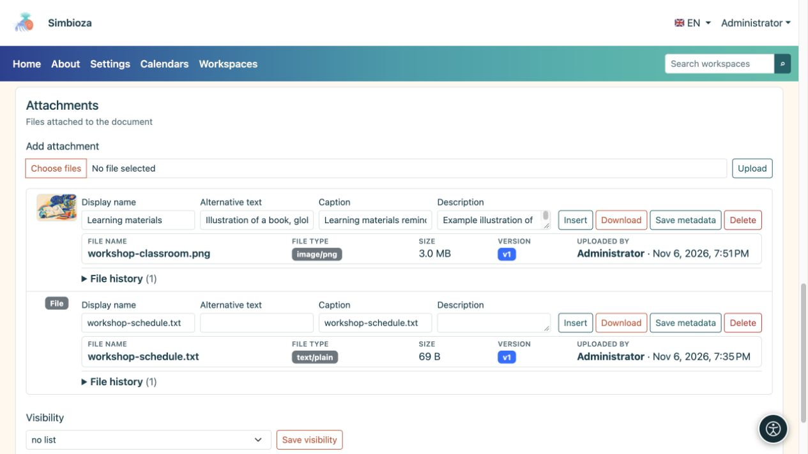
<figcaption>Saisissez des informations descriptives à côté de l’image téléchargée et enregistrez ses métadonnées. Insérer ajoute la pièce jointe sélectionnée au contenu.</figcaption>
</figure>

### Taille du support, espacement et alignement

Sélectionnez une image insérée ou un autre média et ouvrez **Média**. Choisissez une largeur de **25 %, 50 %, 75 % ou 100 %**, un espacement **pas de, petit, moyen ou grand** et un alignement **à gauche, au centre ou à droite**. **Réinitialiser le média** restaure ses paramètres d'apparence initiaux.

**Modifier le texte alternatif de l'image** modifie la description de l'image sélectionnée. Utilisez **Marquer l'image comme décorative** uniquement lorsque l'image ne transmet aucune information, telle qu'un séparateur décoratif. Une légende visible ne remplace pas le texte alternatif.

Une pleine largeur est généralement plus facile à lire pour une capture d’écran. Vérifiez la page dans une fenêtre étroite après avoir apporté des modifications.

<figure>
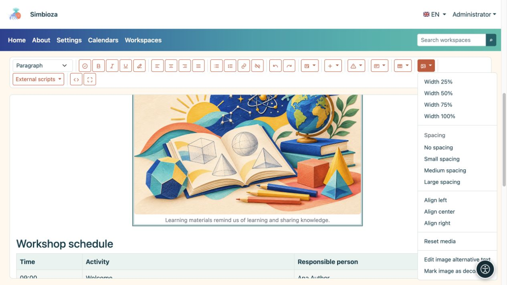
<figcaption>Sélectionnez d’abord l’image, puis utilisez Média pour définir son apparence et sa description.</figcaption>
</figure>

### Listes de pièces jointes et historique

La **Visibilité** dans la section des pièces jointes contrôle qui voit la **liste** des pièces jointes : aucune liste, tout le monde, y compris les invités, ou les utilisateurs authentifiés. Il n’accorde pas lui-même l’accès à une page ou à un fichier privé.

Vous pouvez télécharger un fichier, modifier ses métadonnées et, avec les autorisations appropriées, le supprimer. Lorsque l'**Historique des fichiers** est disponible, examinez les versions précédentes et restaurez-en une si nécessaire. Supprimer une image du texte et supprimer sa pièce jointe sont des actions différentes : la suppression du fichier peut affecter les endroits qui l'utilisent.

## 10. Intégrer le contenu d'un autre service

Pour du contenu tel qu'une activité d'apprentissage interactive ou une vidéo fournie par un autre service, ouvrez **Insérer → Insérer du contenu intégré**.

1. Collez le **code Iframe ou l'URL HTTPS** du fournisseur.
2. Saisissez un **Titre accessible**, tel que « Exercice : identifier des formes géométriques ».
3. Définissez la **Hauteur** et, si nécessaire, **Autoriser le plein écran**.
4. Sélectionnez **Insérer**, enregistrez et vérifiez la page. Utilisez le crayon du bloc pour les modifications ultérieures.

Si le contenu n'apparaît pas, le fournisseur peut interdire l'intégration ou exiger une connexion distincte. Si un script supplémentaire est requis, demandez à l'administrateur de préparer une intégration prise en charge ; ne collez pas vous-même un code de programmation inconnu.

## 11. Comparez les données numériques avec un graphique

1. Choisissez **Éléments dynamiques → Insérer un graphique**.
2. Sélectionnez **Barre, Ligne, Surface, Tarte ou Donut**. Un graphique à barres fonctionne bien pour comparer le nombre de participants par mois.
3. Entrez un titre, des catégories et des valeurs numériques. **Ajouter une catégorie** ajoute une autre catégorie ; **Ajouter une série** ajoute un deuxième ensemble de valeurs, par exemple une autre année.
4. Ajoutez des noms d'axes et une description si cela est utile ; choisissez une légende, une orientation, une apparence, une largeur et un alignement. L'arrière-plan peut suivre le thème.
5. Sélectionnez **Insérer un graphique** et vérifiez l'affichage de la page.

**Résultat :** les valeurs que vous avez saisies sont affichées sous forme de graphique. Ils ne sont pas automatiquement récupérés à partir d'un sondage ou d'une autre table. Utilisez le crayon du graphique pour modifier ses valeurs ou son apparence ; ses paramètres proposent également la suppression.

<figure>
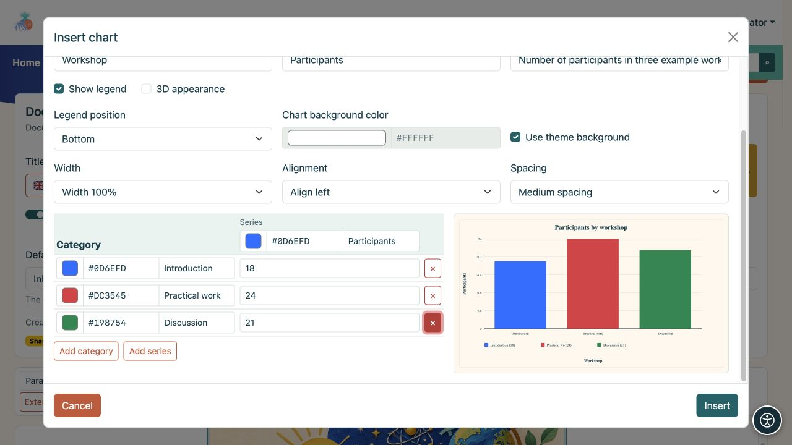
<figcaption>Un tableau avec trois catégories. L'aperçu montre l'effet à mesure que vous modifiez ses valeurs et son apparence.</figcaption>
</figure>

## 12. Afficher les activités sur une chronologie

1. Choisissez **Éléments dynamiques → Insérer une chronologie**.
2. Saisissez un titre ainsi que le début et la fin de la période que vous souhaitez afficher.
3. Sélectionnez l'échelle de temps : **Jours, Semaines, Mois ou Trimestres**.
4. Utilisez **Ajouter un groupe** pour ajouter un groupe, tel que « Préparation de l'événement » et des activités avec des dates de début et de fin. Ajoutez d’autres groupes et marqueurs de dates importantes si nécessaire.
5. Sélectionnez **Insérer une chronologie** et vérifiez que chaque activité correspond à la période choisie.

**Résultat :** la page indique le début et la fin de chaque activité. Il s'agit d'une présentation du plan que vous avez saisi, plutôt que d'un calendrier automatique ou d'un service de rappel. Utilisez le crayon du bloc pour rouvrir ses paramètres.

<figure>
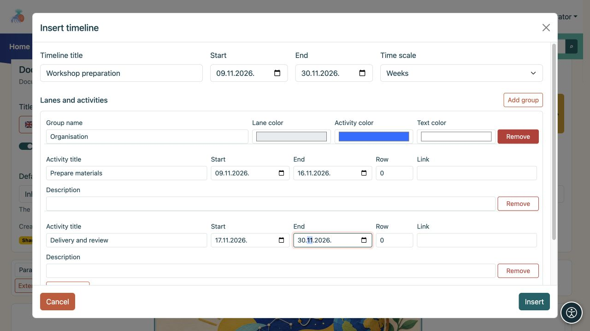
<figcaption>Un exemple de chronologie : une voie avec deux activités et des dates de début et de fin individuelles.</figcaption>
</figure>

## 13. Afficher les données d'autres parties de Simbioza

Ces entrées de menu **Éléments dynamiques** dépendent des modules installés. Si une entrée est manquante, demandez à un administrateur si cette fonctionnalité est disponible dans votre installation.

| Fonctionnalité | Ce qu'il faut faire | Ce que voient les lecteurs |
| --- | --- | --- |
| **Insérer une liste de tâches** | Saisissez un titre et des tâches, une par ligne. Choisissez une liste ou un tableau et qui peut changer de statut. | Tâches et leurs statuts, selon les autorisations sélectionnées. |
| **Insérer le calendrier** | Choisissez un ou plusieurs calendriers proposés, un titre, une vue mois/semaine/jour et la date actuelle ou fixe. | Événements des calendriers auxquels le lecteur peut accéder. L'intégration ne modifie pas les autorisations du calendrier. |
| **Inclure le contenu de la page** | Recherchez un espace de travail et une page ; utilisez **Charger davantage** si nécessaire, puis confirmez. | Le contenu de la page sélectionnée sans conserver une deuxième copie ; l’accès des lecteurs est toujours contrôlé. |
| **Insérer du contenu dynamique** | Choisissez une table de propriétés de page, une galerie de pièces jointes, une recherche dans un espace de travail ou des modifications récentes. Définissez des espaces de travail, un titre, des filtres et le nombre d'éléments. | Une vue à jour des pages accessibles et de leurs données. |

Utilisez le crayon du bloc inséré pour modifier ses paramètres. Certains blocs apparaissent sous forme de récapitulatif des paramètres dans l'éditeur. Enregistrez et ouvrez la vue de la page pour vérifier leur apparence finale.

### Propriétés d'une table de pages

Pour un aperçu du projet avec des colonnes telles que « Statut » et « Date d'échéance », ajoutez d'abord des propriétés et des valeurs nommées de manière cohérente aux pages source. Dans le bloc dynamique, choisissez **Tableau des pages et des propriétés** et répertoriez ces propriétés sous forme de colonnes. Si des données sont manquantes, vérifiez le nom exact de la propriété, les espaces de travail sélectionnés, le filtre d'étiquette et les autorisations de lecture de la page source. Voir [Espaces de travail](podrucja_fr.md) pour les propriétés et les paramètres de page.

### Scripts externes préparés par un administrateur

1. Ouvrez les **Scripts externes**.
2. Si un script a un **encerclé ?**, sélectionnez-le et lisez les instructions. Le point d'interrogation apparaît uniquement lorsque des instructions existent ; les lire n'active pas le script.
3. Sélectionnez le script dont vous avez besoin et enregistrez la page. La sélection est conservée avec cette version de contenu.

Seuls les scripts approuvés apparaissent. Si les instructions nécessitent une modification du code source que vous ne savez pas comment effectuer, demandez à un administrateur ou à un éditeur expérimenté de préparer un exemple pour votre page. **Le tri et la pagination des tableaux intégrés ne nécessitent pas de script externe.**

Vérifiez les scripts sur la page publiée ; ils ne s'exécutent pas dans l'éditeur, les brouillons ou l'historique. Un script révoqué cesse de s'exécuter. L'exportation HTML inclut les scripts approuvés sélectionnés ; les scripts distants ont toujours besoin d'une connexion réseau.

## 14. Enregistrez, vérifiez et publiez votre travail

| Action | Signification |
| --- | --- |
| **Sauvegarder** | Enregistre les modifications sous forme de brouillon. Dans un espace de travail, la version publiée existante reste visible pour les lecteurs. |
| **Enregistrer et soumettre pour examen** | Enregistre le brouillon et le soumet à une personne autorisée à publier. Utilisez-le lorsque le contenu est prêt mais que vous ne le publiez pas vous-même. |
| **Enregistrer et publier** | Avec les autorisations d'édition et de publication, enregistre le contenu et le publie immédiatement. |
| **Annuler** | Quitte l'éditeur ; si les modifications ne sont pas enregistrées, suivez le message avant de partir. |

La soumission pour révision et la publication s’appliquent aux pages de l’espace de travail. Les pages HTML autonomes n'utilisent pas le même processus de révision de l'espace de travail : l'enregistrement des mises à jour de leur propre contenu.

### Vérifiez avant de publier

1. Sélectionnez **Vérifier le document** dans la barre d'outils.
2. Corrigez les problèmes signalés, tels qu'un titre vide, un niveau de titre ignoré, une image sans texte alternatif ou un tableau sans en-tête.
3. Sélectionnez **Vérifier à nouveau**. La vérification est utile, mais ne peut pas juger si votre texte est compréhensible ou si tous les faits sont exacts.
4. Enregistrez les modifications et ouvrez **Aperçu**. Vérifiez la version et la langue que vous consultez. Pour inspecter les modifications non publiées de l'espace de travail, choisissez **Aperçu du brouillon** ; l'enregistrement d'un brouillon ne remplace pas la vue de page publiée ordinaire.
5. Testez les liens, les onglets et les sections extensibles ; vérifiez les images, les données et la mise en page dans une fenêtre étroite.
6. Publiez ou soumettez pour examen. Après la publication, rouvrez la page en tant que lecteur.

Un **brouillon local** proposé après une interruption est enregistré uniquement dans ce navigateur. Il ne remplace pas **Enregistrer**. Si un autre éditeur a modifié le brouillon partagé, comparez les versions proposées avant de restaurer vos modifications.

**Annuler le brouillon partagé** supprime les modifications partagées non publiées et revient à la dernière version publiée. Coordonnez-vous avec d’autres éditeurs avant de confirmer. Sur une nouvelle page qui n'a **jamais été publiée**, la suppression de son brouillon peut supprimer définitivement la page ; lisez la confirmation avant de continuer.

Dans la vue de la page, vous pouvez également voir **Soumettre pour révision**, **Retour au brouillon** ou **Publier**, en fonction de l'état et des autorisations. Un responsable de publication peut publier un brouillon directement ; une soumission préalable pour relecture n’est pas obligatoire. Si vous disposez uniquement de l'autorisation de publication, ouvrez **Aperçu du brouillon**, vérifiez le contenu et la langue, puis choisissez **Publier** dans la barre d'action de la page ; cette autorisation à elle seule ne permet pas l'édition de texte. Une page archivée doit être remise en état de brouillon et publiée à nouveau avant d'être accessible aux lecteurs.

## 15. Traduire une page ou restaurer un contenu antérieur

### Une autre langue de page

1. Sous **Langue du document**, choisissez la langue que vous souhaitez modifier. Les langues proposées sont installées et activées dans l'application.
2. Vérifiez le titre dans cette langue à l'aide du menu à côté de **Titre**.
3. **Traductions → Copier la traduction** peut copier le contenu existant comme point de départ. Choisissez une langue source et une langue cible, puis **Copier pour traduction**.
4. Traduire le texte, les titres des onglets, les légendes et les descriptions des images ; vérifier et publier cette version linguistique.

**La copie ne traduit pas automatiquement le texte.** Une traduction cible existante est remplacée par une nouvelle version. Vous n'êtes pas obligé de traduire dans toutes les langues proposées ; publiez uniquement ceux pour lesquels vous avez préparé du contenu.

### Histoire

Ouvrez **Historique**. Sélectionnez **Aperçu** à côté d'une ancienne version pour la lire en premier. Pour restaurer son contenu, sélectionnez **Restaurer** et suivez la confirmation. Vérifiez ensuite le brouillon actuel et publiez-le si nécessaire. Les barres d'outils **Annuler** et **Rétablir** gèrent les modifications de texte ordinaires dans la session d'édition en cours. Ils ne couvrent pas tous les changements de paramètres multimédias ou de blocs spéciaux, vous ne devez donc pas compter sur eux pour restaurer ces paramètres. Sélectionnez **Enregistrer** avant des modifications plus importantes ; l'historique conserve les versions enregistrées.

## 16. Qui peut lire et modifier une page

La plupart des pages héritent des droits de l’espace de travail. Pour rédiger au quotidien, il suffit de disposer des droits de modification nécessaires ; vous n’avez pas à modifier vous-même les paramètres d’accès. Un brouillon sans version publiée est accessible aux éditeurs, aux personnes chargées de la publication et aux responsables concernés, plutôt qu’aux lecteurs ordinaires. L’arborescence et l’état de la page indiquent qu’il s’agit d’un brouillon.

Lorsque vous disposez de l'autorisation, ouvrez **Gérer la page et les autorisations** dans la barre d'action supérieure de la page. Distinguer entre :

- **Restrictions sur les autorisations héritées :** limitent davantage les droits existants pour la page et ses descendants. Ils n'ajoutent pas quelqu'un qui n'y avait pas accès auparavant.
- **Autorisations directes pour les utilisateurs et les groupes :** exceptions pour la page sélectionnée. Vous pouvez choisir des utilisateurs ou des groupes ; une exception n'ouvre pas automatiquement les autres pages ou descendants de l'espace de travail.

Ouvrez le sélecteur d'utilisateur ou de groupe consultable, recherchez le destinataire et ajoutez-le. S'il y a plus de résultats, recherchez ou chargez des articles proposés supplémentaires. Cochez **Lecture**, **Modification** et **Publier**, puis sélectionnez **Enregistrer les autorisations directes**. L'édition et la publication incluent la lecture ; la publication à elle seule n’inclut pas l’édition. Le panneau de restriction distinct s'applique aux utilisateurs individuels qui ont déjà hérité de droits, et non à des groupes entiers.

L'audience **Public** accorde un accès en lecture, y compris aux invités. Il ne peut accorder d’édition ou de publication. Cela peut rendre une page publiée publique dans un espace de travail privé tandis que le contenu privé restant reste protégé ; il ne publie pas de projet. L'espace de travail peut alors apparaître parmi les espaces de travail disponibles, mais son arborescence affiche uniquement le contenu auquel le lecteur peut accéder.

<figure>

<figcaption>Autorisations directes pour une seule page : un utilisateur, un groupe et l'audience publique ont des droits différents.</figcaption>
</figure>

La modification des autorisations peut exposer le contenu à d'autres personnes. En cas de doute, demandez à un administrateur ou à un gestionnaire d'espace de travail de configurer l'accès. Ensuite, demandez au lecteur visé d'ouvrir la page ; le point de vue d'un administrateur ne constitue pas une preuve que l'accès est correct pour tous les autres. Voir [Autorisations de l'espace de travail](podrucja_fr.md) pour plus de détails.

## 17. Autres actions de page

La barre d'action supérieure de la page affiche uniquement les actions disponibles dans votre installation et pour votre compte. Passez la souris sur une icône pour lire son nom.

<figure>
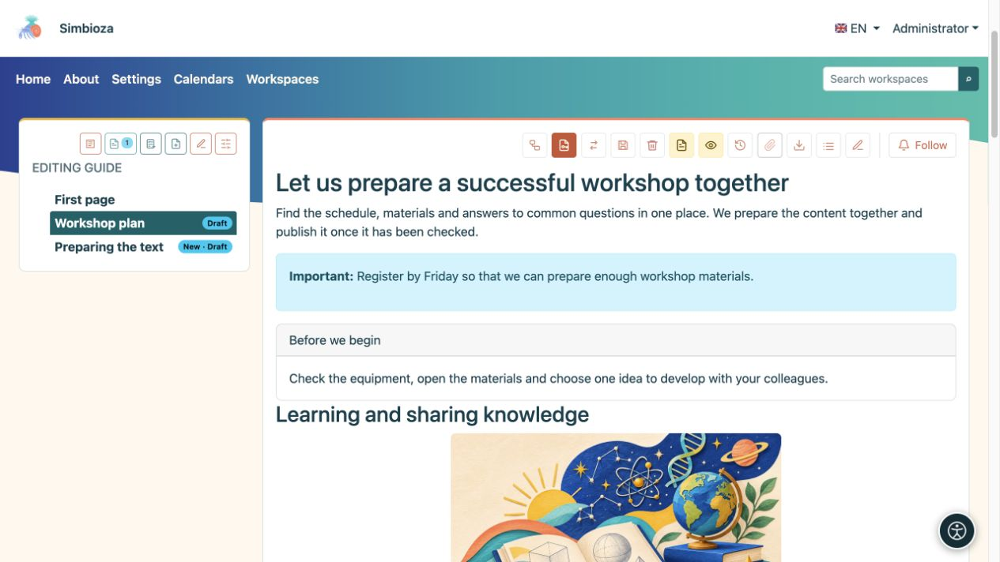
<figcaption>Actions sur les pages publiées : les icônes proposées dépendent de vos autorisations et des fonctionnalités activées.</figcaption>
</figure>

- **Afficher les pièces jointes/Masquer les pièces jointes** ouvre ou ferme la liste des fichiers. **Afficher la table des matières / Masquer la table des matières** affiche ou masque la liste des titres de la page.
- **Historique** ouvre les versions enregistrées ; le menu des drapeaux choisit une traduction existante.
- **Copier ou déplacer la page** est disponible pour les gestionnaires d'espace de travail. Choisissez copier ou déplacer, un espace de travail de destination et un parent, et si vous souhaitez transférer l'historique et les autorisations/restrictions directes. Le contenu, les traductions et les pièces jointes voyagent ensemble. Une copie laisse l'original en place ; un mouvement le supprime après un transfert réussi. Seule la page choisie est copiée ; le déplacement d'une page avec des descendants n'est pas disponible. Vérifiez ensuite les autorisations de destination.
- **La page d'exportation vers HTML** télécharge un ZIP contenant `index.html` et les fichiers locaux associés. Extrayez-le avant d'ouvrir le fichier HTML. Pour les pages de l'espace de travail, cela exporte la version publiée, plutôt qu'un brouillon non publié. Il ne s'agit pas d'une sauvegarde pour restaurer l'intégralité de l'espace de travail.
- Pour un PDF, ouvrez **Imprimer → Enregistrer au format PDF** du navigateur. Vérifiez l’aperçu avant impression et la mise en page avant d’enregistrer.
- **Supprimer la page et le sous-arbre** supprime également les descendants ; lisez attentivement la confirmation. Les pages publiées utilisent la suppression récupérable, tandis que la suppression d'un nouveau document jamais publié via l'éditeur peut être permanente. Demandez à un administrateur la récupération au lieu de supposer que chaque suppression peut être annulée.
- Lorsqu'ils sont activés, **Suivez** et les commentaires prennent en charge les notifications de modifications et les discussions.

Dans l'éditeur, le **Code source** affiche HTML pour les éditeurs expérimentés ; cela n'est pas nécessaire pour les procédures ci-dessus. **Plein écran** donne plus d'espace au contenu ; utilisez la même icône pour revenir aux détails du document et enregistrer les actions.

## 18. Quand quelque chose est inattendu

| Ce que tu vois | Ce qu'il faut faire |
| --- | --- |
| Aucune action de modification ou de publication. | Vérifiez le compte et l'espace de travail. Demandez à un responsable ou à un administrateur de vérifier vos autorisations. |
| Vous avez modifié le texte mais les lecteurs voient toujours l'ancienne page. | Enregistrez le brouillon et vérifiez si la publication est toujours nécessaire. Vérifiez également la langue. |
| Une commande table ou image ne fait rien. | Cliquez d’abord sur une cellule du tableau ou sélectionnez l’image elle-même, puis répétez la commande. |
| Le contenu de la liste déroulante reste ouvert dans l'éditeur. | Il s'agit de la vue d'édition. Vérifiez l'état initial dans la vue de page. |
| Les onglets ou accordéon ont des titres mais pas de corps de texte. | Après l'insertion, remplissez le corps de chaque section dans l'éditeur principal. |
| Le tri et le nombre de lignes sont manquants. | Activez-les dans **les paramètres de ce tableau**, vérifiez son en-tête simple et affichez la page enregistrée. |
| Un fichier est téléchargé mais absent du texte. | Placez le curseur dans le contenu, puis choisissez **Insérer** à côté de la pièce jointe. |
| Vous voyez un calendrier, une page incluse ou une liste dynamique, mais pas un lecteur. | Vérifiez également leurs droits sur le contenu source. L'intégration n'ouvre pas les données privées. |
| Un script manque ou ne fonctionne pas. | Lisez ses instructions et vérifiez la vue publiée. Un administrateur prépare et approuve les scripts. |
| Le texte collé a un style incohérent. | Appliquez **Supprimer le formatage**, puis définissez à nouveau les titres et les listes. |
| L'annulation ne restaure pas une largeur d'image modifiée ou d'autres paramètres de bloc. | Restaurez ces paramètres via leur menu. Enregistrez avant des modifications plus importantes. Choisissez **Annuler** pour ignorer les modifications non enregistrées ; les modifications déjà enregistrées restent enregistrées. |

Avant de terminer, vérifiez le **contenu, la sauvegarde, la langue sélectionnée, les liens et l'accès attendu du lecteur**. Pour la plupart des pages, ceux-ci comptent plus que le nombre d’éléments décoratifs que vous insérez.
