# Uređivanje stranica

Ova je uputa namijenjena urednicima koji u Simbiozi stvaraju i održavaju stranice u područjima. Korak po korak objašnjava otvaranje stranice, naslov i slug, cijelu alatnu traku HTML editora, privitke, svojstva stranice, dinamičke elemente, objavu, prijevode i prava pristupa. Za rad nije potrebno poznavati HTML.

**Primjeri su testni.** Snimke prikazuju namjensko područje *\[Upute\] Primjeri uređivanja stranica* , testne korisnike i izmišljene projektne podatke. Vaši će nazivi, kalendari i korisnici biti drukčiji, ali su koraci isti.

## 1. Prije početka: područje i prava

Ovo poglavlje opisuje stranice u područjima. Područje određuje osnovni skup korisnika i prava, zadani prikaz sadržaja te stablo stranica. Za stvaranje stranice morate imati pravo **Dodavanje** ; za promjenu postojećeg sadržaja **Uređivanje** ; za objavu nacrta **Objavljivanje** . Pravo **Pregled** omogućuje čitanje, ali ne i uređivanje.

1.  Otvorite **Područja** i odaberite željeno područje.
2.  U lijevom stablu označite stranicu ispod koje želite dodati novu stranicu. Za stranicu na vrhu područja označite korijen područja.
3.  Odaberite gumb za dodavanje stavke, unesite naslov i odaberite vrstu **Stranica (HTML dokument)** .
4.  Spremite stavku. Simbioza stvara dokument i otvara ga u HTML editoru.

Stranice koje pripadaju području stvarajte iz njegova stabla. Ako instalacija ima i samostalne HTML stranice, one ostaju dostupne izvan područja sa svojim adresama i pravima; samo dodavanje modula Područja ne premješta ih. Administrator ih po potrebi premješta kroz **Postavke → HTML editor → Stranice izvan područja → Premjesti u područje**. Prije premještanja provjerava prava odredišta; prenose se prijevodi, povijest i privitci, a povezani sadržaj i adrese se usklađuju.

## 2. Naslov, slug i jezik

**Naslov** je tekst koji korisnik vidi u stablu, zaglavlju i poveznicama. Može imati prijevod. Izbornik s oznakom **HR** ili **EN** uz naslov mijenja jezik naslova, dok izbornik **Jezik dokumenta** mijenja inačicu sadržaja koju uređujete. To su dvije povezane, ali različite postavke: prije objave engleske inačice provjerite da su i engleski naslov i engleski sadržaj doista uneseni.

**Slug** je stabilan, čitljiv dio adrese stranice, primjerice `projekt-orion` . Piše se malim slovima, bez razmaka i dijakritičkih znakova; riječi se odvajaju crticom. Slug neka bude kratak i opisuje sadržaj. Nakon što se stranica počne koristiti, ne mijenjajte ga bez potrebe jer stare poveznice i spremljene adrese mogu prestati raditi.

**Omogućeni komentari** određuju smiju li korisnici komentirati objavljenu stranicu. Promjena vrijedi tek nakon objave nacrta. **Zadani prikaz sadržaja stranice** može naslijediti postavku područja ili je samo za tu stranicu nadjačati opcijom *Prikaži* ili *Sakrij* .

 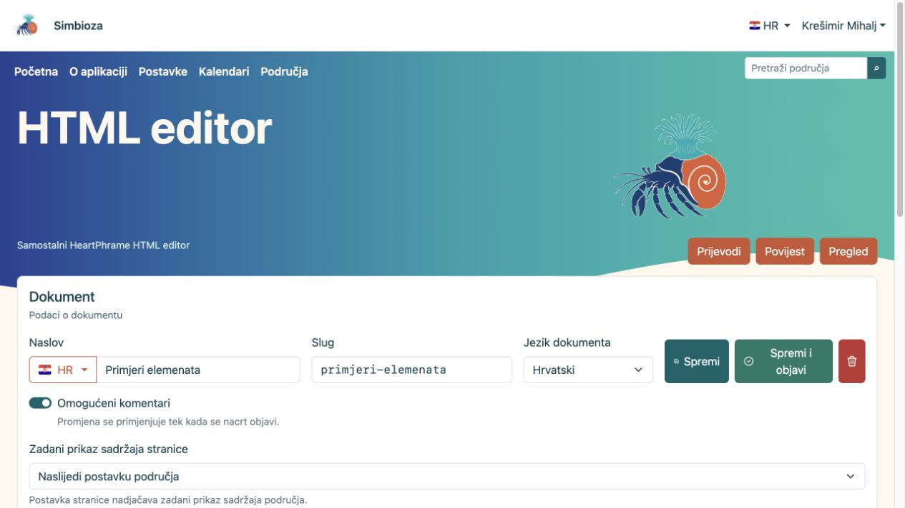 Pregled editora: gore su prijevodi, povijest i pregled, zatim naslov, slug, jezik dokumenta i gumbi za spremanje. Ispod podataka dokumenta nalaze se alatna traka i uređivi sadržaj. 

## 3. Spremanje, objava, pregled, prijevodi i povijest

- **Spremi** čuva nacrt bez promjene javno vidljive inačice. Koristite ga često tijekom rada.
- **Spremi i objavi** sprema nacrt i čini ga trenutačno važećom objavljenom inačicom. Prije klika provjerite sadržaj i prava.
- **Pregled** pokazuje stranicu onako kako je vidi čitatelj. Dinamički elementi tek se ovdje prikazuju s pravim podacima i ACL provjerama.
- **Povijest** prikazuje ranije inačice i omogućuje vraćanje prethodnog sadržaja kada je to potrebno.
- **Prijevodi** pomažu kopirati postojeću inačicu kao polazište. Nakon kopiranja prevedite naslov, sadržaj, opis slike i ostale tekstove; ne objavljujte strojno ili djelomično prevedenu stranicu bez provjere.
- **Obriši dokument** uklanja stranicu iz aktivnog prikaza i oslobađa njezinu adresu. Administrator je može vratiti iz popisa obrisanih dokumenata. Prije brisanja provjerite poveznice i blokove *Uključi sadržaj stranice*.

## 4. Osnovno uređivanje teksta

Kliknite u sadržaj i pišite kao u uobičajenom uređivaču teksta. Za oblikovanje najprije označite tekst. Za radnju na odlomku dovoljno je postaviti pokazivač unutar njega. Nemojte oblikovati naslove povećavanjem ili podebljavanjem običnog teksta: odaberite odgovarajuću razinu naslova jer ona gradi sadržaj stranice i pomaže čitačima zaslona.

- **Format** : Paragraf je običan tekst; Naslov 1–5 gradi hijerarhiju; Citat označava citirani odlomak; Preformatirano čuva razmake i prikladno je za kratke tehničke primjere. Na stranici koristite jedan glavni Naslov 1, a cjeline slažite s Naslovom 2 i podcjelinama s Naslovom 3 bez preskakanja razina.
- **Provjeri dokument** traži prazne naslove, neispravnu hijerarhiju, slike bez zamjenskog teksta i nepostojeće interne poveznice. Provjeru pokrenite prije svake objave.
- **Podebljano, Kurziv i Podcrtano** naglašavaju označeni tekst. Podcrtavanje koristite rijetko jer ga korisnici mogu zamijeniti za poveznicu.
- **Ukloni formatiranje** uklanja neželjeni stil, osobito nakon lijepljenja iz Worda ili weba.
- **Poravnaj lijevo, sredinu, desno i Obostrano poravnanje** primjenjuju poravnanje na odlomak. Za dulji tekst najbolje je lijevo poravnanje.
- **Lista i Numerirana lista** : lista je za stavke bez redoslijeda, numerirana lista za korake koji se izvode po redu. Enter stvara novu stavku, a dvostruki Enter završava listu.
- **Poveznica** pretvara označeni tekst u internu ili vanjsku poveznicu. Tekst poveznice neka opisuje odredište, npr. „pravila prijave”, a ne „kliknite ovdje”. **Ukloni poveznicu** ostavlja tekst i uklanja samo vezu.
- **Poništi** vraća zadnju promjenu, a **Ponovi** ponovno primjenjuje poništenu promjenu. Ta povijest vrijedi samo u trenutačno otvorenoj sesiji uređivanja.

## 5. Umetanje rasporeda, obavijesti i kartica

### Stupci i vodoravna crta

Izbornik **Umetni** nudi **Dva stupca** , **Tri stupca** i **Horizontalnu liniju** . Stupce koristite za kratke usporedne cjeline, ne za duge članke: na uskom zaslonu slažu se jedan ispod drugoga. Vodoravna crta vizualno odvaja velike cjeline, ali nije zamjena za smisleni naslov.

 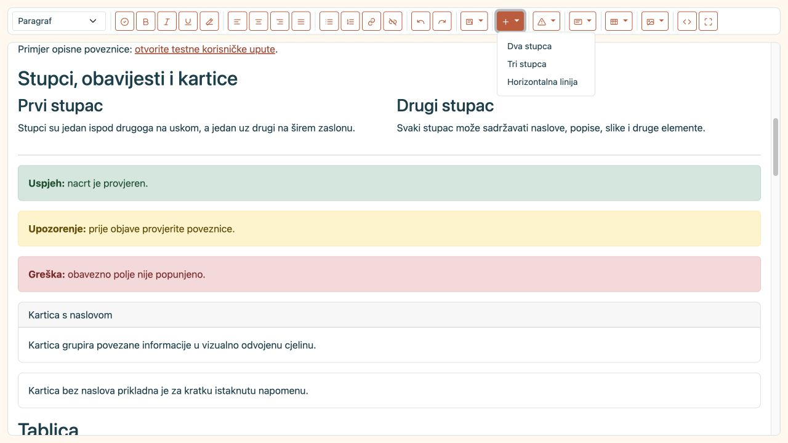 Izbornik Umetni dodaje gotovu strukturu na mjesto pokazivača. Nakon umetanja kliknite u svaki stupac i zamijenite ogledni sadržaj vlastitim tekstom. 

### Bootstrap obavijesti

Obavijest ističe kratku važnu poruku. Izbornik nudi osam vrsta: **primarna** za opću istaknutu poruku, **sekundarna** za dopunu, **uspjeh** za pozitivan ishod, **opasnost** za kritičnu zabranu ili pogrešku, **upozorenje** za potreban oprez, **informativna** za objašnjenje te **svijetla** i **tamna** za neutralne naglaske. Boja ne smije biti jedini nositelj značenja: započnite jasnom riječi poput „Važno”, „Upozorenje” ili „Uspješno”.

 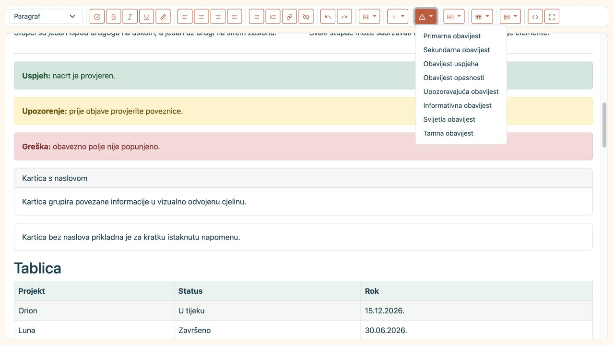 Odaberite vrstu prema značenju, zatim zamijenite ogledni tekst. Za jednu poruku koristite jednu obavijest; niz šarenih okvira otežava čitanje. 

### Kartice

**Kartica s naslovom** umeće odvojeni okvir s zaglavljem i tijelom; prikladna je za sažetak projekta, kontaktnu karticu ili povezanu cjelinu. **Kartica bez naslova** umeće samo tijelo. Naslov kartice neka bude kratak, a važnu hijerarhiju stranice i dalje gradite pravim naslovima.

 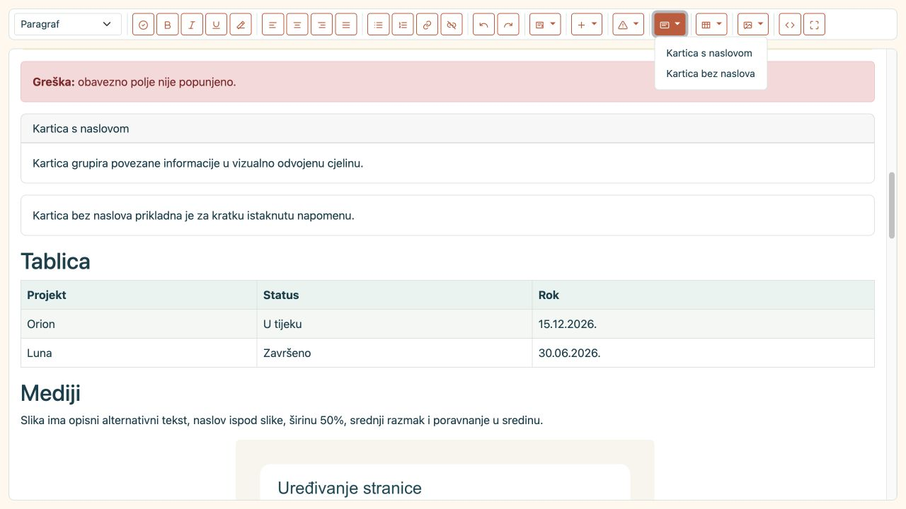 Kartica se umeće na mjesto pokazivača. Kliknite zasebno u naslov i tijelo da zamijenite oba ogledna teksta. 

## 6. Tablice

Odaberite **Umetni tablicu**, a zatim označite broj redaka i stupaca. Tablicu koristite za podatke koji imaju stvaran odnos redak–stupac, a ne za slaganje izgleda stranice.

- **Umetni red iznad/ispod** dodaje red uz ćeliju u kojoj je pokazivač; **Obriši red** uklanja cijeli red.
- **Umetni stupac lijevo/desno** dodaje stupac; **Obriši stupac** uklanja cijeli stupac.
- **Spoji s ćelijom desno/ispod** stvara veću zajedničku ćeliju. Spajajte samo kada je značenje jasno jer složena tablica može biti teška korisnicima čitača zaslona.
- **Podijeli ćeliju** poništava prethodno spajanje odabrane ćelije.

Prvi red neka sadrži jasne nazive stupaca. Nakon svake veće izmjene pregledajte tablicu na užem prozoru; vrlo široka tablica zahtijeva vodoravno pomicanje.

 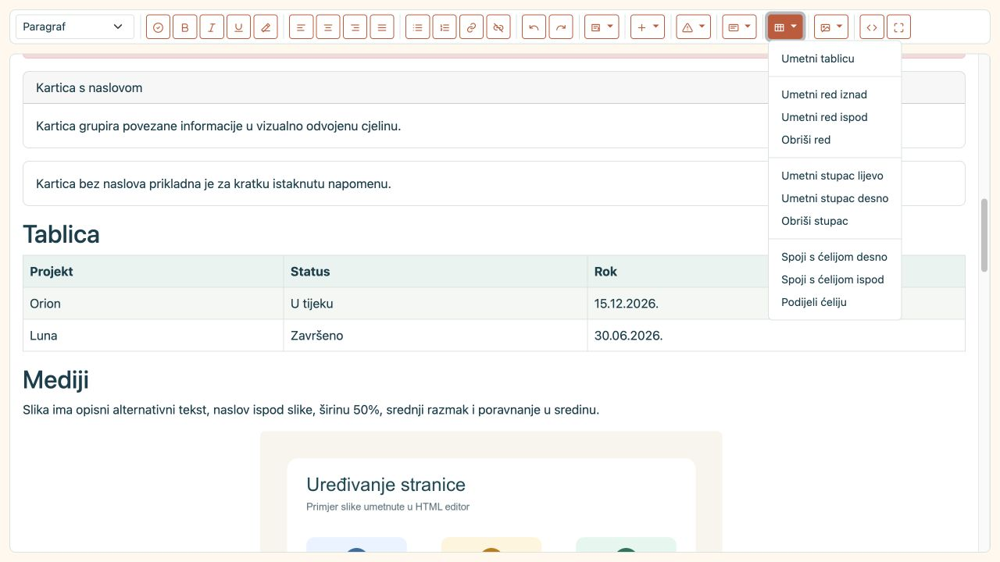 Operacije se primjenjuju u odnosu na ćeliju u kojoj je pokazivač. Ako je naredba onemogućena, najprije kliknite unutar postojeće tablice i odgovarajuće ćelije. 

### Sortiranje i paginacija po tablici

1. Kliknite bilo koju ćeliju postojeće tablice.
2. Otvorite **Tablica → Postavke tablice**.
3. Uključite **Sortiranje i paginacija** i odaberite početni broj redaka: **10, 25, 50, 100 ili Sve**.
4. Odaberite **Primijeni**, spremite i objavite stranicu.

Čitatelj klikom na naziv stupca sortira uzlazno, drugim klikom silazno, a trećim vraća početni redoslijed. Strelice pokazuju smjer. Čitatelj može promijeniti broj redaka i listati stranice bez promjene spremljenog sadržaja. U editoru se i dalje uređuju svi retci. Pri ispisu se prikazuju svi retci; kontrole rade i u HTML izvozu.

Ovo uključujete zasebno za svaku tablicu. Nisu potrebne vanjske skripte ni DataTables. Tablica mora imati jedan redak zaglavlja, jednak broj ćelija u retcima te ne smije sadržavati spojene ćelije ni ugniježđene tablice. Složene tablice zadržavaju običan prikaz. Postojeće tablice ostaju obične dok ne uključite ovu postavku.

## 7. Privitci, slike i izbornik Mediji

1.  U odjeljku **Privitci** odaberite jednu ili više datoteka i kliknite **Učitaj** .
2.  Za sliku ispunite smislen zamjenski tekst koji opisuje informaciju na slici. Ako je slika isključivo ukrasna, označite je na odgovarajući način umjesto ponavljanja okolnog teksta.
3.  Postavite opis ili natpis kada čitatelju treba dodatno objašnjenje.
4.  Postavite pokazivač u sadržaj i na kartici privitka kliknite **Umetni** .
5.  Provjerite vidljivost privitka. Javno objavljena stranica ne smije se oslanjati na sliku koju gosti ne smiju otvoriti.

Kada je slika označena, izbornik **Mediji** nudi širine **25 %, 50 %, 75 % i 100 %** ; razmake **bez razmaka, mali, srednji i veliki** ; poravnanje **lijevo, sredina i desno** ; te **Resetiraj medij** , koji uklanja te postavke. Širina je prilagodljiva zaslonu. Za snimku sučelja obično je najbolje 100 %, a za malu ilustraciju 25–50 %.

 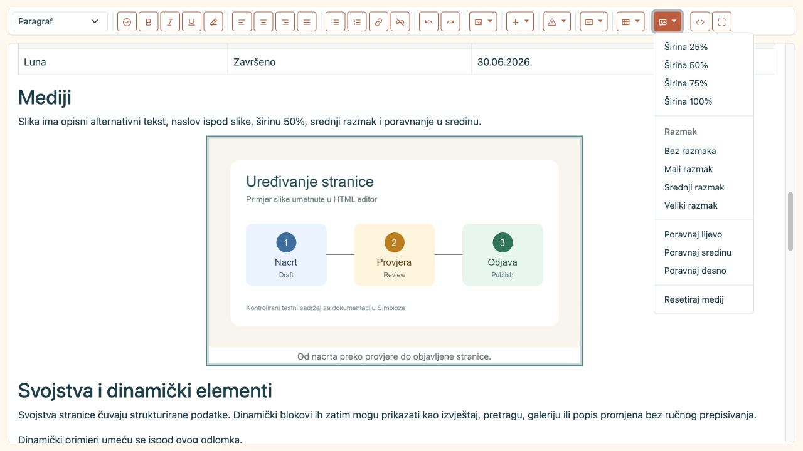 Izbornik Mediji djeluje na trenutačno odabranu sliku ili drugi medij. Ako se ništa ne promijeni, najprije kliknite baš na sliku, a ne na odlomak pokraj nje. 

### Ugrađeni iframe sadržaj

Za H5P, Facebook i druge pouzdane servise otvorite **Umetni** i odaberite **Umetni ugrađeni sadržaj**. Zalijepite potpuni iframe blok koji je dao pružatelj ili unesite samo njegov HTTPS URL.

1.  Upišite kratak **pristupačni naslov** koji opisuje sadržaj iframea.
2.  Odredite visinu u pikselima i uključite prikaz preko cijelog zaslona samo kada ga pružatelj podržava.
3.  Odaberite **Umetni**. Editor normalizira širinu na 100% raspoloživog prostora i zadržava samo podržane sigurnosne atribute.

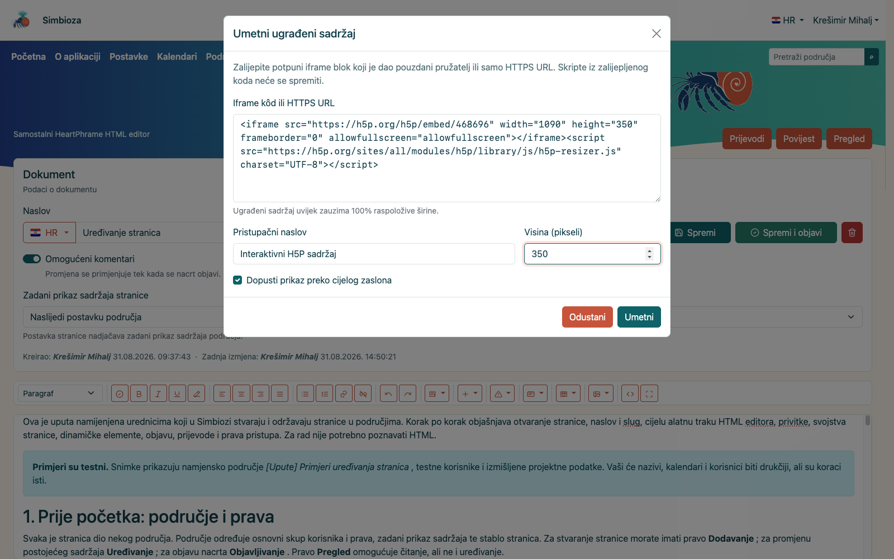Dijalog prihvaća potpuni iframe blok ili HTTPS URL. Spremljeni sadržaj uvijek zauzima 100% raspoložive širine.

**Sigurnost:** ugrađujte samo sadržaj pružatelja kojima vjerujete. Proizvoljni JavaScript iz zalijepljenog koda ne sprema se niti izvršava. Skripte izdvojene iz uvoza postaju kandidati za administratorski pregled; sam poznati URL nije odobrenje. Izvršavaju se samo lokalno odobrene skripte koje su odabrane za tu stranicu. Za H5P resizer i slične integracije administrator najprije provjerava i odobrava točan kod ili URL.

Iframe bez JavaScripta, primjerice Facebookov ugrađeni post, radi izravno. Za promjenu postojećeg bloka odaberite ikonu olovke. Ako uvezeni Confluence HTML sadrži nepoznatu skriptu ili više iframeova u istom makrou, Simbioza ga ostavlja za ručni pregled.

### Vanjske skripte i upute uz njih

Ako stranici treba dodatna funkcija koju je pripremio administrator, otvorite izbornik **Vanjske skripte** i označite odobrenu skriptu. Odabir se sprema s inačicom stranice. Mali **upitnik u kružiću** otvara uputu za korištenje kada ona postoji; samo čitanje upute ne uključuje skriptu. Uputa objašnjava treba li u izvornom HTML-u postaviti neki ID ili drugi podatak.

Ako skripte nema na popisu, obratite se administratoru. On u **Postavke → HTML editor → Vanjske skripte** priprema biblioteku, opcionalni CSS, dodatni kod i prevedene upute te daje odobrenje. Opozvana ili neodobrena skripta ne radi. Skripte se ne pokreću u editoru, nacrtu ili povijesti; provjerite ih u objavljenom prikazu. HTML izvoz uključuje samo odabrane i odobrene skripte: ugrađeni kod kao lokalnu datoteku, a udaljeni kao poveznicu. Udaljeni kod za rad i dalje treba mrežu.

## 8. Provjera dokumenta, izvorni kod i cijeli ekran

### Provjera dokumenta

Provjera je završna kontrolna lista, a ne zamjena za čitanje. Otvorite rezultat, ispravite svaku prijavljenu stavku i kliknite **Ponovno provjeri** . Posebno provjerite zamjenske tekstove slika, redoslijed naslova i interne poveznice. Poruka *Nema pronađenih problema* znači da automatska pravila prolaze; i dalje pročitajte stranicu u Pregledu.

 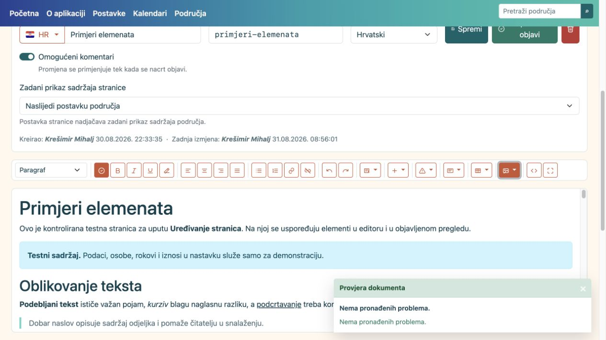 Uspješna provjera nakon popravka naslova, slika i poveznica. Provjeru ponovite nakon naknadnih promjena sadržaja. 

### Izvorni kod

**Izvorni kod** prikazuje HTML. Namijenjen je naprednim urednicima za precizan pregled ili popravak oznaka. Ne lijepite skripte, stilove ni kod iz neprovjerenih izvora; sustav dio nedopuštenog sadržaja može ukloniti pri spremanju. Nakon ručne promjene vratite vizualni prikaz i pokrenite provjeru dokumenta.

 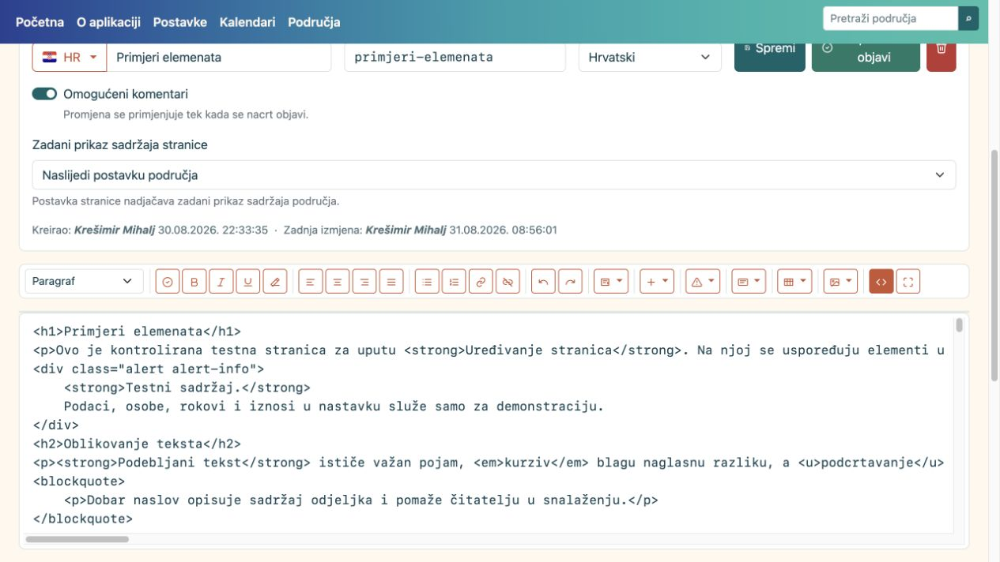 Izvorni kod prikazuje strukturu trenutačne jezične inačice. Ne mijenjajte atribute dinamičkih blokova ako ne znate njihovu ulogu. 

### Cijeli ekran

**Cijeli ekran** ostavlja alatnu traku i sadržaj, a skriva podatke dokumenta kako bi što više prostora ostalo za uređivanje. Navigacija projekta ostaje vidljiva samo ako je tema projekta postavljena kao ljepljiva. Ponovnim klikom na istu ikonu vraćate se u običan prikaz. Spremanje i objava ponovno su dostupni izvan cijelog ekrana.

 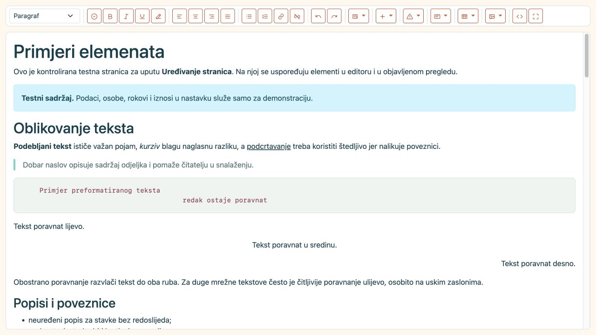 Ispravan puni prikaz: alatna traka ostaje dostupna, a prostor iznad nje ne zauzimaju naslov, slug ni gumbi dokumenta. 

## 9. Dinamički elementi

Dinamički element u editoru izgleda kao označeni blok ili sažetak postavki, a u Pregledu se pretvara u podatke i interaktivne kontrole. Nakon umetanja obvezno otvorite Pregled. Rezultat ovisi o pravima trenutačnog čitatelja; administrator često vidi više od običnog korisnika.

 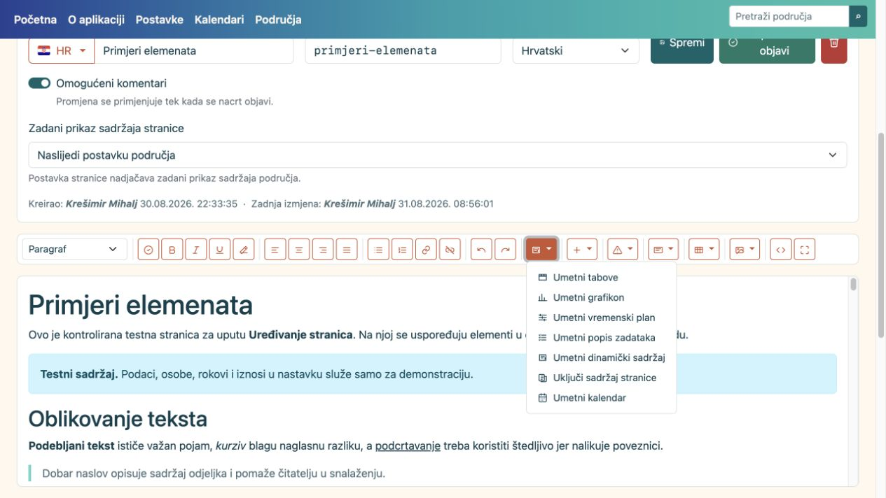 Izbornik sadrži tabove, grafikon, vremenski plan, popis zadataka, dinamički sadržaj, uključeni sadržaj stranice i kalendar. Svaka stavka otvara zaseban obrazac. 

### 9.1. Tabovi

Tabovi prikazuju više kraćih cjelina na istom mjestu. Dodajte naziv svakog taba i njegov sadržaj, gumbom **+** dodajte sljedeći, a **Ukloni** briše odabrani. Nazivi moraju biti kratki i međusobno razlikovni. Ne skrivajte ključne upute u posljednjem tabu jer čitatelj možda neće primijetiti da postoji; za dugačak ili obvezan redoslijed koristite naslove umjesto tabova.

 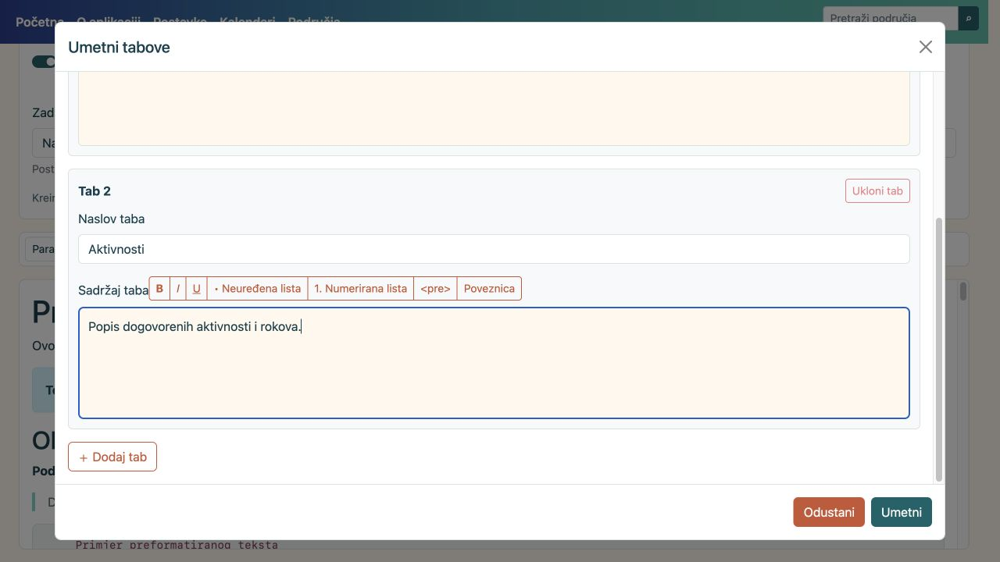 U primjeru se svi tabovi pripremaju u jednom obrascu. Prije umetanja provjerite da svaki ima naslov i smislen sadržaj. 

### 9.2. Grafikon

Grafikon pretvara numeričke podatke u vizualnu usporedbu. Unesite jasan naslov, odaberite vrstu grafikona, nazive kategorija i brojčane vrijednosti. Dodajte serije kada uspoređujete više skupova. Stupčasti grafikon prikladan je za usporedbu kategorija, linijski za promjenu kroz vrijeme, a kružni samo za mali broj dijelova jedne cjeline. Vrijednosti unosite dosljednom jedinicom i u okolnom tekstu napišite zaključak kako informacija ne bi ovisila samo o slici.

 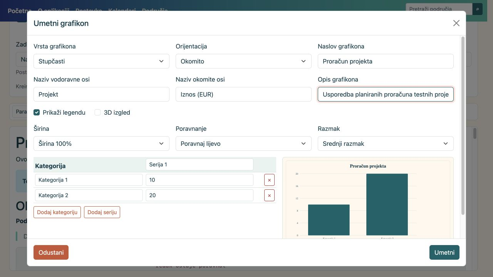 Primjer prikazuje popunjene kategorije i vrijednosti prije umetanja. Ne ostavljajte ogledne oznake; provjerite da broj vrijednosti odgovara broju kategorija. 

### 9.3. Vremenski plan

Vremenski plan prikazuje aktivnosti po datumima. Zadajte početak i kraj prikaza, mjerilo, grupe, aktivnosti i prekretnice. Aktivnost ima naziv, početni i završni datum te pripadajuću grupu; prekretnica označava važan trenutak bez trajanja. Raspon neka bude dovoljno uzak da se stavke mogu pročitati. Datume redovito održavajte: vremenski plan je statička konfiguracija u sadržaju i neće sam promijeniti projektne rokove iz drugog sustava.

 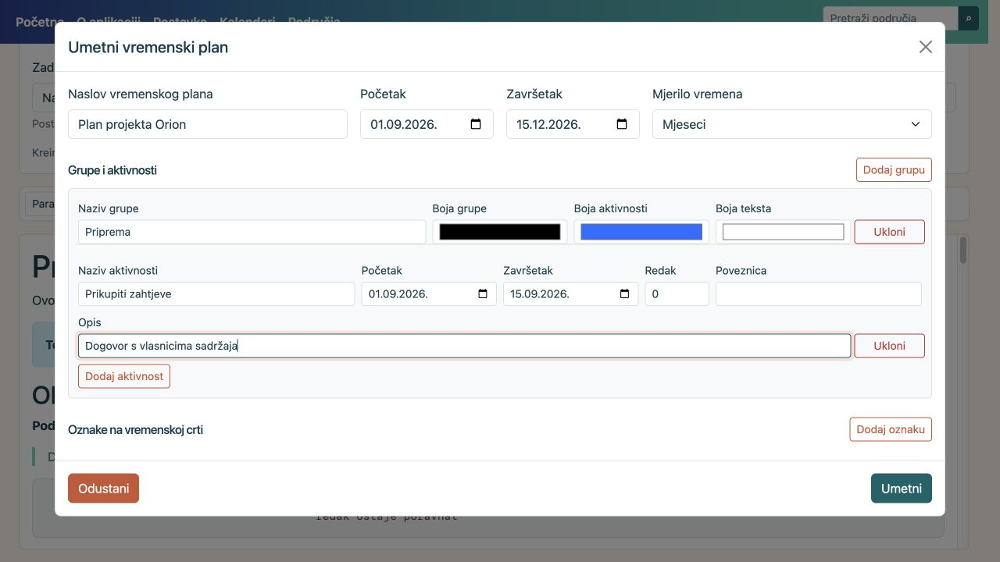 Grupe odvajaju tokove rada, aktivnosti imaju trajanje, a prekretnice jedan datum. U Pregledu provjerite preklapaju li se nazivi. 

### 9.4. Popis zadataka

Popis zadataka omogućuje označavanje dovršenih stavki. Unesite naslov i zadatke, a zatim odaberite tko smije mijenjati stanje. Opseg za urednike prikladan je za internu kontrolnu listu; opseg za prijavljene čitatelje omogućuje širem krugu korisnika označavanje stavki. Anonimni posjetitelji ne dobivaju trajno osobno stanje. Promjene zadataka bilježe se uz korisnika kada je to moguće, pa popis nemojte koristiti za osjetljive osobne ili kadrovske podatke.

Za ACL primjer ista stranica sadrži urednički i čitateljski popis. Korisnik s pravom samo Pregled vidi prvi zaključan, a drugi može označavati. Time se provjerava stvarno ponašanje, a ne samo administratorski prikaz.

 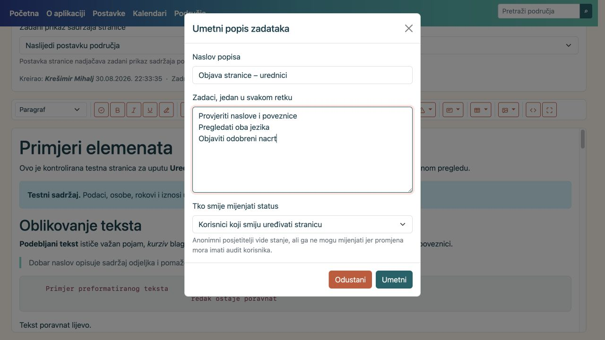 Odabir prava na izmjenu važniji je od samog izgleda popisa. Nakon objave testirajte ga korisnikom koji ima samo pravo čitanja. 

### 9.5. Dinamički sadržaj

Dinamički sadržaj se osvježava prema trenutačnom stanju područja. Dostupne su četiri vrste:

- **Tablica stranica i svojstava** pronalazi stranice prema području, oznakama ili drugim kriterijima te prikazuje odabrane stupce svojstava. Koristi se za katalog projekata, imenik ili evidenciju rokova. Nazivi svojstava moraju biti dosljedni na svim uključenim stranicama.
- **Galerija privitaka** prikazuje slike ili datoteke povezane sa stranicama. Vidljivost svakog privitka i pravo čitanja izvorne stranice i dalje se provjeravaju.
- **Pretraga područja** umeće tražilicu ograničenu na područje. Rezultati uključuju samo stranice koje trenutni korisnik smije vidjeti.
- **Nedavne promjene** prikazuju novije izmjene i pomažu pratiti aktivnost. Broj stavki i obuhvat držite razumnima kako popis ne bi potisnuo glavni sadržaj.

 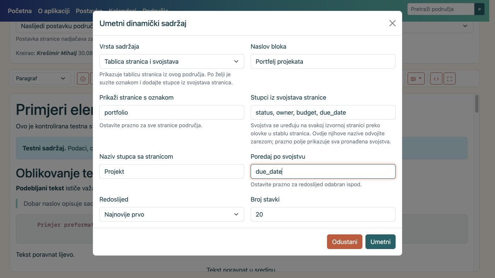 Najprije odaberite vrstu, zatim ispunite postavke koje se pojave. Prazan rezultat u Pregledu najčešće znači da nijedna stranica ne odgovara filtru ili da korisnik nema pravo čitanja. 

### 9.6. Uključi sadržaj stranice

Ovaj blok prikazuje sadržaj druge stranice bez kopiranja. Odaberite područje i stranicu. Kasnija promjena izvora automatski se vidi na svim mjestima uključivanja, pa je to dobro za zajedničku kontaktnu informaciju ili standardnu napomenu. Izbjegavajte kružno uključivanje i duboke lance. Korisnik mora imati pravo vidjeti uključenu stranicu; u suprotnom dobiva sigurnu zamjensku poruku, a ne skriveni sadržaj.

 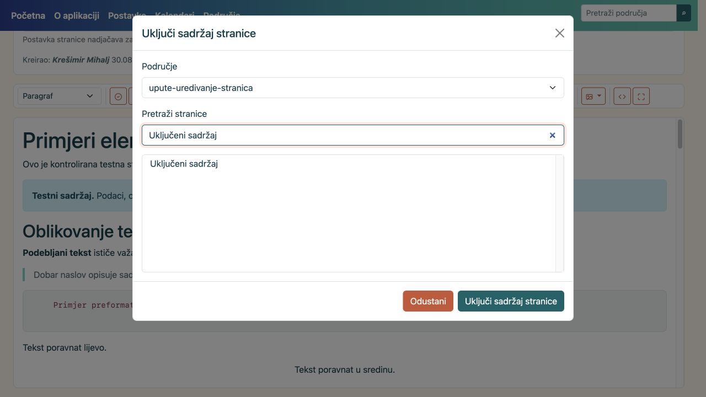 U editoru se vidi oznaka uključene stranice, dok se pravi sadržaj dohvaća u Pregledu uz provjeru prava trenutačnog korisnika. 

### 9.7. Kalendar

Odaberite kalendar koji smijete koristiti, vrstu prikaza i početno razdoblje. Mjesečni prikaz daje pregled datuma, a popisni prikaz bolje odgovara slijedu događaja. Fiksni početni mjesec upotrebljavajte samo kada stranica opisuje određeno razdoblje; za trajnu stranicu obično je bolji aktualni datum.

Pravo na stranicu ne daje automatski pravo na kalendar. Ako čitatelj smije vidjeti stranicu, ali nema pravo na ugrađeni kalendar, Simbioza ne otkriva događaje nego prikazuje obavijest da kalendar nije dostupan. U primjeru su namjerno ugrađeni jedan dopušteni i jedan uskraćeni kalendar kako bi se ta razlika mogla provjeriti.

 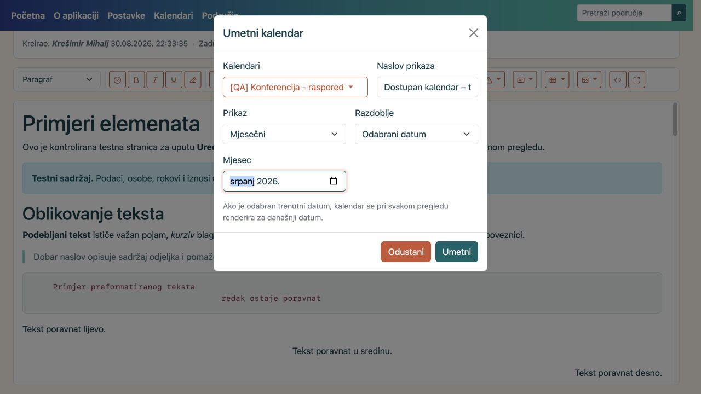 Umetnite kalendar, objavite nacrt i pregledajte stranicu i kao običan čitatelj. Administratorski prikaz ne može potvrditi da je ograničenje ispravno. 

## 10. Svojstva stranice

Svojstvo je strukturirani podatak vezan uz stranicu. Za razliku od teksta u članku, svojstvo ima stalni naziv i vrstu pa ga dinamička tablica može filtrirati, sortirati i prikazati kao stupac. Primjerice, stranice projekata mogu imati `status` , `owner` , `budget` i `due_date` .

Otvorite **Postavke stavke stabla/stranice** . U odjeljku **Svojstva stranice** unesite naziv, vrstu i vrijednost. Gumbom **+** dodajte više redaka, uredite postojeće vrijednosti i kliknite **Ukloni** za svojstvo koje više ne želite. Sve promjene zatim spremite zajedno gumbom **Spremi stavku** ; nije potrebno zatvarati dijalog nakon svakog retka.

- **text** : kratak slobodan tekst, npr. kontakt ili oznaka odjela.
- **status** : kontrolirana poslovna oznaka, npr. U pripremi, U tijeku ili Završeno. Iste statuse pišite jednako na svim stranicama.
- **number** : broj za izračun, sortiranje ili usporedbu; ne upisujte valutu ni razmake u brojčanu vrijednost.
- **date** : datum u zadanom formatu, prikladan za rokove i vremensko filtriranje.
- **user** : korisnička oznaka postojećeg korisnika, korisna za vlasnika ili odgovornu osobu.
- **link** : potpuna adresa s `https://` . Tekstualno objasnite kamo poveznica vodi.

**Oznake stranice** odvajaju se zarezom i služe za grupiranje i filtre, primjerice `portfolio, active, 2026` . Oznake nisu zamjena za svojstva s vrijednošću: oznaka govori da stranica pripada skupini, a svojstvo nosi podatak koji se prikazuje u vlastitom stupcu.

 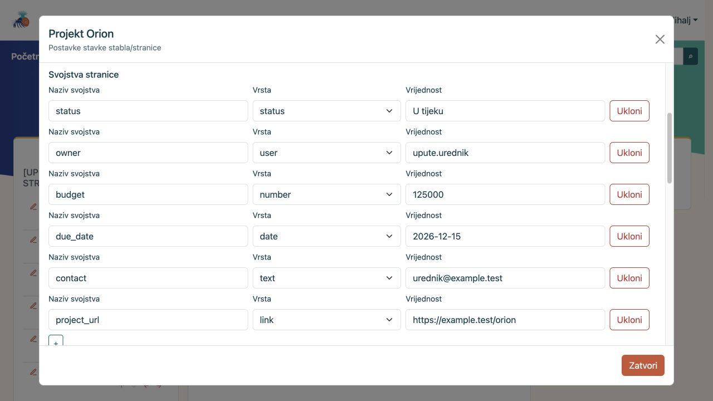 Više svojstava dodaje se i uređuje u istom dijalogu. U primjeru se pripremaju podaci za tablicu projekata; gumb Ukloni briše samo odgovarajući red nakon spremanja stavke. 

### Tablica stranica i svojstava

Za izvještaj umetnite **Dinamički sadržaj → Tablica stranica i svojstava** , odaberite područje, filter oznaka i stupce. Primjer s projektima Orion i Luna prikazuje status, odgovornu osobu, proračun, rok, kontakt i poveznicu. Nova stranica s istim svojstvima automatski ulazi u tablicu ako zadovoljava filter; nije potrebno ručno mijenjati stranicu izvještaja.

 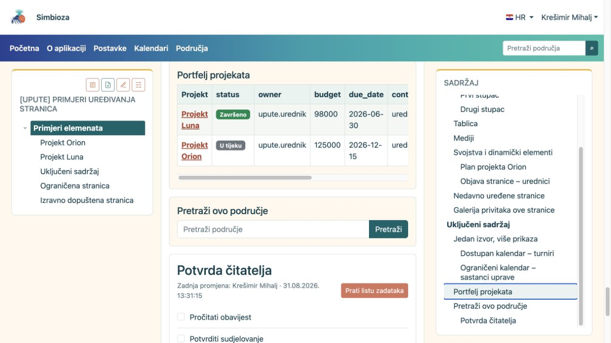 Objavljeni dinamički prikaz spaja strukturirana svojstva i ostale blokove. Ako vrijednost nedostaje samo u jednom retku, provjerite naziv i vrstu svojstva na toj izvornoj stranici. 

## 11. Prava na stranici: nasljeđivanje i izravno dopuštenje

Prava područja temelj su pristupa. Postavke pojedine stavke nude dva posebna mehanizma, koji nisu isto:

### Ograničenja naslijeđenih prava

Ograničenje korisniku oduzima pravo koje već ima preko područja ili grupe. Vrijedi na odabranoj stranici i njezinim podređenim stranicama. Njime nije moguće dodijeliti novo pravo. U tablici odaberite korisnika i isključite samo prava koja treba uskratiti; uklanjanje korisnika iz tablice vraća njegova puna naslijeđena prava.

 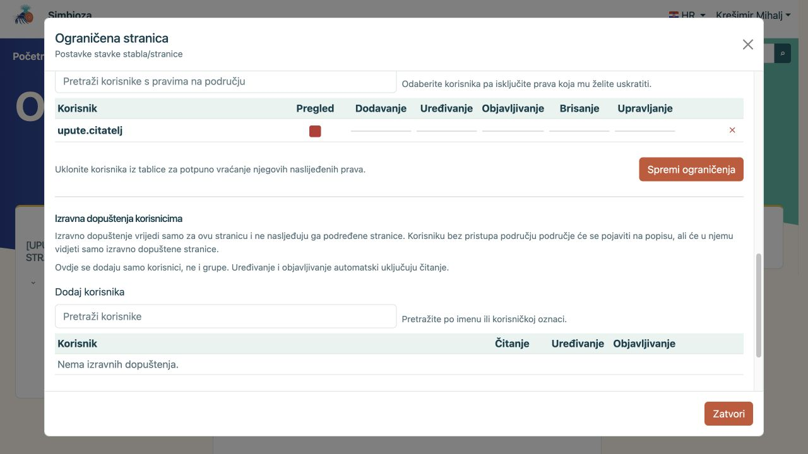 Legenda razlikuje zadržano pravo, uskraćeno pravo i pravo koje korisnik uopće nije naslijedio. Ograničenje se uvijek primjenjuje na korisnika, ne na cijelu grupu. 

### Izravna dopuštenja

Izravno dopuštenje daje korisniku pristup samo toj jednoj stranici i ne prenosi se na podređene stranice. Korisnik bez prava na cijelo područje tada u stablu vidi samo izravno dopuštene stranice. Možete dopustiti Čitanje, Uređivanje ili Objavljivanje; uređivanje i objavljivanje uključuju čitanje. Možete dodati **korisnike i grupe**, uključujući javnu skupinu **Svi** kada stranica treba biti javna i u privatnom području. Iznimka otvara samo dopuštenu stranicu; ostale privatne stranice i sadržaj roditelja ostaju skriveni. Područje je u popisu vidljivo kada u njemu postoji stranica dostupna tom posjetitelju. Koristite iznimke promišljeno i provjerite konačan prikaz kao ciljani korisnik ili gost.

 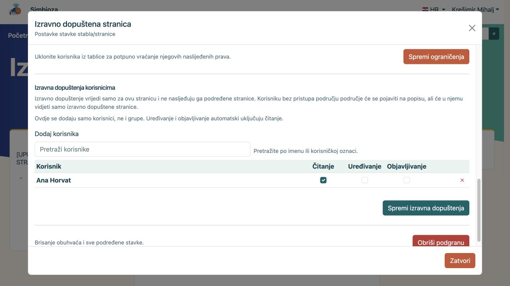 Izravno dopuštenje je iznimka za jednu stranicu. Nakon spremanja provjerite rezultat preuzimanjem tog korisnika ili namjenskim testnim računom. 

### Kako testirati ACL

1.  Spremite prava i objavite stranicu.
2.  Provjerite kao administrator da je sadržaj tehnički ispravan.
3.  Prijavite se ili preuzmite korisnika sa samo čitanjem. Provjerite stablo, uključene stranice, oba kalendara i oba popisa zadataka.
4.  Provjerite korisnika s izravnim dopuštenjem i potvrdite da ne vidi ostatak područja.
5.  Vratite administratorsku sesiju. Ne zaključujte prema administratorskom prikazu jer administrator po definiciji zaobilazi velik dio ograničenja.

## 12. Preporučeni radni postupak

1.  Odaberite pravo područje i stvorite stranicu u odgovarajućem dijelu stabla.
2.  Unesite naslov i provjerite slug. Dodajte drugu jezičnu inačicu naslova.
3.  Pišite u kratkim odlomcima, koristite pravilnu hijerarhiju naslova i opisne poveznice.
4.  Učitajte privitke, unesite zamjenske tekstove i tek ih zatim umetnite.
5.  Dodajte svojstva i oznake prije izrade dinamičke tablice.
6.  Umetnite dinamičke elemente i spremite nacrt.
7.  Pokrenite Provjeru dokumenta te ispravite sve nalaze.
8.  Otvorite Pregled na oba jezika i na uskom i širokom zaslonu.
9.  Ako stranica sadrži ograničene kalendare, zadatke ili uključeni sadržaj, testirajte barem jednog običnog čitatelja.
10. Kada je sve provjereno, odaberite Spremi i objavi. Nakon objave ponovno otvorite javni prikaz.

## 13. Česte pogreške i rješenja

- **Promjena se ne vidi u Pregledu:** sadržaj je spremljen samo kao nacrt. Objavite ga ili provjerite gledate li isti jezik dokumenta.
- **Engleska stranica ima hrvatski naslov:** promijenjen je jezik dokumenta, ali nije prijevod naslova. Otvorite izbornik uz Naslov i unesite EN naslov.
- **Dinamička tablica je prazna:** provjerite područje, filter oznaka, točan naziv svojstva i prava čitanja izvornih stranica.
- **Slika je slomljena za goste:** privitak nema odgovarajuću vidljivost ili je izvorna stranica nedostupna.
- **Kalendar je vidljiv administratoru, ali ne čitatelju:** čitatelj nema zasebno pravo na kalendar; to je očekivana zaštita, a ne nužno pogreška.
- **Naredbe tablice ili medija ne rade:** pokazivač nije u ćeliji odnosno slika nije označena.
- **U sadržaju se pojavljuje čudan stil iz Worda:** označite tekst i primijenite Ukloni formatiranje, zatim ponovno postavite naslove i liste.
- **Izravno dopuštenje otvara i podstranice:** to ne bi trebalo; izravno dopuštenje vrijedi samo za jednu stranicu. Provjerite je li korisnik ipak član grupe s pravom na područje.

**Završna provjera:** dobar rezultat nije samo „izgleda dobro administratoru”. Stranica mora proći provjeru dokumenta, imati oba potpuna prijevoda, ispravne privitke i očekivano ponašanje za čitatelja s ograničenim pravima.

