# Uređivanje stranica

Ovdje naučite napraviti stranicu, dodati tekst, slike i druge sadržaje te je pripremiti za čitatelje. Radite u vizualnom editoru, slično kao u uređivaču teksta. **Za uobičajeni rad ne trebate poznavati HTML ni pisati programski kod.**

Za prvu stranicu dovoljno je proći [stvaranje](#nova-stranica), [osnovno oblikovanje](#tekst) i [spremanje i objavu](#spremanje). Ostale dijelove otvorite kada vam zatrebaju. Koraci za ankete opisani su zasebno u [Anketama](ankete_hr.md).

## 1. Napravite novu stranicu ili otvorite postojeću

1. Otvorite **Područja** i odaberite područje u kojem želite raditi.
2. Za novu stranicu odaberite ikonu **Nova stranica** uz stablo područja. Naziv ikone vidljiv je kada na njoj zadržite pokazivač miša.
3. Upišite **Naslov stranice**. Provjerite jezik uz naslov, odredišno **Područje** i **Nadređenu stranicu**. Nadređena stranica određuje mjesto nove stranice u stablu; za početnu razinu odaberite **Korijen stabla**. Obrazac navodi na kojem je primarnom jeziku naslov obvezan.
4. **Slug** možete ostaviti prazan: sustav ga izrađuje iz naslova. To je kratki dio web-adrese stranice, pa ga poslije ne mijenjajte bez potrebe.
5. Odaberite **Kreiraj i uredi**. Otvorit će se editor nove stranice.

**Rezultat:** stranica postoji na odabranom mjestu i možete unositi sadržaj. Samo stvaranje i upis teksta nisu isto što i objava čitateljima.

<figure>
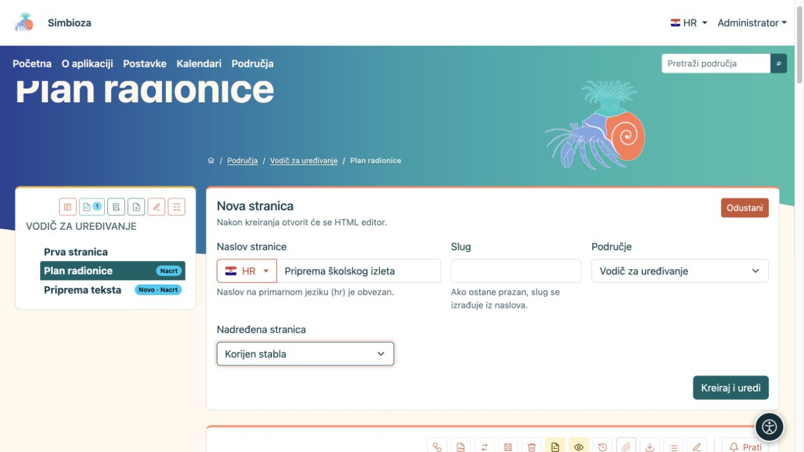
<figcaption>Nova stranica: unesite naslov, provjerite jezik i mjesto u stablu pa odaberite Kreiraj i uredi.</figcaption>
</figure>

Za promjenu postojeće stranice otvorite je iz stabla i odaberite ikonu olovke **Uredi**. Ako ne vidite radnju za stvaranje ili uređivanje, zamolite administratora ili upravitelja područja da provjeri vaša prava.

Instalacija bez Područja može imati stavku **HTML stranice** i radnju **Upravljanje sadržajem**. Ondje stvarate samostalne stranice; njihov sadržaj uređujete istim editorom. Ako su Područja dodana naknadno, samostalne stranice nastavljaju raditi dok ih administrator izričito ne premjesti u područje.

## 2. Upoznajte editor

Gore se nalaze podaci o dokumentu, odabir jezika i radnje spremanja. **Alatna traka** nalazi se neposredno iznad sadržaja koji uređujete. Ispod sadržaja je odjeljak **Privitci** za datoteke povezane sa stranicom.

<figure>
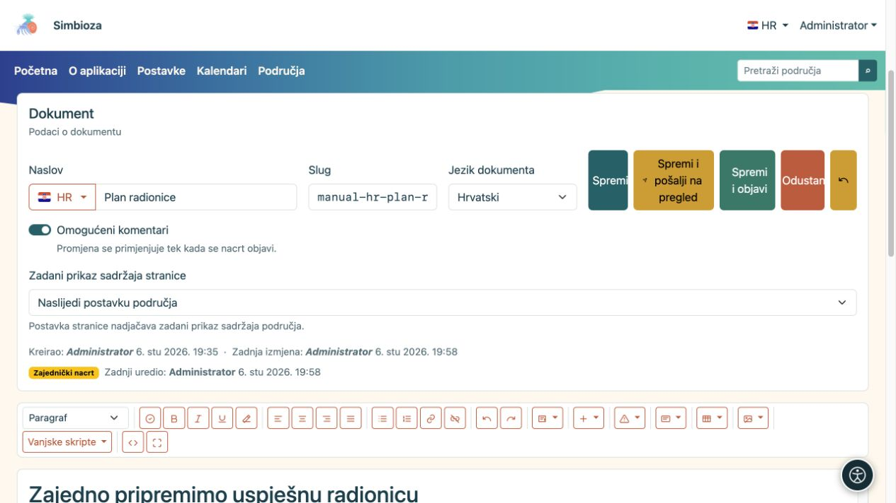
<figcaption>Gornji dio editora: podaci dokumenta i spremanje iznad alatne trake.</figcaption>
</figure>

Ako je ponuđeno, **Omogućeni komentari** dopušta nove komentare; postojeći ostaju vidljivi i kada se novi isključe. Na stranici područja promjena se primjenjuje objavom. **Zadani prikaz sadržaja stranice** može naslijediti postavku područja ili odabrati **Prikaži / Sakrij** za tu stranicu.

Kliknite na mjesto na koje želite nešto upisati ili umetnuti. Za oblikovanje postojećih riječi najprije ih označite; za oblikovanje cijelog odlomka dovoljno je postaviti pokazivač u njega.

Nazive slikovnih gumba saznajte zadržavanjem pokazivača na ikoni. Na užem prozoru alatna se traka raspoređuje u više redaka. Gumbima i poljima možete se kretati tipkama Tab i Shift+Tab; na gumbu za potvrdu upotrijebite Enter ili razmaknicu.

| Skupina u alatnoj traci | Čemu služi |
| --- | --- |
| **Format** | Odlomak, naslovi, citat ili preformatirani tekst. |
| **Provjeri dokument** | Provjera naslova, slika, poveznica i tablica prije objave. |
| **Podebljano**, **Kurziv**, **Podcrtano**, **Ukloni formatiranje** | Oblikovanje označenog teksta. |
| Četiri gumba poravnanja | Lijevo, sredina, desno ili obostrano poravnanje odlomka. |
| **Lista**, **Numerirana lista**, **Poveznica**, **Ukloni poveznicu** | Popisi i poveznice. |
| **Poništi**, **Ponovi** | Poništavanje i ponavljanje običnih promjena teksta tijekom otvorenog uređivanja. |
| **Dinamički elementi** | Tabovi, accordion, padajući sadržaj, grafikoni, vremenski planovi i dostupne integracije. |
| **Umetni**, **Bootstrap obavijesti**, **Kartice** | Stupci, vodoravna crta, ugrađeni sadržaj i istaknute cjeline. |
| **Tablica**, **Mediji** | Rad s odabranom tablicom, slikom ili drugim medijem. |
| **Vanjske skripte** | Dodatne mogućnosti koje je administrator pripremio i odobrio. |
| **Izvorni kod**, **Cijeli ekran** | Napredni HTML prikaz ili više prostora za vizualno uređivanje. |

Neke se mogućnosti pojavljuju samo kada je odgovarajući modul uključen i kada imate potrebna prava. Siva radnja tablice ili medija često samo znači da još niste označili tablicu odnosno sliku.

<figure>
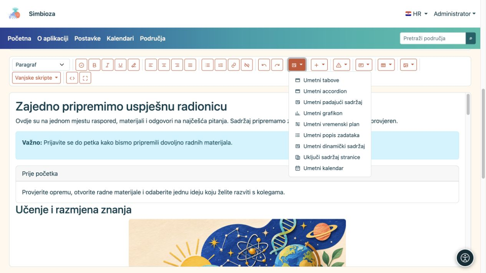
<figcaption>Izbornik Dinamički elementi otvara postavke složenijih sadržaja. Dostupne integracije ovise o instaliranim modulima.</figcaption>
</figure>

## 3. Napišite i oblikujte tekst

### Naslovi, odlomci i popisi

1. Upišite kratak odlomak koji čitatelju objašnjava temu stranice.
2. Za novu cjelinu napišite naslov, postavite pokazivač u njega i u **Formatu** odaberite odgovarajuću razinu naslova. Naslov stranice već je glavna cjelina; u sadržaju je obično dovoljno početi s **Naslov 2**, a podcjeline označiti kao **Naslov 3**.
3. Za nabrajanje upotrijebite **Listu**, a za postupak koji ima redoslijed **Numeriranu listu**.
4. Za kratko isticanje označite riječi i odaberite podebljanje ili kurziv. Za uklanjanje neželjenih stilova nakon lijepljenja označite taj tekst i odaberite **Ukloni formatiranje**.

**Rezultat:** stranica dobiva jasne cjeline, a čitatelji i pomoćne tehnologije lakše se kreću sadržajem. Nemojte običan podebljani odlomak koristiti umjesto pravog naslova.

**Citat** koristite za citirane riječi. **Preformatirano** čuva razmake i raspored kratkog tekstualnog primjera. Za duže odlomke koristite lijevo poravnanje; obostrano poravnanje može stvarati velike praznine između riječi.

### Poveznice

1. Označite tekst koji treba voditi na drugu stranicu, primjerice „Uvjeti prijave”.
2. Odaberite **Poveznica**.
3. Za vanjsku stranicu upišite web-adresu i odaberite **Umetni URL poveznicu**. Za Simbiozinu stranicu u dijelu **Interna poveznica** odaberite područje i stranicu pa potvrdite unos.
4. Ako je popis dug, koristite pretragu i **Učitaj još**. Ponuđene su stranice koje smijete odabrati.

**Ukloni poveznicu** zadržava riječi, ali uklanja njihovo odredište. Nakon spremanja otvorite poveznicu u prikazu stranice i provjerite rezultat.

## 4. Odvojite cjeline stupcima, obavijestima i karticama

| Želite… | Kako | Rezultat |
| --- | --- | --- |
| Dvije ili tri usporedne cjeline | **Umetni → Dva stupca / Tri stupca**, zatim zamijenite tekst u svakom stupcu. | Na širokom zaslonu sadržaji stoje usporedno, a na uskom jedan ispod drugoga. |
| Kratku važnu napomenu | **Bootstrap obavijesti**, odaberite stil i zamijenite ogledni tekst. | Poruka je vizualno istaknuta. Započnite je jasnom riječi poput „Važno”; boja nije dovoljna sama za sebe. |
| Odvojeni okvir s povezanim informacijama | **Kartice → Kartica s naslovom / Kartica bez naslova**. Upišite tekst u tijelo, a po potrebi i naslov. | Sažetak, kontakt ili druga cjelina odvojeni su od ostatka teksta. |
| Jednostavan razdjelnik | **Umetni → Horizontalna linija**. | Pojavljuje se vodoravna crta između dviju cjelina. |

Stupce i kartice koristite za povezane kratke sadržaje, a naslove za strukturu duljeg članka. Uvijek zamijenite sav umetnuti ogledni tekst.

## 5. Tabovi: više sadržaja na istom mjestu

Tabovi su korisni za različite mogućnosti iste teme, primjerice „Prije dolaska”, „Program” i „Kontakt”. Čitatelj bira naslov taba i vidi pripadajući sadržaj.

1. Postavite pokazivač na mjesto umetanja i otvorite **Dinamički elementi → Umetni tabove**.
2. Upišite **od 2 do 6 naslova**, svaki u zaseban redak, i odaberite **Umetni**.
3. U glavnom editoru upišite sadržaj svakog taba na označeno mjesto. Ondje možete uređivati i naslove. Sadržaji su tijekom uređivanja prikazani tako da možete raditi na svakome.
4. Spremite i provjerite prikaz stranice: klik na naslov treba pokazati odgovarajući sadržaj.

<figure>
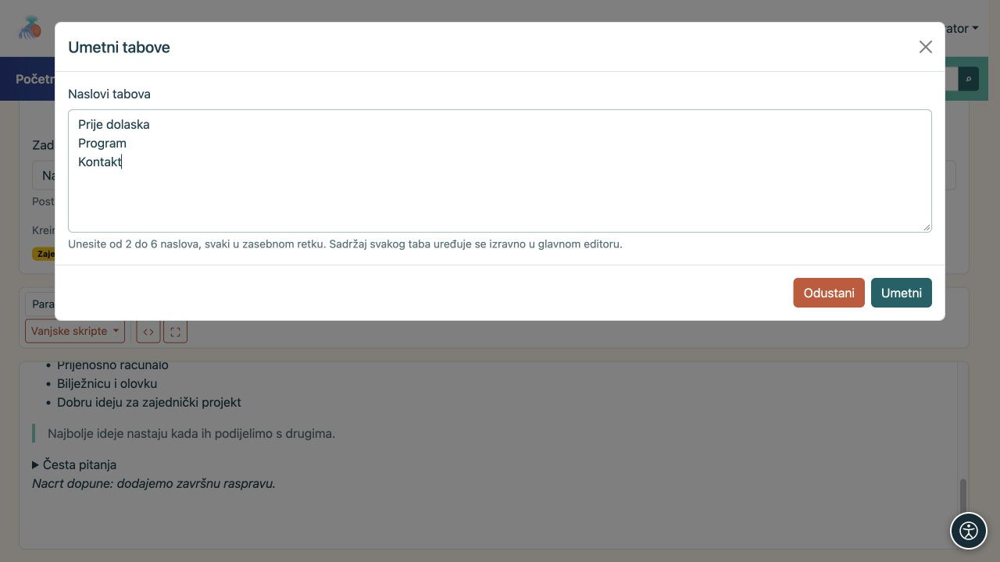
<figcaption>U ovom primjeru nastaju tri taba. Njihove sadržaje nakon umetanja upisujete u glavnom editoru.</figcaption>
</figure>

Olovka uz blok ponovno otvara postavke. **Ukloni tabove** uklanja cijeli blok. Kada u popisu naslova uklonite pojedini naslov, uklanja se i njegov sadržaj. Naslove i sadržaje mijenjajte zajedno; prepisivanje ili preslagivanje samih redaka nije automatsko premještanje pripadajućeg teksta.

## 6. Accordion: skup dijelova koji se otvaraju klikom

Accordion je prikladan za česta pitanja ili nekoliko kraćih postupaka. Čitatelj klikne naslov pitanja i otvori odgovor. Može otvoriti više dijelova istodobno.

1. Odaberite **Dinamički elementi → Umetni accordion**.
2. Unesite **od 1 do 12 naslova**, svaki u zaseban redak, pa odaberite **Umetni**.
3. U glavnom editoru ispod svakog naslova upišite njegov tekst. Možete dodavati poveznice, slike, tablice i druge sadržaje.
4. U prikazu stranice otvorite i zatvorite pojedini dio kako biste provjerili naslov i pripadajući sadržaj.

<figure>
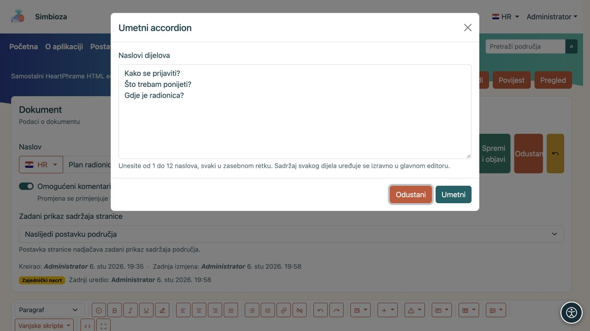
<figcaption>Svaki redak postaje naslov jednog dijela accordiona; odgovore upisujete nakon umetanja.</figcaption>
</figure>

Za promjenu broja dijelova koristite olovku uz blok. Dodani naslov dobiva prazno tijelo, a uklanjanjem naslova briše se i njegovo tijelo. **Ukloni accordion** uklanja cijeli skup.

## 7. Padajući sadržaj: jedna sklopiva napomena

Za samo jednu dodatnu napomenu ili objašnjenje odaberite **Dinamički elementi → Umetni padajući sadržaj**.

1. Upišite **Naslov** koji jasno govori što se nalazi unutra.
2. Ako čitatelj pri otvaranju stranice odmah treba vidjeti tekst, uključite **Prikaži sadržaj otvoren pri učitavanju stranice**.
3. Odaberite **Umetni** i u glavnom editoru upišite sadržaj ispod naslova.

<figure>
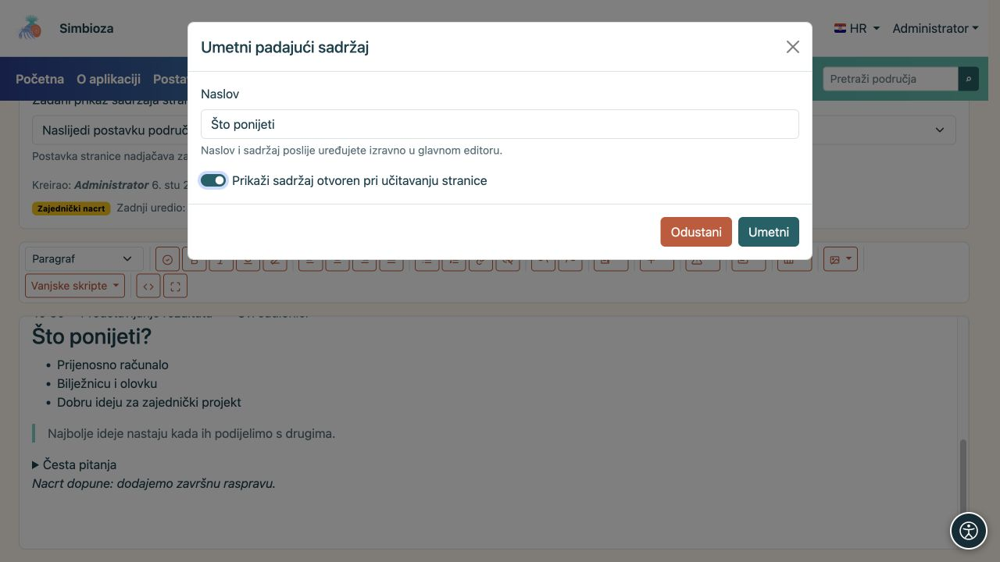
<figcaption>Postavka otvorenog sadržaja određuje što će čitatelj vidjeti pri učitavanju stranice.</figcaption>
</figure>

U editoru je sadržaj otvoren radi uređivanja. U prikazu stranice primjenjuje se odabrano početno stanje; čitatelj ga otvara i zatvara klikom na naslov. Olovka uz blok otvara postavke i nudi uklanjanje bloka.

Tabovi, accordion i padajući sadržaj mogu sadržavati oblikovani tekst i druge elemente. Najvažniju informaciju stranice ipak napišite vidljivo, bez potrebe za otvaranjem skrivenog dijela.

<figure>
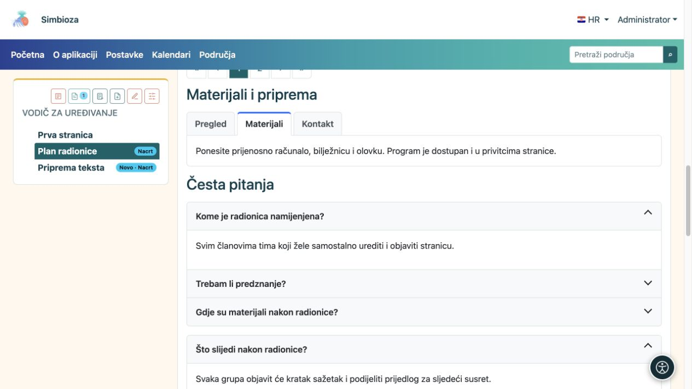
<figcaption>Rezultat za čitatelja: odabrani tab pokazuje materijale, a klik na naslov otvara pojedini odgovor ili dodatnu napomenu.</figcaption>
</figure>

## 8. Tablice, sortiranje i broj redaka

### Napravite i uredite tablicu

Odaberite **Tablica → Umetni tablicu** i unesite podatke u pripremljene ćelije. Prvi redak namijenite nazivima stupaca, primjerice „Naziv”, „Status” i „Rok”.

Za izmjenu najprije kliknite ćeliju na odgovarajućem mjestu pa ponovno otvorite **Tablicu**:

- **Umetni red iznad / ispod** i **Obriši red** djeluju na redak odabrane ćelije.
- **Umetni stupac lijevo / desno** i **Obriši stupac** djeluju na njezin stupac.
- **Spoji s ćelijom desno / ispod** spaja ćelije; **Podijeli ćeliju** razdvaja prethodno spojenu ćeliju.

Tablicu koristite za podatke, a ne za slaganje izgleda stranice. Za raspored sadržaja postoje [stupci](#raspored).

### Omogućite čitatelju sortiranje i listanje

1. Kliknite ćeliju tablice.
2. Otvorite **Tablica → Postavke tablice**.
3. Uključite **Sortiranje i paginacija**.
4. Odaberite **Početni broj redaka po stranici**: **10, 25, 50, 100 ili Sve**.
5. Odaberite **Primijeni**, zatim spremite stranicu.

<figure>
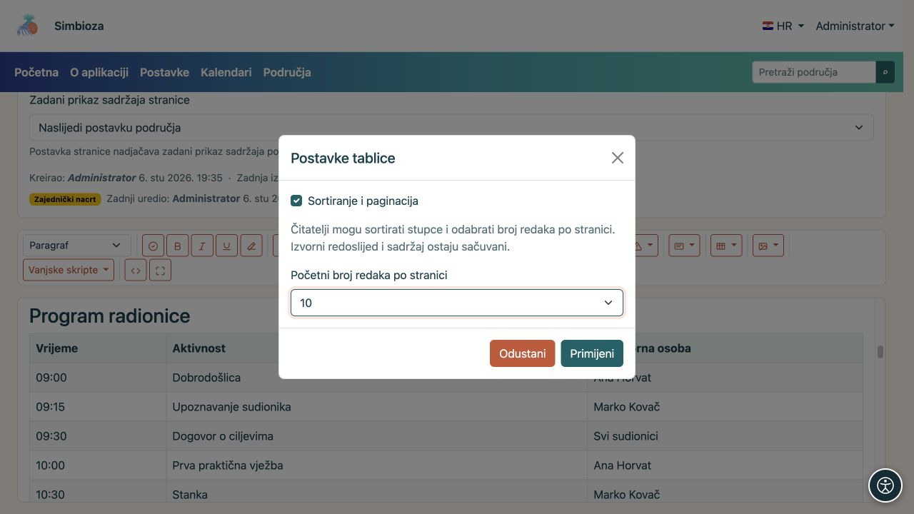
<figcaption>Postavke vrijede za odabranu tablicu. Broj redaka poslije može promijeniti i čitatelj.</figcaption>
</figure>

**Rezultat:** u prikazu stranice čitatelj može kliknuti naslov stupca za uzlazni redoslijed, ponovno za silazni i treći put za izvorni redoslijed. Strelice pokazuju smjer. Iznad/uz tablicu bira broj redaka, a kontrolama za listanje mijenja stranicu. **Sve** prikazuje sve retke.

Ovo uključujete **zasebno za svaku tablicu**. U editoru se i dalje uređuju svi retci; čitateljevo sortiranje ne mijenja spremljene podatke. Nije potrebno odabrati vanjsku skriptu. Kontrole rade i u HTML izvozu, a pri ispisu prikazuju se svi retci.

Za ovu mogućnost tablica mora imati jedan redak zaglavlja, jednak broj ćelija u podatkovnim retcima te ne smije imati spojene ćelije ili tablicu unutar ćelije. Ako je složenija, zadržite običan prikaz ili razdvojite podatke u jednostavnije tablice.

<figure>
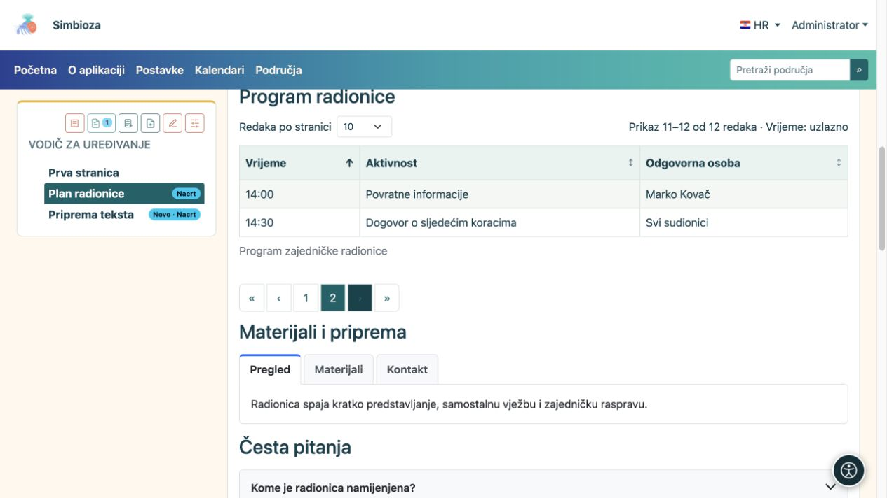
<figcaption>Čitateljev prikaz: odabrano je 10 redaka po stranici, a na drugoj su stranici preostala dva retka, 11–12 od ukupno 12. Strelica u zaglavlju pokazuje sortiranje.</figcaption>
</figure>

## 9. Učitajte sliku, video ili drugu datoteku

1. Ispod sadržaja otvorite **Privitci**, odaberite **Dodaj privitak / Odaberi datoteke** i zatim **Učitaj**. Pričekajte završetak učitavanja.
2. Uz datoteku unesite **Prikazni naziv**. To je naziv koji želite pokazati čitatelju; može biti razumljiviji od izvornog naziva datoteke.
3. Za sliku unesite **Alternativni tekst**: kratak opis informacije koju slika prenosi. Primjer: „Raspored prostorija s označenim ulazom”, a ne samo „slika1.png”.
4. **Caption** je kratki natpis uz umetnuti medij, a **Opis** služi dodatnom objašnjenju privitka. Odaberite **Spremi metapodatke**.
5. Postavite pokazivač na željeno mjesto u sadržaju i uz privitak odaberite **Umetni**.

**Rezultat:** slika ili video pojavljuju se u sadržaju, a druga datoteka kao poveznica za otvaranje/preuzimanje. Samo učitavanje privitka ne umeće ga automatski u tekst.

<figure>
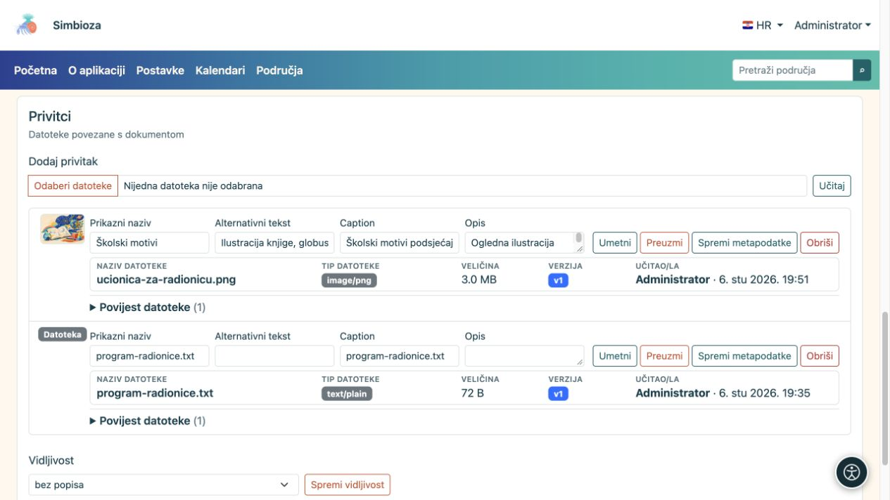
<figcaption>Uz učitanu sliku unesite opisne podatke i spremite metapodatke. Gumb Umetni dodaje odabrani privitak u sadržaj.</figcaption>
</figure>

### Veličina, razmak i poravnanje medija

Kliknite umetnutu sliku ili drugi medij i otvorite **Mediji**. Odaberite širinu **25 %, 50 %, 75 % ili 100 %**, razmak **bez razmaka, mali, srednji ili veliki** i poravnanje **lijevo, sredina ili desno**. **Resetiraj medij** vraća njegove postavke izgleda na početne vrijednosti.

**Uredi alternativni tekst slike** mijenja opis odabrane slike. **Označi sliku kao ukrasnu** upotrijebite samo kada slika nema informacijsku ulogu, primjerice za ukrasni razdjelnik. Natpis uz sliku nije zamjena za alternativni tekst.

Za snimku sučelja obično je najčitljivija puna širina. Nakon izmjene pogledajte stranicu i u užem prozoru.

<figure>
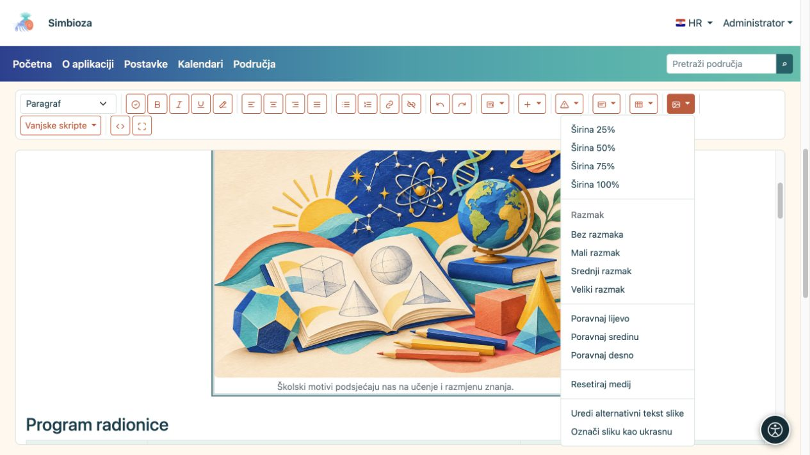
<figcaption>Najprije odaberite sliku, zatim u izborniku Mediji podesite njezin izgled i opis.</figcaption>
</figure>

### Popis i povijest privitaka

**Vidljivost** u odjeljku privitaka određuje tko vidi **popis** privitaka: bez popisa, svi uključujući goste ili prijavljeni korisnici. To samo po sebi ne daje pravo pristupa privatnoj stranici ili datoteci.

Uz privitak možete preuzeti datoteku, promijeniti metapodatke i, uz odgovarajuća prava, obrisati je. Ako je dostupna **Povijest datoteke**, ondje pregledajte prethodne inačice i po potrebi vratite odabranu. Uklanjanje slike iz teksta i brisanje privitka različite su radnje: brisanje datoteke može utjecati na mjesta koja je koriste.

## 10. Ugradite sadržaj drugog servisa

Za sadržaj poput interaktivnog obrazovnog materijala ili videa koji pruža drugi servis otvorite **Umetni → Umetni ugrađeni sadržaj**.

1. Zalijepite njegov **Iframe kôd ili HTTPS URL** koji je pripremio pružatelj.
2. Unesite **Pristupačni naslov**, primjerice „Vježba: prepoznajte geometrijske likove”.
3. Podesite **Visinu** i, ako je potrebno, **Dopusti prikaz preko cijelog zaslona**.
4. Odaberite **Umetni**, spremite i provjerite stranicu. Za kasnije promjene koristite olovku uz blok.

Ako se sadržaj ne prikazuje, pružatelj možda ne dopušta ugrađivanje ili traži dodatnu prijavu. Ako je potrebna dodatna skripta, zamolite administratora da pripremi podržanu integraciju; nemojte samostalno lijepiti nepoznati programski kod.

## 11. Grafikon za usporedbu brojčanih podataka

1. Odaberite **Dinamički elementi → Umetni grafikon**.
2. Izaberite vrstu: **Stupčasti, Linijski, Površinski, Kružni ili Prstenasti**. Za usporedbu broja sudionika po mjesecima prikladan je stupčasti grafikon.
3. Unesite naslov, kategorije i brojčane vrijednosti. **Dodaj kategoriju** dodaje novu skupinu, a **Dodaj seriju** drugi niz vrijednosti, primjerice drugu godinu.
4. Po potrebi dodajte nazive osi i opis, uključite legendu te podesite orijentaciju, izgled, širinu i poravnanje. Pozadina može pratiti temu.
5. Odaberite **Umetni grafikon** i provjerite rezultat u prikazu stranice.

**Rezultat:** uneseni brojevi prikazuju se kao grafikon. Podaci se ne dohvaćaju automatski iz ankete ili druge tablice. Za promjenu brojeva ili izgleda kliknite olovku uz grafikon; u njegovim postavkama možete ga i ukloniti.

<figure>
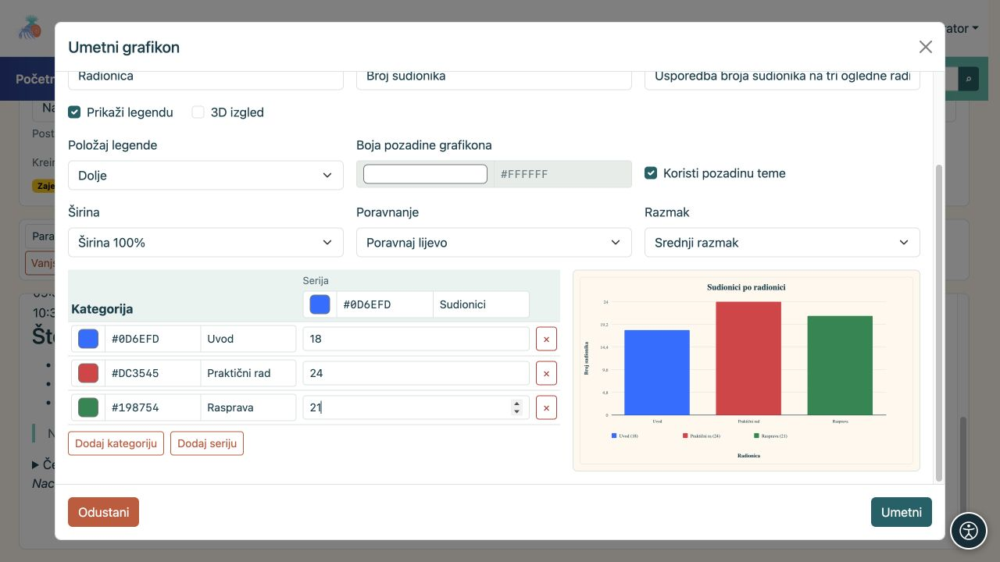
<figcaption>Primjer grafikona s tri kategorije. Dok mijenjate vrijednosti i izgled, pregled pokazuje njihov učinak.</figcaption>
</figure>

## 12. Vremenski plan za raspored aktivnosti

1. Odaberite **Dinamički elementi → Umetni vremenski plan**.
2. Unesite naslov te početak i završetak razdoblja koje prikazujete.
3. Odaberite mjerilo vremena: **Dani, Tjedni, Mjeseci ili Tromjesečja**.
4. Dodajte grupu, primjerice „Priprema događaja”, i u nju aktivnosti s datumima početka i završetka. Po potrebi dodajte druge grupe i oznake važnih datuma.
5. Odaberite **Umetni vremenski plan** i provjerite jesu li sve aktivnosti unutar zadanog razdoblja.

**Rezultat:** na stranici se vidi kada pojedina aktivnost počinje i završava. To je prikaz plana koji ste unijeli, a ne automatski kalendar ni sustav slanja podsjetnika. Olovkom uz blok ponovno otvorite njegove postavke.

<figure>
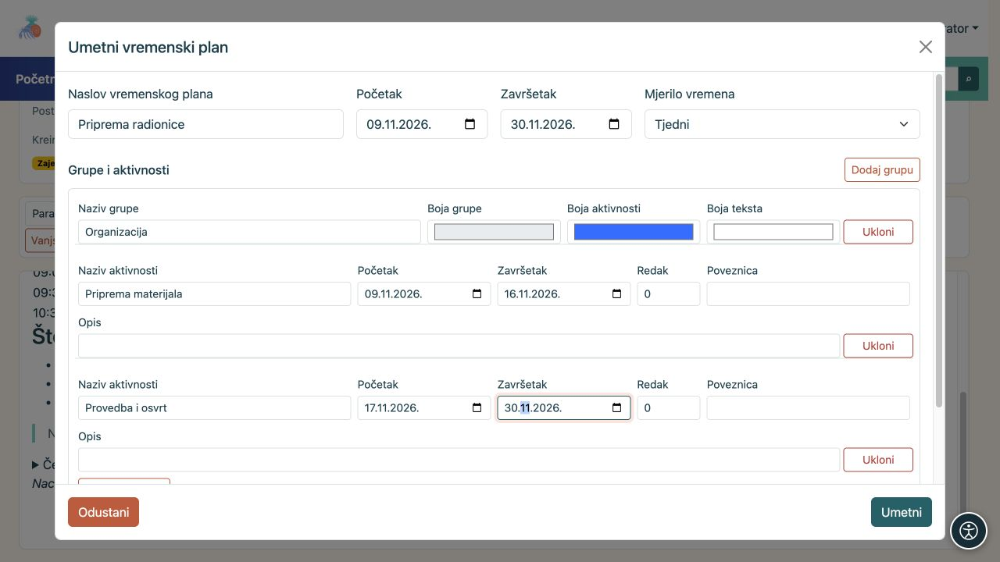
<figcaption>Primjer vremenskog plana: jedna grupa s dvije aktivnosti i zasebnim datumima početka i završetka.</figcaption>
</figure>

## 13. Prikažite podatke iz drugih dijelova Simbioze

Ove stavke izbornika **Dinamički elementi** ovise o instaliranim modulima. Ako ih nema, provjerite s administratorom jesu li dostupne na vašoj instalaciji.

| Mogućnost | Što napraviti | Što čitatelj dobiva |
| --- | --- | --- |
| **Umetni popis zadataka** | Upišite naslov i zadatke, svaki u zaseban redak. Odaberite popis ili tablicu te tko smije mijenjati status. | Zadatke sa statusima, prema pravima koja ste odabrali. |
| **Umetni kalendar** | Odaberite jedan ili više ponuđenih kalendara, naslov, mjesečni/tjedni/dnevni prikaz te trenutačni ili zadani datum. | Događaje kalendara koje čitatelj smije vidjeti. Prava kalendara ne mijenjaju se umetanjem. |
| **Uključi sadržaj stranice** | Pronađite područje i stranicu pretragom; po potrebi odaberite **Učitaj još** i potvrdite. | Sadržaj izabrane stranice bez ručnog održavanja druge kopije; pristup se provjerava i za čitatelja. |
| **Umetni dinamički sadržaj** | Odaberite tablicu stranica i svojstava, galeriju privitaka, pretragu područja ili nedavne promjene. Podesite područja, naslov, filtere i broj stavki. | Ažuran pregled iz dostupnih stranica i njihovih podataka. |

Za promjenu postavki koristite olovku uz umetnuti blok. U editoru se dio tih sadržaja prikazuje kao okvir sa sažetkom postavki. Konačan izgled provjerite nakon spremanja u prikazu stranice.

### Svojstva za tablicu stranica

Ako želite pregled projekata sa stupcima poput „Status” i „Rok”, najprije na izvornim stranicama unesite jednako nazvana svojstva i njihove vrijednosti. Zatim u dinamičkom bloku odaberite **Tablica stranica i svojstava** i ta svojstva upišite kao stupce. Ne pojavljuju li se podaci, provjerite točan naziv svojstva, odabrana područja, filter oznaka i prava čitanja izvornih stranica. Više o svojstvima i postavkama pročitajte u [Područjima](podrucja_hr.md).

### Vanjske skripte koje je pripremio administrator

1. Otvorite **Vanjske skripte**.
2. Ako uz skriptu postoji **? u kružiću**, kliknite ga i pročitajte uputu. Upitnik se prikazuje samo kada je uputa pripremljena; njegovo otvaranje ne uključuje skriptu.
3. Označite skriptu koju trebate i spremite stranicu. Odabir se čuva s inačicom sadržaja.

Na popisu su samo odobrene skripte. Ako uputa traži izmjenu izvornog HTML-a koju ne znate napraviti, zamolite administratora ili iskusnijeg urednika da pripremi primjer za vašu stranicu. **Za ugrađeno sortiranje i listanje tablica ne trebate vanjsku skriptu.**

Skripte se provjeravaju na objavljenoj stranici; ne izvršavaju se u editoru, nacrtu ni povijesti. Opozvana skripta prestaje raditi. HTML izvoz uključuje odabrane i odobrene skripte, a udaljene skripte i dalje trebaju mrežnu vezu.

## 14. Spremite rad, provjerite ga i objavite

| Radnja | Što znači |
| --- | --- |
| **Spremi** | Sprema promjene kao nacrt. U području postojeća objavljena inačica ostaje vidljiva čitateljima. |
| **Spremi i pošalji na pregled** | Sprema nacrt i šalje ga osobi koja ima pravo objave. Koristite je kada je sadržaj spreman, a ne objavljujete ga sami. |
| **Spremi i objavi** | Uz pravo uređivanja i objave sprema sadržaj i odmah ga objavljuje. |
| **Odustani** | Napušta uređivanje; ako postoje nespremljene promjene, pratite poruku prije izlaska. |

Radnje slanja na pregled i objave odnose se na stranice u područjima. Samostalne HTML stranice nemaju taj isti tijek pregleda područja: spremanje mijenja njihov vlastiti sadržaj.

### Provjera prije objave

1. Odaberite **Provjeri dokument** u alatnoj traci.
2. Ispravite prijavljene probleme, primjerice prazan naslov, preskočenu razinu naslova, sliku bez alternativnog teksta ili tablicu bez zaglavlja.
3. Odaberite **Ponovno provjeri**. Provjera pomaže, ali ne može ocijeniti je li tekst razumljiv ili jesu li svi podaci točni.
4. Spremite promjene i otvorite **Pregled**. Provjerite koju inačicu i jezik gledate. Za provjeru neobjavljenih promjena u području odaberite **Pregledaj nacrt**; obični čitateljski prikaz objavljene stranice ne zamjenjuje se samim spremanjem nacrta.
5. Otvorite poveznice, tabove i sklopive dijelove; provjerite slike i podatke te raspored na užem prozoru.
6. Objavite ili pošaljite na pregled. Nakon objave ponovno otvorite stranicu kao čitatelj.

**Lokalni nacrt** koji editor može ponuditi nakon prekida rada spremljen je samo u tom pregledniku. To nije zamjena za **Spremi**. Ako drugi urednik u međuvremenu promijeni zajednički nacrt, usporedite ponuđene verzije prije vraćanja svojih promjena.

**Odbaci zajednički nacrt** uklanja neobjavljene zajedničke promjene i vraća zadnju objavljenu inačicu. Prije potvrde uskladite se s drugim urednicima. Ako nova stranica **nikada nije bila objavljena**, odbacivanje nacrta može je trajno obrisati; pročitajte potvrdu prije nastavka.

U prikazu stranice možete vidjeti i **Pošalji na pregled**, **Vrati u nacrt** ili **Objavi**, ovisno o statusu i pravima. Objavljivač može objaviti nacrt i izravno, bez prethodnog slanja na pregled. Ako imate samo pravo objave, otvorite **Pregledaj nacrt**, provjerite sadržaj i jezik pa u traci stranice odaberite **Objavi**; samo to pravo ne daje i uređivanje teksta. Arhiviranu stranicu treba vratiti u nacrt i ponovno objaviti prije nego što postane dostupna čitateljima.

## 15. Prijevodi i povrat starijeg sadržaja

### Drugi jezik stranice

1. U **Jeziku dokumenta** odaberite jezik koji želite uređivati. Ponuđeni su jezici instalirani i omogućeni u aplikaciji.
2. U izborniku uz **Naslov** provjerite i naslov na tom jeziku.
3. Preko **Prijevodi → Kopiraj prijevod** možete kopirati postojeći sadržaj kao početak. Odaberite izvorni i ciljni jezik te **Kopiraj za prijevod**.
4. Prevedite tekst, naslove tabova, natpise i opise slika; provjerite i objavite tu jezičnu inačicu.

**Kopiranje ne prevodi tekst automatski.** Postojeći ciljni prijevod zamjenjuje se novom inačicom. Nije potrebno prevoditi stranicu na svaki ponuđeni jezik; objavite samo jezike za koje imate pripremljen sadržaj.

### Povijest

Otvorite **Povijest**. Uz raniju inačicu odaberite **Pregled** kako biste je prvo pročitali. Ako želite vratiti njezin sadržaj, odaberite **Vrati** i pratite potvrdu. Nakon povrata provjerite aktualni nacrt i provedite objavu ako je potrebna. **Poništi** i **Ponovi** u alatnoj traci služe običnim promjenama teksta u trenutačnom uređivanju. Ne obuhvaćaju sve promjene postavki medija i posebnih blokova, pa se za njihov povrat nemojte oslanjati na te gumbe. Prije većih izmjena odaberite **Spremi**; povijest čuva spremljene inačice.

## 16. Tko vidi i uređuje stranicu

Većina stranica nasljeđuje prava svojeg područja. Za običan unos i promjenu teksta dovoljno je imati odgovarajuća prava; ne trebate sami mijenjati postavke pristupa. Nacrt bez objavljene inačice dostupan je odgovarajućim urednicima, objavljivačima i upraviteljima, a ne običnim čitateljima. U stablu i statusu stranice označeno je da je riječ o nacrtu.

Ako imate ovlasti za to, otvorite **Upravljaj stranicom i dozvolama** u njezinoj gornjoj traci radnji. Ondje razlikujte:

- **Ograničenja naslijeđenih prava:** dodatno ograničavaju postojeća prava na toj stranici i podređenim stranicama. Ne služe dodavanju osobe koja prije nije imala pristup.
- **Izravna dopuštenja korisnicima i grupama:** iznimke za odabranu stranicu. Možete odabrati korisnike ili grupe; pojedina iznimka ne otvara automatski ostale stranice područja ni podstranice.

U pretraživom odabiru najprije otvorite popis korisnika ili grupa, pronađite primatelja i dodajte ga. Ako popis ima više rezultata, pretražite ga ili učitajte sljedeće ponuđene stavke. Provjerite **Čitanje**, **Uređivanje** i **Objavljivanje** pa odaberite **Spremi izravna dopuštenja**. Uređivanje i objavljivanje uključuju čitanje; samo objavljivanje ne uključuje uređivanje. Zaseban odjeljak ograničenja odnosi se na pojedine korisnike koji već imaju naslijeđena prava, a ne na cijele grupe.

Publika **Javno** daje pravo čitanja, uključujući gostima. Ne može dati pravo uređivanja ili objavljivanja. Tako i pojedina objavljena stranica u privatnom području može biti javna; ostatak privatnog sadržaja ostaje zaštićen. Time se nacrt ne objavljuje. Područje se tada može pojaviti u popisu dostupnih područja, ali čitatelj u stablu vidi samo ono čemu smije pristupiti.

<figure>
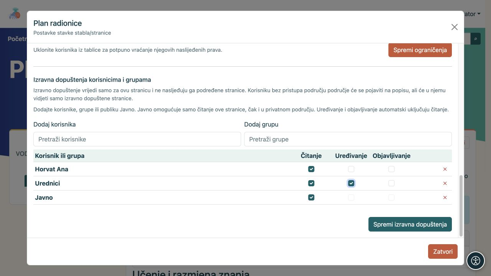
<figcaption>Primjer izravnih dopuštenja za jednu stranicu: korisnik, grupa i publika Javno imaju različita prava.</figcaption>
</figure>

Promjena prava može otvoriti sadržaj drugima. Ako niste sigurni, zamolite administratora ili upravitelja područja da to podesi. Nakon promjene zamolite osobu kojoj je pristup namijenjen da otvori stranicu; administratorski prikaz nije dokaz da je pristup dobro postavljen za ostale. Za podrobnije objašnjenje pogledajte [prava u Područjima](podrucja_hr.md).

## 17. Ostale radnje na stranici

Gornja traka objavljene stranice prikazuje samo radnje koje su dostupne u vašoj instalaciji i za vaš račun. Zadržite pokazivač na ikoni kako biste pročitali naziv.

<figure>
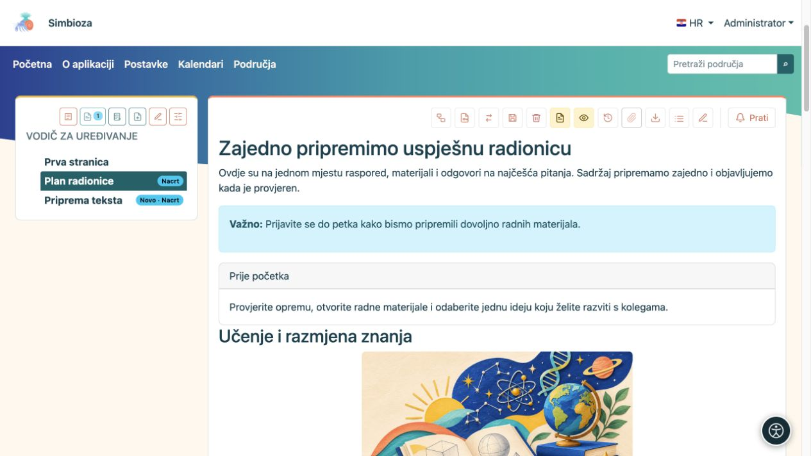
<figcaption>Radnje na objavljenoj stranici: ponuđene ikone ovise o vašim pravima i uključenim mogućnostima.</figcaption>
</figure>

- **Prikaži privitke / Sakrij privitke** otvara ili zatvara popis datoteka uz stranicu. **Prikaži sadržaj / Sakrij sadržaj** prikazuje ili skriva popis naslova na stranici.
- **Povijest** otvara spremljene inačice, a izbornik sa zastavicom bira postojeći prijevod.
- **Kopiraj ili premjesti stranicu** dostupno je upraviteljima područja. Odaberite kopiranje ili premještanje, ciljno područje i roditelja te želite li prenijeti povijest i izravna dopuštenja/ograničenja. Sadržaj, prijevodi i privitci prenose se zajedno. Kopija ostavlja izvor na mjestu; premještanje ga uklanja nakon uspješnog prijenosa. Kopira se samo odabrana stranica; premještanje stranice s podstranicama nije dostupno. Nakon postupka provjerite prava odredišta.
- **Izvezi stranicu u HTML** preuzima ZIP s datotekom `index.html` i povezanim lokalnim datotekama. Raspakirajte ga prije otvaranja HTML datoteke. Za stranicu područja izvozi se objavljena inačica, a ne neobjavljeni nacrt. To nije sigurnosna kopija za povrat cijelog područja.
- Za PDF otvorite preglednikov **Ispis → Spremi kao PDF**. Prije spremanja provjerite pregled ispisa i raspored sadržaja.
- **Obriši stranicu i podgranu** uklanja i podstranice; pažljivo pročitajte potvrdu. Objavljene stranice brišu se uz mogućnost oporavka, ali brisanje novog, nikad objavljenog dokumenta kroz editor može biti trajno. Za oporavak pitajte administratora; nemojte pretpostaviti da se svako brisanje može poništiti.
- Ako su uključeni, **Prati** i komentari služe praćenju promjena i raspravi uz stranicu.

**Izvorni kod** u editoru prikazuje HTML i namijenjen je iskusnijim urednicima. Za opisane postupke nije potreban. **Cijeli ekran** daje više prostora sadržaju; istom se ikonom vratite na podatke dokumenta i gumbe spremanja.

## 18. Ako nešto ne izgleda kako očekujete

| Što vidite | Što napraviti |
| --- | --- |
| Nema gumba za uređivanje ili objavu. | Provjerite račun i područje. Zamolite upravitelja ili administratora da provjeri vaša prava. |
| Uredili ste tekst, a čitatelj još vidi staru stranicu. | Spremite nacrt i provjerite treba li ga još objaviti. Provjerite i jezik. |
| Naredba za tablicu ili sliku ne djeluje. | Najprije kliknite ćeliju tablice ili označite baš sliku, zatim ponovite radnju. |
| Padajući sadržaj u editoru je stalno otvoren. | To je prikaz za uređivanje. Početno stanje provjerite u prikazu stranice. |
| Tabovi ili accordion imaju naslov, ali nemaju tekst. | Nakon umetanja treba u glavnom editoru popuniti tijelo svakog dijela. |
| Ne vidite sortiranje i broj redaka. | Uključite ih u **Postavkama te tablice**, provjerite ima li jednostavno zaglavlje i pogledajte spremljenu stranicu. |
| Privitak je učitan, ali nije u tekstu. | Postavite pokazivač u tekst pa na privitku odaberite **Umetni**. |
| Kalendar, uključena stranica ili dinamički popis vidljiv je vama, ali ne čitatelju. | Provjerite čitateljeva prava i na izvornom sadržaju. Umetanje ne otvara privatne podatke. |
| Skripta nije ponuđena ili ne radi. | Pročitajte njezinu uputu i provjerite objavljeni prikaz. Odobravanje i pripremu rješava administrator. |
| Nakon lijepljenja tekst izgleda neujednačeno. | Primijenite **Ukloni formatiranje** pa ponovno postavite naslove i popise. |
| Poništi ne vraća promijenjenu širinu slike ili druge postavke bloka. | Te postavke vratite kroz njihov izbornik. Prije većih zahvata spremite rad. Za odbacivanje nespremljenih promjena odaberite **Odustani**; već spremljene promjene ostaju spremljene. |

Prije nego završite, provjerite **sadržaj, spremanje, odabrani jezik, poveznice i očekivani pristup čitatelja**. Za većinu stranica to je važnije od broja umetnutih ukrasnih elemenata.
