# Modifica delle pagine

> Le schermate mostrano l’interfaccia in inglese.

Scopri come creare una pagina, aggiungere testo, immagini e altri contenuti e prepararla per i lettori. Lavori in un editor visivo, proprio come un elaboratore di testi. **Non è necessario conoscere HTML o scrivere il codice di programmazione per le modifiche quotidiane.**

Per la prima pagina, segui [creazione pagina](#new-page), [formattazione di base](#text) e [salvataggio e pubblicazione](#saving). Torna alle altre sezioni quando ne hai bisogno. I sondaggi hanno le proprie [guide separate](ankete_it.md).

## 1. Crea una nuova pagina o aprine una esistente

1. Apri **Aree di lavoro** e scegli l'area di lavoro in cui desideri lavorare.
2. Per creare una pagina, seleziona l'icona **Nuova pagina** accanto all'albero dell'area di lavoro. Passa il mouse sopra un'icona per leggerne il nome.
3. Inserisci il **Titolo della pagina**. Controlla la lingua, l'**Area di lavoro** di destinazione e la **Pagina superiore**. La pagina superiore determina dove appare la nuova pagina nell'albero; scegli **Radice dell'albero** per il livello superiore. Il modulo indica in quale lingua principale è obbligatorio inserire un titolo.
4. Puoi lasciare **Slug** vuoto: il sistema lo deriva dal titolo. È la parte breve dell'indirizzo web della pagina, quindi evita di cambiarlo in seguito senza motivo.
5. Seleziona **Crea e modifica**. La nuova pagina si apre nell'editor.

**Risultato:** la pagina esiste nella posizione selezionata ed è pronta per il contenuto. La creazione della pagina e la digitazione del testo sono operazioni separate dalla pubblicazione per i lettori.

<figure>
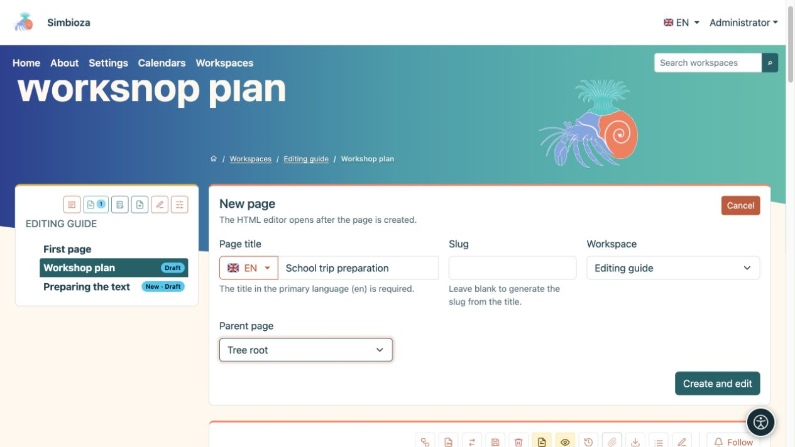
<figcaption>Nuova pagina: inserisci un titolo, verificane la lingua e la posizione nell'albero, quindi seleziona Crea e modifica.</figcaption>
</figure>

Per modificare una pagina esistente, aprila dall'albero e seleziona la matita **Modifica**. Se manca l'azione di creazione o modifica, chiedi a un amministratore o al gestore dell'area di lavoro di verificare le tue autorizzazioni.

Un'installazione senza aree di lavoro può avere pagine **HTML** e **Gestisci contenuto**. Crea lì pagine autonome e modificane il contenuto con lo stesso editor. Se le aree di lavoro vengono installate in un secondo momento, le pagine autonome continuano a funzionare finché un amministratore non le sposta esplicitamente in un'area di lavoro.

## 2. Orientarsi nell'editor

I dettagli del documento, la selezione della lingua e le azioni di salvataggio sono in alto. La **barra degli strumenti** si trova immediatamente sopra il contenuto che modifichi. **Allegati**, sotto il contenuto, contiene i file associati alla pagina.

<figure>
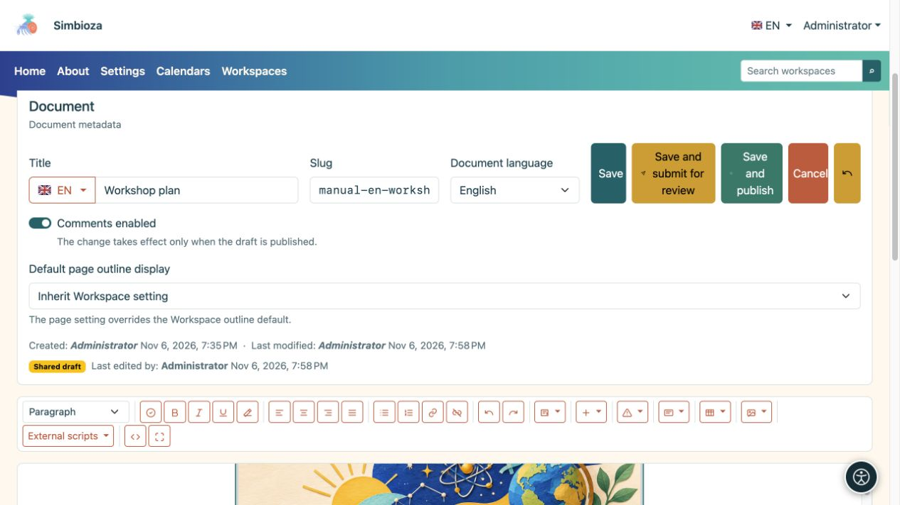
<figcaption>La parte superiore dell'editor: dettagli del documento e azioni di salvataggio sopra la barra degli strumenti.</figcaption>
</figure>

Dove offerto, **Commenti abilitati** consente nuovi commenti; i commenti esistenti rimangono quando i nuovi commenti vengono disattivati. In una pagina dell'area di lavoro questa modifica segue la pubblicazione. La **Visualizzazione predefinita del sommario della pagina** può ereditare l'impostazione dell'area di lavoro o scegliere **Mostra/Nascondi** per quella pagina.

Fai clic nel punto in cui desideri digitare o inserire qualcosa. Seleziona le parole esistenti prima di formattarle; per formattare un intero paragrafo, posiziona il cursore al suo interno.

Passa il mouse sopra un pulsante con un'icona per leggerne il nome. In una finestra più stretta la barra degli strumenti va a capo su più righe. Usa Tab e Maiusc+Tab per spostarti tra pulsanti e campi; attiva il pulsante selezionato con Invio o Spazio.

| Gruppo barra degli strumenti | Cosa fa |
| --- | --- |
| **Formato** | Paragrafi, titoli, citazioni o testo preformattato. |
| **Controlla documento** | Controlla titoli, immagini, collegamenti e tabelle prima della pubblicazione. |
| **Grassetto**, **Corsivo**, **Sottolineato**, **Rimuovi formattazione** | Formatta il testo selezionato. |
| Quattro pulsanti di allineamento | Allineamento del paragrafo a sinistra, al centro, a destra o giustificato. |
| **Elenco puntato**, **Elenco numerato**, **Collegamento**, **Rimuovi collegamento** | Elenchi e collegamenti. |
| **Annulla**, **Ripeti** | Inverte o ripete le normali modifiche al testo nella sessione di modifica corrente. |
| **Elementi dinamici** | Schede, pannello espandibile, contenuti a discesa, grafici, sequenze temporali e integrazioni disponibili. |
| **Inserisci**, **Avvisi Bootstrap**, **Riquadri** | Colonne, una linea orizzontale, contenuti incorporati e sezioni evidenziate. |
| **Tabella**, **Media** | Funziona sulla tabella, immagine o altro supporto selezionato. |
| **Script esterni** | Funzionalità aggiuntive preparate e approvate da un amministratore. |
| **Codice sorgente**, **Schermo intero** | Visualizzazione HTML avanzata o più spazio per l'editing visivo. |

Alcune funzionalità vengono visualizzate solo quando il modulo corrispondente è abilitato e si dispone delle autorizzazioni necessarie. Una tabella o un comando multimediale non disponibile spesso significa semplicemente che non hai ancora selezionato una cella o un'immagine della tabella.

<figure>
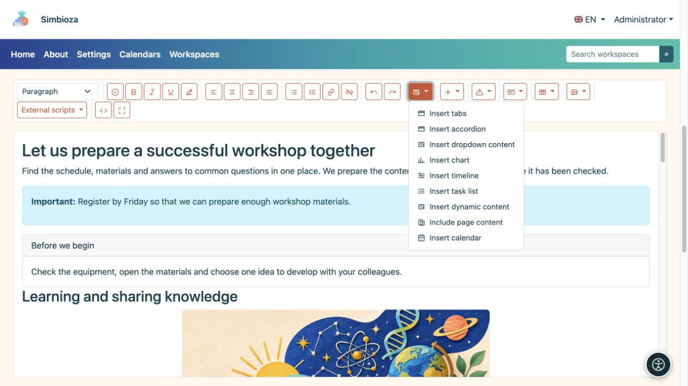
<figcaption>Gli elementi dinamici aprono le impostazioni per contenuti più complessi. Le integrazioni disponibili dipendono dai moduli installati.</figcaption>
</figure>

## 3. Scrivere e formattare il testo

### Intestazioni, paragrafi ed elenchi

1. Scrivi un breve paragrafo di apertura che spieghi l'oggetto della pagina.
2. Per una nuova sezione, digita un'intestazione, posiziona il cursore al suo interno e scegli il suo livello in **Formato**. Il titolo della pagina è già l'intestazione principale; le sezioni del corpo normalmente iniziano con **Intestazione 2**, seguita da **Intestazione 3** per le sottosezioni.
3. Utilizza l'**Elenco non ordinato** per gli elementi e l'**Elenco ordinato** per i passaggi che devono avvenire in sequenza.
4. Seleziona alcune parole e applica il grassetto o il corsivo per enfatizzare. Per rimuovere lo stile incollato indesiderato, seleziona il testo e scegli **Rimuovi formattazione**.

**Risultato:** la pagina presenta sezioni chiare, che facilitano la navigazione per i lettori e la tecnologia assistiva. Non utilizzare un normale paragrafo in grassetto come sostituto di un titolo vero e proprio.

Utilizza **Citazione** per le parole tra virgolette. **Preformattato** preserva gli spazi e il layout di un breve esempio di testo. L'allineamento a sinistra funziona meglio per i paragrafi più lunghi; la giustificazione può introdurre ampi divari tra le parole.

### Collegamenti

1. Seleziona le parole che dovrebbero portare da qualche parte, come "Requisiti dell'applicazione".
2. Seleziona **Collegamento**.
3. Per una pagina esterna, inserisci l'indirizzo web e seleziona **Inserisci collegamento URL**. Per una pagina Simbioza, scegli un'area di lavoro e una pagina in **Link interno**, quindi conferma.
4. Per un elenco lungo, utilizza la ricerca e **Carica altro**. Il selettore offre le pagine che puoi selezionare.

**Scollega** mantiene le parole e rimuove la loro destinazione. Dopo aver salvato, apri il collegamento dalla visualizzazione della pagina per verificarlo.

## 4. Sezioni separate con colonne, avvisi e schede

| Vuoi… | Cosa fare | Risultato |
| --- | --- | --- |
| Due o tre sezioni parallele | **Inserisci → Due colonne/Tre colonne**, quindi sostituisci il testo in ciascuna colonna. | I contenuti vengono visualizzati affiancati su uno schermo ampio e impilati su uno schermo stretto. |
| Una breve nota importante | Apri **Avvisi Bootstrap**, scegli uno stile e sostituisci il testo di esempio. | Il messaggio risalta. Inizia con una parola chiara come “Importante”; il colore da solo non basta. |
| Una casella separata di informazioni correlate | **Riquadri → Riquadro con titolo / Riquadro senza titolo**. Compila il contenuto e, dove previsto, l'intestazione. | Un riepilogo, un contatto o una sezione correlata sono separati dal testo circostante. |
| Un semplice divisorio | **Inserisci → Linea orizzontale**. | Una linea orizzontale separa due sezioni. |

Utilizza colonne e schede per brevi contenuti correlati e intestazioni per la struttura di un articolo più lungo. Sostituisci sempre tutto il testo di esempio inserito.

## 5. Schede: diverse alternative in un unico posto

Le schede funzionano bene per le alternative all'interno di un argomento, come "Prima dell'arrivo", "Programma" e "Contatti". I lettori selezionano il titolo di una scheda per visualizzarne il contenuto.

1. Posiziona il cursore dove dovrebbe andare il blocco e apri **Elementi dinamici → Inserisci schede**.
2. Inserisci **da 2 a 6 titoli**, uno per riga, e seleziona **Inserisci**.
3. Nell'editor principale, inserisci il contenuto di ciascuna scheda. Puoi anche modificare i titoli lì. Durante la modifica, i contenuti vengono disposti in modo che tu possa lavorare su ciascuno di essi.
4. Salva e controlla la visualizzazione della pagina: selezionando un titolo dovrebbe essere visualizzato il contenuto corrispondente.

<figure>
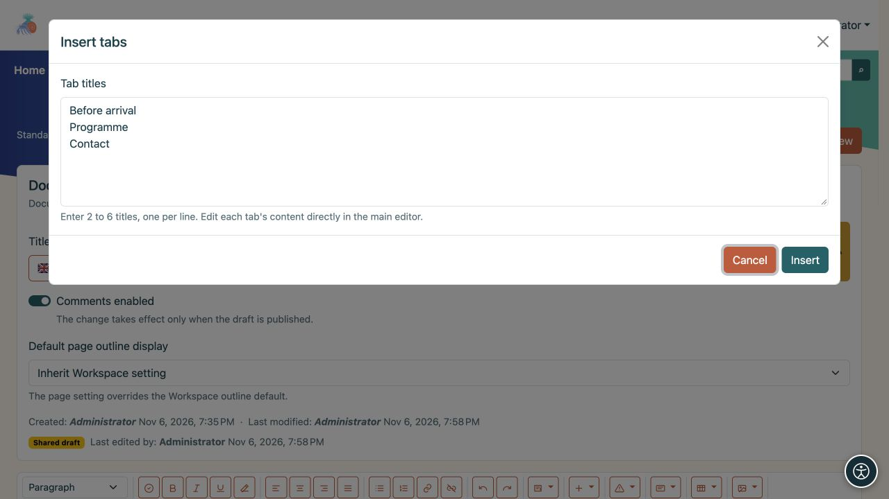
<figcaption>Questo esempio crea tre schede. Dopo averli inseriti, scrivi i loro corpi nell'editor principale.</figcaption>
</figure>

La matita accanto al blocco riapre le sue impostazioni. **Rimuovi schede** rimuove l'intero blocco. La rimozione di un titolo dall'elenco dei titoli ne rimuove anche il contenuto. Cambia titoli e contenuti insieme; la riscrittura o la riorganizzazione delle righe del titolo non sposta automaticamente il testo associato.

## 6. Pannelli espandibili: sezioni che i lettori possono espandere

Una pannello espandibile è adatta alle domande più frequenti o a diverse brevi procedure. I lettori selezionano il titolo di una domanda per aprirne la risposta. Possono mantenere aperte più sezioni contemporaneamente.

1. Scegli **Elementi dinamici → Inserisci pannello espandibile**.
2. Inserisci **da 1 a 12 titoli**, uno per riga, quindi seleziona **Inserisci**.
3. Nell'editor principale, compila il corpo sotto ciascun titolo. Puoi aggiungere collegamenti, immagini, tabelle e altri contenuti.
4. Nella visualizzazione della pagina, apri e chiudi le singole sezioni per controllarne i titoli e il contenuto.

<figure>
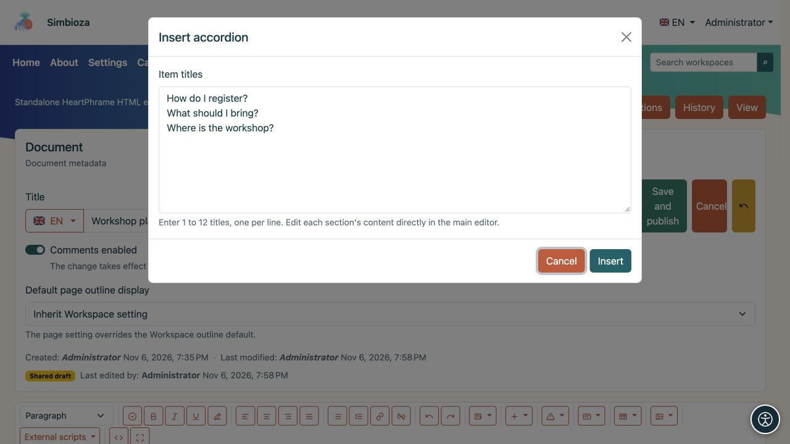
<figcaption>Ogni riga diventa il titolo di una sezione della pannello espandibile; scrivere le risposte dopo aver inserito il blocco.</figcaption>
</figure>

Usa la matita del blocco per modificare il numero di sezioni. Un nuovo titolo riceve un corpo vuoto; rimuovendo un titolo si rimuove anche il suo corpo. **Rimuovi pannello espandibile** rimuove l'intero gruppo.

## 7. Contenuto a discesa: una nota espandibile

Per una singola nota o spiegazione aggiuntiva, scegli **Elementi dinamici → Inserisci contenuto a discesa**.

1. Inserisci un **Titolo** che descriva chiaramente il contenuto.
2. Abilita **Mostra contenuto espanso al caricamento della pagina** se i lettori devono vedere il testo immediatamente.
3. Seleziona **Inserisci** e compila il corpo sotto il titolo nell'editor principale.

<figure>
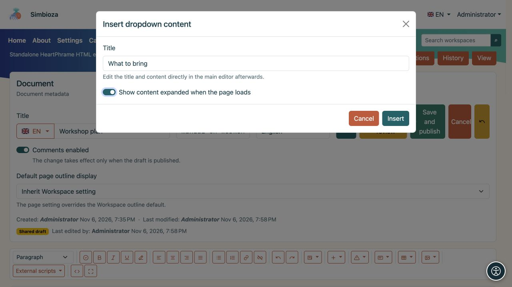
<figcaption>L'impostazione del contenuto espanso determina ciò che un lettore vede quando viene caricata la pagina.</figcaption>
</figure>

Il corpo rimane aperto nell'editor in modo che tu possa modificarlo. La visualizzazione della pagina segue lo stato iniziale scelto; i lettori selezionano il titolo per aprirlo o chiuderlo. La matita del blocco apre le sue impostazioni e offre la rimozione.

Schede, pannelli espandibili e contenuti a discesa possono contenere testo formattato e altri elementi. Mantieni visibili le informazioni più importanti della pagina senza obbligare i lettori ad aprire una sezione nascosta.

<figure>
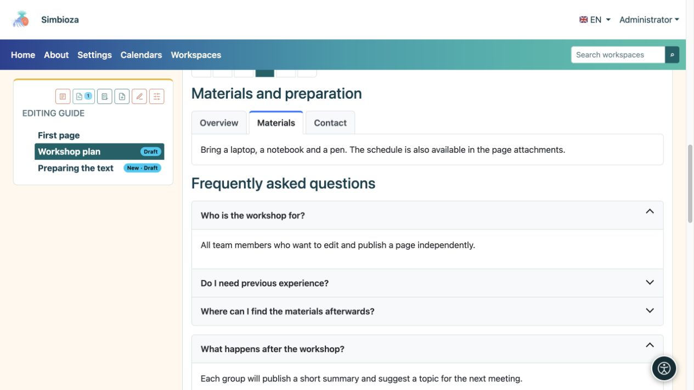
<figcaption>Il risultato per i lettori: la scheda selezionata mostra i materiali, mentre selezionando un titolo si apre una risposta o una nota aggiuntiva.</figcaption>
</figure>

## 8. Tabelle, ordinamento e numero di righe

### Creare e modificare una tabella

Scegli **Tabella → Inserisci tabella** e compila le celle preparate. Utilizza la prima riga per le intestazioni delle colonne, come "Nome", "Stato" e "Data di scadenza".

Per modificare una tabella, fai prima clic sulla cella pertinente e riapri **Tabella**:

- **Inserisci riga sopra/sotto** ed **Elimina riga** agiscono sulla riga di quella cella.
- **Inserisci colonna sinistra/destra** e **Elimina colonna** agiscono sulla sua colonna.
- **Unisci con la cella a destra / sotto** unisce le celle; **Dividi cella** separa una cella precedentemente unita.

Utilizza le tabelle per i dati anziché il layout di pagina. Utilizza le [colonne](#layout) per organizzare i contenuti.

### Consenti ai lettori di ordinare e sfogliare le righe

1. Fare clic su una cella della tabella.
2. Apri **Tabella → Impostazioni tabella**.
3. Abilita **Ordinamento e impaginazione**.
4. Scegli le **Righe iniziali per pagina**: **10, 25, 50, 100 o Tutte**.
5. Seleziona **Applica**, quindi salva la pagina.

<figure>
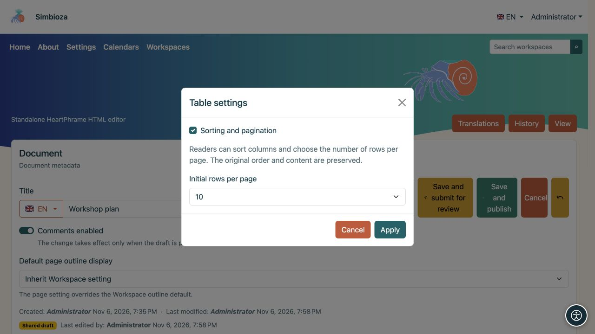
<figcaption>Queste impostazioni si applicano alla tabella selezionata. I lettori possono modificare il numero di righe in seguito.</figcaption>
</figure>

**Risultato:** i lettori selezionano un'intestazione di colonna per ordinarla in modo crescente, selezionarla di nuovo per l'ordine discendente e una terza volta per l'ordine originale. Le frecce mostrano la direzione. Possono scegliere un numero di righe accanto alla tabella e sfogliare le pagine con i controlli di impaginazione. **Tutto** visualizza ogni riga.

Abilita questo **separatamente per ogni tabella**. L'editor mostra ancora ogni riga; l'ordinamento di un lettore non modifica i dati salvati. Non è richiesto alcuno script esterno. I controlli funzionano anche nelle esportazioni HTML e la stampa mostra tutte le righe.

Questa funzionalità richiede una riga di intestazione, lo stesso numero di celle in ciascuna riga di dati, nessuna cella unita e nessuna tabella nidificata all'interno di una cella. Per una tabella più complessa, mantieni la visualizzazione ordinaria o dividi i dati in tabelle più semplici.

<figure>
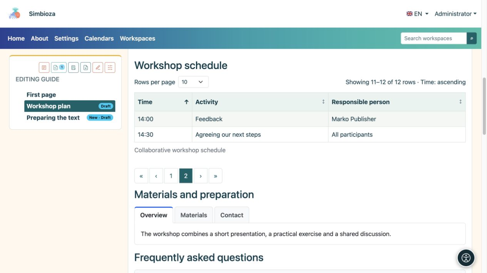
<figcaption>Visualizzazione lettore: sono selezionate 10 righe per pagina. La pagina due mostra le due righe rimanenti, 11–12 di 12. La freccia dell'intestazione indica l'ordinamento.</figcaption>
</figure>

## 9. Carica un'immagine, un video o un altro file

1. Sotto il contenuto, apri **Allegati**, scegli **Aggiungi allegato/Scegli file**, quindi **Carica**. Attendi il completamento del caricamento.
2. Inserisci un **Nome visualizzato** accanto al file. Questo è il nome che vuoi che i lettori vedano; può essere più chiaro del nome file originale.
3. Per un'immagine, inserisci **Testo alternativo**: una breve descrizione delle informazioni che trasmette. Ad esempio, "Disposizione della sala con l'ingresso contrassegnato", anziché "image1.png".
4. **Didascalia** è una breve nota accanto al supporto inserito; **Descrizione** fornisce informazioni aggiuntive sull'allegato. Seleziona **Salva metadati**.
5. Posiziona il cursore nel punto in cui dovrebbe apparire il file e seleziona **Inserisci** accanto all'allegato.

**Risultato:** un'immagine o un video vengono visualizzati nel contenuto; un altro file viene visualizzato come collegamento per l'apertura o il download. Il solo caricamento non inserisce un file nel testo.

<figure>
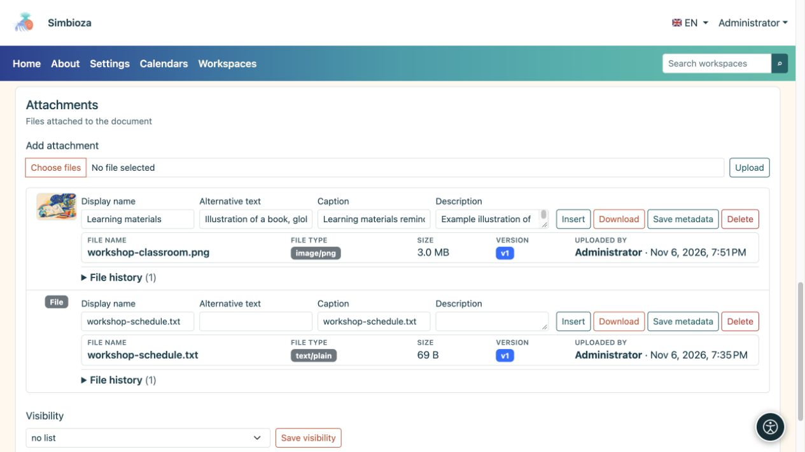
<figcaption>Inserisci le informazioni descrittive accanto all'immagine caricata e salva i suoi metadati. Inserisci aggiunge l'allegato selezionato al contenuto.</figcaption>
</figure>

### Dimensioni, spaziatura e allineamento del supporto

Seleziona un'immagine inserita o un altro supporto e apri **Media**. Scegli una larghezza di **25%, 50%, 75% o 100%**, **no, spaziatura piccola, media o grande** e allineamento **sinistra, centro o destra**. **Reimposta supporto** ripristina le impostazioni di aspetto iniziali.

**Modifica testo alternativo immagine** modifica la descrizione dell'immagine selezionata. Utilizza **Segna immagine come decorativa** solo quando l'immagine non trasmette informazioni, ad esempio un divisore decorativo. Una didascalia visibile non sostituisce il testo alternativo.

Una larghezza intera è solitamente più facile da leggere per uno screenshot. Controlla la pagina in una finestra stretta dopo aver apportato le modifiche.

<figure>
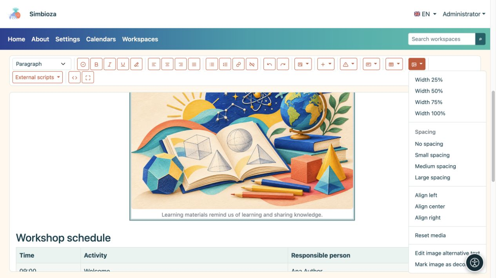
<figcaption>Seleziona prima l'immagine, quindi utilizza Media per impostarne l'aspetto e la descrizione.</figcaption>
</figure>

### Elenchi e cronologia degli allegati

La **Visibilità** nella sezione degli allegati controlla chi vede l'**elenco** dell'allegato: nessun elenco, tutti, compresi gli ospiti, o gli utenti autenticati. Di per sé non garantisce l'accesso a una pagina o a un file privato.

Puoi scaricare un file, modificarne i metadati e, con le opportune autorizzazioni, eliminarlo. Laddove sia disponibile la **Cronologia file**, rivedi le versioni precedenti e ripristinane una se necessario. Rimuovere un'immagine dal testo ed eliminare il suo allegato sono azioni diverse: eliminare il file può influire sui luoghi che lo utilizzano.

## 10. Incorpora contenuto da un altro servizio

Per contenuti come un'attività di apprendimento interattivo o un video fornito da un altro servizio, aprire **Inserisci → Inserisci contenuto incorporato**.

1. Incolla il **codice Iframe o l'URL HTTPS** del provider.
2. Inserisci un **titolo accessibile**, ad esempio "Esercizio: identifica le forme geometriche".
3. Imposta l'**Altezza** e, se necessario, **Consenti schermo intero**.
4. Seleziona **Inserisci**, salva e controlla la pagina. Usa la matita del blocco per modifiche successive.

Se il contenuto non viene visualizzato, il provider può vietare l'incorporamento o richiedere un accesso separato. Se è necessario uno script aggiuntivo, chiedi all'amministratore di preparare un'integrazione supportata; non incollare tu stesso codice di programmazione sconosciuto.

## 11. Confronta i dati numerici con un grafico

1. Scegli **Elementi dinamici → Inserisci grafico**.
2. Seleziona **Barra, Linea, Area, Torta o Ciambella**. Un grafico a barre funziona bene per confrontare il conteggio dei partecipanti per mese.
3. Inserisci un titolo, categorie e valori numerici. **Aggiungi categoria** aggiunge un'altra categoria; **Aggiungi serie** aggiunge un secondo set di valori, ad esempio un altro anno.
4. Aggiungi i nomi degli assi e una descrizione se utile; scegli una legenda, un orientamento, un aspetto, una larghezza e un allineamento. Lo sfondo può seguire il tema.
5. Seleziona **Inserisci grafico** e controlla la visualizzazione della pagina.

**Risultato:** i valori immessi vengono visualizzati come grafico. Non vengono recuperati automaticamente da un sondaggio o da un'altra tabella. Utilizza la matita del grafico per modificarne i valori o l'aspetto; le sue impostazioni offrono anche la rimozione.

<figure>
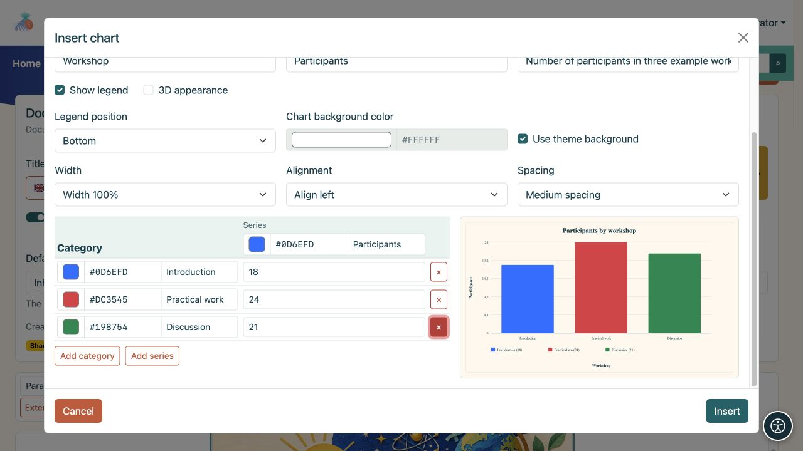
<figcaption>Un grafico con tre categorie. L'anteprima mostra l'effetto mentre ne modifichi i valori e l'aspetto.</figcaption>
</figure>

## 12. Mostra le attività su una sequenza temporale

1. Scegli **Elementi dinamici → Inserisci sequenza temporale**.
2. Inserisci un titolo e l'inizio e la fine del periodo che desideri mostrare.
3. Seleziona la scala temporale: **Giorni, Settimane, Mesi o Trimestri**.
4. Utilizza **Aggiungi gruppo** per aggiungere un gruppo, ad esempio "Preparazione evento", e attività con date di inizio e fine. Aggiungi ulteriori gruppi e indicatori di date importanti dove necessario.
5. Seleziona **Inserisci sequenza temporale** e verifica che ogni attività rientri nel periodo scelto.

**Risultato:** la pagina mostra quando inizia e finisce ogni attività. Questa è una presentazione del piano inserito, piuttosto che un calendario automatico o un servizio di promemoria. Usa la matita del blocco per riaprire le sue impostazioni.

<figure>
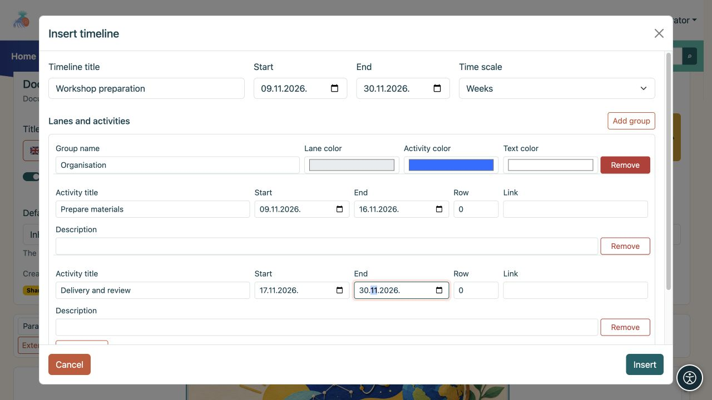
<figcaption>Un esempio di sequenza temporale: una corsia con due attività e date di inizio e fine individuali.</figcaption>
</figure>

## 13. Mostra dati da altre parti di Simbioza

Queste voci di menu **Elementi dinamici** dipendono dai moduli installati. Se manca una voce, chiedi a un amministratore se quella funzionalità è disponibile nella tua installazione.

| Caratteristica | Cosa fare | Cosa vedono i lettori |
| --- | --- | --- |
| **Inserisci elenco attività** | Inserisci un titolo e delle attività, una per riga. Scegli un elenco o una tabella e chi può modificare lo stato. | Attività e relativi stati, in base alle autorizzazioni selezionate. |
| **Inserisci calendario** | Scegli uno o più calendari offerti, un titolo, la visualizzazione mese/settimana/giorno e la data corrente o fissa. | Eventi dai calendari a cui il lettore può accedere. L'incorporamento non modifica le autorizzazioni del calendario. |
| **Includi contenuto della pagina** | Cerca un'area di lavoro e una pagina; utilizza **Carica altro** dove necessario, quindi conferma. | Il contenuto della pagina selezionata senza mantenere una seconda copia; l'accesso del lettore è ancora controllato. |
| **Inserisci contenuto dinamico** | Scegli una tabella delle proprietà della pagina, una raccolta di allegati, una ricerca nell'area di lavoro o modifiche recenti. Imposta aree di lavoro, un titolo, filtri e numero di elementi. | Una visualizzazione aggiornata delle pagine accessibili e dei relativi dati. |

Usa la matita del blocco inserito per modificarne le impostazioni. Alcuni blocchi vengono visualizzati come riepilogo delle impostazioni nell'editor. Salva e apri la visualizzazione della pagina per verificarne l'aspetto finale.

### Proprietà per una tabella di pagine

Per una panoramica del progetto con colonne come "Stato" e "Data di scadenza", aggiungi prima proprietà e valori con nomi coerenti alle pagine di origine. Nel blocco dinamico, seleziona **Tabella pagine e proprietà** ed elenca tali proprietà come colonne. Se mancano dati, controlla il nome esatto della proprietà, le aree di lavoro selezionate, il filtro delle etichette e le autorizzazioni di lettura della pagina di origine. Vedere [Aree di lavoro](podrucja_it.md) per le proprietà e le impostazioni della pagina.

### Script esterni preparati da un amministratore

1. Apri **Script esterni**.
2. Se uno script presenta un **? cerchiato**, selezionalo e leggi le istruzioni. Il punto interrogativo compare soltanto quando esistono istruzioni; leggerle non abilita lo script.
3. Seleziona lo script che ti serve e salva la pagina. La selezione viene mantenuta con quella versione del contenuto.

Vengono visualizzati solo gli script approvati. Se le istruzioni richiedono una modifica al codice sorgente che non sai come apportare, chiedi a un amministratore o a un editor esperto di preparare un esempio per la tua pagina. **L'ordinamento e l'impaginazione delle tabelle integrati non richiedono uno script esterno.**

Controlla gli script sulla pagina pubblicata; non vengono eseguiti nell'editor, nelle bozze o nella cronologia. Uno script revocato interrompe l'esecuzione. L'esportazione HTML include gli script approvati selezionati; gli script remoti necessitano comunque di una connessione di rete.

## 14. Salva, controlla e pubblica il tuo lavoro

| Azione | Significato |
| --- | --- |
| **Salva** | Salva le modifiche come bozza. In un'area di lavoro, la versione pubblicata esistente rimane visibile ai lettori. |
| **Salva e invia per revisione** | Salva la bozza e la sottopone a una persona autorizzata a pubblicare. Usalo quando il contenuto è pronto, ma non sarai tu a pubblicarlo. |
| **Salva e pubblica** | Con permessi di modifica e pubblicazione, salva il contenuto e lo pubblica immediatamente. |
| **Annulla** | Lascia l'editor; se le modifiche non vengono salvate, segui il messaggio prima di uscire. |

L'invio per la revisione e la pubblicazione si applica alle pagine dell'area di lavoro. Le pagine HTML autonome non utilizzano lo stesso processo di revisione dell'area di lavoro: il salvataggio aggiorna il proprio contenuto.

### Controlla prima di pubblicare

1. Seleziona **Controlla documento** sulla barra degli strumenti.
2. Correggi i problemi segnalati, come un'intestazione vuota, un livello di intestazione saltato, un'immagine senza testo alternativo o una tabella senza intestazione.
3. Seleziona **Controlla di nuovo**. Il controllo aiuta, ma non può giudicare se il testo è comprensibile o se tutti i fatti sono corretti.
4. Salva le modifiche e apri **Anteprima**. Controlla quale versione e lingua stai visualizzando. Per esaminare le modifiche dell'area di lavoro non pubblicate, scegli **Anteprima bozza**; il salvataggio di una bozza non sostituisce la normale visualizzazione della pagina pubblicata.
5. Testare collegamenti, schede e sezioni espandibili; controlla immagini, dati e layout in una finestra ristretta.
6. Pubblica o invia per la revisione. Dopo la pubblicazione, riapri la pagina come lettore.

Una **bozza locale** offerta dopo un'interruzione viene salvata solo in quel browser. Non sostituisce **Salva**. Se un altro editor ha modificato la bozza condivisa, confronta le versioni offerte prima di ripristinare le modifiche.

**Elimina bozza condivisa** rimuove le modifiche condivise non pubblicate e ripristina l'ultima versione pubblicata. Coordinarsi con gli altri redattori prima di confermare. In una nuova pagina che **non è mai stata pubblicata**, scartare la bozza può eliminare la pagina in modo permanente; leggere la conferma prima di continuare.

Nella vista della pagina possono comparire anche **Invia per revisione**, **Riporta a bozza** o **Pubblica**, secondo lo stato e le autorizzazioni. Chi è autorizzato a pubblicare può pubblicare direttamente una bozza; non è obbligatorio inviarla prima per revisione. Se disponi soltanto dell'autorizzazione alla pubblicazione, apri **Anteprima bozza**, controlla contenuto e lingua, quindi scegli **Pubblica** nella barra delle azioni della pagina; questa sola autorizzazione non permette di modificare il testo. Una pagina archiviata deve essere riportata a bozza e pubblicata nuovamente prima di essere disponibile ai lettori.

## 15. Traduci una pagina o ripristina il contenuto precedente

### Un'altra lingua della pagina

1. In **Lingua del documento**, scegli la lingua che desideri modificare. Le lingue offerte sono installate e abilitate nell'applicazione.
2. Controlla il titolo in quella lingua utilizzando il menu accanto a **Titolo**.
3. **Traduzioni → Copia traduzione** può copiare il contenuto esistente come punto di partenza. Scegli una lingua di origine e di destinazione, quindi **Copia per traduzione**.
4. Traduci il testo, i titoli delle schede, le didascalie e le descrizioni delle immagini; controllare e pubblicare la versione in quella lingua.

**La copia non traduce automaticamente il testo.** Una traduzione di destinazione esistente viene sostituita da una nuova versione. Non è necessario tradurre in tutte le lingue offerte; pubblica solo quelli per i quali hai preparato dei contenuti.

### Cronologia

Apri **Cronologia**. Seleziona **Anteprima** accanto a una versione precedente per leggerla prima. Per ripristinarne il contenuto, seleziona **Ripristina** e segui la conferma. Quindi controlla la bozza attuale e pubblicala se necessario. Le barre degli strumenti **Annulla** e **Ripeti** gestiscono le normali modifiche al testo nella sessione di modifica corrente. Non coprono ogni modifica delle impostazioni multimediali o dei blocchi speciali, quindi non fare affidamento su di essi per ripristinare tali impostazioni. Seleziona **Salva** prima di modifiche più grandi; la cronologia mantiene le versioni salvate.

## 16. Chi può leggere e modificare una pagina

La maggior parte delle pagine eredita le autorizzazioni dell'area di lavoro. Per la scrittura di tutti i giorni sono necessari solo i relativi permessi di modifica; non è necessario modificare personalmente le impostazioni di accesso. Una bozza senza una versione pubblicata è disponibile ai redattori, agli editori e ai manager interessati, piuttosto che ai normali lettori. L'albero e lo stato della pagina la identificano come bozza.

Se disponi dell'autorizzazione, apri **Gestisci pagina e autorizzazioni** nella barra delle azioni superiore della pagina. Distinguere tra:

- **Restrizioni sulle autorizzazioni ereditate:** limita ulteriormente i diritti esistenti per la pagina e i suoi discendenti. Non aggiungono qualcuno che prima non aveva accesso.
- **Autorizzazioni dirette per utenti e gruppi:** eccezioni per la pagina selezionata. Puoi scegliere utenti o gruppi; un'eccezione non apre automaticamente altre pagine o discendenti dell'area di lavoro.

Apri il selettore utente o gruppo ricercabile, trova il destinatario e aggiungilo. Se ci sono più risultati, cerca o carica ulteriori articoli offerti. Seleziona **Leggi**, **Modifica** e **Pubblica**, quindi seleziona **Salva autorizzazioni dirette**. L'editing e la pubblicazione includono la lettura; la sola pubblicazione non include la modifica. Il pannello di restrizione separato si applica ai singoli utenti che hanno già ereditato i diritti, non a interi gruppi.

Il pubblico **Pubblico** concede l'accesso in lettura, anche agli ospiti. Non può concedere modifiche o pubblicazioni. Ciò può rendere pubblica una pagina pubblicata all'interno di un'area di lavoro privata mentre il restante contenuto privato rimane protetto; non pubblica una bozza. L'area di lavoro può quindi apparire tra le aree di lavoro disponibili, ma la sua struttura mostra solo il contenuto a cui il lettore può accedere.

<figure>

<figcaption>Autorizzazioni dirette per una singola pagina: un utente, un gruppo e il Pubblico hanno diritti diversi.</figcaption>
</figure>

La modifica delle autorizzazioni può esporre il contenuto ad altri. In caso di dubbi, chiedi a un amministratore o a un responsabile dell'area di lavoro di configurare l'accesso. Successivamente, chiedi al lettore previsto di aprire la pagina; il punto di vista di un amministratore non è la prova che l'accesso sia corretto per tutti gli altri. Per ulteriori dettagli, vedere [Autorizzazioni area di lavoro](podrucja_it.md).

## 17. Altre azioni sulla pagina

La barra delle azioni superiore della pagina mostra solo le azioni disponibili nella tua installazione e per il tuo account. Passa il mouse sopra un'icona per leggerne il nome.

<figure>
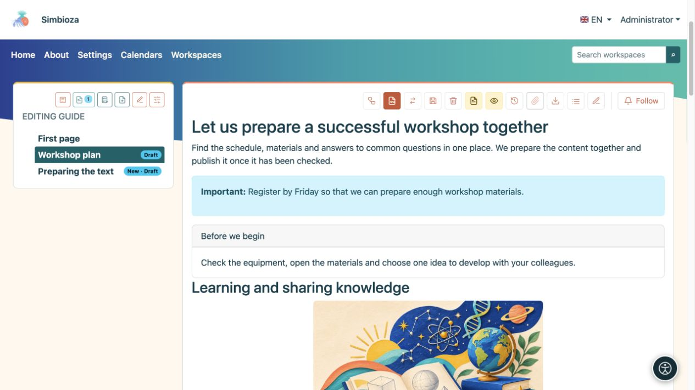
<figcaption>Azioni sulla pagina pubblicata: le icone offerte dipendono dalle autorizzazioni e dalle funzionalità abilitate.</figcaption>
</figure>

- **Mostra allegati/Nascondi allegati** apre o chiude l'elenco dei file. **Mostra sommario / Nascondi sommario** mostra o nasconde l'elenco delle intestazioni all'interno della pagina.
- **Cronologia** apre le versioni salvate; il menu con le bandiere sceglie una traduzione esistente.
- **Copia o sposta pagina** è disponibile per i responsabili delle aree di lavoro. Scegli se copiare o spostare, l'area di lavoro e la pagina superiore di destinazione e se trasferire cronologia e autorizzazioni/restrizioni dirette. Contenuti, traduzioni e allegati vengono trasferiti insieme. Una copia mantiene l'originale al suo posto; uno spostamento lo rimuove dopo il trasferimento riuscito. Viene copiata soltanto la pagina scelta; non è possibile spostare una pagina con pagine discendenti. Verifica poi le autorizzazioni della destinazione.
- **Esporta pagina in HTML** scarica uno ZIP contenente `index.html` e i file locali associati. Estrailo prima di aprire il file HTML. Per le pagine delle aree di lavoro, viene esportata la versione pubblicata, anziché una bozza non pubblicata. Non è una copia di sicurezza per ripristinare l'intera area di lavoro.
- Per un PDF, aprire **Stampa → Salva come PDF** del browser. Controlla l'anteprima di stampa e il layout prima di salvare.
- **Elimina pagina e sottoalbero** rimuove anche i discendenti; leggere attentamente la conferma. Le pagine pubblicate utilizzano l'eliminazione recuperabile, mentre l'eliminazione di un nuovo documento mai pubblicato tramite l'editor può essere permanente. Chiedi a un amministratore informazioni sul ripristino invece di dare per scontato che ogni eliminazione possa essere annullata.
- Laddove abilitati, **Segui** e i commenti supportano le notifiche di modifica e la discussione.

Nell'editor, **Codice sorgente** visualizza HTML per gli editor esperti; non è necessario per le procedure di cui sopra. **Schermo intero** dà più spazio ai contenuti; utilizzare la stessa icona per tornare ai dettagli del documento e salvare le azioni.

## 18. Quando qualcosa è inaspettato

| Quello che vedi | Cosa fare |
| --- | --- |
| Nessuna azione di modifica o pubblicazione. | Controlla l'account e l'area di lavoro. Chiedi a un manager o un amministratore di verificare le tue autorizzazioni. |
| Hai cambiato il testo ma i lettori vedono ancora la vecchia pagina. | Salva la bozza e verifica se è ancora necessaria la pubblicazione. Controlla anche la lingua. |
| Un comando di tabella o immagine non fa nulla. | Per prima cosa fai clic su una cella della tabella o seleziona l'immagine stessa, quindi ripeti il comando. |
| Il contenuto a discesa rimane aperto nell'editor. | Questa è la vista di modifica. Controlla lo stato iniziale nella visualizzazione della pagina. |
| Le schede o i pannelli espandibili hanno i titoli ma non il testo del contenuto. | Dopo l'inserimento, compila il corpo di ciascuna sezione nell'editor principale. |
| Mancano l'ordinamento e il numero di righe. | Abilitali nelle **impostazioni di quella tabella**, controlla la sua semplice intestazione e visualizza la pagina salvata. |
| Un file è caricato ma assente dal testo. | Posiziona il cursore nel contenuto, quindi seleziona **Inserisci** accanto all'allegato. |
| Vedi un calendario, una pagina inclusa o un elenco dinamico, ma un lettore no. | Controlla anche i loro diritti sul contenuto originale. L'incorporamento non apre i dati privati. |
| Manca uno script o non funziona. | Leggi le sue istruzioni e controlla la vista pubblicata. Un amministratore prepara e approva gli script. |
| Il testo incollato ha uno stile incoerente. | Applica **Rimuovi formattazione**, quindi imposta nuovamente intestazioni ed elenchi. |
| L'annullamento non ripristina la larghezza dell'immagine modificata o altre impostazioni di blocco. | Ripristina tali impostazioni tramite il loro menu. Salva prima di modifiche più grandi. Scegli **Annulla** per eliminare le modifiche non salvate; le modifiche già salvate rimangono salvate. |

Prima di finire, controlla **il contenuto, il salvataggio, la lingua selezionata, i link e l'accesso previsto del lettore**. Per la maggior parte delle pagine questi contano più del numero di elementi decorativi inseriti.
