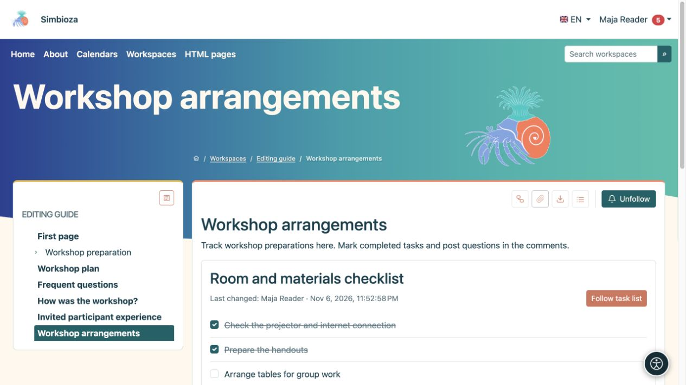

# Aufgabenlisten auf einer Seite

> Die Bildschirmaufnahmen zeigen die englische Benutzeroberfläche.

[Zusammenarbeit](suradnja_de.md)

**Ziel:** Sehen Sie, was getan werden muss und was auf einer freigegebenen Seite abgeschlossen ist. Aufgabendefinitionen gehören zum Dokument; der aktuelle Fertigstellungsstatus wird separat gespeichert.

## Markieren Sie eine Aufgabe als erledigt

1. Öffnen Sie eine veröffentlichte Seite mit Aufgaben.
2. Melden Sie sich an und aktivieren Sie das Kontrollkästchen neben einer Aufgabe. Fokussieren Sie mit einer Tastatur das Kontrollkästchen und drücken Sie die **Leertaste**.
3. Warten Sie auf die Bestätigung. Eine erfolgreiche Änderung wird gespeichert, ohne dass die gesamte Seite erneut gespeichert werden muss.

**Ergebnis:** Leser sehen den aktuellen Stand. Eine autorisierte Person kann es erneut auswählen, um die Aufgabe erneut zu öffnen. In einer Liste kann auch **Letzte Änderung** angezeigt werden. Wenn das Speichern fehlschlägt, wird der vorherige Zustand wiederhergestellt und eine Meldung angezeigt.

Gäste können öffentliche Listen lesen, ihren Status jedoch nicht ändern. Für angemeldete Benutzer bestimmen die Einstellung **Wer darf den Status ändern** und der Seitenzugriff die Aktion. Wenn ein Kontrollkästchen nicht verfügbar ist, bitten Sie den Autor, die Einstellung zu überprüfen, anstatt zu versuchen, sie zu umgehen.

<figure class="my-4">

<figcaption>Zwei Vorbereitungen sind abgeschlossen; die Tischeinteilung bleibt offen. Für Abschlussänderungen ist kein erneutes Speichern der gesamten Seite erforderlich.</figcaption>
</figure>

## Fügen Sie eine Liste als Autor hinzu

1. Platzieren Sie den Cursor an der gewünschten Stelle im [HTML-Editor](uredivanje-stranica_de.md).
2. Wählen Sie **Aufgabenliste einfügen** unter **Einfügen**.
3. Geben Sie den **Listentitel** und Aufgaben ein, eine pro Zeile.
4. Wählen Sie **Listenansicht: Liste** oder **Tabelle**.
5. Wählen Sie unter **Wer darf den Status ändern** Folgendes aus:
   - **Benutzer, die die Seite bearbeiten dürfen** für Redakteure;
   - **Alle angemeldeten Benutzer, die die Seite anzeigen können** zur Leserbeteiligung.
6. Wählen Sie **Einfügen**, überprüfen Sie den Inhalt, speichern und veröffentlichen Sie ihn dann entsprechend dem Workflow der Seite.

**Ergebnis:** Das veröffentlichte Dokument enthält eine interaktive Liste. Entwürfe, Verlauf und statische Exporte sind keine Orte zum Speichern von Abschlussänderungen.

## Bearbeiten Sie eine vorhandene Liste

Wählen Sie im Editor den Stift des Aufgabenblocks aus. Ändern Sie den Titel, die Zeilen, die Ansicht oder die Richtlinie und wenden Sie sie an. In der Tabellenansicht ist die erste Spalte für die Aufgabe und ihren Status geschützt. Verwenden Sie gewöhnliche [Tabellentools](uredivanje-stranica_de.md#tables) für zusätzliche Spalten und deren Inhalt. Durch das Hinzufügen oder Verschieben einer Aufgabe im Dialogfeld wird deren gesamte Zeile verschoben.

Wenn **Aufgabenliste folgen** angeboten wird, folgen Sie der gesamten Liste mit einer Schaltfläche und nicht mit jedem Kontrollkästchen. Wählen Sie unter [Folgen und Benachrichtigungen](pracenje-obavijesti_de.md) die Zustellung aus.
