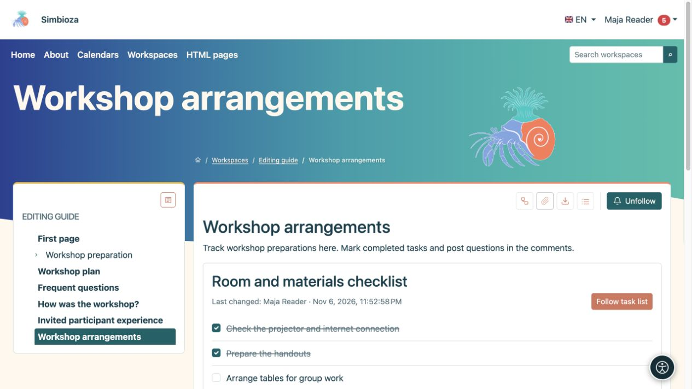

# Task lists on a page

[Collaboration](suradnja_en.md)

**Goal:** see what needs doing and what is complete on a shared page. Task definitions belong to the document; current completion state is saved separately.

## Mark a task complete

1. Open a published page containing tasks.
2. Sign in and select the checkbox beside a task. With a keyboard, focus the checkbox and press **Space**.
3. Wait for confirmation. A successful change is saved without saving the whole page again.

**Result:** readers see the current state. An authorised person may select it again to reopen the task. A list may also show **Last change**. If saving fails, the previous state returns and a message appears.

Guests may read public lists but cannot change their state. For signed-in users, the **Who may change status** setting and page access determine the action. If a checkbox is unavailable, ask the author to check the setting rather than trying to bypass it.

<figure class="my-4">

<figcaption>Two preparations are complete; arranging the tables remains open. Completion changes do not require saving the whole page again.</figcaption>
</figure>

## Add a list as an author

1. Place the cursor where needed in [HTML Editor](uredivanje-stranica_en.md).
2. Choose **Insert task list** from **Insert**.
3. Enter the **List title** and tasks, one per line.
4. Choose **List view: List** or **Table**.
5. Under **Who may change status**, select:
   - **Users who may edit the page** for editors;
   - **All signed-in users who can view the page** for reader participation.
6. Select **Insert**, check the content, then save and publish according to the page's workflow.

**Result:** the published document contains an interactive list. Drafts, history and static exports are not places to save completion changes.

## Edit an existing list

Select the task block's pencil in the editor. Change its title, lines, view or policy and apply. In table view, the first column is protected for the task and its state. Use ordinary [table tools](uredivanje-stranica_en.md#tables) for extra columns and their content; adding or moving a task in the dialog moves its entire row.

Where **Follow task list** is offered, follow the whole list with one button rather than each checkbox. Choose delivery under [Following and notifications](pracenje-obavijesti_en.md).
