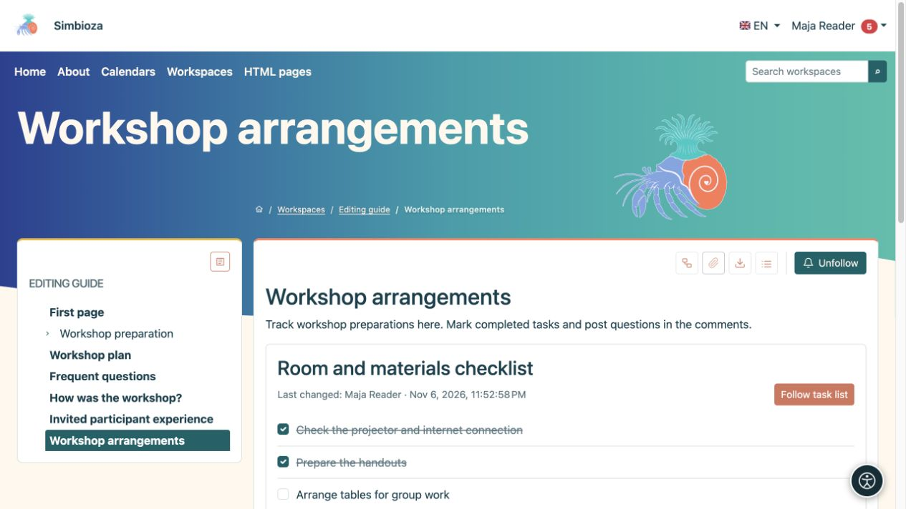

# Listas de tareas en una página

> Las capturas de pantalla muestran la interfaz en inglés.

[Colaboración](suradnja_es.md)

**Objetivo:** ver qué hay que hacer y qué está completo en una página compartida. Las definiciones de tareas pertenecen al documento; El estado de finalización actual se guarda por separado.

## Marcar una tarea completa

1. Abra una página publicada que contenga tareas.
2. Inicie sesión y seleccione la casilla de verificación junto a una tarea. Con un teclado, enfoque la casilla de verificación y presione **Espacio**.
3. Espere la confirmación. Un cambio exitoso se guarda sin guardar nuevamente toda la página.

**Resultado:** los lectores ven el estado actual. Una persona autorizada podrá seleccionarlo nuevamente para reabrir la tarea. Una lista también puede mostrar **Último cambio**. Si el guardado falla, regresa al estado anterior y aparece un mensaje.

Los invitados pueden leer listas públicas pero no pueden cambiar su estado. Para los usuarios que han iniciado sesión, la configuración **Quién puede cambiar el estado** y el acceso a la página determinan la acción. Si una casilla de verificación no está disponible, pídale al autor que marque la configuración en lugar de intentar omitirla.

<figure class="my-4">

<figcaption>Dos preparativos están completos; La disposición de las mesas permanece abierta. Los cambios de finalización no requieren guardar toda la página nuevamente.</figcaption>
</figure>

## Agregar una lista como autor

1. Coloque el cursor donde sea necesario en [HTML Editor](uredivanje-stranica_es.md).
2. Elija **Insertar lista de tareas** en **Insertar**.
3. Ingrese el **Título de la lista** y las tareas, una por línea.
4. Elija **Vista de lista: Lista** o **Tabla**.
5. En **Quién puede cambiar el estado**, seleccione:
   - **Usuarios que pueden editar la página** para editores;
   - **Todos los usuarios registrados que puedan ver la página** para la participación del lector.
6. Seleccione **Insertar**, verifique el contenido, luego guarde y publique según el flujo de trabajo de la página.

**Resultado:** el documento publicado contiene una lista interactiva. Los borradores, el historial y las exportaciones estáticas no son lugares para guardar cambios de finalización.

## Editar una lista existente

Seleccione el lápiz del bloque de tareas en el editor. Cambie su título, líneas, vista o política y aplique. En la vista de tabla, la primera columna está protegida para la tarea y su estado. Utilice [herramientas de tabla](uredivanje-stranica_es.md#tables) ordinarias para columnas adicionales y su contenido; agregar o mover una tarea en el cuadro de diálogo mueve toda su fila.

Cuando se ofrece **Seguir lista de tareas**, siga la lista completa con un botón en lugar de cada casilla de verificación. Elija la entrega en [Siguiente y notificaciones](pracenje-obavijesti_es.md).
