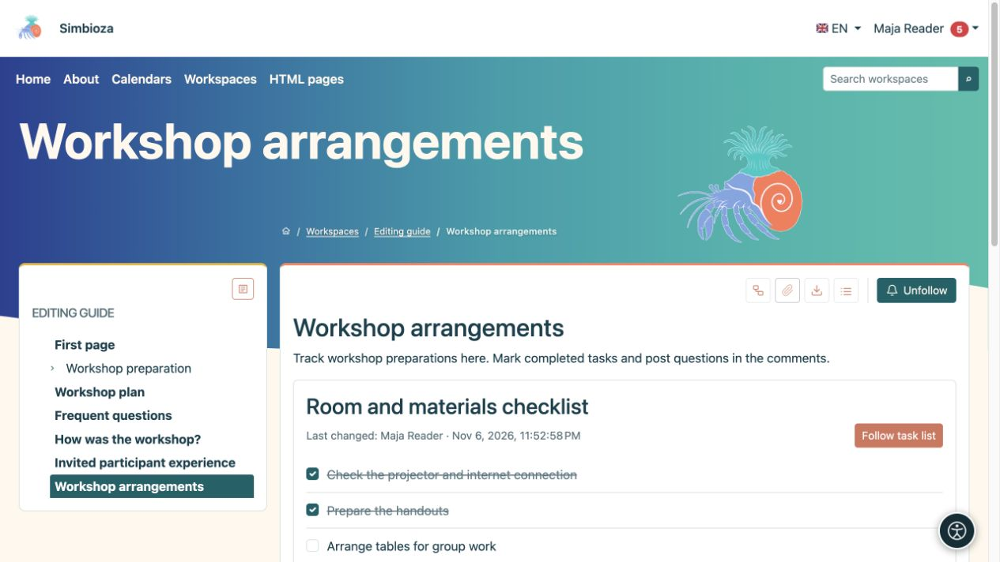

# Listes de tâches sur une page

> Les captures d’écran présentent l’interface en anglais.

[Collaboration](suradnja_fr.md)

**Objectif :** voir ce qui doit être fait et ce qui est terminé sur une page partagée. Les définitions de tâches appartiennent au document ; l’état d’achèvement actuel est enregistré séparément.

## Marquer une tâche comme terminée

1. Ouvrez une page publiée contenant des tâches.
2. Connectez-vous et cochez la case en regard d’une tâche. Avec un clavier, cochez la case et appuyez sur **Espace**.
3. Attendez la confirmation. Une modification réussie est enregistrée sans enregistrer à nouveau la page entière.

**Résultat :** les lecteurs voient l'état actuel. Une personne autorisée peut le sélectionner à nouveau pour rouvrir la tâche. Une liste peut également afficher **Dernière modification**. Si l'enregistrement échoue, l'état précédent revient et un message apparaît.

Les invités peuvent lire les listes publiques mais ne peuvent pas modifier leur état. Pour les utilisateurs connectés, le paramètre **Qui peut modifier le statut** et l'accès à la page déterminent l'action. Si une case à cocher n'est pas disponible, demandez à l'auteur de vérifier le paramètre plutôt que d'essayer de le contourner.

<figure class="my-4">

<figcaption>Deux préparatifs sont terminés ; la disposition des tables reste ouverte. Les modifications finales ne nécessitent pas de réenregistrer la page entière.</figcaption>
</figure>

## Ajouter une liste en tant qu'auteur

1. Placez le curseur là où cela est nécessaire dans [HTML Editor](uredivanje-stranica_fr.md).
2. Choisissez **Insérer une liste de tâches** dans **Insérer**.
3. Saisissez le **Titre de la liste** et les tâches, une par ligne.
4. Choisissez **Vue en liste : Liste** ou **Tableau**.
5. Sous **Qui peut changer de statut**, sélectionnez :
   - **Utilisateurs pouvant modifier la page** pour les éditeurs ;
   - **Tous les utilisateurs connectés qui peuvent afficher la page** pour la participation des lecteurs.
6. Sélectionnez **Insérer**, vérifiez le contenu, puis enregistrez et publiez selon le flux de travail de la page.

**Résultat :** le document publié contient une liste interactive. Les brouillons, l'historique et les exportations statiques ne permettent pas d'enregistrer les modifications apportées.

## Modifier une liste existante

Sélectionnez le crayon du bloc de tâches dans l'éditeur. Modifiez son titre, ses lignes, sa vue ou sa politique et appliquez-le. En vue tableau, la première colonne est protégée pour la tâche et son état. Utilisez des [outils de table](uredivanje-stranica_fr.md#tables) ordinaires pour les colonnes supplémentaires et leur contenu ; l'ajout ou le déplacement d'une tâche dans la boîte de dialogue déplace toute sa ligne.

Lorsque **Suivre la liste des tâches** est proposé, suivez toute la liste avec un bouton plutôt qu'avec chaque case à cocher. Choisissez la livraison sous [Suivi et notifications](pracenje-obavijesti_fr.md).
