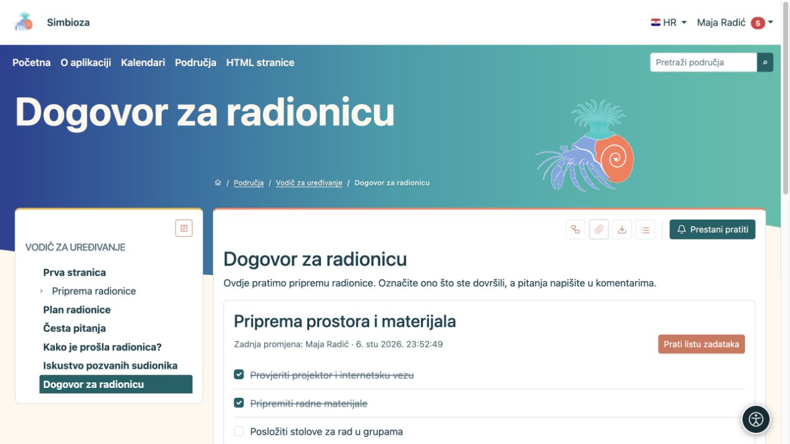

# Popisi zadataka na stranici

[Suradnja](suradnja_hr.md)

**Cilj:** na zajedničkoj stranici vidjeti što treba napraviti i što je dovršeno. Zadaci su dio sadržaja dokumenta; njihovo aktualno stanje sprema se zasebno.

## Označite dovršen zadatak

1. Otvorite objavljenu stranicu s popisom zadataka.
2. Prijavite se i odaberite kućicu uz zadatak. Tipkovnicom dođite do kućice pa pritisnite **Space**.
3. Pričekajte potvrdu. Uspješna promjena ostaje spremljena bez ponovnog spremanja cijele stranice.

**Rezultat:** svi čitatelji vide aktualno stanje. Ponovnim odabirom ovlaštena osoba može ponovno otvoriti zadatak. Lista može prikazati i podatak **Zadnja promjena**. Ako spremanje ne uspije, prethodno se stanje vraća i pojavljuje se poruka.

Gost može čitati javni popis, ali ne može mijenjati stanje. Prijavljenom korisniku mogućnost ovisi o postavci **Tko smije mijenjati status** i pravu na stranicu. Ako je kućica nedostupna, ne pokušavajte je zaobići; zamolite autora da provjeri postavku.

<figure class="my-4">

<figcaption>Dvije su pripreme dovršene, a raspored stolova još je otvoren. Promjene stanja ne traže ponovno spremanje cijele stranice.</figcaption>
</figure>

## Dodajte popis kao autor

1. U [HTML editoru](uredivanje-stranica_hr.md) postavite pokazivač na željeno mjesto.
2. U izborniku **Umetni** odaberite **Umetni popis zadataka**.
3. Unesite **Naslov popisa** i zadatke, jedan u svakom retku.
4. Odaberite **Prikaz popisa: Popis** ili **Tablica**.
5. Za **Tko smije mijenjati status** odaberite:
   - **Korisnici koji smiju uređivati stranicu** za rad urednika;
   - **Svi prijavljeni korisnici koji vide stranicu** za sudjelovanje čitatelja.
6. Odaberite **Umetni**, provjerite sadržaj te spremite i objavite stranicu prema njezinu postupku.

**Rezultat:** objavljeni dokument sadrži interaktivan popis. Nacrt, povijest i statični izvoz nisu mjesto za spremanje promjena dovršenosti.

## Uredite postojeći popis

U editoru odaberite olovku bloka zadataka. Promijenite naslov, retke, prikaz ili pravilo pa primijenite promjenu. U tabličnom prikazu prvi je stupac zaštićen za zadatak i status. Dodatne stupce i sadržaj uređujete običnim [alatima tablice](uredivanje-stranica_hr.md#tablice); dodavanje ili pomicanje zadatka u modalu pomiče cijeli njegov redak.

Ako je dostupno **Prati listu zadataka**, pratite cijelu listu jednim gumbom. Ne trebate pratiti svaku kućicu. Način dostave odaberite u [praćenju i obavijestima](pracenje-obavijesti_hr.md).
