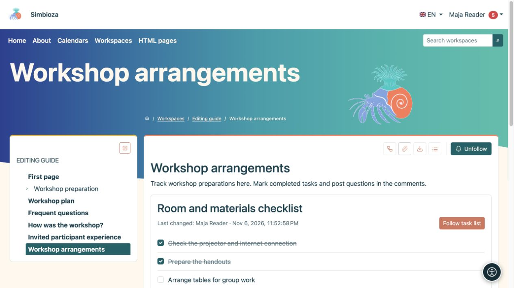

# Elenchi di attività su una pagina

> Le schermate mostrano l’interfaccia in inglese.

[Collaborazione](suradnja_it.md)

**Obiettivo:** vedere cosa è necessario fare e cosa è stato completato su una pagina condivisa. Le definizioni delle attività appartengono al documento; lo stato di completamento corrente viene salvato separatamente.

## Contrassegna un'attività come completata

1. Apri una pagina pubblicata contenente attività.
2. Accedi e seleziona la casella di controllo accanto a un'attività. Con una tastiera, seleziona la casella di controllo e premi **Spazio**.
3. Attendi conferma. Una modifica riuscita viene salvata senza salvare nuovamente l'intera pagina.

**Risultato:** i lettori vedono lo stato attuale. Una persona autorizzata può selezionarlo nuovamente per riaprire l'attività. Un elenco può anche mostrare **Ultima modifica**. Se il salvataggio fallisce, viene ripristinato lo stato precedente e viene visualizzato un messaggio.

Gli ospiti possono leggere gli elenchi pubblici ma non possono modificare il proprio stato. Per gli utenti che hanno effettuato l'accesso, l'impostazione **Chi può modificare lo stato** e l'accesso alla pagina determinano l'azione. Se una casella di controllo non è disponibile, chiedi all'autore di verificare l'impostazione anziché provare a ignorarla.

<figure class="my-4">

<figcaption>Due preparativi sono completi; resta aperta la disposizione dei tavoli. Le modifiche al completamento non richiedono il salvataggio successivo dell'intera pagina.</figcaption>
</figure>

## Aggiungi un elenco come autore

1. Posiziona il cursore dove necessario in [HTML Editor](uredivanje-stranica_it.md).
2. Scegli **Inserisci elenco attività** da **Inserisci**.
3. Inserisci il **Titolo elenco** e le attività, una per riga.
4. Scegli **Visualizzazione elenco: Elenco** o **Tabella**.
5. In **Chi può modificare lo stato**, seleziona:
   - **Utenti che possono modificare la pagina** per gli editori;
   - **Tutti gli utenti registrati che possono visualizzare la pagina** per la partecipazione dei lettori.
6. Seleziona **Inserisci**, controlla il contenuto, quindi salva e pubblica in base al flusso di lavoro della pagina.

**Risultato:** il documento pubblicato contiene un elenco interattivo. Bozze, cronologia ed esportazioni statiche non sono luoghi in cui salvare le modifiche al completamento.

## Modifica un elenco esistente

Seleziona la matita del blocco attività nell'editor. Modifica il titolo, le righe, la vista o la politica e applica. Nella vista tabella, la prima colonna è protetta per l'attività e il relativo stato. Utilizzare i normali [strumenti tabella](uredivanje-stranica_it.md#tables) per colonne aggiuntive e il relativo contenuto; aggiungendo o spostando un'attività nella finestra di dialogo si sposta l'intera riga.

Laddove viene offerto **Segui elenco attività**, segui l'intero elenco con un pulsante anziché con ciascuna casella di controllo. Scegli la consegna in [Segui e notifiche](pracenje-obavijesti_it.md).
